# 01.02 Longest match

The scanner learns every operator and mark of punctuation C has, from one
character to three. Many start with the same character, and one rule decides
between them: take the longest that matches.

## Where this fits


This lesson builds the second cell of the scanner on the map, longest match.
The scanner still takes the source text from the driver and hands a list of
tokens to the right; what changes is which tokens it can make. Until now an
operator was a plus or a minus. Now it is any of C's. The driver still
compiles only sums, but an operator it does not know reaches it as a token, so
its error can say what it wanted instead. After this lesson the compiler reads
all of C's operators and prints them, though it compiles only the two.

## The idea


C has operators of one, two and three characters, and several begin with the
same character. `>` is greater than. `>>` shifts right, `>=` compares, and
`>>=` shifts right and stores the result. So in `1>>=2`, standing at the `>`,
the scanner finds three operators that the text could start with: `>`, `>>`
and `>>=`. C's answer, and this scanner's, is to take the longest one that
matches, a rule called **longest match** (or "maximal munch"). `1>>=2` is
`1`, `>>=`, `2`.

A real program would have names there, as in `a>>=b`. The scanner reads names
from lesson 01.03 on; until then numbers stand in for them, and the operator
between them is found the same way.

A **punctuator** is C's word for all of these, the operators and the marks
such as `(` and `;`. The scanner gets the longest match by asking in order. It
has a table of the punctuators of three characters and of two, the
three-character ones first, and takes the first entry the text starts with.
Failing all of them, a single character that C uses is a token of one
character. Failing that, the text holds no token: `invalid token`, as before.



A token never holds a space, so a space ends whatever was being read, and that
is the only thing it does. `1->2` is three tokens, the arrow of C's pointers to
structs in the middle. `1- >2` is four: a minus and a greater-than, because the
space came between them. Spaces that fall between tokens change nothing:
`1 >>= 2` and `1>>=2` are the same three tokens.

### `startswith`

Whether the text at a place starts with a given string: a `strncmp` of as many
characters as the string has. The scanner asks it of each entry of the table
in turn, until one matches.

### `read_punct`

How long the punctuator at a place is: 3, 2 or 1, or 0 when there is none. It
tries the table, then the single characters, as above. `tokenize()` calls it
where it used to look for a plus or a minus, and makes a token of that length.

## Run it

`./learn run cc --at 01.02` builds the compiler and runs the sample, `5 + 20 -
4`, as before; then, in the project's directory, a line of operators:

<!-- verify: session wait=10 -->
```
$ ./learn run cc --at 01.02
Running cc as it stands at 01.02 (Longest match). Its files are in build/at/cc/01.02/
$ cd build/at/cc/01.02
$ printf '1 >>= 2 -> 3 != 4 ... 5' > p.c
$ ./cc --tokens p.c
1:1 num 1 1
1:3 punct >>=
1:7 num 2 2
1:9 punct ->
1:12 num 3 3
1:14 punct !=
1:17 num 4 4
1:19 punct .
1:20 punct .
1:21 punct .
1:23 num 5 5
1:24 eof
```

`...` comes out as three dots. It is C's mark for a function that takes any
number of arguments, and it joins the table with those functions, in lesson
09.02; until then nothing needs it as one token.

The space in the figure, with numbers, one case a line:

<!-- verify: session -->
```
$ printf '1->2\n1- >2\n' > sp.c
$ ./cc --tokens sp.c
1:1 num 1 1
1:2 punct ->
1:4 num 2 2
2:1 num 1 1
2:2 punct -
2:4 punct >
2:5 num 2 2
2:6 eof
```

A `*` was an invalid token in 01.01. Now it is a token, and it is the walker,
which knows only `+` and `-`, that turns it away, by saying what it wanted:

<!-- verify: session -->
```
$ printf '1 * 2\n' > mul.c
$ ./cc mul.c >/dev/null; echo $?
expected '-'
1
```

## How it works

### Longest first

The table is in order: every entry of three characters comes before every
entry of two.

<!-- verify: fact cmd="awk '/static char \*kw\[\]/,/};/' tokenize.c | grep -o '\"[^\"]*\"' | wc -l | tr -d ' '" expect=21 -->
It holds 21 entries, and its first line shows the order:

```
    "<<=", ">>=", "==", "!=", "<=", ">=", "->", "+=",
```

The loop takes the first entry the text starts with, so the order is the rule.
What it protects is an **invariant** of the table: no entry comes before a
longer one that starts with it. Put the two-character entries first and `>>`
would match at `>>=`, the `=` would be left over as a token of its own, and
`1>>=2` would become `1`, `>>`, `=`, `2`: the lower half of the figure. Single
characters need no place in the table: they are tried after all of it, from a
string of the ones C uses.

### The rule is local

The scanner takes the longest operator at the place it stands, and never asks
whether the program would make sense with a shorter one. Two minus signs
written together are one token, `--`, C's decrement:

<!-- verify: session -->
```
$ printf '1--2\n' > dec.c
$ ./cc --tokens dec.c
1:1 num 1 1
1:2 punct --
1:4 num 2 2
1:5 eof
```

Whoever wrote `1--2` most likely meant `1 - -2`, one minus a minus two. But
decrementing `1` means nothing, so the program is wrong, and the scanner does
not try to rescue it: the parser of module 02 turns it away. For the same
reason, once names scan in lesson 01.03, `a+++b` is `a`, `++`, `+`, `b`. Where
one token ends and the next begins is settled by the scanner, before anything
knows what the program means, and a space is how a programmer settles it
otherwise.

### All of the language's operators, from the start

The scanner knows every operator the finished compiler will take: `%=`, `&&`,
`->` and the rest, long before the parser knows what any of them do. The
scanner is the cheapest part to finish, and the list is the language's, not
the compiler's. So an operator the compiler does not handle yet is a token,
and the part that does not know it says so by name, as the walker said
`expected '-'` above. A character that is in no token of C is turned away
here, at once:

<!-- verify: session -->
```
$ printf '1 @ 2\n' > at.c
$ ./cc at.c; echo $?
invalid token
1
```

chibicc's scanner takes any punctuation character the C library's `ispunct`
accepts, and that takes `@`, `$` and the backquote too; this one lists C's own
single characters instead. The list has `#` in it already, for the
preprocessor of module 08.

## Break it

Take `--` out of the table. In `build/at/cc/01.02/tokenize.c`, in
`read_punct()`, change the third line of the table to

<!-- verify: patch file=tokenize.c
-    "-=", "*=", "/=", "++", "--", "%=", "&=", "|=", "^=", "&&",
+    "-=", "*=", "/=", "++", "%=", "&=", "|=", "^=", "&&",
-->
<!-- verify: skip reason="the line as the reader changes it; the patch above makes the change" -->
```
    "-=", "*=", "/=", "++", "%=", "&=", "|=", "^=", "&&",
```

and build the compiler again, then read `1--2` with it:

<!-- verify: session -->
```
$ make -s
$ ./cc --tokens dec.c
1:1 num 1 1
1:2 punct -
1:3 punct -
1:4 num 2 2
1:5 eof
$ ./cc dec.c >/dev/null
expected a number
```

Nothing complains, and the tokens are different: with no `--` to match, the
longest operator at the first minus is a minus, and so is the next. `1--2` now
scans as `1 - -2`, a sum of two numbers, one with a sign: the guess the
scanner must not make, made silently. The walker happens to stop it here, since
it cannot take a sign before a number, but from lesson 02.05, where a sign is
an operator of its own, this scanner would compile `1--2` into a program that
returns 3. And `i--`, which C says decrements `i`, could no longer be written at
all. Put the line back.

<!-- verify: revert file=tokenize.c -->

## Go deeper

- [Programming Language Pragmatics](https://www.cs.rochester.edu/~scott/pragmatics/),
  4th edition, by Michael L. Scott (Morgan Kaufmann, 2016), section 2.2,
  "Scanning": the "longest possible token" rule, and its sidebar on the cases
  where the rule needs more than one character of look-ahead.

Related: 01.01 A stream of tokens, 02.04 Precedence and associativity: the whole table
