# 02.01 A grammar, and a function for each rule

A grammar is a short description of what a language allows. Written one rule
to a function, the same description is also the program that reads the
language, and what that program builds is a tree of the expression.

## Where this fits


This lesson starts the parser, the middle box of the compiler on the map. The
scanner of module 01, to its left, hands it the list of tokens; the parser
reads them the way a grammar says and builds a tree of the expression. The
code generator, to its right, is still dashed: from lesson 02.03 it makes the
program from that tree. Until then the code still comes from the walk over the
tokens that module 01 left in the driver, and the tree is something to print
and look at. After this lesson the compiler knows the structure of a sum:
which operator takes which operands.

## The idea


The compiler of module 01 reads "a number, then a `+` or a `-` and a number,
again and again". That description of the language is hidden inside a loop in
`main`. It is enough for sums, and it cannot grow: it has no way to say that in
`1 + 2 * 3` the `*` goes first, or what a pair of parentheses means. Every new
operator would be another special case in the same loop.

What is needed is a way to write down what the language allows, apart from any
code, and a program that follows what was written. A **grammar** is that
description: a list of **rules**, each giving a name to a pattern made of tokens
and of the names of other rules. Here are this lesson's three, as the comments
at the top of their functions in `parse.c` write them:

<!-- verify: skip reason="the grammar, as the rule comments in parse.c write it, not lines of code" -->
```
expr = add
add = primary ("+" primary | "-" primary)*
primary = num
```

A word in quotes is a token that must be there. A bare name is another rule:
`num` is any number token. `|` means "or", and `( ... )*` means "what is in the
brackets, any number of times, none included". Read with these rules, `5 + 20
- 4` is an `expr` because it is an `add`: a `primary` (5), then `+` and a
`primary` (20), then `-` and a `primary` (4), and then nothing more that fits.

**Recursive descent** turns the rules into code one for one. Each rule becomes
a function of the same name. A rule name inside a rule becomes a call of that
function; a token in quotes becomes a look at the current token; `|` becomes an
`if`; `( ... )*` becomes a loop. A function that reads a rule calls the
functions of the rules inside it, which call theirs, down to the rules that
read single tokens: the descent of the name.

Each function gives back what it read as a node of a **syntax tree**: a tree
whose leaves are numbers and whose other nodes are operators, an operator's
children being its operands, left first. The figure follows the functions
through `5 + 20 - 4`:



At this lesson that tree is printed by `--tree` and used for nothing else. Once
the parser has accepted the input, `main` still compiles it with the walk over
the tokens from module 01, which reads sums left to right and never looks at
the tree. Lesson 02.03 changes this: from there the code is made from the tree
alone.

### `new_node`

Every node of the tree is made here, from the start of the memory it gets from
`calloc`, so that every field begins as zero: no children and a value of 0.
It records the node's kind and the token it came from, which an error about the
node will point at.

### `new_binary`

The node of an operator with two operands, `lhs` on the left and `rhs` on the
right.

### `new_num`

A leaf: an `ND_NUM` node holding the number's value.

### `add`

The rule for sums and differences. It reads one `primary`, then goes round a
loop for as long as the next token is `+` or `-`: each time it reads another
`primary` and makes a node whose left child is everything read so far and whose
right child is the new operand. The node is made from the operator's token,
kept in `start` before the operand is read, so an error about the operation
can point at the operator.

### `primary`

The smallest piece of an expression. For now only a number: its token becomes
a leaf. Anything else is the error "expected an expression", at the token
where an expression should have started.

### `parse`

The whole input: one `expr`, and then the end of the file. `expr` itself is
given with the file, and does nothing but call `add`. It is there because it
names the loosest level of the grammar: lesson 02.04 puts levels above `add`,
and changes only that one call.

### printing the tree

`--tree` prints one node a line, each child two spaces further in than its
parent, the left child first. A node is its operator, or `num` and the value.
Every tree in this module is printed this way.

## Run it

`./learn run cc --at 02.01` prints the tree of the lesson's sample, the
`5 + 20 - 4` of module 01:

<!-- verify: session -->
```
$ ./learn run cc --at 02.01
Running cc as it stands at 02.01 (A grammar, and a function for each rule). Its files are in build/at/cc/02.01/
-
  +
    num 5
    num 20
  num 4
```

The root is the `-`; its left operand is the `+` of 5 and 20, its right one the
4. That is `(5 + 20) - 4`. The rest happens in the project's directory. The
program is still the one module 01 made, from the tokens:

<!-- verify: session -->
```
$ cd build/at/cc/02.01
$ ./cc try.c
  .globl main
main:
  li a0, 5
  li t0, 20
  add a0, a0, t0
  li t0, 4
  sub a0, a0, t0
  ret
$ ./ccrun try.c; echo $?
21
```

Three numbers taken away one after another, and the parser's view of it:

<!-- verify: session -->
```
$ printf '1 - 2 - 3\n' > s.c; ./cc --tree s.c
-
  -
    num 1
    num 2
  num 3
$ ./ccrun s.c; echo $?
252
```

`(1 - 2) - 3` is -4, and a status is the low 8 bits of what `main` returns, so
-4 arrives as 256 - 4, 252. Now two inputs the grammar does not allow:

<!-- verify: session -->
```
$ printf '1 * 2\n' > mul.c; ./cc --tree mul.c; echo $?
mul.c:1: 1 * 2
           ^ extra token
1
$ printf '1 +\n' > e.c; ./cc --tree e.c; echo $?
e.c:1: 1 +
          ^ expected an expression
1
```

`*` has been a token since lesson 01.02, but no rule here uses it. `add` stops
in front of it, having read `1`, and `parse` finds a token where the end of the
file should be. In `1 +`, `add` asks for a `primary` after the `+` and gets the
end of the file.

## How it works

### A token in, a node and a token out

Every parsing function has the same shape:

```
static Node *add(Token **rest, Token *tok) {
```

It is given the first token it may read, and it returns the node it built.
Through `rest` it hands back the first token it did not use. Nothing else
moves: there is no current token kept anywhere, so the caller decides where
reading goes on. In the loop of `add`,

```
      node = new_binary(ND_SUB, node, primary(&tok, tok->next), start);
```

`tok->next` steps over the `-` before `primary` starts, and `&tok` is where
`primary` leaves the token after its number. Looking one token ahead is only
`tok->next`, and coming back to a token is only keeping its pointer. This is
the shape of chibicc's parser, which this one is taken from.

### The loop makes the tree lean left

The **invariant** of the loop in `add` is that after each turn, `node` is the
tree of everything read so far. For `1 - 2 - 3` it is `num 1`, then the `-` of
1 and 2, then a `-` whose left child is that tree and whose right child is 3.
Each new operator takes the whole of what is to its left as its left operand.
This is **left associativity**, and it is what C says for `-`: `1 - 2 - 3` is
`(1 - 2) - 3`, -4, not `1 - (2 - 3)`, which is 2. The loop is what gives it.
A rule that called itself for its right operand would lean the other way, as
the Break it below shows.

### Nothing may be left over

`parse` insists on the end of the file after the expression:

```
  if (tok->kind != TK_EOF)
    error_tok(tok, "extra token");
```

`add` returns at the first token it has no rule for, and that is not an error
for `add`: inside parentheses, in the next lesson, it will stop at a `)` that
someone else reads. Only `parse` knows that the input must be over. Without
the check, `1 * 2` would be the tree `num 1`, and the `* 2` would be dropped
without a word.

## Decide the boundary

This parser is written by hand, one function a rule, as chibicc's is. The
expression parsers of clang and gcc are code written by hand too: clang
21.1.0's `Parser::ParseRHSOfBinaryExpression`, in
clang/lib/Parse/ParseExpr.cpp, and gcc 15.2.0's `c_parser_binary_expression`,
in gcc/c/c-parser.cc (lesson 02.04 looks at how they are built instead of a
function a level).

The other way is to write the grammar in a file of its own and have a program,
a **parser generator**, write the parser from it. Then the grammar is the one
place the language is described, and the parser cannot drift away from it. The
price is a second language and a tool in the build, and a parser made of code
nobody wrote, which you change only through the grammar and the tool. By hand,
every line of the parser is yours to read, step through and bend for one odd
case, and the grammar lives in comments that only you keep true. Do you want
the grammar to be the program, or the input of one?

## Break it

Have `-` read its right operand with `add` instead of `primary`. In
`build/at/cc/02.01/parse.c`, in `add`, change the line

<!-- verify: patch file=parse.c
-      node = new_binary(ND_SUB, node, primary(&tok, tok->next), start);
+      node = new_binary(ND_SUB, node, add(&tok, tok->next), start);
-->
```
      node = new_binary(ND_SUB, node, primary(&tok, tok->next), start);
```

to

<!-- verify: skip reason="the line as the reader changes it; the patch above makes the change" -->
```
      node = new_binary(ND_SUB, node, add(&tok, tok->next), start);
```

and build again in the project's directory:

<!-- verify: session -->
```
$ make -s
$ ./cc --tree s.c
-
  num 1
  -
    num 2
    num 3
$ ./ccrun s.c; echo $?
252
$ ./same s.c
same: status 252
```

The tree now leans right: the first `-` reads its right operand with a whole
`add`, and that `add` takes everything left, `2 - 3`. The tree means `1 - (2 -
3)`, which is 2. But the program still returns -4, and `same` finds nothing
wrong, because the code at this lesson does not come from the tree: the walk
over the tokens goes left to right whatever the parser built. A wrong tree is
invisible to everything but `--tree` until lesson 02.03, where the same change
makes the program return 2 and `same` say they differ. Put the line back.

<!-- verify: revert file=parse.c -->

## Go deeper

- [Programming Language Pragmatics](https://www.cs.rochester.edu/~scott/pragmatics/),
  4th edition, by Michael L. Scott (Morgan Kaufmann, 2016), section 2.1.2,
  "Context-Free Grammars": the notation for rules that can contain themselves,
  which is what a grammar for expressions needs.
- Programming Language Pragmatics, 4th edition, by Michael L. Scott (Morgan
  Kaufmann, 2016), section 2.3.1, "Recursive Descent": a parser with one
  routine per rule, worked through on a small calculator language.

Related: 01.01 A stream of tokens, 02.02 The syntax tree, 02.03 Code from a tree: registers as a stack
