# 02.02 The syntax tree

`*` must go before `+`, and parentheses must be able to say otherwise. The
parser does not check a rule of precedence to get this right: a second level
in the grammar makes products sit deeper in the tree than sums, and the shape
of the tree is the precedence.

## Where this fits



This lesson is the tree, the second piece of the parser on the map. The
scanner still hands the parser its tokens, and what the parser builds is now
the whole structure of an arithmetic expression, products, quotients and
parentheses included. The code generator to its right, still dashed, is what
the tree is for: the next lesson makes code from it. After this lesson the
compiler reads `1 + 2 * 3 - 4 / 2` and `(1 + 2) * 3` into the trees that mean
what C says they mean, though it cannot make a program of either yet.

## The idea


In C, `1 + 2 * 3` is 7: the `*` takes its operands first, and its result is
the right operand of the `+`. Which of two operators takes its operands first
is **precedence**, and `*` and `/` have a higher precedence than `+` and `-`:
they **bind tighter**.

The grammar of lesson 02.01 has one level, sums. Putting `*` into that level's
loop would read `1 + 2 * 3` left to right, as `(1 + 2) * 3`, which is 9. What
gives 7 is a second level. Products get a rule of their own, and the rule for
sums takes whole products as its operands:

<!-- verify: skip reason="the grammar, as the rule comments in parse.c write it, not lines of code" -->
```
add = mul ("+" mul | "-" mul)*
mul = primary ("*" primary | "/" primary)*
primary = "(" expr ")" | num
```

Now the operand of a `+` is whatever `mul` reads, and `mul` reads `2 * 3` to
the end before `add` sees another token. The product is finished first and
becomes one operand of the sum: a node below the `+`. An operator that binds
tighter sits on a lower level of the grammar, so it is reached deeper in the
calls, and its node lands deeper in the tree. When the tree is evaluated from
the leaves up, the deepest operators go first, which is what precedence means.

Parentheses say otherwise. In `(1 + 2) * 3`, the `(` is read by `primary`,
the lowest level, which then reads a whole `expr` inside, back at the loosest
level, and wants a `)` after it. The sum comes back as one operand, and this
time it is the `+` that sits below the `*`.

A parser goes through many rules to read a little: for `(1 + 2) * 3`, `add`
calls `mul`, which calls `primary`, which finds the `(` and calls `expr`, and
so on down to each number. The tree it keeps holds none of that path:


A tree with a node for every rule used is a **parse tree**. The one kept here
has a node only for each operator and each number, and is the **syntax tree**
the rest of the compiler works from. The parentheses are not in it: their whole
effect is where the `+` sits.

### `mul`

The rule for products and quotients, built as `add` is: one `primary`, then a
loop for as long as the next token is `*` or `/`, each time a new `ND_MUL` or
`ND_DIV` node whose left child is the product so far. So `8 / 4 / 2` leans
left too, `(8 / 4) / 2`, as C says. Two more changes come with it: `add` now
calls `mul` where it called `primary`, and `primary` reads a parenthesised
`expr`.

## Run it

`./learn run cc --at 02.02` prints the tree of the new sample,
`1 + 2 * 3 - 4 / 2`:

<!-- verify: session wait=10 -->
```
$ ./learn run cc --at 02.02
Running cc as it stands at 02.02 (The syntax tree). Its files are in build/at/cc/02.02/
-
  +
    num 1
    *
      num 2
      num 3
  /
    num 4
    num 2
```

The `*` and the `/` are a level below the `+` and the `-`: `(1 + (2 * 3)) - (4
/ 2)`. In the project's directory, parentheses, and an expression made of
nothing else:

<!-- verify: session -->
```
$ cd build/at/cc/02.02
$ printf '(1 + 2) * 3\n' > p.c; ./cc --tree p.c
*
  +
    num 1
    num 2
  num 3
$ printf '((((7))))\n' > n.c; ./cc --tree n.c
num 7
$ printf '(1 + 2\n' > o.c; ./cc --tree o.c; echo $?
o.c:1: (1 + 2
             ^ expected ')'
1
```

Four pairs of parentheses, and the tree is one number. The compiler as a
whole still makes its code with the walk over the tokens from module 01, which
knows `+` and `-` only:

<!-- verify: session -->
```
$ ./ccrun try.c; echo $?
try.c:1: 1 + 2 * 3 - 4 / 2
               ^ expected '-'
1
```

The parser took the `*`; the walk did not. That is why `./learn run` shows the
tree at this lesson and not a status. The next lesson replaces the walk with
code made from the tree.

## How it works

### Tighter is deeper

All of precedence is in which function calls which. `add` reads its operands
with `mul`:

```
  Node *node = mul(&tok, tok);
```

and nothing in `mul` ever calls `add` except through a parenthesis. So a
product can be an operand of a sum, but a sum can be an operand of a product
only when it is in parentheses. There is no table of precedences anywhere in
the parser. A level that binds tighter is further down the chain of calls,
and each level up the chain is a level up the tree. Lessons 02.04 and 02.05
add seven more levels, and every one goes in the same way.

### Back to the top, and no node left behind

The parentheses are in `primary`:

```
  if (equal(tok, "(")) {
    Node *node = expr(&tok, tok->next);
    *rest = skip(tok, ")");
    return node;
  }
```

Inside a pair of parentheses any expression may stand, so `primary` starts
again at the loosest level, `expr`. This is where the grammar becomes
recursive: `expr` reaches `primary`, and `primary` calls `expr`, as deep as the
parentheses go. `skip` (lesson 01.01's) checks that the next token is the `)`
and steps over it, or stops with `expected ')'` there, as the run above shows.
`primary` returns the node of the expression inside, not a node of its own:
the parentheses have decided the shape, and nothing later needs to know they
were there.

### Why a tree, and not the tokens

The tokens of `1 + 2 * 3 - 4 / 2` are in the order they were written; the
operands of the `*` are the tokens on either side of it, but the operands of
the `-` are two whole stretches of the line, found only by knowing every
operator's precedence. The tree has done that work once. Every operator node
holds its two operands, already grouped, each one a tree of its own. The
code generator of the next lesson needs no more than that: for each node,
make the code of its left operand, then of its right one, then the one
instruction that joins them.

## Break it

Let `primary` forget to step over the `)`. In `build/at/cc/02.02/parse.c`, in
`primary`, change the line

<!-- verify: patch file=parse.c
-    *rest = skip(tok, ")");
+    *rest = tok;
-->
```
    *rest = skip(tok, ")");
```

to

<!-- verify: skip reason="the line as the reader changes it; the patch above makes the change" -->
```
    *rest = tok;
```

and build again:

<!-- verify: session -->
```
$ make -s
$ ./cc --tree p.c; echo $?
p.c:1: (1 + 2) * 3
             ^ extra token
1
$ ./cc --tree o.c; echo $?
+
  num 1
  num 2
0
```

The `)` of `(1 + 2) * 3` is never read. `primary` returns with that `)` as the
next token, `mul` and `add` have no rule for it and stop, and `parse` finds it
where the end of the file should be: "extra token", for a correct expression.
And `(1 + 2`, with no `)` at all, is now accepted, because nothing checks for
one. The `skip` was doing two jobs, reading the `)` and insisting on it. Put
the line back.

<!-- verify: revert file=parse.c -->

## Go deeper

- [Programming Language Pragmatics](https://www.cs.rochester.edu/~scott/pragmatics/),
  4th edition, by Michael L. Scott (Morgan Kaufmann, 2016), section 2.1.3,
  "Derivations and Parse Trees": how the rules of a grammar decide precedence
  and associativity, and the tree that records every rule used.
- Programming Language Pragmatics, 4th edition, by Michael L. Scott (Morgan
  Kaufmann, 2016), section 1.6.2, "Semantic Analysis and Intermediate Code
  Generation": the smaller tree a compiler keeps once parsing is done.

Related: 02.01 A grammar, and a function for each rule, 02.04 Precedence and associativity: the whole table
