# 02.04 Precedence and associativity: the whole table

The rest of C's operators on two integers, all but the comparisons, come in
this lesson: `%`, the bitwise `&`, `^` and `|`, and the shifts `<<` and `>>`.
Each is more of the two ideas this module already has: a level in the grammar
for its precedence, and one instruction for its code.

## Where this fits



This lesson lights two pieces of the map at once, "every operator" in the
parser and in the code generator, because each new operator needs both: the
parser must know how tightly it binds, and the code generator what it becomes.
Nothing else on the map changes. The tree is still the one thing passed from
the one to the other, and only gains new kinds of node. After this lesson the
compiler reads and runs every operator of C that does arithmetic or works on
bits, with C's precedence and grouping, and gives gcc's answer on each.

## The idea


C sorts its binary operators into levels. From the loosest down: `|`, then
`^`, then `&`, then `==` and `!=`, then `<`, `<=`, `>` and `>=`, then `<<`
and `>>`, then `+` and `-`, then `*`, `/` and `%`. Within a level every
operator here groups to the left: `8 >> 1 >> 1` is `(8 >> 1) >> 1`. How an
operator groups with others of its own level is its **associativity**.

Lesson 02.02 showed how a level gets into the grammar: a rule of its own,
whose operands are read by the next tighter level's rule. The ladder is that,
done eight times. This lesson adds four rungs, `|`, `^`, `&` and the shifts,
and puts `%` beside `*` and `/`. The comparisons are the next lesson's: until
then `&` takes its operands straight from the shifts.

`6 % 4 << 2 | 1` goes through three of the levels at once:


`%` binds tightest, so `6 % 4` is the deepest node, 2. The shift takes that
as its left operand, `2 << 2` is 8, and the `|` at the top makes 9. On the
code side each new node kind is one instruction: `rem` for `%`, `and`, `xor`
and `or` for the bitwise operators, `sll` for `<<` and `sra` for `>>`.

### `bitor`

The loosest level so far, so `expr` now starts here instead of at `add`. One
operand, read by `bitxor`; then, as long as the next token is `|`, another,
each pair becoming an `ND_BITOR` node that leans left.

### `bitxor`

The same for `^`, with `bitand` for its operands.

### `bitand`

The same for `&`. At this lesson its operands are read by `shift`; lesson
02.05 puts the comparisons in between, and changes these two calls.

### `shift`

`<<` and `>>`, with `add` for the operands, so a shift is by a whole sum: the
count in `1 << 2 + 3` is 5. The other changes of the lesson are one line or
one case each: `mul` takes `%`, and `gen_binary` gets `rem`, `and`, `or`,
`xor`, `sll` and `sra`.

## Run it

The sample is still `1 + 2 * 3 - 4 / 2`, and still 5:

<!-- verify: session wait=10 -->
```
$ ./learn run cc --at 02.04; echo $?
Running cc as it stands at 02.04 (Precedence and associativity: the whole table). Its files are in build/at/cc/02.04/
5
```

In the project's directory: the expression of the figure; a shift of a
negative number, written `0 - 16` because a minus sign in front of a number
comes only in the next lesson; and a comparison, which is not here yet.

<!-- verify: session -->
```
$ cd build/at/cc/02.04
$ printf '6 %% 4 << 2 | 1\n' > ops.c; cat ops.c
6 % 4 << 2 | 1
$ ./cc --tree ops.c
|
  <<
    %
      num 6
      num 4
    num 2
  num 1
$ ./cc ops.c
  .globl main
main:
  li t0, 6
  li t1, 4
  rem t0, t0, t1
  li t1, 2
  sll t0, t0, t1
  li t1, 1
  or t0, t0, t1
  mv a0, t0
  ret
$ ./ccrun ops.c; echo $?
9
$ printf '(0-16) >> 2\n' > sh.c; ./same sh.c
same: status 252
$ printf -- '-3 < 2\n' > c.c; ./cc c.c; echo $?
c.c:1: -3 < 2
       ^ expected an expression
1
```

(`%%` is how `printf` writes one `%`.) -16 shifted right by 2 is -4, which
arrives as 252, and gcc agrees. `-3 < 2` fails at its first token: a `-` with
nothing before it is not yet anything the grammar knows.

## How it works

### Where C surprises

The ladder is C's, and two of its rungs are not where many programmers expect
them. Shifts are looser than `+` and `-`, so `1 << 2 + 3` shifts by 5:

<!-- verify: session -->
```
$ printf '1 << 2 + 3\n' > a.c; ./cc --tree a.c; ./ccrun a.c; echo $?
<<
  num 1
  +
    num 2
    num 3
32
```

And `&`, `^` and `|` are looser than `==`: `1 & 2 == 2` means `1 & (2 == 2)`,
not `(1 & 2) == 2`. At this lesson there is no `==` level, so the expression
does not get that far:

<!-- verify: session -->
```
$ printf '1 & 2 == 2\n' > b.c; ./cc --tree b.c; echo $?
b.c:1: 1 & 2 == 2
             ^ extra token
1
```

Lesson 02.05 adds the level, and the same file then gives the tree C means.
A compiler cannot improve on these choices: the order is part of the language,
and a program written for it must get exactly it.

### `>>` keeps the sign

A right shift moves the bits toward the low end, and something has to come in
at the top. `srl`, the logical shift, brings in zeros; `sra`, the arithmetic
shift, copies the sign bit, so a negative number stays negative and `-16 >> 2`
is -4. For a negative left operand, C leaves the choice to each compiler, and
gcc on this machine shifts the sign in, as the `same` run above shows. So
`gen_binary` writes `sra`:

```
    println("  sra %s, %s, %s", rd, rs1, rs2);
```

A program that shifts negative numbers right is one whose meaning depends on
the compiler; matching gcc here means matching it on the choice C left open.

### 64 bits, not an int

Every value in this compiler is 64 bits wide, because it has no types yet: a
register is 64 bits, and nothing says a value should be fewer. C's `int` is 32
bits. The two give the same answers as long as every result fits in an `int`,
and it is exactly when one does not that C says the program is undefined: an
`int` that overflows is not allowed to happen. On such a program the two
compilers have no reason to agree, and they do not:

<!-- verify: session -->
```
$ printf '(1 << 31) >> 30\n' > big.c; ./same big.c
ours: status 2
gcc: status 254
differ
```

For gcc, `1 << 31` in an `int` lands on the sign bit and comes out negative,
and shifting that keeps the sign: -2. In 64 bits it is a positive number, and
the answer is 2. Module 06 gives every value a type, and with it the 32 bits
of an `int`.

## Decide the boundary

This parser has a function for every level, and the chain of calls between
them is the table of precedences. Adding a level is adding a function and
changing one call, as this lesson did four times. The price is paid on every
operand: to read the single number in `1`, the parser goes down through
`expr`, `bitor`, `bitxor`, `bitand`, `shift`, `add`, `mul` and `primary`,
whether or not any of those operators is in the expression.

The other way is one loop and a table. clang 21.1.0 reads every binary
operator in one function, `Parser::ParseRHSOfBinaryExpression` in
clang/lib/Parse/ParseExpr.cpp. Each operator has a precedence number from a
table (`prec::InclusiveOr` is 6, `prec::Multiplicative` 14). The loop stops at
an operator looser than the level it was asked for, and it calls itself for
the right side when the next operator binds tighter than the one in hand (or
as tight, for assignment and the conditional, the two that group to the
right). Associativity is one expression there: a left-associative operator
asks for strictly tighter operators on its right, `ThisPrec + !isRightAssoc`.
This way of parsing is called **precedence climbing**. gcc 15.2.0's
`c_parser_binary_expression`, in gcc/c/c-parser.cc, does not call itself at
all. Its comment calls it "operator-precedence parsing": what has been read so
far is kept on a stack where "the precedence levels are strictly increasing",
and an operator no tighter than the top pops operands and operators off and
combines them. The stack is an array with one entry a level, so its depth is
the number of levels, never the length of the expression.

With a table, a new level is a new row, and the work done for each operand
follows the operators that are really there. With a function a level, the
grammar can be read straight off the code, and a level that needs something
odd has a function of its own to put it in. Will your language's table of
operators stay as fixed as C's, and which do you want to read when it goes
wrong: a chain of small functions, or one loop and a table?

## Break it

Skip a rung. In `build/at/cc/02.04/parse.c`, in `bitor`, make both of its
calls of `bitxor` call `bitand` instead:

<!-- verify: patch file=parse.c
-  Node *node = bitxor(&tok, tok);
+  Node *node = bitand(&tok, tok);
   while (equal(tok, "|")) {
     Token *start = tok;
-    node = new_binary(ND_BITOR, node, bitxor(&tok, tok->next), start);
+    node = new_binary(ND_BITOR, node, bitand(&tok, tok->next), start);
-->
<!-- verify: skip reason="the function as the reader changes it; the patch above makes the change" -->
```
static Node *bitor(Token **rest, Token *tok) {
  // bitor = bitxor ("|" bitxor)*
  Node *node = bitand(&tok, tok);
  while (equal(tok, "|")) {
    Token *start = tok;
    node = new_binary(ND_BITOR, node, bitand(&tok, tok->next), start);
  }
  *rest = tok;
  return node;
}
```

Build again, and give it an expression with both operators:

<!-- verify: session -->
```
$ make -s
parse.c:68:14: warning: unused function 'bitxor' [-Wunused-function]
   68 | static Node *bitxor(Token **rest, Token *tok) {
      |              ^~~~~~
1 warning generated.
$ printf '1 ^ 3 | 4\n' > x.c; ./cc --tree x.c; echo $?
x.c:1: 1 ^ 3 | 4
         ^ extra token
1
```

The warning is clang's, the host's C compiler on a Mac; gcc words it in its
own way. It has seen what happened: nothing calls `bitxor` any more. `bitor`
reads its first operand with `bitand`, which reads the 1 and stops at the `^`,
an operator no level it reaches knows. `bitor` sees no `|` after it, so the
expression is over, and `parse` finds the `^` where the end of the file should
be. A level that no call reaches is a level the language has lost. Put the two
calls back.

<!-- verify: revert file=parse.c -->

## Go deeper

- [Programming Language Pragmatics](https://www.cs.rochester.edu/~scott/pragmatics/),
  4th edition, by Michael L. Scott (Morgan Kaufmann, 2016), section 6.1.1,
  "Precedence and Associativity": the same rules in several languages side by
  side, and why they differ.
- [Parsing expressions by precedence climbing](https://eli.thegreenplace.net/2012/08/02/parsing-expressions-by-precedence-climbing),
  by Eli Bendersky - the one-loop-and-a-table way of the boundary above,
  worked through on an example and then as a short Python program; its
  "Handling associativity" is the `+ 1` of clang's `ThisPrec + !isRightAssoc`,
  and its section on Clang points at the same function.

Related: 02.02 The syntax tree, 02.05 Unary operators and comparisons
