# 02.05 Unary operators and comparisons

The last operators of the module need a little more than one instruction each:
the comparisons, which the machine offers only as "less than", and the
operators with one operand, such as the minus sign in `-3`.

## Where this fits


Like the lesson before, this one lights "every operator" in both the parser and
the code generator: two more levels of the grammar for the comparisons, one
for the operators in front of an operand, and the instructions for each. The
rest of the map stays as it was. After this lesson the compiler takes any
integer expression made of C's arithmetic, bitwise, shift and comparison
operators, with signs, `!` and `~` in front of any operand, and its programs
give gcc's answers on every one whose values fit in an `int`.

## The idea


At lesson 02.04 `-3 < 2` stopped at its first token: no rule allowed a `-`
with nothing before it, and no level had a `<`. Both are missing pieces of C's
ladder.

A comparison in C is an operator like `+`: its result is a number, 1 when it
holds and 0 when it does not. So a comparison can be an operand anywhere a
number can, and `-3 < 2 == !0` is a correct expression: `-3 < 2` is 1, `!0` is
1, and `1 == 1` is 1. The comparisons get two levels, `==` and `!=` looser
than `<`, `<=`, `>` and `>=`, and both sit between `&` and the shifts, where
the ladder of lesson 02.04 has them.

Four comparisons need only two kinds of node. `a > b` says the same as
`b < a`, and `a >= b` the same as `b <= a`, so the parser builds `>` as a `<`
node with its operands swapped, as the figure shows for `1 > 2`.

A **unary operator** takes one operand and stands in front of it: `-x`
negates, `!x` is 1 when `x` is 0 and 0 otherwise, `~x` flips every bit, and
`+x` is `x`. They get a level of their own, below `*` and above the numbers
and parentheses, and the operand of a unary operator is another unary, so they
stack: `- -1`, `-!x`.

On the code side, the figure below is what each one becomes:



### `new_unary`

A node with one child, kept in `lhs`. `--tree` prints such a `-` with one
line under it, which is how it tells negation from subtraction.

### `equality`

As `add` does, for `==` (`ND_EQ`) and `!=` (`ND_NE`), with `relational` for the
operands. `bitand` now reads its operands with `equality` instead of `shift`.

### `relational`

`<` and `<=` make `ND_LT` and `ND_LE` nodes; `>` and `>=` make the same two
with the operands the other way round. Its operands are read by `shift`.

### `unary`

A `-`, `!` or `~` in front makes an `ND_NEG`, `ND_NOT` or `ND_BITNOT` node over
whatever `unary` reads next. A `+` makes no node at all: it returns its
operand. Anything else is a `primary`. `mul` now reads its operands with
`unary`; `gen_binary` gets the four comparisons, and `gen_expr` the three
unary nodes, each the operand's code and then one instruction on the same
register.

## Run it

The sample is unchanged, and so is its status:

<!-- verify: session wait=10 -->
```
$ ./learn run cc --at 02.05; echo $?
Running cc as it stands at 02.05 (Unary operators and comparisons). Its files are in build/at/cc/02.05/
5
```

In the project's directory, a `>`, a `<=`, the expression from the start of
the lesson, and one that lesson 02.04 could not read:

<!-- verify: session -->
```
$ cd build/at/cc/02.05
$ printf '1 > 2\n' > g.c; ./cc --tree g.c; ./cc g.c
<
  num 2
  num 1
  .globl main
main:
  li t0, 2
  li t1, 1
  slt t0, t0, t1
  mv a0, t0
  ret
$ printf '1 <= 2\n' > le.c; ./cc le.c
  .globl main
main:
  li t0, 1
  li t1, 2
  slt t0, t1, t0
  xori t0, t0, 1
  mv a0, t0
  ret
$ printf -- '-3 < 2 == !0\n' > cmp.c; ./cc --tree cmp.c; ./same cmp.c
==
  <
    -
      num 3
    num 2
  !
    num 0
same: status 1
$ printf '1 & 2 == 2\n' > b.c; ./cc --tree b.c; ./same b.c
&
  num 1
  ==
    num 2
    num 2
same: status 1
```

`1 > 2` is compiled as `2 < 1`, one `slt`. `1 <= 2` is compiled as "not
`2 < 1`": the `slt` with its operands swapped, then `xori` with 1, which turns
1 into 0 and 0 into 1. And `&` is looser than `==`, so `1 & 2 == 2` is
`1 & (2 == 2)`, `1 & 1`, which is 1; read as `(1 & 2) == 2` it would be 0.

## How it works

### A comparison is a number

<!-- verify: mention names="cmp.c" outside reason="the file the reader made in Run it, not part of the project" -->
Nothing in the tree or the code marks a comparison's result as special: it is
a value in a register like any other, 1 or 0 because the instructions chosen
for each comparison leave exactly 1 or 0. That is what lets `==` compare two
comparisons in `cmp.c`.

### Everything from "less than"

RISC-V has one kind of instruction that puts the result of a comparison in a
register: **set if less than**. `slt rd, rs1, rs2` writes 1 to `rd` if `rs1 <
rs2` as signed numbers, else 0; `sltu` does the same for unsigned numbers, and
`slti` and `sltiu` compare with a number written in the instruction. Its
branches compare too, but they jump instead of giving a value. There is
nothing for the other five.

So the other five are built from it. `>` and `>=` never reach the code
generator: the parser has swapped them into `<` and `<=`.

```
    if (equal(tok, ">")) {
      node = new_binary(ND_LT, shift(&tok, tok->next), node, start);
      continue;
    }
```

`<=` is "not greater than", which is `slt` with the operands swapped and the
answer flipped by `xori`. `==` asks whether `a xor b` is zero, since the xor of
two numbers is zero only when every bit is the same, and `!=` whether it is
not. `seqz` and `snez`, like `neg` and `not`, are pseudo-instructions. The
program below has all four: `./cc u.c` writes, in order, `xor`, `seqz`, `not`
and `neg` for `-~(1 == 2)`, and `xor`, `snez` and `seqz` for `!(5 != 6)`. The
disassembler, told not to use the pseudo-instructions' names, shows what the
assembler made of them:

<!-- verify: session -->
```
$ printf -- '-~(1 == 2) + !(5 != 6)\n' > u.c; ./ccrun u.c; echo $?
1
$ riscv64-elf-objdump -d -M no-aliases build/prog.o | sed -n '/<main>:/,$p'
0000000000000000 <main>:
   0:	00100293          	addi	t0,zero,1
   4:	00200313          	addi	t1,zero,2
   8:	0062c2b3          	xor	t0,t0,t1
   c:	0012b293          	sltiu	t0,t0,1
  10:	fff2c293          	xori	t0,t0,-1
  14:	405002b3          	sub	t0,zero,t0
  18:	00500313          	addi	t1,zero,5
  1c:	00600393          	addi	t2,zero,6
  20:	00734333          	xor	t1,t1,t2
  24:	00603333          	sltu	t1,zero,t1
  28:	00133313          	sltiu	t1,t1,1
  2c:	006282b3          	add	t0,t0,t1
  30:	00028513          	addi	a0,t0,0
  34:	00008067          	jalr	zero,0(ra)
```

(`ccrun` leaves the object file it linked in `build/`.) `seqz` is `sltiu` with
1: unsigned, only 0 is less than 1. `snez` is `sltu` from the `zero` register:
unsigned, every number but 0 is greater than 0. `not` is an xor with -1, all
ones, and `neg` subtracts from `zero`, a register that always reads 0. `!` is
the same `seqz` as `==`'s, on the operand itself.

### In front, and tighter than anything

The unary level is under `mul`, so a unary operator binds tighter than any
binary one, and `unary` calls itself for its operand:

<!-- verify: session -->
```
$ printf -- '-2 * 3\n' > n.c; ./cc --tree n.c
*
  -
    num 2
  num 3
$ printf -- '- -1\n' > m2.c; ./cc --tree m2.c; ./ccrun m2.c; echo $?
-
  -
    num 1
1
$ printf -- '--1\n' > m1.c; ./cc --tokens m1.c; ./cc m1.c; echo $?
1:1 punct --
1:3 num 1 1
1:4 eof
m1.c:1: --1
        ^ expected an expression
1
```

`-2 * 3` is `(-2) * 3`. `- -1` is two negations, and 1. But `--1`, without
the space, never reaches `unary` as two minus signs: the scanner's longest
match of lesson 01.02 makes `--` one token, C's decrement operator, which needs
a variable to work on and has no place in this grammar. gcc reads it the same
way and refuses it too ("lvalue required as decrement operand"): a person who
means two minus signs has to put a space between them.

## Break it

Make `<=` a plain "less than". In `build/at/cc/02.05/codegen.c`, in
`gen_binary`, replace the two lines of the `ND_LE` case

<!-- verify: patch file=codegen.c
-    println("  slt %s, %s, %s", rd, rs2, rs1);
-    println("  xori %s, %s, 1", rd, rd);
+    println("  slt %s, %s, %s", rd, rs1, rs2);
-->
```
    println("  slt %s, %s, %s", rd, rs2, rs1);
    println("  xori %s, %s, 1", rd, rd);
```

with the one `ND_LT` has:

<!-- verify: skip reason="the line as the reader writes it; the patch above makes the change" -->
```
    println("  slt %s, %s, %s", rd, rs1, rs2);
```

Build again, and compare with gcc twice:

<!-- verify: session -->
```
$ make -s
$ ./same le.c
same: status 1
$ printf '1 <= 1\n' > le1.c; ./same le1.c
ours: status 0
gcc: status 1
differ
```

`1 <= 2` still agrees: when the two sides differ, "less than" and "less than or
equal" give the same answer. Only operands that are equal tell them apart, and
on `1 <= 1` the broken compiler says 0. A check of `<=` that never compares
two equal numbers would find nothing wrong. Put the two lines back.

<!-- verify: revert file=codegen.c -->

## Go deeper

- [Programming Language Pragmatics](https://www.cs.rochester.edu/~scott/pragmatics/),
  4th edition, by Michael L. Scott (Morgan Kaufmann, 2016), section 6.1,
  "Expression Evaluation": how languages write their operators, in front,
  between or after the operands, and what results they give.
- [The RISC-V instruction set manual](https://github.com/riscv/riscv-isa-manual) -
  the integer instructions `slt` and `sltu`, and the pseudo-instructions
  `seqz`, `snez`, `neg` and `not`.

Related: 02.04 Precedence and associativity: the whole table, module 03 (statements and control flow)
