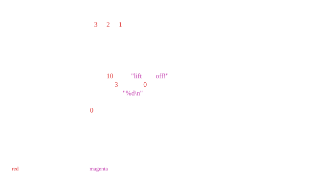

# 06.02 Numbers and strings

The scanner learns its first two rules: a string, from a quote to the same
quote again, is drawn in magenta, and a number, a digit where a word may
start and the digits and dots after it, in red. Neither can be decided from
one character alone, so the scan now carries two facts along the row: may a
word start here, and is this inside a string.

## Where this fits


This lesson works inside the highlight piece, on the right-hand side of the
map between render and the frame. The rows hand it their render as
before; it now gives two more classes, and the frame draws them in their
colours. Nothing else changes. Since every edit renders its row again, the
colours follow the text as you type: a digit typed into a name stays plain,
and the same digit typed after a space turns red. After this lesson the
numbers and strings of a C file are coloured.

## The idea

At 06.01 `countdown.c` is still one colour. Take row 7,
`char order[10] = "lift off!";`, and ask which characters are a number and
which a string.

A string is easy to find from the left. A `"` or a `'` opens one, and the
same quote closes it; everything between is part of it, spaces and digits
too. One detail comes from C: inside a string, `\"` is a quote that does not
close it, so a backslash takes the next character along with it.

A number needs one more fact. The `10` of `order[10]` is a number, but the
`3` of a name such as `y3` is part of the name. What decides is the
character before the digit. kilo calls a character that can end a word a
**separator**: white space, the end of the row, and any of
`, . ( ) + - / * = ~ % [ ] ;`. A digit starts a number only at the start of
the row or right after a separator; a digit or a dot right after a number
goes on with it, so `2.25` is one number.

So the scan keeps two things as it walks the row: `prev_sep`, 1 when a word
may start at the next character, and `in_string`, the quote that opened the
string it is in, or 0. Step through row 7:


For each character the rules are tried in an order: a string (inside one,
or a quote that opens one), then a non-printable character, then a number.
A character no rule takes stays normal and sets `prev_sep` from itself. The
order matters. A digit inside a string is string, never number, because the
string rule takes it first.

### `is_separator`

One line: true for the `'\0'` that ends `render`, for white space as
`isspace()` sees it, and for the fourteen characters in the list. The
`'\0'` counts so that the end of the row is a separator too.

### Strings and numbers, in `editorUpdateSyntax`

Two rules join the loop. The string rule comes first, ahead of 06.01's
non-printable rule. Inside a string, every character is `HL_STRING`; a
backslash with a character after it takes both; the quote that opened the
string closes it. Outside one, a `"` or a `'` opens one and is string
itself. The number rule comes after the non-printable rule: a digit with
`prev_sep` set, or a digit or a dot right after a byte already marked
`HL_NUMBER`, is `HL_NUMBER`.

Around the two rules: the variables start at the top of each row,
`prev_sep` at 1 and `in_string` at 0; a non-printable character sets
`prev_sep` to 0; and at the bottom, where a character no rule took stays
normal, `prev_sep` becomes `is_separator()` of that character. Outside the
function are the classes 6 and 7 and their colours in
`editorSyntaxToColor()`, magenta (35) and red (31), and a `flags` field in
`struct editorSyntax` set to `HL_HIGHLIGHT_STRINGS | HL_HIGHLIGHT_NUMBERS`
for C. Nothing reads those flags, in antirez's kilo as here: strings and
numbers are coloured in every language.

## Run it

Make the program in this lesson's folder:

<!-- verify: session -->
```
$ ./learn files kilo --at 06.02
Wrote kilo as it stands at 06.02 (Numbers and strings) to build/at/kilo/06.02/
$ printf '/* countdown.c: 3, 2, 1,\n\n   and lift off. */\n#include <stdio.h>\n\nint main(void) {\n\tchar order[10] = "lift off!";\n\tfor (int i = 3; i > 0; i--)\n\t\tprintf("%%d\\n", i);\t// one a line\n\tputs(order);\t/* then the order */\n\treturn 0;\n}\n' > build/at/kilo/06.02/countdown.c
```

and open it:

```
./learn run kilo --at 06.02 -- countdown.c
```



Every number is red and every string magenta, the `%d\n` of row 9 included:
the backslash took the `n` along. The 3, 2 and 1 of row 1 are red too.
They are in a comment, but this lesson's scanner knows no comments: to it
they are digits after spaces. The next lesson fixes that.

Now press Down ten times and Right nine times, to just after the `0` of
`return 0;`, and type `.5`: the number grows, all of it red. Press Backspace
twice, Left once, and type `x`: `x0` is a name now, and the `0` in it is
plain. Written with the colour of each run in front of it (`[r:0.5]` is
`0.5` in red), row 11 after each:

<!-- verify: skip reason="row 11 of the editor's screen after each edit, its colours written out; captured on a 16 x 56 pseudo-terminal with track.py's Screen" -->
```
        return [r:0.5];
        return x0;
```

Quit with Ctrl-Q four times; nothing is saved.

<!-- verify: mention names="countdown.c" outside reason="the file the reader makes to open in the editor, not a file of the project" -->

## How it works

### The class before is the scan's memory

```
if ((isdigit(*p) && (prev_sep || row->hl[i-1] == HL_NUMBER)) ||
    (*p == '.' && i >0 && row->hl[i-1] == HL_NUMBER)) {
```

`prev_sep` cannot say "a number goes on": a digit is not a separator, so
after the `1` of `10` it is 0. What carries the number on is the class just
given to the byte before, `row->hl[i-1]`. `hl` is the scan's output and, one
byte back, its memory. Break it removes that half of the test.

The rule is the original's, and so are its limits. Only the fourteen
characters, white space and the end of the row are separators, so in `{0}`
and in `i<10` the number stays plain: `{` and `<` are not on the list. In
`0x1F` only the `0` is red, the `x` being a letter; and `3.14.15` is one
number, since a dot after a number always goes on with it. All four were
checked on a C row at this lesson.

### A backslash last in the row

```
if (*p == '\\' && *(p+1)) {
```

antirez's kilo tests only `*p == '\\'`, then marks `hl[i+1]` and steps two
bytes. When the backslash is the last byte of the row, as in a C string
continued on the next line, `char *s = "one \`, `hl[i+1]` is one byte past
the end of `hl`, and `p` steps over the `'\0'` that ends `render` and reads
on through whatever memory follows it. On this Mac nothing showed. Put the
original line back in this lesson's code and build it with AddressSanitizer,
the memory checker of 04.02, and opening a file with that row stops kilo at
once: `heap-buffer-overflow`, a `WRITE of size 1` "0 bytes after 16-byte
region", the 16 classes of that row. With the test, a backslash with nothing
after it is string alone, and the string ends with the row.

A string never goes on to the next row: `in_string` starts at 0 on every
row. So in that file the second row, `two";`, shows `two` plain and its
quote opening a new string that runs to the end of the row. C's own rule,
where the backslash joins the two lines, is not kilo's.

### The colour after a control code

06.01 set `current_color` back to -1 after a reverse-video character,
because `ESC [ 0 m` turns the colour off too. Here is what that is for. On
the row `x = "a"`, Ctrl-A, `"b";`, both strings are magenta here, and the
`A` between them is magenta in reverse video, since `ESC [ 7 m` keeps the
colour already set. antirez's kilo, which keeps its own idea of the colour,
draws the second string with no colour at all (checked on his own build).
Inside a string the order of the rules shows again: a Ctrl-A typed between
the quotes is string, not non-printable, and goes to the terminal as the
raw byte, as in the core.

## Decide the boundary

kilo's scanner is a few dozen lines of C written for one family of
languages: the separators, the quotes and the backslash are C's, in the
code itself. Another editor could read each language's rules from a file, a
grammar of regular expressions (one pattern for a string, one for a number,
one for a comment), and colour any language someone has written a grammar
for, with no change to the editor. It pays with a regular-expression engine
inside the editor, rules that are slower to run than a few `if`s, and
languages whose corners still need code. Is a new language a change to the
editor, or a file you add to it?

## Break it

Take away the half of the number rule that reads the class before. In
`build/at/kilo/06.02/kilo.c`, in `editorUpdateSyntax()`, change the first
line of the number test:

<!-- verify: patch file=kilo.c
-        if ((isdigit(*p) && (prev_sep || row->hl[i-1] == HL_NUMBER)) ||
+        if ((isdigit(*p) && prev_sep) ||
-->
<!-- verify: skip reason="the line as the reader changes it; the patch above makes the change" -->
```
        if ((isdigit(*p) && prev_sep) ||
```

```
./learn run kilo --at 06.02 -- countdown.c
```

Row 7 now shows only the first digit of `10` in red:

<!-- verify: skip reason="row 7 of the editor's screen, its colours written out; captured on a 16 x 56 pseudo-terminal with track.py's Screen" -->
```
        char order[[r:1]0] = [m:"lift off!"];
```

The `1` follows `[`, a separator, so it starts a number. Starting a number
set `prev_sep` to 0, and the `0` after it is a digit with no separator
before it: with nothing left to say that a number goes on, it is plain. The
one-digit numbers of the file, `3`, `0` and the rest, look as before, which
is why a bug like this can hide. Put the line back.

<!-- verify: revert file=kilo.c -->

## Go deeper

- [antirez's kilo.c, strings](https://github.com/antirez/kilo/blob/323d93b29bd89a2cb446de90c4ed4fea1764176e/kilo.c#L442-L462) - the original string rule, with the backslash test on line 445; then [the number rule](https://github.com/antirez/kilo/blob/323d93b29bd89a2cb446de90c4ed4fea1764176e/kilo.c#L472-L479) and [`is_separator`](https://github.com/antirez/kilo/blob/323d93b29bd89a2cb446de90c4ed4fea1764176e/kilo.c#L366-L368), the same as here.
- [Build Your Own Text Editor, chapter 7](https://viewsourcecode.org/snaptoken/kilo/07.syntaxHighlighting.html) - "Colorful numbers" brings in `prev_sep` for the `32` of `int32_t`, and counts the `'\0'` as a separator; "Colorful strings" takes the character after a backslash only when "there's at least one more character in that line", the test this lesson puts in.

Related: 06.01 A colour for every character, 06.03 Comments, on one line and across many
