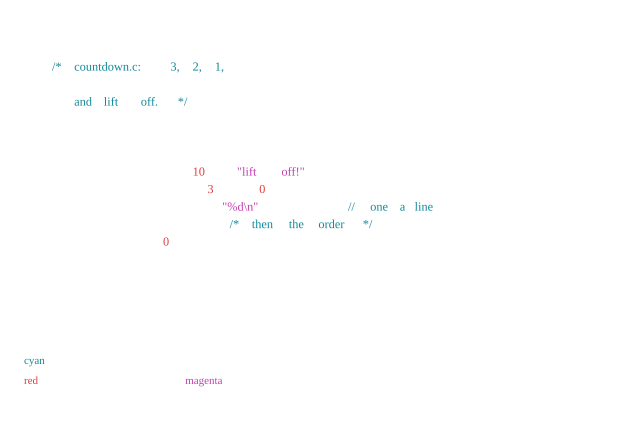
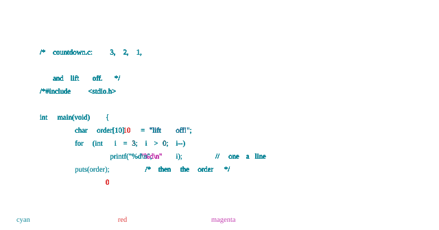

# 06.03 Comments, on one line and across many

A `//` comment runs to the end of its row; a `/* */` comment runs to its
`*/`, however many rows that takes. The second kind makes a row's colours
depend on the rows above it. So each row now remembers whether it ends
inside a comment, and when that changes, the change is carried down to the
rows after it, as far as it reaches.

## Where this fits


This lesson works inside the highlight piece, on the right-hand side of the
map between render and the frame, and changes what kind of piece it is.
Until now it coloured each row from that row's text alone. Now a row's
colours also depend on the row before it, so after one row's text changes,
the highlighter may go on to the rows after it before the frame is drawn.
For that each row has to know where it is in the file, and the core's own
inserts and deletes keep that number right. After this lesson comments are
coloured, and opening or closing one near the top of a file recolours the
rest of it in the next frame.

## The idea

A `//` comment is a row's own business: after a separator, and not already
inside a comment, `//` makes the rest of the row a comment, and the scan of
that row stops. A `/*` outside a string opens a comment that runs up to and
including its `*/`. Within one row that is one more fact for the scan to
carry, `in_comment`, like `in_string` in 06.02.

Across rows it is more. Row 3 of `countdown.c` is `   and lift off. */`.
Nothing on that row says it is a comment, and its `and` is even a C++
keyword. It is a comment only because row 1 opened one and row 2, which is
empty, did not close it. So the scan of a row has to start from what the row
before it ended in. Each row keeps that in `hl_oc`: 1 if it ended inside a
`/* */` comment, set at the end of its own scan. The next row's scan starts
with `in_comment` set to its row above's `hl_oc`:



When a file is opened, its rows are scanned top to bottom, so the row
above is always done first. An edit is different. Type `/*` at the start of
row 4, and row 4 now ends inside a comment. Row 5 starts differently, so
its colours are wrong, though its text did not change: it has to be scanned
again, then perhaps row 6, and so on. It stops at the first row that ends
the way it ended before: every row after it starts as it did, so its
colours are still right.



### `editorRowHasOpenComment`

Returns the row's `hl_oc`: whether its last scan ended inside a comment.
The scan of a row asks it about the row whose `idx` is one less.

### Comments, in `editorUpdateSyntax`

Three rules go first in the loop, ahead of strings: `//` marks the rest of
the row `HL_COMMENT` and leaves the loop; inside a comment every character
is `HL_MLCOMMENT`, and a `*/` closes it; outside one, and outside a string,
a `/*` opens one. Before the loop, `in_comment` starts as the row above
ended. After it, the row's `in_comment` is kept in `hl_oc`, and if that
changed and there is a next row, `row` becomes the next row and
`goto nextrow` jumps back to the label at the top.

The marks are the language's: `struct editorSyntax` gets three fields for
them, the C entry of `HLDB` gets `"//","/*","*/"`, and both comment classes
are cyan (36) in `editorSyntaxToColor()`.

### Where each row is, in `editorInsertRow` and `editorDelRow`

A row finds the row above it through `idx`, its place in `E.row`. An insert
adds 1 to the `idx` of every row after it, and counts the new row before
rendering it; a delete takes 1 off, then scans again the row that moved up
into the gap, which has a new row above it.

## Run it

Make the program in this lesson's folder:

<!-- verify: session -->
```
$ ./learn files kilo --at 06.03
Wrote kilo as it stands at 06.03 (Comments, on one line and across many) to build/at/kilo/06.03/
$ printf '/* countdown.c: 3, 2, 1,\n\n   and lift off. */\n#include <stdio.h>\n\nint main(void) {\n\tchar order[10] = "lift off!";\n\tfor (int i = 3; i > 0; i--)\n\t\tprintf("%%d\\n", i);\t// one a line\n\tputs(order);\t/* then the order */\n\treturn 0;\n}\n' > build/at/kilo/06.03/countdown.c
```

and open it:

```
./learn run kilo --at 06.03 -- countdown.c
```

The screen is the first figure: both comments cyan, the digits of row 1
too, now that the comment rule comes before the number rule. Press Down
three times and type `/` and then `*`, as in the stepped figure. Rows 4 to
10 turn cyan, and rows 11 and 12 do not. Written with the colour of each
run in front of it (`[c:...]` is cyan, `[r:0]` a red 0), rows 9 to 12:

<!-- verify: skip reason="rows of the editor's screen, their colours written out; captured on a 16 x 56 pseudo-terminal with track.py's Screen" -->
```
                [c:printf("%d\n", i);      // one a line]
        [c:puts(order);    /* then the order */]
        return [r:0];
}
```

Press Backspace twice: the `/*` is gone, the same rows are scanned again,
and every colour is back as it was. Quit with Ctrl-Q.

<!-- verify: mention names="countdown.c" outside reason="the file the reader makes to open in the editor, not a file of the project" -->

## How it works

### The end of the row is the scan's own

```
return row->hl_oc;
```

and at the end of the scan:

```
int oc = in_comment;
```

At the end of a row the scan knows whether it is inside a comment: that is
`in_comment`, and that is what is kept. antirez's kilo works it out
afterwards, from the row's last character: in the comment's colour, and not
the `/` of a `*/`. An empty row has no last character, so to the original a
comment ends at any blank row inside it. With the tab of row 9 made spaces
(the table below says why), antirez's build draws row 3 of `countdown.c` as
code: uncoloured, but for its `and` in the keyword colour.

### A loop, and where it stops

```
int oc = in_comment;
if (row->hl_oc != oc && row->idx+1 < E.numrows) {
    row->hl_oc = oc;
    row = &E.row[row->idx+1];
    goto nextrow;
}
row->hl_oc = oc;
```

The **invariant** is that every row's colours and `hl_oc` are what a scan of
its text gives, starting from its row above's `hl_oc`. An edit breaks it
for the edited row, which `editorUpdateRow()` scans at once, and perhaps
for the rows after. These lines put it back: they go on while a row's end
state changes, and stop at the first row whose end state did not, because
from there down every scan would start, and so end, as before. Most typing
does not touch the end state, and costs one row.

The other kind is real: `/*` typed at the top of a file with no `*/` below
it scans every row to the end. On a file of 200,000 rows on this Mac, that
key came back within a few hundredths of a second of a key that scans one
row. antirez's kilo carries the change with a call,
`editorUpdateSyntax(&E.row[row->idx+1])`, one call deeper for every row it
reaches. Break it puts that call back.

### The bugs fixed here

All of this hangs on each row knowing its row above, through `idx`, and on
every rule taking the comment state into account. Each case below was
checked by putting the original's line back in this lesson's code, on the
rows shown (separated by `/`):

| the case | with the original's line | here |
|---|---|---|
| `//` after a tab: row 9 of `countdown.c` | kilo is killed as it opens the file: the rule marks `row->size-i` classes, `size` counting `chars` and `i` counting `render`, which after two tabs is negative | `row->rsize-i` |
| a blank row in a comment: rows 1 to 3 of `countdown.c` | row 3 drawn as code | `in_comment` kept in `hl_oc` |
| `//` typed in front of row 1's `/*` | row 3 stays cyan: the `//` rule `return`s before `hl_oc` is set | `break` |
| `/*` / `// old */ z = 3;` / `w = 5;` | the `//` takes the rest of row 2, its `*/` is never seen, and `w = 5;` is comment | `!in_comment` in the `//` test |
| `s = "/*";` / `int x = 1;` | the string's `/*` opens a comment, and every row after it is cyan | `!in_string` in the `/*` test |
| `x` / `/* a` / `b */` / `c = 1;`: Backspace at the start of row 2, then `x` typed on `b */` | `bx */` drawn as code: the delete renumbers with `idx++` | `idx--` |
| `a = 1; // note` / `/* b` / `c = 2;` / `*/`: Backspace at the start of row 2 | `c = 2;` and `*/` stay cyan | the row that moved up scanned again |
| `x = 1; // a /* b` / `c;` / `d;`: Enter just before the `/*` | `d;`, the last row, is never reached | `E.numrows++` before `editorUpdateRow()` |

The first is why antirez's own kilo cannot open `countdown.c` at all: on
this Mac it is killed by a signal while it reads row 9.

## Decide the boundary

kilo keeps one fact per row, the state at its end, and scans a row again
only when its text or the row above's end state changes: most keys cost
one row, a few the rest of the file. Another editor could keep nothing and
scan the whole file on every key: no state to get wrong, no `idx` to keep,
at a cost that grows with the file on every key. Or it could scan only the
rows on the screen, from a guess about the row above the top: fast on any
file, and sometimes wrong. How long are your files, and how often does one
key change the end of its row?

## Break it

Put the original's recursive call back. In `build/at/kilo/06.03/kilo.c`, at
the end of `editorUpdateSyntax()`, replace the two lines that move to the
next row and jump back to `nextrow` with a call:

<!-- verify: patch file=kilo.c
-        row = &E.row[row->idx+1];
-        goto nextrow;
+        editorUpdateSyntax(&E.row[row->idx+1]);
-->
<!-- verify: skip reason="the line as the reader changes it; the patch above makes the change" -->
```
        editorUpdateSyntax(&E.row[row->idx+1]);
```

Make a C file of 200,000 short rows:

<!-- verify: session -->
```
$ yes 'x;' | head -n 200000 > build/at/kilo/06.03/big.c
```

and open it:

```
./learn run kilo --at 06.03 -- big.c
```

The build warns `unused label 'nextrow'` first; then the file opens. Type
`/` and then `*` at the top. kilo is gone: no new screen is drawn, and the
shell's prompt comes back where the cursor was. `./learn` passes on how
kilo ended as its own exit status, which bash's `echo $?` shows as 245:
256 minus 11, and 11 is SIGSEGV, the signal for a bad memory access. The
terminal is still raw, so what you type does not show: type `reset` and
press Enter.

The change ran down the file one call deeper per row, and each call takes a
frame of the stack: on this Mac 80 bytes for this function, so 200,000 rows
need 16 MB of stack where macOS gives a program 8 MB (`ulimit -s` says
8176, in kilobytes). 100,000 rows still fit, just. With the loop the same
keys rescan all 200,000 rows in one frame. Put the two lines back.

<!-- verify: revert file=kilo.c -->

## Go deeper

- [antirez's kilo.c, comments](https://github.com/antirez/kilo/blob/323d93b29bd89a2cb446de90c4ed4fea1764176e/kilo.c#L412-L440) - the `//` rule with `row->size-i` on line 415 and its `return`, and the `/* */` rule with no `in_string` test; [`editorRowHasOpenComment`](https://github.com/antirez/kilo/blob/323d93b29bd89a2cb446de90c4ed4fea1764176e/kilo.c#L373-L378), the last-character rule; [the end of `editorUpdateSyntax`](https://github.com/antirez/kilo/blob/323d93b29bd89a2cb446de90c4ed4fea1764176e/kilo.c#L510-L516), the recursive call on line 515; and the `idx++` of [`editorDelRow`](https://github.com/antirez/kilo/blob/323d93b29bd89a2cb446de90c4ed4fea1764176e/kilo.c#L628).
- [Build Your Own Text Editor, chapter 7](https://viewsourcecode.org/snaptoken/kilo/07.syntaxHighlighting.html) - "Colorful multiline comments" keeps in `hl_open_comment` "whatever state in_comment got left in", as this lesson does, and carries a change on because the function "keeps calling itself with the next line": the recursion of Break it.

Related: 06.02 Numbers and strings, 06.04 Keywords
