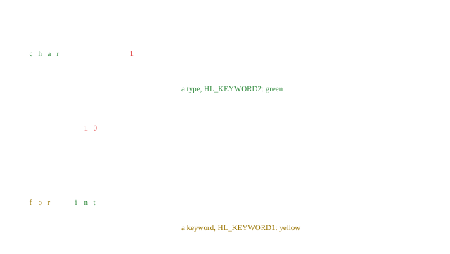
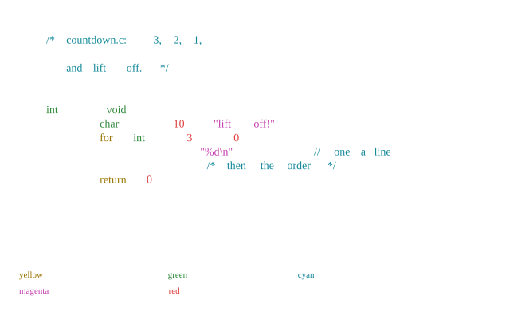

# 06.04 Keywords

The last rule of the scanner: the words of a language's list are drawn in
yellow, and the type names in it in green. A word counts only when it stands
on its own, with a separator before it and one after it, so a name that
merely begins like a keyword stays plain.

## Where this fits


This lesson works inside the highlight piece, on the right-hand side of the
map between render and the frame, and completes the language table that
belongs to it: after the file names of 06.01 and the comment marks of 06.03,
the C entry gets its list of words. The rows and the frame are as before;
the frame draws two more classes. After this lesson a C file has every
colour kilo knows how to give it.

## The idea

At 06.03, `for`, `return`, `int`, `char` and `void` in `countdown.c` are
still in the default colour. What makes them special is not their letters:
it is that C reserves them. So kilo cannot find them by a rule like "a digit
after a separator". It has to be told the words, and it keeps them in the
language's table, `C_HL_keywords`: 81 words in all, C's keywords and
C++'s, and at the end twelve type names. A type name is written with a `|` after it, `"int|"`;
the `|` is not part of the word, it marks it as the second kind. The first
kind is `HL_KEYWORD1`, yellow, the second `HL_KEYWORD2`, green.

A word of the list counts only where a word may start, with `prev_sep` set
(06.02), and only if a separator follows it. Both are needed. Without the
first, the `do` at the end of `undo` would count. Without the second, the start of a
longer word would: `order` begins with `or`, which is a C++ keyword (another
way to write `||`). At each place a word may start, kilo tries the words of
the list in order, and the first one that fits wins:



When a word does not fit, the scan goes on as before, and `prev_sep` is 0
after its first letter, so the rest of `order` is never tried. Strings and
comments come first in the loop, so a keyword inside either is a string or
a comment.

### Keywords, in `editorUpdateSyntax`

The new rule comes after numbers, as the last before "anything else stays
normal", and only when `prev_sep` is set. For each word of `keywords` it
takes the length, and, when the word ends in `|`, notes that it is a type
and takes one off the length. If the row has those letters here and a
separator right after them, it sets that many classes to `HL_KEYWORD2` or
`HL_KEYWORD1`, steps past them and leaves the inner loop. After the loop,
`keywords[j]` not NULL means a word was found: `prev_sep` becomes 0, since
the scan is now at the end of a word, and the loop goes on with the next
character.

The rest is outside the function: `keywords` in `struct editorSyntax`,
the list itself, `C_HL_keywords`, in the C entry of `HLDB`, and the two
classes, yellow (33) and green (32), in `editorSyntaxToColor()`.

## Run it

Make the program in this lesson's folder:

<!-- verify: session -->
```
$ ./learn files kilo --at 06.04
Wrote kilo as it stands at 06.04 (Keywords) to build/at/kilo/06.04/
$ printf '/* countdown.c: 3, 2, 1,\n\n   and lift off. */\n#include <stdio.h>\n\nint main(void) {\n\tchar order[10] = "lift off!";\n\tfor (int i = 3; i > 0; i--)\n\t\tprintf("%%d\\n", i);\t// one a line\n\tputs(order);\t/* then the order */\n\treturn 0;\n}\n' > build/at/kilo/06.04/countdown.c
```

and open it:

```
./learn run kilo --at 06.04 -- countdown.c
```



Every colour of the module is on this screen but blue, which 06.05 gives the
search's match. The `and` of
row 3 is a C++ keyword, but it is inside the comment, and the comment rule
comes first. `#include`, `printf`, `puts` and `main` are not in the list,
and stay plain.

Now press Down twelve times, to the row past the end of the file, and type
`do`: it is yellow, since the end of the row is a separator. Type `ne`, and
`done` is plain again. Written with the colour of each run in front of it
(`[y:do]` is `do` in yellow), row 13 after each:

<!-- verify: skip reason="row 13 of the editor's screen after each key, its colours written out; captured on a 16 x 56 pseudo-terminal with track.py's Screen" -->
```
[y:do]
done
```

Quit with Ctrl-Q four times; nothing is saved.

<!-- verify: mention names="countdown.c" outside reason="the file the reader makes to open in the editor, not a file of the project" -->

## How it works

### A separator on both sides

```
if (!strncmp(p,keywords[j],klen) &&
    is_separator(*(p+klen)))
```

`p+klen` is the byte just after the word. When the word ends the row, that
byte is the `'\0'` that ends `render`, which `is_separator()` counts (06.02),
so `do` alone on its row is a keyword. The order of the list matters only
for words that begin alike, and the test makes it matter less: `do` comes
before `double|` in the list, and on `double d;` the `do` does not fit,
since a `u` follows, and `double|` does.

The list is all kilo knows. `size_t` and `FILE` are types to C, but not in
the list, so they stay plain; so does the `int` of `static_cast<int>`,
because `<` is no separator. All three were checked at this lesson.

### strncmp(), not memcmp()

<!-- verify: mention names="memcmp() memcmp(p,keywords[j],klen)" outside reason="the C library function and the call antirez's kilo has here; this project calls strncmp() instead" -->

antirez's kilo compares with `memcmp(p,keywords[j],klen)`. `memcmp()` is
allowed to read all `klen` bytes, and near the end of a row there are fewer
than that left in `render`: the comparison may read past its end.
`strncmp()` stops at the first `'\0'`, and `render` ends in one. With the
original line put back in this lesson's code and built with
AddressSanitizer, `countdown.c` does not even open: AddressSanitizer stops
kilo while it reads the file, with a `heap-buffer-overflow`, a
`READ of size 12` in `memcmp`, called from `editorUpdateSyntax()`. Built
the normal way, the same code draws the same screen as this lesson's: the
read past the end did no harm that shows, here, this time. The C standard
promises nothing about it.

The list in the original also has `"deltype"`, a typo for C++'s
`decltype`; here it is spelt right.

### What a word start costs

A place where a word may start and no keyword fits tries all 81 words:
`main`, `order` and each `i` of `countdown.c` cost 81 `strncmp()` calls
apiece, most of which stop at the first letter. The rule waiting for
`prev_sep` is what keeps that to word starts: inside a word, no keyword is
tried at all.

## Decide the boundary

kilo colours a word by spelling: if it is in the list, it is a keyword. The
list cannot know what a word means in this program. `order` is a variable
and `main` a function, `size_t` is a type only because a header says so,
and a macro can make any name mean anything. Another editor could parse the
program as a compiler does, headers and all, and colour each name by what it
is: types, functions, variables and macros each in their own colour, even
when they are not in any list. It pays with a parser for each language, the
time to run it on every change, and code in the middle of being typed, which
does not parse. Should the colour of a word say what kind of word it is, or
what it stands for here?

## Break it

Take away the separator after the word. In `build/at/kilo/06.04/kilo.c`, in
`editorUpdateSyntax()`, make the test only compare the letters:

<!-- verify: patch file=kilo.c
-                if (!strncmp(p,keywords[j],klen) &&
-                    is_separator(*(p+klen)))
+                if (!strncmp(p,keywords[j],klen))
-->
<!-- verify: skip reason="the line as the reader changes it; the patch above makes the change" -->
```
                if (!strncmp(p,keywords[j],klen))
```

```
./learn run kilo --at 06.04 -- countdown.c
```

Rows 7 and 10:

<!-- verify: skip reason="rows of the editor's screen, their colours written out; captured on a 16 x 56 pseudo-terminal with track.py's Screen" -->
```
        [g:char] [y:or]der[[r:10]] = [m:"lift off!"];
        puts([y:or]der);    [c:/* then the order */]
```

The `or` of `order` is yellow, both times outside the comment: it is the
first word of the list that fits the letters, and nothing checks what comes
after it. The `der` stays plain, as `prev_sep` is 0 after a keyword. The
other words of the file are whole keywords, or begin like none. On
`double d;`, `do` comes first in the list and wins: `do` yellow, `uble`
plain. Put the lines back.

<!-- verify: revert file=kilo.c -->

## Go deeper

- [antirez's kilo.c, keywords](https://github.com/antirez/kilo/blob/323d93b29bd89a2cb446de90c4ed4fea1764176e/kilo.c#L481-L505) - the original rule, with `memcmp()` on line 489; and [`C_HL_keywords`](https://github.com/antirez/kilo/blob/323d93b29bd89a2cb446de90c4ed4fea1764176e/kilo.c#L166-L184), with `"deltype"` on line 174.
- [Build Your Own Text Editor, chapter 7](https://viewsourcecode.org/snaptoken/kilo/07.syntaxHighlighting.html) - "Colorful keywords" builds the same rule with `strncmp()`, a separator before and after (so the `void` of `avoid` is not coloured), and the `'\0'` at the end of the row counted as a separator.

Related: 06.02 Numbers and strings, 06.05 Showing the match
