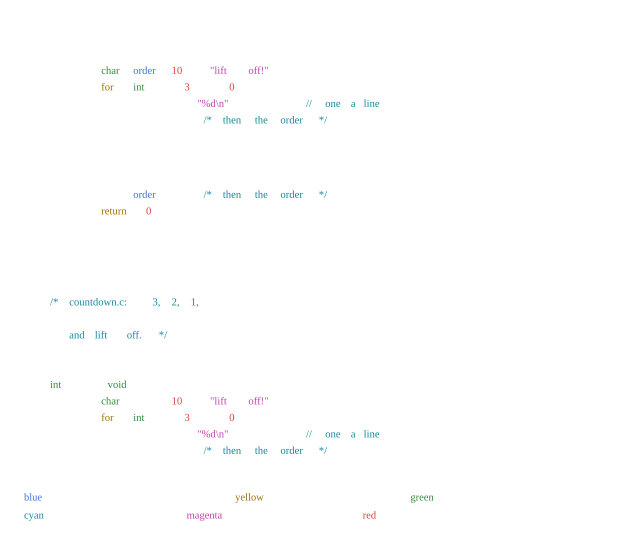

# 06.05 Showing the match

While a search is on, its match is drawn in blue. The blue is written into
the row's classes like any other colour, so the row's own classes are saved
first, and put back as soon as the search moves to another match or ends.

## Where this fits


This lesson builds the match piece, which hangs from the find piece of the
core. Find, from module 05, moves the cursor and the view to each match and
changes no row. Now, for as long as a match is the match, it also lends that
row's classes a new one, drawn in blue by the frame as any class is; the
highlighter's own classes for the row are kept aside and handed back after.
It works in every file, one with no language too, since every row has
classes from 06.01 on. After this lesson you see the whole match, not only
the cursor at its start.

## The idea

At 06.04, Ctrl-F `order` in `countdown.c` puts row 7 at the top of the
screen and the cursor on the `o` of `order`. Which characters matched is up
to you to see. The frame already draws every byte in the colour of its
class, so the simplest way to show the match is one more class:
`HL_MATCH`, 8, blue. Set the match's classes to 8 and the next frame draws
it blue.

But those classes are the row's real colours. Leave the 8s in, and the
match stays blue after the search, until the row is next edited and scanned
again. So before it writes the 8s, the search copies the row's classes into
`saved_hl`, and notes which row they came from in `saved_hl_line`. Before it
colours the next match, and when the search ends, by Escape or by Enter, it
copies them back:



Two details show in the figure. Row 7's `order` comes after a tab, and the
blue is on the screen's `order`, not on the last two of the tab's spaces
and `cha`. And
row 10 holds `order` twice, but only the first is blue: the search finds the
first place in a row, and colours that.

### Put the colours back

A macro, `FIND_RESTORE_HL`: if classes are saved, copy them back into the
`hl` of row `saved_hl_line`, free the copy, and set `saved_hl` to NULL. It
is written as `do { ... } while (0)` so that `FIND_RESTORE_HL;` is one
statement wherever it goes.

### The match, in `editorFind`

The search keeps `saved_hl_line` and `saved_hl`, none saved at the start. It
puts the colours back in two places: once the search has looked for the
next match, before it colours one, so the last match's row has its own
colours whether or not a new one is found; and in the Escape and Enter
case, before it returns. When
it finds a match, it saves the row's classes, works out the match's column
in `render`, and sets `qlen` classes there to `HL_MATCH`. The colour itself,
blue (34), is one more case in `editorSyntaxToColor()`.

## Run it

Make the program in this lesson's folder:

<!-- verify: session -->
```
$ ./learn files kilo --at 06.05
Wrote kilo as it stands at 06.05 (Showing the match) to build/at/kilo/06.05/
$ printf '/* countdown.c: 3, 2, 1,\n\n   and lift off. */\n#include <stdio.h>\n\nint main(void) {\n\tchar order[10] = "lift off!";\n\tfor (int i = 3; i > 0; i--)\n\t\tprintf("%%d\\n", i);\t// one a line\n\tputs(order);\t/* then the order */\n\treturn 0;\n}\n' > build/at/kilo/06.05/countdown.c
$ cp build/at/kilo/06.05/countdown.c build/at/kilo/06.05/countdown.txt
```

and open it:

```
./learn run kilo --at 06.05 -- countdown.c
```

Press Ctrl-F and type `order`: the top screen of the figure. Press Down for
the next match, row 10; Down again goes round to row 7. Press Escape: the
view and the cursor go back to row 1, and every row has its own colours
again, as at 06.04. Quit with Ctrl-Q.

Then open `countdown.txt` the same way and search for `order`. The file has
no language, so nothing on it is coloured but the match. Written with the
colour of each run in front of it (`[b:order]` is `order` in blue), its top
row while the search is on:

<!-- verify: skip reason="the top row of the editor's screen during the search, its colours written out; captured on a 16 x 56 pseudo-terminal with track.py's Screen" -->
```
        char [b:order][10] = "lift off!";
```

<!-- verify: mention names="countdown.c countdown.txt" outside reason="the files the reader makes to open in the editor, not files of the project" -->

## How it works

### A macro, because it changes the search's own variables

```
#define FIND_RESTORE_HL do { \
    if (saved_hl) { \
        memcpy(E.row[saved_hl_line].hl,saved_hl, E.row[saved_hl_line].rsize); \
        free(saved_hl); \
        saved_hl = NULL; \
    } \
} while (0)
```

`saved_hl` and `saved_hl_line` are local variables of `editorFind()`, and
putting the colours back has to change `saved_hl`. A function would need
their addresses; a macro written inside the function is simply its code,
pasted in twice. The **invariant** is that while the search runs, at most
one row has classes that are not its own, the row `saved_hl_line` names,
and only when `saved_hl` holds its own; when the search returns, none has.
The copy back takes `rsize` bytes from the saved copy, which is safe because
nothing can change the row while the search holds it: the search reads the
keys itself, and every key it takes is search, never an edit.

### The match's column is a place in render

```
for (j = 0; j < match_offset; j++)
    rx += row->chars[j] == TAB ? 8 - rx%8 : 1;
memset(row->hl+rx,HL_MATCH,qlen);
```

05.01 made the search look in `chars`, so that the cursor lands on the
match, and `match_offset` is a place in `chars`. But `hl` follows `render`.
antirez's kilo searched `render`, and colours from `match_offset` directly.
Do that here and the blue lands on the wrong cells: on row 7, the tab is
one byte of `chars` and eight columns of `render`, so `match_offset` 6 is
render column 6, and the blue covers the last two of the tab's spaces and
`cha` (checked: the screen shows `cha` blue and `order` uncoloured). So the
loop counts the columns the tabs before the match take, as
`editorUpdateRow()` does, and colours from there. `qlen` is right in
`render` too: the query cannot hold a tab, since `isprint()` says no to it,
so neither can the text it matched.

### The module, from one end to the other

Each row keeps a class for every byte of its `render`, made where `render`
is made (06.01). The scan gives them by rules tried in an order: comments,
strings, non-printable characters, numbers, keywords (06.02 to 06.04). A
row starts from the comment state its row above ended in, and a change to
that state is carried down the file until it stops changing (06.03). The
frame turns each class into a colour, sending an escape sequence only where it
changes. And the search borrows one row's classes for its match, and gives
them back. Nothing else in the editor knows the colours exist.

## Decide the boundary

kilo shows the match by writing it into the row's classes, so the frame
needs no new code, at the price of saving and restoring them, and of a row
left blue if a restore is missed, as Break it shows. Another editor could
leave the classes alone and tell the frame where the match is, as a row
and two columns: the frame would draw those cells in the match's colour
over whatever class they have, and there would be nothing to put back. It
pays with a frame that knows about the search. Which should know about the
other: the search about the colours, or the frame about the search?

## Break it

Forget to put the colours back when the search ends. In
`build/at/kilo/06.05/kilo.c`, in `editorFind()`, in the case for Escape and
Enter, delete the line:

<!-- verify: patch file=kilo.c
-            FIND_RESTORE_HL;
             editorSetStatusMessage("");
-->
```
            FIND_RESTORE_HL;    <- delete this line
            editorSetStatusMessage("");
            return;
```

```
./learn run kilo --at 06.05 -- countdown.c
```

Press Ctrl-F, type `order` and press Escape. The view goes back to the top,
the message line empties, and row 7 still says:

<!-- verify: skip reason="row 7 of the editor's screen after the search, its colours written out; captured on a 16 x 56 pseudo-terminal with track.py's Screen" -->
```
        [g:char] [b:order][[r:10]] = [m:"lift off!"];
```

The search is over, but its 8s are still in row 7's `hl`, and the frame
draws whatever `hl` says. They stay until the row is edited: type a
character anywhere on row 7, and the row is scanned again and its colours
are its own. The copy in `saved_hl` is never freed either. Searching again
does not help: the search ends the same way, and leaves its new match blue
as well. Put the line back.

<!-- verify: revert file=kilo.c -->

## Go deeper

- [antirez's kilo.c, `editorFind`](https://github.com/antirez/kilo/blob/323d93b29bd89a2cb446de90c4ed4fea1764176e/kilo.c#L1014-L1107) - the original search, with `FIND_RESTORE_HL` on [lines 1022-1028](https://github.com/antirez/kilo/blob/323d93b29bd89a2cb446de90c4ed4fea1764176e/kilo.c#L1022-L1028), at the left margin, and the match coloured from its place in `render` on [line 1092](https://github.com/antirez/kilo/blob/323d93b29bd89a2cb446de90c4ed4fea1764176e/kilo.c#L1092).
- [Build Your Own Text Editor, chapter 7](https://viewsourcecode.org/snaptoken/kilo/07.syntaxHighlighting.html) - "Colorful search results" and "Restore syntax highlighting after search" build the same thing with `saved_hl` and `saved_hl_line` as static variables of a callback, and say why the saved line is safe to use: the user cannot edit the file between saving and restoring.

Related: 05.02 Next match, previous match, and going back, 06.04 Keywords
