# 01.06 The phases of a compiler, and the first: a scanner

A new program begins here, `mote`, built the way the book draws a
compiler: phases in a row, each handing the next a form of the program
that is easier to work on. This lesson writes the row, and its first
phase, the scanner, which turns characters into tokens.
**Read first:** section 1.6 as far as the start of 1.6.1, then 1.6.1 as far as Example 1.21 (pages 26 to 28), in Programming Language Pragmatics, 4th edition.

Figure 1.3 draws the phases of a compiler and Figure 1.4 those of an
interpreter; in `mote` they become the order of the calls in `main.c`.
Example 1.21 lists the tokens of the book's GCD program in C; this lesson
prints the tokens of yours.

## Where this fits



This lesson is the frame on the right of the map, labelled `mote`, the
arrows inside it, and its first box, the scanner. The frame is the
driver: the program that reads the file and hands it from phase to phase.
The scanner is given the program's text, the same files in `programs/`
that the other roads read, and gives back a list of tokens. The parser
beside it, still dashed, is what will take that list (lesson 01.07). After
this lesson `mote` can show you any program as the tokens it is made of,
and say where a character the language does not have is; it runs nothing
yet.

## The idea


`mote0` works on characters, every line, every time it reaches the line.
To run `while i != j do` it finds where the word `while` ends, skips a
space, reads `i` a character at a time and compares it with every name it
has, skips a space, tells `!=` from `!` and `=`, and so on, and it does all
of that again on every pass of the loop. Characters are the least useful
form a program can be in: almost every question about the program means
reading some of them again.

Section 1.6 splits the work. A compiler is a row of **phases**, and each
one is given the program in one form and hands the next a more useful one:
characters to tokens, tokens to a parse tree, the parse tree to a syntax
tree with a symbol table, and from there to code. The first three phases
are the **front end**: they find out what the program says. A compiler
then writes code for it; an interpreter built on the same front end runs
the tree instead. The figure is the row this chapter builds, phase by
phase, with the lesson that builds each.

The first phase is the **scanner**. It reads the characters once, from
the first to the last, and groups them into **tokens**: a name, a number,
a keyword or an operator. Spaces, tabs, line ends and comments only keep
tokens apart, and are dropped. Each token keeps its kind, its text, and
the line and column where it starts, so that any later phase can say
where in the file a problem is.


<!-- verify: fact cmd="printf 'while i != j do' | wc -c | tr -d ' '" expect=15 -->
`while i != j do` is 15 characters and five tokens: the keyword
`while`, the name `i`, the operator `!=`, the name `j`, the keyword `do`.
From here on no phase looks at a character again.

### `Token`

In `mote.h`, which every phase includes: a token's kind, a pointer to its
text in the source and its length (the text is not copied), a number's
value, its line and column, and the next token. The scanner's result is
the first token of a list that always ends with one of kind `T_EOF`, so a
later phase can look at "the next token" without checking for the end.

### `scan`

One loop over the characters, keeping the line and the column. A line end
starts the next line; a space, a tab or a carriage return moves one
column; `#` skips to the end of the line. Anything else starts a token,
and its first character says which kind: a digit a number, a letter or
`_` a name, anything else an operator. At the end of the text it adds
the end-of-file token and returns the list.

### `number`

The digits, and their value, worked out as they are read. A value that
would not fit in 63 bits is an error at the number's place.

### `name`

The letters, digits and `_` of a word, all of them, and only then the
question whether the word is one of the eight keywords.

### `op`

The operators, tried against a table whose two-character entries come
first. A character that starts no operator is an error, with its line and
column.

### `options`

The command line: one option and one file. The option says which phase to
stop after. At this lesson there is nothing to run a program with, so
`--tokens` is not optional yet.

### `print_tokens`

`--tokens`: a token a line, as `LINE:COL KIND TEXT`, and the end of the
file last.

### `main`

The phases in order, which is the whole picture of the compiler in a few
lines: read the file, scan it, and stop after the scanner when `--tokens`
was asked for. Each later lesson adds its phase below, with the option
that stops after it.

## Run it

At this lesson the sample is the tokens of `gcd.mote`, whole:

<!-- verify: session wait=10 -->
```
$ ./learn run lang --at 01.06
Running lang as it stands at 01.06 (The phases of a compiler, and the first: a scanner). Its files are in build/at/lang/01.06/
2:1 keyword read
2:6 name i
3:1 keyword read
3:6 name j
4:1 keyword while
4:7 name i
4:9 op !=
4:12 name j
4:14 keyword do
5:5 keyword if
5:8 name i
5:10 op >
5:12 name j
5:14 keyword then
6:9 name i
6:11 op :=
6:14 name i
6:16 op -
6:18 name j
7:5 keyword else
8:9 name j
8:11 op :=
8:14 name j
8:16 op -
8:18 name i
9:5 keyword end
10:1 keyword end
11:1 keyword write
11:7 name i
11:8 eof
```

Line 1 is the comment, so the first token is on line 2. The indentation is
gone, but not forgotten: `if` is at column 5 because four spaces came
before it. In the project's directory, the characters against the tokens:

<!-- verify: session
line 3 ~ \s*170
line 5 ~ \s*30
-->
```
$ cd build/at/lang/01.06
$ wc -c < programs/gcd.mote
     170
$ ./mote --tokens programs/gcd.mote | wc -l
      30
```

170 characters become 29 tokens and the end of the file.
<!-- verify: fact cmd="head -1 programs/gcd.mote | wc -c | tr -d ' '" expect=55 -->
The comment on the first line, with its line end, was 55 of the characters.
(On some systems `wc` prints its numbers without the spaces in front.)

A scanner is why line ends stop mattering. Here is a program written on
one line, which the scanner reads like any other, and the first
interpreter refuses:

<!-- verify: session -->
```
$ printf 'read i read j write i + j\n' > one.mote
$ ./mote --tokens one.mote
1:1 keyword read
1:6 name i
1:8 keyword read
1:13 name j
1:15 keyword write
1:21 name i
1:23 op +
1:25 name j
1:26 eof
$ echo 3 4 | ./mote0 one.mote
one.mote:1: expected the end of the line
```

`mote0` has no tokens, only lines, so it needs a statement to end where its
line ends. For the scanner a line end is one more thing that keeps tokens
apart.

A character that is in no token is found at once, with its place, before
any later phase would run:

<!-- verify: session -->
```
$ printf 'x := 1 @ 2\n' > at.mote
$ ./mote --tokens at.mote
at.mote:1:8: unexpected character '@'
$ ./mote programs/gcd.mote
usage: mote (--tokens) FILE
```

The second command is `mote` with nothing to do but scan: the scanner is
the only phase there is, and it is not a way to run a program.

## How it works

### Longest match, by the order of a table

The operators are one table, the two-character ones first:

```
static const char *ops[] = {":=", "==", "!=", "<=", ">=", "<", ">", "+", "-", "*", "/", "(", ")"};
```

and `op()` takes the first entry the text starts with:

```
  for (int i = 0; i < 13; i++)
    if (!strncmp(t->text, ops[i], strlen(ops[i]))) {
```

At `<=` both `<=` and `<` match. Because `<=` is tried first, the scanner
takes the longer one: the rule is called **longest match**, and the order
of the table is how this scanner keeps it. It matters only where a short
operator is the start of a longer one, which in this language means `<`
and `>`. `!` and `:` are no operators by themselves, so `!=` and `:=` could
sit anywhere in the table. [The cc track's lesson 01.02](/t/cc/01.02) is
this rule at length, for all of C's operators, where it decides much more.

### A keyword is a name first

`name()` reads the whole word before it asks whether the word is a
keyword. So the longest match holds for words too:

<!-- verify: session -->
```
$ printf 'done do enddo end\n' > kw.mote
$ ./mote --tokens kw.mote
1:1 name done
1:6 keyword do
1:9 name enddo
1:15 keyword end
1:18 eof
```

Checked the other way round, `done` would be the keyword `do` followed by
the name `ne`. Reading the word first and then looking it up means a
keyword is only ever a whole word, and the table of keywords can grow
without the scanner changing.

### The place of every token

Every token starts with the line and column the loop has counted:

```
      *t = (Token){.text = p, .line = line, .col = col};
```

The **invariant** is that `line` and `col` always describe the character
at `p`. Every way of moving `p` keeps it: a line end does
`line++, col = 1, p++;`, a space `col++, p++;`, a comment `col++, p++;`
for each character it skips, and a token

```
      p += t->len, col += t->len;
```

since a token never holds a line end. A tab counts as one column, which is
what the message says and not always where your editor puts it. The end
of the file sits just after the last character of the last line, as
`11:8` above: an error that is found only at the end, such as a missing
`end`, will point there.

The place rides on every token so that the phases after the scanner never
need the characters again to say where something is: `error_tok()` takes a
token and prints `FILE:LINE:COL:`. It is in `scan.c` because the scanner
is what knows the file's name; every later phase calls it.

### Stopping after a phase

`main()` is Figures 1.3 and 1.4 written as calls:

```
  Token *tok = scan(file, read_file(file));
  if (mode == TOKENS) {
    print_tokens(tok);
    return 0;
  }
```

Each phase takes what the one before it made. Lesson 01.07 adds the parse
below these lines, with `--parse-tree` stopping after it; 01.08 adds the
analysis, with `--tree` and `--symbols`; then, from 01.09, the end of the
row: the tree walked, or code written for it. A phase you can stop after
and print is a phase you can look at, which is how each of the next
lessons shows its work.

## Decide the boundary

This compiler has a scanner of its own, and the parser of lesson 01.07
will never see a character. The other way is a parser that reads
characters itself, skipping spaces and gathering digits wherever it
happens to be. The book calls that possible, but awkward and slow; it is
what `mote0` does, on every line, every time. A scanner of its own costs a
pass over the text and a list of tokens in memory, and buys a parser that
thinks in words, white space and comments handled in one place, and a
place for every message. Is there anything in a language that a separate
scanner could not decide alone, without asking the parser what it expects
next?

## Break it

Try the one-character operators first. In `build/at/lang/01.06/scan.c`,
change the table to

<!-- verify: patch file=scan.c
-static const char *ops[] = {":=", "==", "!=", "<=", ">=", "<", ">", "+", "-", "*", "/", "(", ")"};
+static const char *ops[] = {"<", ">", "+", "-", "*", "/", "(", ")", ":=", "==", "!=", "<=", ">="};
-->
<!-- verify: skip reason="the line as the reader changes it; the patch above makes the change" -->
```
static const char *ops[] = {"<", ">", "+", "-", "*", "/", "(", ")", ":=", "==", "!=", "<=", ">="};
```

and build again:

<!-- verify: session
line 3 ~ \s*30
-->
```
$ make -s
$ ./mote --tokens programs/gcd.mote | wc -l
      30
$ ./mote --tokens programs/sum.mote
programs/sum.mote:5:10: unexpected character '='
```

`gcd.mote` scans exactly as before: its two-character operators are `!=`
and `:=`, and nothing shorter matches at their first character. `sum.mote`
has `while i <= n do`. At column 9 the table now offers `<` first, the
scanner takes it, and the `=` at column 10 is left to start a token of its
own, which no entry of the table does. Notice where the message points: at
the `=`, a character that is perfectly fine, one column after the real
mistake, which was made in the table. A scanner that broke longest match
in a language where `=` alone were an operator would say nothing at all,
and hand the parser `<` and `=`. Put the line back.

<!-- verify: revert file=scan.c -->

## Go deeper

- [Programming Language Pragmatics](https://www.cs.rochester.edu/~scott/pragmatics/),
  4th edition, by Michael L. Scott (Morgan Kaufmann, 2016), section 1.6:
  Figures 1.3 and 1.4 again, beside `main.c`, and Example 1.21 beside the
  output of `--tokens`.
- Crafting Interpreters, by Robert Nystrom,
  [chapter 4, "Scanning"](https://craftinginterpreters.com/scanning.html):
  the same phase for another small language, Lox, written in Java. Its
  tokens keep only a line, not a column; it calls the longest-match rule
  maximal munch, and it settles keywords as this scanner does, by reading
  the whole word first.

Related: 01.03 An interpreter: the program run from its text, 01.07 The parser: tokens into a tree
