# 01.07 The parser: tokens into a tree

The parser reads the scanner's tokens by the grammar of the language and
builds the parse tree: a node for every rule it used and every token it
took. The tree is the proof that the program follows the rules, and the
first place where the compiler knows which part of the program belongs to
which.
**Read first:** the rest of section 1.6.1, from Example 1.22 (pages 28 to 32), in Programming Language Pragmatics, 4th edition.

Example 1.22 writes rules of a grammar for C's while loop, and Example
1.23 with Figure 1.5 builds the whole parse tree of the book's GCD
program. This lesson writes the whole grammar of your language and prints
the whole parse tree of your `gcd.mote`.

## Where this fits



This lesson is the parser, the second box inside `mote` on the map. The
scanner to its left hands it a list of tokens; it hands semantic analysis,
still dashed, a tree (lesson 01.08). The driver calls it after the scanner
and gains an option that stops after it. After this lesson `mote` turns
away any program that breaks the grammar, before a line of it runs, with
the line and column of the first token that does not fit; and it shows the
tree of any program that does fit.

## The idea


The tokens are a flat list. `i := i - j` is five of them, and nothing in
the list says that the `-` takes `i` and `j`, or that the whole of
`i - j` is what `:=` stores, or where a `while`'s body ends. The rules that
say so are the language's **grammar**, and this is all of it, as the
comment at the top of `parse.c` gives it:

```
//   program = { stmt } .
//   stmt    = name ":=" expr | "read" name | "write" expr
//           | "if" cond "then" { stmt } [ "else" { stmt } ] "end"
//           | "while" cond "do" { stmt } "end" .
//   cond    = expr ( "==" | "!=" | "<" | ">" | "<=" | ">=" ) expr .
//   expr    = term { ( "+" | "-" ) term } .
//   term    = factor { ( "*" | "/" ) factor } .
//   factor  = number | name | "(" expr ")" | "-" factor .
```

Each line is a **rule**: the name on the left is made of what is on the
right. A quoted word is a token that must be there, a bare name is another
rule (or, for `name` and `number`, a token of that kind), `|` separates
choices, `{ }` means as many times as there are, zero included, and `[ ]`
means once or not at all. A program is statements; a statement is one of
five forms; a condition is two expressions compared; an expression is
terms added and subtracted, a term factors multiplied and divided.

The parser is the grammar written as C: a function for each rule. Each
function makes a node named after its rule, and hangs under it, in order,
a leaf for every token it takes and the node of every rule it calls. A
node is a `Parse` (in `mote.h`): a rule's name, or for a leaf the token,
then its first child and its next sibling.


For `i := i - j`, `stmt()` sees a name, takes it, takes `:=`, and calls
`expr()`. `expr()` calls `term()`, which calls `factor()`, which takes
`i`. Back in `expr()` there is a `-`, so it takes it and calls `term()`
again, and that `term()` calls `factor()` for `j`. Five tokens, six rule
nodes. The `expr` above two `term`s above two `factor`s is there only
because the grammar has a level for `+ -` and another for `* /`, so that
`*` binds tighter than `-`. Figure 1.5 is large for the same reason: the
size of a parse tree is the grammar's, not the program's.

### `factor`

A number or a name is taken as it is; `(` is taken, then an expression,
then `)`; a `-` is taken, then another factor. Any other token is an
error at its place: `expected a number, a name or '('`.

### `term`

A factor, then for as long as the next token is `*` or `/`, that token and
another factor.

### `expr`

The same shape one level up: terms, joined by `+` and `-`.

### `cond`

An expression, one of the six comparisons, another expression.

### `stmt`

The first token chooses the form: a name an assignment, and each of
`read`, `write`, `if` and `while` its own. A block's statements go on
until a token that cannot start one, which must then be the block's `else`
or `end`.

### `parse`

Statements until the end of the file. Anything left that cannot start a
statement is an error there, so a program is either all grammar or
refused.

### `print_parse`

`--parse-tree`: a node a line, two spaces deeper for each level; a rule by
its name, a leaf as its token's kind and text.

## Run it

At this lesson the sample is the parse tree of `gcd.mote`. Its first lines:

<!-- verify: session wait=10 -->
```
$ ./learn run lang --at 01.07
Running lang as it stands at 01.07 (The parser: tokens into a tree). Its files are in build/at/lang/01.07/
program
  stmt
    keyword read
    name i
  stmt
    keyword read
    name j
  stmt
    keyword while
    cond
      expr
        term
          factor
            name i
      op !=
...
```

The third statement is the whole loop: everything up to its `end` hangs
under that `stmt`. In the project's directory:

<!-- verify: session
line 3 ~ \s*64
-->
```
$ cd build/at/lang/01.07
$ ./mote --parse-tree programs/gcd.mote | wc -l
      64
```

<!-- verify: fact cmd="./mote --parse-tree programs/gcd.mote | awk 'NF == 1' | wc -l | tr -d ' '" expect=35 -->
64 nodes for 11 lines of text: 29 leaves, one for each token, and 35 rule
nodes. One statement on its own, whole:

<!-- verify: session -->
```
$ printf 'i := i - j\n' > one.mote
$ ./mote --parse-tree one.mote
program
  stmt
    name i
    op :=
    expr
      term
        factor
          name i
      op -
      term
        factor
          name j
```

The parser asks only whether the tokens fit the grammar. That `i` and `j`
have no value here is not its question; lesson 01.08 asks it.

A `while` without its `do`, and a mistake the first interpreter never
finds:

<!-- verify: session -->
```
$ printf 'read i\nwhile i > 0\n    i := i - 1\nend\n' > nodo.mote
$ ./mote --parse-tree nodo.mote
nodo.mote:3:5: expected 'do'
$ printf 'read i\nif i > 100 then\n    write i +\nend\nwrite i\n' > never.mote
$ echo 5 | ./mote0 never.mote
5
$ ./mote --parse-tree never.mote
never.mote:4:1: expected a number, a name or '('
```

The missing `do` is reported at the first token where a `do` should have
been, the `i` on the next line: that is where the parser found out. In
`never.mote` the `write i +` is in a branch that is not taken for 5, so
`mote0`, which reads a line only when it reaches it, runs the program and
never sees the mistake. The parser reads every token of the program before
anything runs, so it finds it however the program would have run.

## How it works

### One token ahead is enough


Every choice in this parser is made by looking at the next token and
nothing further. A statement is an assignment if it starts with a name,
and every other form starts with its own keyword, so `stmt()` never has to
try one form and back up to try another. A factor is chosen the same way,
by a number, a name, `(` or `-`. The functions call one another down the
grammar, and the stack of running functions is, at every moment, the path
from the root of the tree to the token being taken; the figure steps
through it. This way of parsing, a function for each rule and calls that
descend the grammar, is called **recursive descent**, and it works without
backing up only for a grammar whose choices the next token always decides.
Chapter 2 comes back to which grammars those are.

### Braces are loops, brackets are ifs

The notation of the grammar turns into C one piece at a time. A choice
`|` is an `if` on the next token; `{ }` is a `while`; `[ ]` is an `if`.
`expr = term { ( "+" | "-" ) term }` becomes:

```
  add(n, term());
  while (equal(tok, "+") || equal(tok, "-")) {
    take(n);
    add(n, term());
  }
```

and `[ "else" { stmt } ]` inside the `if` form becomes:

```
    if (equal(tok, "else")) {
      take(n);
      stmts(n);
    }
```

Read the grammar and the functions side by side and there is nothing in
one that is not in the other. That is the point of writing the parser this
way: a rule changed in the grammar is one function changed in the parser.

### The leaves are the tokens

This tree keeps everything, the `:=`, the `do`, the `end`, even though
nothing after the parser will need them. Its **invariant**, the property
that makes it a parse tree, is that its leaves, read left to right, are
the program's tokens, in order, every one of them (all but the end of the
file). One function keeps it, because it is the only place a leaf is made
and the only place the parser moves on to the next token:

```
static void take(Parse *n) {
  Parse *leaf = node(NULL);
  leaf->tok = tok;
  add(n, leaf);
  tok = tok->next;
}
```

A token cannot be skipped without a leaf, nor a leaf made for a token not
yet reached. The project's own two options show it, the leaves of
`--parse-tree` against the tokens of `--tokens`:

<!-- verify: session -->
```
$ ./mote --parse-tree programs/gcd.mote | awk 'NF == 2 {print $1, $2}' > leaves
$ ./mote --tokens programs/gcd.mote | awk 'NF == 3 {print $2, $3}' > tokens
$ cmp leaves tokens && grep -c . leaves
29
```

A rule's node is one word on its line, a leaf two, and a token three with
its place: the two lists are the same 29 lines.

## Decide the boundary

This parser is written by hand from the grammar: six functions, each a
rule. The other way is a **parser generator**, a tool that is given the
grammar and writes the parser; chapter 2 builds a parser of each kind.
Written by hand, the parser is easy to read and to step through, and each
message can say exactly what was expected where. Made by a tool, the
grammar is the only thing to maintain, and the tool proves the grammar can
be parsed, which a hand-written parser only assumes. Crafting Interpreters
notes that GCC and V8 parse by hand, by recursive descent. Which will
change more often in your language: its grammar, or what it says when a
program breaks it?

## Break it

Swap the two levels: let `term` join with `+` and `-`, and `expr` with
`*` and `/`. First the tree as it is, of a line that has both:

<!-- verify: session -->
```
$ printf 'write 1 + 2 * 3\n' > p.mote
$ ./mote --parse-tree p.mote
program
  stmt
    keyword write
    expr
      term
        factor
          number 1
      op +
      term
        factor
          number 2
        op *
        factor
          number 3
```

`2 * 3` is one `term`, deeper than the `+`: the multiplication is grouped
first. Now, in `build/at/lang/01.07/parse.c`, change the loop in `term()`
and the loop in `expr()` to

<!-- verify: patch file=parse.c
   Parse *n = node("term");
   add(n, factor());
-  while (equal(tok, "*") || equal(tok, "/")) {
+  while (equal(tok, "+") || equal(tok, "-")) {
-->
<!-- verify: patch file=parse.c
   Parse *n = node("expr");
   add(n, term());
-  while (equal(tok, "+") || equal(tok, "-")) {
+  while (equal(tok, "*") || equal(tok, "/")) {
-->
<!-- verify: skip reason="the two lines as the reader changes them; the patches above make the change" -->
```
  while (equal(tok, "+") || equal(tok, "-")) {     <- in term()
  while (equal(tok, "*") || equal(tok, "/")) {     <- in expr()
```

and build again:

<!-- verify: session -->
```
$ make -s
$ ./mote --parse-tree p.mote
program
  stmt
    keyword write
    expr
      term
        factor
          number 1
        op +
        factor
          number 2
      op *
      term
        factor
          number 3
```

It still parses, and nothing complains: the grammar is as valid as before
and accepts exactly the same programs. But now `1 + 2` is the deeper
group, and the `*` takes it and 3 as its operands. Whatever runs this tree
will work out `(1 + 2) * 3`, 9 instead of 7. Precedence is not a check
anywhere in the parser; it is the shape of the grammar, and the tree
inherits it. Put the two lines back.

<!-- verify: revert file=parse.c -->

## Go deeper

- [Programming Language Pragmatics](https://www.cs.rochester.edu/~scott/pragmatics/),
  4th edition, by Michael L. Scott (Morgan Kaufmann, 2016), section 1.6.1:
  Example 1.22 beside the comment at the top of `parse.c`, and Figure 1.5
  beside `--parse-tree` on `gcd.mote`. Count which of Figure 1.5's nodes
  are there for lists and for precedence.
- [The cc track's lesson 02.01](/t/cc/02.01): a grammar and a function for
  each rule again, for C's expressions, building a syntax tree directly
  rather than a parse tree.
- Crafting Interpreters, by Robert Nystrom,
  [chapter 6, "Parsing Expressions"](https://craftinginterpreters.com/parsing-expressions.html):
  its section 6.2 has the same translation from grammar notation to code
  as a table, and its grammar has a rule for each level of precedence, as
  this one does.

Related: 01.06 The phases of a compiler, and the first: a scanner, 01.08 Semantic analysis: the syntax tree and the symbol table
