# 01.08 Semantic analysis: the syntax tree and the symbol table

Semantic analysis walks the parse tree once and keeps only what the
program means: a syntax tree, a symbol table with one entry for each name,
every use of a name pointing at its entry, and the one rule of the
language that the grammar cannot state, checked before the program runs.
**Read first:** section 1.6.2 as far as Example 1.24 (pages 32 to 34), in Programming Language Pragmatics, 4th edition.

Figure 1.6 draws a syntax tree whose names point into a symbol table;
`--tree` and `--symbols` print yours. The section's split between the
rules checked before a program runs and the rules checked while it runs
is here too, with one rule of the first kind.

## Where this fits


This lesson is semantic analysis, the third box inside `mote` on the map,
and the symbol table under it. The parser to its left hands it the parse
tree; it hands on a syntax tree and the table, to the two ends still
dashed: the tree walk of lesson 01.09, and the improver and the code
generator of lessons 01.10 and 01.11. With it the front end is whole: the
three phases that find out what a program says. After this lesson `mote`
refuses a program that uses a name before the text gives it a value, and
shows any other program as its syntax tree and its names as a table.

## The idea


The parse tree holds everything the parser met, and much of it is there
only for the parser. `i := i - j` hangs from a `stmt` with an `expr`, two
`term`s and two `factor`s above its five tokens, and the `:=` is a leaf of
its own. The names are still only text: the `i` before the `:=` and the
`i` after it are two tokens that happen to have the same letters, and
nothing says they are one variable except comparing the letters again.

Semantic analysis walks the parse tree once, and three things happen on
the way.

What only the parser needed is dropped. The result is a **syntax tree**: a
node for each operator with its operands under it, a node for each
statement with its parts. `i := i - j` becomes four nodes: the assignment,
the subtraction under it, and the two names under that.

Every name is entered in the **symbol table** the first time the text
gives it a value, by `read` or `:=`, and every use of the name becomes a
pointer to that entry. "The same `i`" is now a fact the tree holds, not a
question asked of strings.

And the rule the grammar cannot state is checked: a name may be used only
after the text has given it a value. The grammar describes each statement
by itself, and cannot say "a name used here must have been given a value
somewhere above". The book calls the rules a compiler checks before the
program runs the **static semantics** of a language, and those that can be
checked only while it runs, such as a variable used before it has a value,
the **dynamic** ones.

An entry of the table is a `Symbol` (in `mote.h`): its number, its name,
and the line and column where the text first gives it a value. A node of
the syntax tree is a `Node`: its kind, the token it came from (for
messages), a number's value, a name's entry, its operands, and for `if`
and `while` the condition and the statements of each branch.

### `find`

A name looked up in the table, by comparing its letters with each
entry's: the only place in `mote` that compares names, and it runs while
the program is being analyzed, never while it runs.

### `enter`

The entry of a name that is given a value here: the one it has already,
or a new one numbered after the last.

### `expression`

An expr, a term or a factor of the parse tree made into a syntax tree. A
number is a node with its value; a name must already have an entry (the
static rule), and its node points at it; a parenthesis leaves only what is
inside it. An expr or a term is a chain, operand, operator, operand, and
each operator makes a node of everything to its left and the operand to
its right.

### `statement`

A `stmt` made into a statement node: for `x := e`, `e` first and then
`x`'s entry; for `read x`, `x`'s entry; for `if` and `while`, the
condition and the statements of the body, and of the `else`. `analyze()`
runs it over the program's statements in order, which is what makes the
rule about "after".

### `print_expr`

An expression in prefix form: `(- i#1 j#2)` is the operator, then its
operands, each name with its number in the table.

### `print_tree`

`--tree`: a statement a line, the statements of a block two spaces deeper.

### `print_symbols`

`--symbols`: each entry as its number, its name, and where the text first
gives it a value.

## Run it

At this lesson the sample is the syntax tree of `gcd.mote`, whole:

<!-- verify: session wait=10 -->
```
$ ./learn run lang --at 01.08
Running lang as it stands at 01.08 (Semantic analysis: the syntax tree and the symbol table). Its files are in build/at/lang/01.08/
read i#1
read j#2
while (!= i#1 j#2)
  if (> i#1 j#2)
    := i#1 (- i#1 j#2)
  else
    := j#2 (- j#2 i#1)
write i#1
```

<!-- verify: fact cmd="./mote --parse-tree programs/gcd.mote | wc -l | tr -d ' '" expect=64 -->
Eight lines where the parse tree had 64. In the project's directory, the
table:

<!-- verify: session -->
```
$ cd build/at/lang/01.08
$ ./mote --symbols programs/gcd.mote
1 i 2:6
2 j 3:6
```


`i` is entry 1 because `read i` on line 2 is the first place the text
gives it a value; the `i` is at column 6. Every `i#1` in the tree is a
pointer to that entry. One statement by itself:

<!-- verify: session -->
```
$ printf 'read i\nread j\ni := i - j\n' > one.mote
$ ./mote --tree one.mote
read i#1
read j#2
:= i#1 (- i#1 j#2)
```

<!-- verify: fact cmd="./mote --parse-tree one.mote | sed 1,7d | wc -l | tr -d ' '" expect=11 -->
The last line is the four nodes of the figure; the same statement takes 11
nodes of the parse tree. Now two programs that break the rule, one using a
name too early and one giving `x` a value from itself as its first
statement:

<!-- verify: session -->
```
$ printf 'write 1\nx := y + 1\n' > late.mote
$ ./mote --tree late.mote
late.mote:2:6: y is used before anything gives it a value
$ printf 'x := x + 1\n' > self.mote
$ ./mote --tree self.mote
self.mote:1:6: x is used before anything gives it a value
```

Neither program runs at all: the error comes before anything would. And a
program the rule accepts, though it goes wrong when it runs:

<!-- verify: session -->
```
$ printf 'if 1 > 2 then\n    x := 1\nend\nwrite x\n' > maybe.mote
$ ./mote --tree maybe.mote
if (> 1 2)
  := x#1 1
write x#1
$ ./mote0 maybe.mote
maybe.mote:4: x has no value yet
```

The text gives `x` a value on line 2, above the `write`, so the static
rule is kept. But `1 > 2` is false, line 2 never runs, and the first
interpreter, which checks while it runs, stops at line 4. That is a
dynamic rule, and lesson 01.09 checks it in `mote` too.

## How it works

### What is dropped, and why nothing is lost

`:=`, `do`, `then`, `else`, `end` and the parentheses are gone from the
syntax tree, and none of what they said is. An assignment node is an
assignment, so it needs no `:=`. A `while` node has a condition and a list
of statements, and the list ends where the `end` was. A parenthesis said
which operator takes which operands, and the shape of the tree says the
same:

<!-- verify: session -->
```
$ printf 'write 10 - 3 - 2\nwrite (1 - 2) * 3\n' > shape.mote
$ ./mote --tree shape.mote
write (- (- 10 3) 2)
write (* (- 1 2) 3)
```

In the prefix form each pair of parentheses printed is one node: the
operator first, then its operands. The source's own parentheses are not
there; the subtraction sitting under the `*` is.

### Chains folded to the left

The first line above needs a decision. The parser left `10 - 3 - 2` as a
flat chain under one `expr`: a term, `-`, a term, `-`, a term. Subtraction
is not the same in both groupings, `(10 - 3) - 2` is 5 and `10 - (3 - 2)`
is 9, and the language means the first, as C does. So the chain is folded
from the left:

```
  Node *n = expression(k);
  for (Parse *op = k->next; op; op = op->next->next) {
    Node *b = new_node(kind_of(op->tok), op->tok);
    b->lhs = n;
    b->rhs = expression(op->next);
    n = b;
  }
```

Each operator takes everything built so far as its left operand. An
operator that groups this way is called **left-associative**; every
operator of the language is.

### One entry for each name

The table is a list in the order names first get a value, which is the
order of the numbers `--symbols` prints. The **invariant** of the
analysis is that, once it has finished, every use of a name in the tree
points at an entry. One line keeps it for uses, in `expression()`:

```
      if (!(n->sym = find(t)))
        error_tok(t, "%.*s is used before anything gives it a value", t->len, t->text);
```

A name node is either given its entry or the compiler stops; no node
leaves the analysis with a name and no entry. The targets of `read` and
`:=` get theirs from `enter()`. So every later phase can follow a pointer
where `mote0` had to search a list, and lesson 01.09 keeps a variable's
value in its entry.

### The rule reads the text, not the future



The rule is checked in the order the statements are written, and for an
assignment the right side comes first:

```
    n->lhs = expression(k->next->next);
    n->sym = enter(t);
```

So `x := x + 1` is checked before `x` is entered, and refused when nothing
above gave `x` a value. That is what **static** means here: the analysis
reads the text and never runs it. It cannot know which branch an `if` will
take, so it accepted `maybe.mote`. Nor does it know that a loop will come
round again, so it refuses a program that would run correctly:

<!-- verify: session -->
```
$ printf 'i := 0\nwhile i < 2 do\n    if i > 0 then\n        write y\n    end\n    y := i\n    i := i + 1\nend\n' > later.mote
$ ./mote --tree later.mote
later.mote:4:15: y is used before anything gives it a value
$ ./mote0 later.mote
0
```

The `write y` runs only on the second pass, after `y := i` has run once.
The rule is a promise about the text that is easy to state and to check;
it is not a proof about every run, in either direction.

## Decide the boundary

In this language a name comes into being when the text first gives it a
value. C, and most of the book's languages, make you declare it first.
With declarations the static rule could promise more: every name used is
one the program declared, so a misspelled `totl := 0` is an error, where
here it quietly makes a second variable. Neither way can promise that a
variable has a value when it is used, as `maybe.mote` shows; that stays
with the running program (lesson 01.09), or is left unchecked, as C leaves
it. Declaring costs a line for each name, and buys errors found earlier.
How many of a language's mistakes should a reader of the text, rather
than a run, be able to catch?

## Break it

Enter the target of `:=` before checking its right side. In
`build/at/lang/01.08/analyze.c`, in `statement()`, swap the two lines so
that they read

<!-- verify: patch file=analyze.c
-    n->lhs = expression(k->next->next);
     n->sym = enter(t);
+    n->lhs = expression(k->next->next);
-->
<!-- verify: skip reason="the two lines as the reader leaves them; the patch above makes the change" -->
```
    n->sym = enter(t);
    n->lhs = expression(k->next->next);
```

and build again:

<!-- verify: session -->
```
$ make -s
$ ./mote --tree self.mote
:= x#1 (+ x#1 1)
$ ./mote --symbols self.mote
1 x 1:1
```

`x := x + 1` as the first statement is accepted now: by the time the
right side is looked at, `x` is in the table, put there by this very
statement. The tree is well formed and every name points at an entry, so
nothing later would notice; the program reads a variable that nothing has
given a value. The order of two lines was the whole rule for this case.
Put them back.

<!-- verify: revert file=analyze.c -->

## Go deeper

- [Programming Language Pragmatics](https://www.cs.rochester.edu/~scott/pragmatics/),
  4th edition, by Michael L. Scott (Morgan Kaufmann, 2016), section 1.6.2:
  Figure 1.6 beside `--tree` and `--symbols` on `gcd.mote`, and the
  section's examples of static and dynamic rules beside this language's
  one rule of each kind.
- [The cc track's lesson 02.02](/t/cc/02.02): a syntax tree built straight
  from the parser, without a parse tree in between, for C's expressions.

Related: 01.07 The parser: tokens into a tree, 01.09 Walking the tree: an interpreter built on the front end
