# 00.01 One experiment, end to end

This track builds a deep learning library in numpy, the lab that runs
experiments on it, and the experiments that test what research papers
claim, each small enough for a laptop. This first lesson shows the whole
track in one picture, then runs one complete experiment in one short file.
It fits a curve to noisy points, and it does by hand, in a few lines each,
every job that later becomes a part of the system.

## Where this fits



The map is the track from the bottom up. The lab is under every run. The
engine above it does the arithmetic of learning, and the data above that
is what it learns from. Each lesson's experiment, one script per lesson,
stands on all three. Above the experiments are the models of modules 06
to 12 and the research of modules 13 to 15. This copy of the map lights
every piece that modules 00 to 09 build; the rest stays dashed until its
code exists. The strip at the bottom holds this module's three lessons.

Follow one experiment through it: the digit reader of module 03, which
learns to name the digit in small pictures of handwritten digits.

- The lab reads the experiment's settings, makes a folder for each run, and
  gives the run its seed, one number from which every random choice in the
  run follows.
- The data layer loads 60,000 pictures, each 28 by 28 pixels and labelled
  with the digit it shows, from a copy fetched once, and cuts them into
  batches of 128 in an order the seed decides.
- The engine passes a batch through the network, layers of multiplications
  and sums, to ten scores for each picture, one per digit, and turns them
  into a single number, the loss, that says how wrong the scores were. Then
  it works backwards through the same arithmetic to find which way to move
  each of the network's weights, about eighty thousand of them, to make the
  loss smaller, and the optimiser moves them all a small step that way.
- That repeats for every batch, and the lab logs the loss of each step.
- At the end the network is scored on 10,000 pictures it never trained on.
  The lab writes the run's numbers down, and over three seeds prints their
  mean and spread and draws every run's curve.

Each layer is given something and gives something back:

| layer | given | gives back | built in |
|---|---|---|---|
| the lab | an experiment's settings and seeds | a folder per run (settings, log, result), the spread over seeds, curves | module 00; checkpoints 02.05, checks 04.06 |
| the data | a seed, or files fetched once | inputs with their right answers, in batches | points 01.04, digits 03.01, shifted digits 05.03 |
| the engine | the arithmetic of a model and its loss | the loss, which way to move every weight, and the step that moves them | modules 01 to 03 |
| an experiment | one question, as settings | a number with its spread over seeds, and curves | one per lesson |

The order is the order the pieces are needed in. The lab comes first,
because no number in the track counts without it: every result is several
runs, each recorded. Then the engine, from the bottom. Module 01 starts
with a derivative measured by nudging a number, because that is the check
every later derivative is held to, then builds numbers that carry their
own derivatives backwards through a computation, on single numbers where
every step can be followed by hand. Module 02 does the same over whole
arrays, under PyTorch's names, because single numbers are a thousand times
too slow for pictures. Module 03 brings the digits and the optimisers, each
the fix for something the plain step does wrong; module 04 what lets a
deep network train at all; module 05 how to tell a network that learned
from one that memorised. The models and the research modules stand on all
of it.

This lesson builds none of these pieces yet. Its experiment is one file
that does the data's job, the engine's and the lab's by hand: it makes its
own points, works out its own derivatives, takes its own steps, and prints
its results to the screen, where they scroll away.

## The idea


Here are twenty points, each an x between -1 and 1 and a y. They were made
by a rule: y is sin(pi x), plus a random amount of **noise**, different for
every point and typically about 0.2 in size (its standard deviation is
0.2). Pretend the rule is unknown and only the points are there. The job is
a rule of our own that, given a new x, predicts its y well.

Machine learning does this job by picking a family of rules with some
numbers left open, and letting the data choose the numbers. Here the family
is the cubics, `p(x) = w0 + w1 x + w2 x^2 + w3 x^3`. This is the
**model**. Its four numbers w0 to w3 are its **weights**, and
choosing them picks one cubic out of all of them.

To choose them, we need to say how wrong a cubic is. For each point, take
the difference between the prediction p(x) and the real y, and square it,
so a miss above and a miss below both count, and the big misses count
most. Average the squares over the twenty points. That average, the **mean
squared error**, is the **loss**: one number for the whole cubic, smaller
is better. With every weight 0 the cubic is the flat line y = 0, and the
loss is 0.3875.

The **gradient** is the list of the loss's derivatives, one for each
weight: how fast the loss changes when that weight alone moves a little,
and in which direction. Where a derivative is negative, raising that weight
lowers the loss; where it is positive, lowering it does. So move every
weight a small step against its derivative, `w <- w - lr * gradient`, where
the **learning rate** lr, 0.5 here, sets the size of the step. Then
work out the gradient again at the new weights, and step again. That loop
is **gradient descent**. Running it is **training** the model, and each
pass round the loop is one **step**.

<!-- verify: fact cmd="python3 -c 'import numpy as np; from experiments.curve import *; x, y = make_data(20, 0.2, np.random.default_rng(0)); X = features(x, 3); print(*np.round(gradient(np.zeros(4), X, y), 3), sep=\", \")'" expect="-0.455, -0.589, -0.147, -0.257" -->

At the start, with every weight 0, the gradient is -0.455, -0.589, -0.147,
-0.257 for w0 to w3. All four are negative: raising any of the weights
would lower the loss, and raising w1, the slope, would lower it fastest.

<!-- verify: fact cmd="python3 -c 'import numpy as np; from experiments.curve import *; x, y = make_data(20, 0.2, np.random.default_rng(0)); X = features(x, 3); print(*np.round(fit(X, y, 0.5, 1), 3), sep=\", \")'" expect="0.227, 0.295, 0.073, 0.129" -->
<!-- verify: fact cmd="python3 -c 'import numpy as np; from experiments.curve import *; x, y = make_data(20, 0.2, np.random.default_rng(0)); X = features(x, 3); print(round(loss(fit(X, y, 0.5, 1), X, y), 4))'" expect=0.1896 -->

One step of 0.5 times minus the gradient gives the weights 0.227, 0.295,
0.073, 0.129, and the loss falls from 0.3875 to 0.1896. The figure follows
the cubic through two thousand such steps.

A low loss on these twenty points is not the goal, though: good
predictions for new x are. So the experiment draws 500 more points by the
same rule, which training never sees. They are the **test set**, and their
loss, the **test loss**, is the experiment's result. The twenty points it
trains on are the **training set**, and their loss is the **training
loss**.

### `make_data()` and `features()`

`make_data()` draws n points from a numpy random number generator: each x
anywhere from -1 to 1, every value equally likely, and y as sin(pi x) plus
noise. `features()`
turns the x's into a matrix with one row per point and the columns 1, x,
x^2 and x^3. The predictions for every point at once are then that matrix
times the four weights, `X @ w` in numpy.

### `loss()` and `gradient()`

The mean squared error, and its four derivatives worked out by hand. How it
works derives the formula and checks it.

### `fit()`

Gradient descent: the weights start at 0, and each step subtracts lr times
the gradient. Every 100 steps it reports the training loss.

### `main()`

The experiment itself. Its settings sit in `CONFIG` at the top of the file:
20 training points, 500 test points, noise 0.2, a cubic, lr 0.5, 2000
steps, seed 0. It makes a random number generator from the seed, draws the
training points and then the test points from it, fits, and prints the
weights and both losses.

## Run it

`./learn run research --at 00.01 -- curve` writes the project as it stands
at this lesson and runs the experiment `curve` in it:

<!-- verify: session -->
```
$ ./learn run research --at 00.01 -- curve
Running research as it stands at 00.01 (One experiment, end to end). Its files are in build/at/research/00.01/
step     0  train loss 0.3875
step   100  train loss 0.0200
step   200  train loss 0.0111
step   300  train loss 0.0105
step   400  train loss 0.0104
...
step  2000  train loss 0.0104
weights [ 0.079  2.305 -0.135 -2.411]
train loss 0.0104  test loss 0.0496
```

The training loss falls fast for the first few hundred steps and then
stops moving: this is as close to these twenty points as any cubic gets.
The cubic it found is p(x) = 0.079 + 2.305 x - 0.135 x^2 - 2.411 x^3. On
the twenty points it trained on its loss is 0.0104. On the 500 it never saw
its loss is 0.0496, nearly five times as much. How it works explains the
gap.

## How it works

### Four derivatives, by hand

The loss is an average over the n training points of one squared miss
each, `L = (1/n) * sum over i of (p_i - y_i)^2`, where p_i is the
prediction for point i, `w0 + w1 x_i + w2 x_i^2 + w3 x_i^3`. Take one
weight, w_k, and ask how L changes when only w_k moves.

1. p_i changes at the rate x_i^k: w_k is multiplied by x_i^k in p_i, and
   nothing else in p_i depends on w_k (for w0, x_i^0 is 1).
2. The square of a miss, (p_i - y_i)^2, changes at 2 (p_i - y_i) times the
   rate p_i changes: the chain rule. So at 2 (p_i - y_i) x_i^k.
3. The derivative of an average is the average of the derivatives:
   `dL/dw_k = (1/n) * sum over i of 2 (p_i - y_i) x_i^k`.

For all four weights at once, with X the matrix of `features()`: the misses
are `X @ w - y`, one per point, and multiplying them by `X.T` sums each
miss times x_i^k for every k. That is the one line of `gradient()`:

```
    return 2 * X.T @ (X @ w - y) / len(y)
```

A derivative can be checked without any of that algebra. Nudge one weight
up by a tiny h and down by h, and the change in the loss divided by 2h is
the derivative, as closely as h is small. Do that for each weight at the
starting weights and compare. The rest of the page runs in the project's
directory, where `python3 -m experiments.curve` is the run `./learn run`
made:

<!-- verify: session
vary 3.7650105255693234e-11 /\d\.\d+e-1[01]/
-->
```
$ cd build/at/research/00.01
$ python3 -c '
import numpy as np
from experiments.curve import make_data, features, loss, gradient
x, y = make_data(20, 0.2, np.random.default_rng(0))
X, w, h = features(x, 3), np.zeros(4), 1e-6
by_hand = gradient(w, X, y)
nudged = np.array([(loss(w + h * e, X, y) - loss(w - h * e, X, y)) / (2 * h) for e in np.eye(4)])
print("by hand:", by_hand)
print("nudged: ", nudged)
print("largest difference:", np.abs(by_hand - nudged).max())'
by hand: [-0.45455003 -0.5893619  -0.14663228 -0.25738709]
nudged:  [-0.45455003 -0.5893619  -0.14663228 -0.25738709]
largest difference: 3.7650105255693234e-11
```

They agree to ten decimal places. Lesson 01.01 makes this nudge a tool of
its own, and from then on every derivative in the track is held to it.

### Below the noise


The noise added to every y has a standard deviation of 0.2, so even the
true curve, sin(pi x), misses a new point by 0.2 or so: its mean squared
error on new points is about 0.2^2 = 0.04, and no rule can do better on
average, because the noise cannot be predicted.

<!-- verify: fact cmd="python3 -c 'import numpy as np; from experiments.curve import *; x, y = make_data(20, 0.2, np.random.default_rng(0)); print(round(float(np.mean((np.sin(np.pi * x) - y) ** 2)), 4))'" expect=0.0196 -->
<!-- verify: fact cmd="python3 -c 'import numpy as np; from experiments.curve import *; rng = np.random.default_rng(0); make_data(20, 0.2, rng); xt, yt = make_data(500, 0.2, rng); print(round(float(np.mean((np.sin(np.pi * xt) - yt) ** 2)), 4))'" expect=0.0348 -->

On these twenty training points the true curve scores 0.0196 (their noise
happened to be small), and the cubic scores 0.0104: lower than the rule
that made the points. No honest predictor should beat the truth, and the
cubic only did it by bending towards these twenty particular noise values,
which a new point does not share. On the 500 test points the order turns
round: sin(pi x) scores 0.0348 and the cubic 0.0496. The training loss
flatters; the test loss is the result.

That only holds if the fit never sees a test point, and that is the
**invariant** this file keeps: the test points are drawn apart from the
training points,

```
    x, y = make_data(cfg["n_train"], cfg["noise"], rng)
    xt, yt = make_data(cfg["n_test"], cfg["noise"], rng)
```

and `fit()` is given the training matrix and nothing else:

```
    w = fit(X, y, cfg["lr"], cfg["steps"], ...)
```

`Xt` and `yt` are used once, after training, to score the weights it
returns. Every experiment in the track keeps the same rule, and module 05
is about what happens to a result when it is broken.

## Decide the boundary

<!-- verify: fact cmd="python3 -c 'import numpy as np; from experiments.curve import *; x, y = make_data(20, 0.2, np.random.default_rng(0)); print(*np.round(np.linalg.lstsq(features(x, 3), y, rcond=None)[0], 3), sep=\", \")'" expect="0.079, 2.305, -0.135, -2.411" -->

This experiment finds the weights by descent, two thousand small steps. For
this model there is a shortcut. Its loss is a sum of squares of things that
are linear in the weights, and the weights that make such a loss smallest
are the answer to four linear equations, which numpy's least-squares solver
(np.linalg.lstsq) solves in one call. Its answer here is 0.079, 2.305,
-0.135, -2.411: the weights descent reached. Descent pays two thousand
steps for the same four numbers. What it buys is that it needs nothing but
the gradient, so it works unchanged when the model is a network, where no
such equations exist, and that is every model after this module. When a
problem has an exact answer, do you take it, or the method that still works
once the problem changes?

## Break it

Give the fit fewer points. In `experiments/curve.py`, in the `CONFIG` line
at the top, change `n_train=20` to `n_train=5`, and run it again:

<!-- verify: patch file=experiments/curve.py old="n_train=20" new="n_train=5" -->
<!-- verify: session -->
```
$ python3 -m experiments.curve
step     0  train loss 0.3473
step   100  train loss 0.0386
step   200  train loss 0.0212
step   300  train loss 0.0166
step   400  train loss 0.0153
step   500  train loss 0.0150
step   600  train loss 0.0149
...
step  2000  train loss 0.0149
weights [ 0.291  2.358 -0.879 -3.031]
train loss 0.0149  test loss 0.1931
```

By its training loss this fit is as good as the last one: 0.0149, still
below the noise. By its test loss it is four times worse: 0.1931 against
0.0496. A cubic has four weights, and with only five points to satisfy it
can pass close to every one of them, noise and all; away from them it is
far off. The
training loss alone could not have told you. (These are other test points
too: they are drawn after the training points, and five training points use
fewer random numbers than twenty. The next lesson comes back to that.) Put
`n_train=20` back.

<!-- verify: revert file=experiments/curve.py -->

## Go deeper

- [Dive into Deep Learning, 3.1 Linear Regression](https://d2l.ai/chapter_linear-regression/linear-regression.html) -
  the same experiment with a straight line: "3.1.1.2 Loss Function" for the
  squared error, "3.1.1.3 Analytic Solution" for the one-call answer of
  Decide the boundary, and "3.1.1.4 Minibatch Stochastic Gradient Descent"
  for the step this lesson takes, on a few points at a time.
- [Dive into Deep Learning, 3.6 Generalization](https://d2l.ai/chapter_linear-regression/generalization.html) -
  "3.6.1 Training Error and Generalization Error" is the gap between 0.0104
  and 0.0496, and "3.6.2.1 Polynomial Curve Fitting" fits polynomials of
  growing degree to see it widen.
- [A Recipe for Training Neural Networks](https://karpathy.github.io/2019/04/25/recipe/)
  by Andrej Karpathy - its step 2, "Set up the end-to-end
  training/evaluation skeleton", is this lesson's whole file, and two of
  the checks listed there, "verify loss @ init" and "overfit one batch",
  come back in module 04's checklist of bugs that do not crash.

Related: 00.02 The same run twice: seeds, configs and logs, 01.01 A derivative by nudging
