# 01.02 A graph of values, and the chain rule backwards

A Value is one number that remembers how it was made. Arithmetic on Values
builds a graph as it computes, and one walk back over that graph, applying
the chain rule at every node, leaves in every Value the derivative of the
result with respect to it: all of them, from one pass. This is
backpropagation, and it is how every network in the track gets its
gradients.

## Where this fits



This lesson is the second piece of the engine, the values: automatic
differentiation, over single numbers. It is built on nothing but Python's
floats, and the nudge of 01.01 sits beside it as its check: every gradient
it gives is held to the nudge. Above it, the next lesson writes a neuron, a
layer and a network as arithmetic on these Values, and the one after
trains them. After this lesson any formula written with Values gives the
derivative of its result with respect to every number in it, exactly and
at once, where the nudge needed two runs of the formula for each number
and was good to ten digits.

## The idea


01.01's nudge finds a derivative by running the function again, twice for
every input. That is fine for checking a few numbers. A network has
thousands of weights, then millions, and training needs the derivative of
the loss with respect to every one of them at every step: by nudging, a
network of a million weights would be run two million times per step. What
training needs is every derivative at once, for about the cost of running
the network once more.

The **chain rule** says how. If o depends on n, and n depends on w, a small
move of w moves n by dn/dw times as much, and that moves o by do/dn times
as much again: do/dw = do/dn x dn/dw. Any formula is a chain of small steps
- a sum, a product, a tanh - and each step's own derivative, its **local
derivative**, is simple and known. Multiply the local derivatives along the
way from an input to the result, and that is the input's derivative.

So compute the formula one step at a time and keep every step: which
numbers went in, what was done to them. That makes a **graph**, a node for
each number with arrows from the inputs of each step to its result. Then
walk it backwards from the result. The result's own gradient is 1: it moves
one for one with itself. Each node passes its gradient back to the nodes it
was made from, multiplied by its step's local derivative. When the walk has
passed a node, that node holds the derivative of the result with respect to
it. This is **backpropagation**: the backward pass of Rumelhart, Hinton and
Williams, "Learning representations by back-propagating errors" (Nature,
1986), whose equations 4 to 7 do exactly this for their one kind of step,
a weighted sum then the logistic function. Here each kind of step carries
its own rule, so the same walk works for any formula.

The figure runs it on one neuron with two inputs:
o = tanh(x1 w1 + x2 w2 + b), with x1 = 1.5, x2 = -0.5, w1 = 0.8, w2 = -1.2
and b = -1. Forward, x1 w1 = 1.2 and x2 w2 = 0.6, their sum s = 1.8,
n = s + b = 0.8, and o = tanh(0.8) = 0.664. Backward: o.grad = 1. The local
derivative of tanh is 1 - tanh^2, so n.grad = 1 - 0.664^2 = 0.5591. A sum
moves one for one with each of its inputs, so s and b get 0.5591 each, and
so do x1 w1 and x2 w2. A product moves by the other input for each unit of
one: w1.grad = x1 x 0.559055 = 1.5 x 0.559055 = 0.838583, and
x1.grad = w1 x 0.559055 = 0.447244. Run it below prints every number of the
figure, to four places, and the nudge's.

### `Value`

One float, `.data`, and its gradient, `.grad`, 0 until a backward pass
fills it. A Value made by arithmetic also keeps `_prev`, the Values it was
made from, `_op`, the operation's name, and `_backward`, a small function
that passes this Value's gradient back to `_prev`. That is the graph: each
Value points at its inputs. A Value made from a plain number has none of
them; it is a leaf.

### `__mul__`

Every operation has the same shape: compute the result as a new Value that
remembers its inputs, and give it a `_backward` that applies the local
derivative. For a product, each input's gradient gains the result's
gradient times the other input's value. `__add__`, `__pow__`, `exp`,
`log`, `tanh` and `relu` differ only in their local derivative;
subtraction and division need none of their own, since a - b is
a + (-1 x b) and a / b is a x b^-1.

### `backward`

Lists the graph in an order where each Value comes after every Value it
was made from, sets the result's gradient to 1, then calls `_backward` on
each Value in the reverse of that order.

### `neuron`

The experiment, `experiments/graph.py`, writes the figure's neuron as
arithmetic on Values, keeping each step in a variable of its own so that
it can print every node. It also takes plain floats, so the nudge of
01.01 can call it on numbers and hold each gradient to it.

## Run it

<!-- verify: session timeout=120 -->
```
$ ./learn run research --at 01.02 -- graph
Running research as it stands at 01.02 (A graph of values, and the chain rule backwards). Its files are in build/at/research/01.02/
node             op         value       grad
x1               -         1.5000     0.4472
x2               -        -0.5000    -0.6709
w1               -         0.8000     0.8386
w2               -        -1.2000    -0.2795
b                -        -1.0000     0.5591
x1*w1            *         1.2000     0.5591
x2*w2            *         0.6000     0.5591
x1*w1 + x2*w2    +         1.8000     0.5591
n = ... + b      +         0.8000     0.5591
o = tanh(n)      tanh      0.6640     1.0000
d o / d x1 : backward +0.44724413  nudge +0.44724413
d o / d x2 : backward -0.67086620  nudge -0.67086620
d o / d w1 : backward +0.83858275  nudge +0.83858275
d o / d w2 : backward -0.27952758  nudge -0.27952758
d o / d b  : backward +0.55905517  nudge +0.55905517
largest difference from the nudge: 1.2e-10
```

The table is the graph, one node to a line in the order the forward pass
made them, each with the operation that made it, its value and its
gradient. The five leaves at the top are the neuron's inputs; the weights
w1, w2 and b are the ones training would move. Then each of those five
gradients beside the nudge's, to eight decimals: the same, and the largest
gap, 1.2e-10, is the nudge's own error from 01.01. One backward pass gave
all five; the nudge called the neuron ten times.

## How it works

### The order of the walk

A node may pass its gradient back only once it is complete, once every
step that used the node has added its share. That is the **invariant** the
order keeps. `backward()` lists the graph by a depth-first search that
appends a Value only after everything it was made from, a **topological
order**: in the list, every Value comes after its inputs. Walked in
reverse, every Value comes before its inputs, so every step that used it
has already run:

```
        self.grad = 1.0
        for v in reversed(order):
            if v._backward is not None:
                v._backward()
```

In this neuron each Value is used once, and any walk from o back would
do. In a network, one number feeds every neuron of the next layer, and the
order is what makes its gradient whole. The search keeps its own stack of
Values still to visit instead of calling itself, because a graph can be
deeper than Python lets a function call itself:

<!-- verify: fact cmd='python3 -c "import sys; print(sys.getrecursionlimit())"' expect=1000 -->

by default Python stops a recursion 1000 calls deep.

<!-- verify: fact cmd='python3 -B -c "from engine.value import Value; xs = [Value(1.0) for i in range(5000)]; s = sum(xs); s.backward(); print(xs[0].grad)"' expect=1.0 -->

A sum of 5000 Values, added one at a time, is a chain 5000 deep, and
`backward()` gives each of them its gradient, 1.0, without a recursion.

### Gradients add up


Every `_backward` adds to its inputs' gradients, `+=`, and never sets
them. A Value used twice gets a share from each use, and its derivative is
their sum: in b = a x a, with a = 3, the product's backward runs
`self.grad += other.data * out.grad` and then
`other.grad += self.data * out.grad`, and both are a.

<!-- verify: fact cmd='python3 -B -c "from engine.value import Value; a = Value(3.0); b = a * a; b.backward(); print(a.grad)"' expect=6.0 -->

a.grad comes out 6.0, which is 2a, the derivative of a^2. With `=` in
place of `+=` the second line would overwrite the first, and a.grad would
be 3. The same adding has a cost: a second `backward()` on the same graph
adds to what the first left. Gradients have to be set back to 0 before
each pass; the training loop of 01.04 does.

### Each operation's local derivative

| operation | its result | what each input's grad gains |
|---|---|---|
| a + b | a + b | the result's grad, unchanged |
| a * b | a b | the result's grad times the other input |
| a ** n | a^n | n a^(n-1) times the result's grad |
| a.exp() | e^a | e^a, the result itself, times the result's grad |
| a.log() | ln a | 1 / a times the result's grad |
| a.tanh() | tanh a | 1 - tanh(a)^2 times the result's grad |
| a.relu() | a if a > 0, else 0 | the result's grad where a > 0, else nothing |

<!-- verify: fact cmd='python3 -B -c "from engine.value import Value; fs = [lambda a: a.exp(), lambda a: a.log(), lambda a: a ** 3, lambda a: a.tanh(), lambda a: a.relu()]; vs = [Value(0.7) for f in fs]; [f(v).backward() for f, v in zip(fs, vs)]; print(*[format(v.grad, \".6f\") for v in vs])"' expect="2.013753 1.428571 1.470000 0.634740 1.000000" -->
<!-- verify: fact cmd='python3 -B -c "from engine.value import Value; from engine.nudge import derivative; fs = [lambda a: a.exp(), lambda a: a.log(), lambda a: a ** 3, lambda a: a.tanh(), lambda a: a.relu()]; print(*[format(derivative(lambda t: f(Value(t)).data, 0.7), \".6f\") for f in fs])"' expect="2.013753 1.428571 1.470000 0.634740 1.000000" -->

Each rule is the derivative from a calculus book; each is checked the same
way. At a = 0.7, `backward()` on a.exp(), a.log(), a ** 3, a.tanh() and
a.relu() leaves in a.grad `2.013753 1.428571 1.470000 0.634740 1.000000`:
e^0.7, 1 / 0.7, 3 x 0.7^2, 1 - tanh(0.7)^2 and 1. The nudge of each gives
the same six decimals. tanh and exp need not compute anything new for
their rule: the result already holds tanh(a) and e^a.

## Decide the boundary

This engine keeps the whole graph, every intermediate Value, until
`backward()` has run: memory in proportion to the number of steps the
formula took. In return, one backward pass gives the derivative of one
result with respect to every input. That is **reverse mode**. The other
way round, **forward mode**, carries each number's derivative along with
it as the formula runs and keeps nothing, but it gives the derivative with
respect to one input per pass. Training has one result, the loss, and
millions of inputs, the weights, so deep learning libraries train in
reverse mode. A function with one input and a thousand outputs is the other
way about. How many results do you need derivatives of, and with respect
to how many inputs?

## Break it

Walk the graph the wrong way. In `backward()` in `engine/value.py`, drop
the `reversed`:

<!-- verify: patch file=engine/value.py
-        for v in reversed(order):
@block
-->
```
        for v in order:
```

and run graph again (`./learn run research --at 01.02 -- graph`):

<!-- verify: session run="./learn run research --at 01.02 -- graph" timeout=120 -->
```
node             op         value       grad
x1               -         1.5000     0.0000
x2               -        -0.5000     0.0000
w1               -         0.8000     0.0000
w2               -        -1.2000     0.0000
b                -        -1.0000     0.0000
x1*w1            *         1.2000     0.0000
x2*w2            *         0.6000     0.0000
x1*w1 + x2*w2    +         1.8000     0.0000
n = ... + b      +         0.8000     0.5591
o = tanh(n)      tanh      0.6640     1.0000
d o / d x1 : backward +0.00000000  nudge +0.44724413
d o / d x2 : backward +0.00000000  nudge -0.67086620
d o / d w1 : backward +0.00000000  nudge +0.83858275
d o / d w2 : backward +0.00000000  nudge -0.27952758
d o / d b  : backward +0.00000000  nudge +0.55905517
largest difference from the nudge: 8.4e-01
```

Nothing failed and every number was computed; only o and n have
gradients.
The walk now starts at the leaves: each product passed back its gradient
while that gradient was still 0, then each sum did the same, and o's tanh
ran last, filling n.grad when nothing was left to pass it on. The values
are all right, and the forward pass is untouched, which is why a broken
backward pass is so easy to miss: only the check against the nudge, 0.84
off where it was 1e-10, gives it away. Put `reversed` back.

<!-- verify: revert file=engine/value.py -->

## Go deeper

- [Learning representations by back-propagating errors](https://doi.org/10.1038/323533a0) by Rumelhart, Hinton and Williams (Nature, 1986) - the paper is four pages. Equations 4 to 7 are the backward pass: dE/dy at the output, dE/dx through each unit's logistic function, dE/dw for each weight, and dE/dy for the layer below as a sum over every connection a unit feeds. That last sum is this lesson's `+=`.
- [Automatic Differentiation in Machine Learning: a Survey](https://arxiv.org/abs/1502.05767) by Baydin, Pearlmutter, Radul and Siskind - section 3.2, "Reverse Mode", and Table 3, a reverse pass over a small formula worked line by line as the figure above does; section 3.1 for forward mode, the other side of Decide the boundary; section 3.3 for where backpropagation came from before 1986.
- [The spelled-out intro to neural networks and backpropagation: building micrograd](https://www.youtube.com/watch?v=VMj-3S1tku0) by Andrej Karpathy - "implementing the backward function for a whole expression graph" (1:17:32) builds the same topological order, and "fixing a backprop bug when one node is used multiple times" (1:22:28) is this lesson's `+=`, found the hard way.
- [micrograd](https://github.com/karpathy/micrograd) by Andrej Karpathy - the engine this one follows in spirit, a Value class of about a hundred lines; its README's example builds a formula of Values and checks two gradients from one `backward()`.

Related: 01.01 A derivative by nudging, 01.03 A neuron, a layer, a network

