# 02.02 Broadcasting, and its backward

Every layer of a network adds one row of biases to a whole batch of rows.
numpy does that by repeating the row, which is called broadcasting. This
lesson gives broadcasting its backward: a number the forward pass repeated
gets the sum of its copies' gradients. It also brings the check every
later gradient is held to, the nudge of 01.01 for whole tensors.

## Where this fits



This is the second lesson on the tensors box of the engine row. It lets
two tensors of different shapes meet in one operation, the way a batch of
inputs meets the one set of weights a layer has. Everything above it that
works on batches needs that: every layer from 02.03 on adds a bias to a
batch. Below it is numpy's broadcasting, which does the forward pass; this
lesson's code does the backward. After it the engine gives each input a
gradient in its own shape whatever shapes met, and can check any gradient
it computes against the nudge.

## The idea


A batch of 5 rows of 4 numbers, plus a bias of 4, is what the first layer
of a network computes for 5 inputs. Here is 02.01's engine given exactly
that, in its folder, `build/at/research/02.01/`:

<!-- verify: setup
$ ./learn files research --at 02.01
-->
<!-- verify: session cwd=build/at/research/02.01 -->
```
$ python3 - <<'EOF'
import engine as torch
x = torch.ones(5, 4)
bias = torch.zeros(4, requires_grad=True)
out = x + bias
print(tuple(out.shape))
out.backward(torch.ones_like(out))
EOF
(5, 4)
Traceback (most recent call last):
...
ValueError: a gradient of shape (5, 4) for a tensor of shape (4,): the inputs of an operation must have the same shape
```

The forward pass works: numpy added the bias to every row. The backward
pass does not. The gradient arrives in the output's shape, 5 rows of 4,
and the bias has 4 numbers. 02.01's engine refuses to guess what goes
where.

numpy's rule for the forward pass, which PyTorch follows exactly, is
called **broadcasting**. Line the two shapes up from the right. Two sizes
fit when they are equal, or when one of them is 1; a dimension one shape
does not have counts as 1. Where a size is 1, that dimension is repeated
to match the other. So `(5, 4)` and `(4,)` give `(5, 4)`, the bias repeated
down 5 rows; `(3, 1)` and `(1, 4)` give `(3, 4)`, each repeated along the
dimension where it has 1, as in the figure. The copies are never made in
memory: numpy reads the same number again.

The backward follows from the chain rule, as in 02.01. Take
out[i, j] = a[i, 0] + b[0, j], with `a` of shape `(3, 1)` and `b` of shape
`(1, 4)`. The gradient for a[i, 0] adds up, over every output number, its
gradient times how much it moves when a[i, 0] does. Every out[i, j] in row
i moves one for one with a[i, 0], and no other row moves at all. So
a.grad[i, 0] is the sum over j of out.grad[i, j]: the sum along the
dimension `a` was repeated over. In the figure, the 2 in `a` was used in
four places, and its gradient is the sum of those four shares.

A multiply is the same with a weight in each term. For
out[i, j] = a[i, 0] * b[0, j], a.grad[i, 0] is the sum over j of
out.grad[i, j] * b[0, j]. That is 02.01's rule, out.grad times the other
input, worked out in the output's shape, then summed over the repeats.
Every operation's backward can stay what it was, as long as one step
afterwards sums each gradient down to its input's shape. **A broadcast in
the forward pass is a sum in the backward pass.**

### `unbroadcast`

That one step. Given a gradient in the output's shape and the shape of an
input, it sums over every dimension the input was repeated along: first
the dimensions the input did not have at all, on the left, then each one
where the input has size 1. It is called in one place, `_accumulate`, the
function every gradient goes through on its way into `.grad`: one line
there replaces 02.01's refusal, so every operation, those here and those
later lessons add, gives each input a gradient of its own shape.

### `gradcheck`

The nudge of 01.01, for tensors, under PyTorch's name
`torch.autograd.gradcheck`. A function of tensors returns many numbers, and
the nudge needs one. So `gradcheck` weighs every output number by a fixed
random number and adds them up: L = sum(f(inputs) * v). `backward(v)`
gives the gradient of L for each input; then it nudges each number of
each input up and down by `eps` and measures how L moves. The two must
agree for every number, or it raises an error that names the input and the
place. PyTorch's `gradcheck` is stricter: it works out the gradient of
every output number separately, where this one checks one random mix of
them. A wrong gradient would have to be wrong in a way that random mix
happens to cancel to get past it.

### `combine`

The function the experiment puts each pair of shapes through,
`(a + b) * b * a`, so that each input meets the other's shape in both an
add and a multiply.

## Run it

`broadcast` puts five pairs of shapes through `combine`, prints the shape
of the result and of each gradient, and runs `gradcheck` on each; then the
bias of a layer:

<!-- verify: session wait=10 -->
```
$ ./learn run research --at 02.02 -- broadcast
Running research as it stands at 02.02 (Broadcasting, and its backward). Its files are in build/at/research/02.02/
         a          b      a op b      a.grad     b.grad  gradcheck
    (3, 4)     (3, 4)      (3, 4)      (3, 4)     (3, 4)  ok
    (3, 1)     (1, 4)      (3, 4)      (3, 1)     (1, 4)  ok
 (2, 3, 4)       (4,)   (2, 3, 4)   (2, 3, 4)       (4,)  ok
    (5, 4)       (4,)      (5, 4)      (5, 4)       (4,)  ok
    (3, 4)         ()      (3, 4)      (3, 4)         ()  ok
a batch of 5 rows plus a bias of 4: the bias's gradient is [5.0, 5.0, 5.0, 5.0], one 1.0 from each row, summed
$ cd build/at/research/02.02
```

(The last line moves you into the project's folder, where the rest of the
lesson runs.) Every gradient has its own input's shape, whatever the output's was, and
the nudge agrees with each one. `()` is a single number, broadcast over
everything; its gradient is the sum of all 12. The last line is the layer's
case: the bias was added to 5 rows, so each of its numbers gets 5 shares of
1.

The script names its engine in one line, `import engine as torch`. Change
that line to `import torch` and the same script runs on PyTorch (if you
have it installed):

<!-- verify: patch file=experiments/broadcast.py
-import engine as torch                      # the engine; "import torch" runs this on PyTorch
@block
-->
```
import torch
```

<!-- verify: session needs=torchrun timeout=120 -->
```
$ python3 -m experiments.broadcast
         a          b      a op b      a.grad     b.grad  gradcheck
    (3, 4)     (3, 4)      (3, 4)      (3, 4)     (3, 4)  ok
    (3, 1)     (1, 4)      (3, 4)      (3, 1)     (1, 4)  ok
 (2, 3, 4)       (4,)   (2, 3, 4)   (2, 3, 4)       (4,)  ok
    (5, 4)       (4,)      (5, 4)      (5, 4)       (4,)  ok
    (3, 4)         ()      (3, 4)      (3, 4)         ()  ok
a batch of 5 rows plus a bias of 4: the bias's gradient is [5.0, 5.0, 5.0, 5.0], one 1.0 from each row, summed
```

The same shapes, the same gradients, and PyTorch's own `gradcheck`, the
stricter one, passes on them too. Put the line back to
`import engine as torch`.

<!-- verify: revert file=experiments/broadcast.py -->

## How it works

### Two loops, and the 1 that stays

```
while g.ndim > len(shape):
    g = g.sum(axis=0)
for i, n in enumerate(shape):
    if n == 1 and g.shape[i] != 1:
        g = g.sum(axis=i, keepdims=True)
```

The first loop sums away the dimensions the input never had: a `(4,)` bias
under a `(2, 3, 4)` output loses the 2 and then the 3. The second sums each
dimension where the input had size 1 and the gradient does not, with
`keepdims=True` so that the 1 stays: a `(3, 1)` input must get a `(3, 1)`
gradient, not a `(3,)` one. After both, the gradient has exactly the
input's shape.

### The rule, kept by construction

```
g = unbroadcast(g, self.data.shape)
```

This line in `_accumulate` is what keeps the **invariant** of 02.01, that a
tensor's `.grad` has the tensor's shape. 02.01 kept it by refusing any
gradient of another shape; now every gradient is made the right shape on
the way in. Because it is in `_accumulate`, no operation has to know about
broadcasting at all. The matrix products and sums of 02.03 get it without
a line of their own.

### Why the check runs in float64

`gradcheck` nudges by `eps = 1e-6`. In float32 a number has about seven
significant digits, so f(x + 1e-6) and f(x - 1e-6) differ in their last
digit or two, and the nudge itself is off by tens of percent. In float64
it is good to about ten digits, enough to tell a right gradient from a
wrong one. That is why `broadcast` makes its inputs from numpy's float64
arrays. Afterwards `gradcheck` puts back each input's numbers and gradient
as it found them, so checking a gradient never changes it.

## Decide the boundary

Broadcasting is silent, and that has a cost. A column of three predictions
minus a row of three targets is not three differences:

<!-- verify: session -->
```
$ python3 - <<'EOF'
import engine as torch
pred = torch.tensor([[1.0], [2.0], [3.0]])
y = torch.tensor([1.0, 2.0, 3.0])
d = pred - y
print(tuple(d.shape))
print((d * d).tolist())
EOF
(3, 3)
[[0.0, 1.0, 4.0], [1.0, 0.0, 1.0], [4.0, 1.0, 0.0]]
```

`(3, 1)` and `(3,)` broadcast to `(3, 3)`: every prediction against every
target. Each prediction here is exactly right, and the squared errors are
not zero. A loss made from them trains, with no error anywhere, towards the
wrong thing. This engine, like numpy and PyTorch, broadcasts whenever the
shapes fit. A stricter one could refuse any two shapes that differ and make
every repeat explicit, `b.expand(5, 4)` in PyTorch's names, and pay with
longer lines everywhere a bias is added. Would you rather write out every
repeat, or keep one rule in your head and print the shape when a loss
looks wrong?

<!-- verify: mention names="expand()" outside reason="PyTorch's, named as the alternative; this engine has none" -->

## Break it

Average the copies instead of adding them, as if they shared one gradient
between them. In `engine/tensors.py`, in `unbroadcast`, change the second
`sum` to `mean`:

<!-- verify: patch file=engine/tensors.py
-            g = g.sum(axis=i, keepdims=True)
@block
-->
```
g = g.mean(axis=i, keepdims=True)
```

<!-- verify: session
vary "(np.int64(0), np.int64(0))" /\((np\.int64\(0\)|0), (np\.int64\(0\)|0)\)/
-->
```
$ python3 -m experiments.broadcast
         a          b      a op b      a.grad     b.grad  gradcheck
    (3, 4)     (3, 4)      (3, 4)      (3, 4)     (3, 4)  ok
Traceback (most recent call last):
...
RuntimeError: Jacobian mismatch for output 0 with respect to input 0: at position (np.int64(0), np.int64(0)) backward gives 0.045104108, the nudge 0.18041643
```

The first pair has nothing to broadcast and passes. In the second, `a` is
`(3, 1)` and was repeated across 4 columns; the mean divides its gradient
by 4, and `gradcheck` catches it at the first number: 0.045104108 is a
quarter of 0.18041643. (numpy 2 writes each index of the position as
`np.int64(0)`; the place is row 0, column 0.) Each copy moved the output
by the full amount, so each copy's gradient counts in full. Put `sum` back.

<!-- verify: revert file=engine/tensors.py -->

## Go deeper

- [NumPy: Broadcasting](https://numpy.org/doc/stable/user/basics.broadcasting.html) - the
  rule as numpy states it, from the trailing dimension, with a `(4, 3)` plus `(3,)` example
  and the `(4, 3)` plus `(4,)` one that fails; and the note that the stretching is only
  conceptual, no copies are made.
- [PyTorch: Broadcasting semantics](https://docs.pytorch.org/docs/stable/notes/broadcasting.html)
  - the same rule in PyTorch's words, and how in-place operations may not change the shape
  of the tensor they write into.
- [Automatic Differentiation in Machine Learning: a Survey](https://arxiv.org/abs/1502.05767)
  by Baydin, Pearlmutter, Radul and Siskind - section 2.1, "AD Is Not Numerical
  Differentiation": why the nudge, with its truncation and round-off errors, is a check on
  the gradient and not a way to compute it.
- [Mathematics for Machine Learning](https://mml-book.github.io) by Deisenroth, Faisal and
  Ong - chapter 5, section 5.3, gradients of functions with many outputs: the Jacobian that
  PyTorch's `gradcheck` builds in full and this one samples.

Related: 02.01 The scalar engine is a thousand times too slow, 02.03 Matrix multiply, sums and indexing
