# 02.03 Matrix multiply, sums and indexing

A layer of a network is one matrix multiply: every input of a batch times
every weight, in one operation. This lesson adds it to the engine, with its
backward, which turns out to be two more matrix multiplies, and the sums,
indexing and in-place updates that training needs around it. Then the two
groups of 01.04 are trained again, as matrices.

## Where this fits



This is the third lesson on the tensors box, and the one that makes it a
library a network can be written in: matrix products, sums and means,
picking numbers out by position, and changing a weight where it is. Above
it, the two groups of points are trained again with tensors, and from 02.04
on every layer and loss is built from these operations. Below it, numpy
does the products and sums, and 02.02's broadcasting gives every gradient
its input's shape. After this lesson the engine can train a network on a
whole batch in a few lines, hundreds of times faster than the scalar engine
could.

## The idea


The first layer of 01.04's network takes 2 numbers for each point and gives
8. For a batch of points that is a table of inputs, one row a point, times a
table of weights. Here is 02.02's engine asked to do it, in its folder,
`build/at/research/02.02/`:

<!-- verify: setup
$ ./learn files research --at 02.02
-->
<!-- verify: session cwd=build/at/research/02.02 -->
```
$ python3 - <<'EOF'
import engine as torch
x = torch.ones(200, 2)
w = torch.ones(2, 16, requires_grad=True)
h = x @ w
EOF
Traceback (most recent call last):
...
TypeError: unsupported operand type(s) for @: 'Tensor' and 'Tensor'
```

Elementwise operations cannot do it: each output number of a layer depends
on a whole row of the input and a whole column of the weights. That is a
**matrix product**. For `x` of shape `(n, k)` and `w` of shape `(k, m)`,
`x @ w` has shape `(n, m)`, and out[i, j] is the sum over k of
x[i, k] * w[k, j]: row i of x against column j of w. With 200 points of 2
numbers and 16 hidden units, one product computes all 3200 hidden values.

Its backward comes from the chain rule, as before; the work is in keeping
track of which numbers touch which.

- **w's gradient.** w[k, j] appears in every out[i, j] of column j, each
  time multiplied by x[i, k]. So moving w[k, j] moves out[i, j] by x[i, k],
  and its gradient adds up, over the rows i, out.grad[i, j] * x[i, k]. That
  sum, for every k and j at once, is the matrix product `x.T @ out.grad`.
- **x's gradient.** x[i, k] appears in every out[i, j] of row i, each time
  multiplied by w[k, j]. Its gradient adds up, over the columns j,
  out.grad[i, j] * w[k, j], which for every i and k at once is
  `out.grad @ w.T`.

`.T` is the **transpose**, rows made columns. The shapes check the result:
`x.T @ out.grad` is `(k, n)` times `(n, m)`, which is `(k, m)`, the shape of
`w`; `out.grad @ w.T` is `(n, m)` times `(m, k)`, which is `(n, k)`, the
shape of `x`. Each gradient has its own tensor's shape, and the only way to
multiply these three tables to get it is the right one. The figure works
both out on whole numbers small enough to check by hand.

The rest of the lesson is what training needs around the product. A loss
is the mean over the batch, so the engine needs **sums** and means; their
backward is 02.02 run in reverse: every number that went into a sum moved
it one for one, so the sum's gradient is repeated back over all of them. **A
sum in the forward pass is a broadcast in the backward pass.** The last
layer has one output, a column, and the loss wants it as a row of scores,
so the engine needs **indexing**, `x[:, 0]`, whose backward puts each
picked number's gradient back where it was picked from. And an update
changes each weight where it is, which the graph must not record.

### `__matmul__`

The product and its two-product backward. A vector on either side is
treated as a matrix of one row or one column for the backward, then given
its own shape back; tensors with more than two dimensions are stacks of
matrices, as in numpy and PyTorch.

### `sum` and `mean`

`sum` over every number, or along `dim`, keeping that dimension as size 1
when `keepdim=True`, as PyTorch's does. Its backward puts the summed
dimensions back as size 1 and spreads the gradient along them. `mean` is
the sum divided by how many numbers went into it.

### `__getitem__`

Indexing: anything numpy takes, a number, a slice, a list or tensor of
positions, a mask. Its backward starts from zeros in the input's shape and
adds each picked number's gradient at the place it came from.

### `transpose`, `reshape` and `argmax`

`transpose` and `.T` swap dimensions, and their backward swaps them back;
`reshape`, and `view` the same here, gives the same numbers another shape,
and the backward gives the gradient the old one. `argmax` is the position
of the largest number: a position has no gradient.

### `__eq__`

The comparisons, `==`, `!=`, `<` and the rest, number by number: tensors of
True and False, with no gradient. `float()` makes them 1.0 and 0.0, so the
mean of a comparison is a fraction, the accuracy.

### `no_grad` and `__isub__`

`with torch.no_grad():` runs a block without recording a graph, and
`p -= lr * p.grad` changes a weight's numbers in place. The engine allows
the second only inside the first, as PyTorch does.

### `forward`, `hinge` and `sgd_step`

The two groups again. `forward` is the network as matrices: each layer
`x @ w + b`, a `relu` after all but the last. `hinge` is 01.04's hinge loss
in one line of tensor arithmetic, and the accuracy. `sgd_step` moves every
weight against its gradient inside `no_grad()`, then forgets the gradient.

## Run it

`groups_tensors` trains a wider network than 01.04's, 2-16-16-1, on four
times the points, 200, for 1000 steps, over three seeds:

<!-- verify: session wait=10
vary "0.16 ms" /\d+\.\d\d ms/
-->
```
$ ./learn run research --at 02.03 -- groups_tensors
Running research as it stands at 02.03 (Matrix multiply, sums and indexing). Its files are in build/at/research/02.03/
seed 0: loss 0.0000, accuracy 1.000, on fresh points 0.998, 0.16 ms a step
seed 1: loss 0.0000, accuracy 1.000, on fresh points 0.996, 0.16 ms a step
seed 2: loss 0.0000, accuracy 1.000, on fresh points 0.999, 0.16 ms a step
training accuracy        1 +- 0 (min 1, max 1, 3 seeds)
accuracy on fresh points 0.998 +- 0.00153 (min 0.996, max 0.999, 3 seeds)
curves in runs/groups_tensors/loss.svg
$ cd build/at/research/02.03
```

Every training point right in all three seeds, and 998 of 1000 fresh
points on average. A step takes about 0.16 milliseconds here, against about
70 for 01.04's scalar step on a quarter of the points and half the width.
Three seeds of 1000 steps now take less time than one seed of 80 steps did.


The loss reaches 0, a margin of 1 on every point, in a few hundred steps.
(The rest of the lesson runs in the project's folder, where the last line
of the run leaves you.)

## How it works

### The two products, checked

The derivation above says `w.grad = x.T @ out.grad` and
`x.grad = out.grad @ w.T`. With the numbers of the figure, and
`out.sum()` as the result, whose gradient is 1 for every number of `out`:

<!-- verify: session -->
```
$ python3 - <<'EOF'
import engine as torch
x = torch.tensor([[1.0, 2.0], [3.0, 4.0], [5.0, 6.0]], dtype=torch.float64, requires_grad=True)
w = torch.tensor([[1.0, 0.0, -1.0], [2.0, 1.0, 0.0]], dtype=torch.float64, requires_grad=True)
(x @ w).sum().backward()
print(w.grad.tolist())
print(x.grad.tolist())
print(torch.autograd.gradcheck(lambda a, b: a @ b, (x, w)))
EOF
[[9.0, 9.0, 9.0], [12.0, 12.0, 12.0]]
[[0.0, 3.0], [0.0, 3.0], [0.0, 3.0]]
True
```

With every out.grad 1, each number of w's gradient adds up a column of x,
1 + 3 + 5 = 9 and 2 + 4 + 6 = 12, and each of x's adds up a row of w,
1 + 0 - 1 = 0 and 2 + 1 + 0 = 3. The nudge, with a random weighting of the
outputs rather than all ones, agrees. In the code the two products are
these lines, with `a`, `b` and `g` the two inputs and the output's
gradient:

```
ga = g @ np.swapaxes(b, -1, -2)
gb = np.swapaxes(a, -1, -2) @ g
```

`np.swapaxes(b, -1, -2)` is `b.T` for a matrix, and swaps only the last two
dimensions of a stack of them.

### A place picked twice

```
np.add.at(g, index, out.grad.data)
```

Indexing can pick the same place more than once, `x[torch.tensor([0, 0, 2])]`,
and then that number was used twice and must get both shares, as `x` did in
02.01. numpy's `g[index] += ...` would not do it: with an index repeated it
adds only once. `np.add.at` adds once for every time the index appears:

<!-- verify: session -->
```
$ python3 - <<'EOF'
import engine as torch
x = torch.tensor([1.0, 2.0, 3.0], requires_grad=True)
picked = x[torch.tensor([0, 0, 2])]
picked.backward(torch.ones_like(picked))
print(x.grad.tolist())
EOF
[2.0, 0.0, 1.0]
```

### The update is not part of the graph

```
if GRAD_ENABLED and self.requires_grad:
    raise RuntimeError("a leaf Variable that requires grad is being used in an in-place operation.")
```

`p -= lr * p.grad` changes the numbers of a weight. If the graph were still
recording, the multiply that used `p` in the forward pass would hold a value
that has since changed under it, and the next backward would use the wrong
one. So `__isub__` refuses unless `no_grad()` has turned recording off, with
PyTorch's own message. Inside `no_grad()`, `_result` makes plain tensors
with no inputs and no backward, and the `-=` changes the numbers in place:
the weight is still the same leaf the next forward pass uses. `no_grad`
puts the old setting back when its block ends, even when the block raised,
so an error in an update cannot leave recording off for the rest of the
run.

## Decide the boundary

This engine changes a weight's numbers in place, inside `no_grad()`. Each
weight is one array for the whole run, and an update costs no new memory.
Another design, JAX's, never changes an array: an update computes new
weights from the old and returns them, and the old ones are dropped. It
pays for new arrays on every step, and in return no update can ever change
a number a graph still needs. Which would you rather debug: an error the engine raises when you
forget `no_grad()`, or a copy you never see?

## Break it

Let a repeated index add only once. In `engine/tensors.py`, in
`__getitem__`, replace the `np.add.at` line with numpy's ordinary indexed
add:

<!-- verify: patch file=engine/tensors.py
-                np.add.at(g, index, out.grad.data)
@block
-->
```
g[index] += out.grad.data
```

<!-- verify: session -->
```
$ python3 - <<'EOF'
import engine as torch
x = torch.tensor([1.0, 2.0, 3.0], requires_grad=True)
picked = x[torch.tensor([0, 0, 2])]
picked.backward(torch.ones_like(picked))
print(x.grad.tolist())
EOF
[1.0, 0.0, 1.0]
$ python3 -m experiments.groups_tensors | tail -3
training accuracy        1 +- 0 (min 1, max 1, 3 seeds)
accuracy on fresh points 0.998 +- 0.00153 (min 0.996, max 0.999, 3 seeds)
curves in runs/groups_tensors/loss.svg
```

x[0] was picked twice and now gets one share, 1 where it should be 2.
Nothing fails, and the two groups train exactly as before, because their
network only ever picks each place once (`x[:, 0]`). The bug waits for the first model that picks
the same place twice, such as a table of word vectors in which the same
word appears twice in one batch. Put `np.add.at` back.

<!-- verify: revert file=engine/tensors.py -->

## Go deeper

- [CS231n, Optimization 2: backpropagation](https://cs231n.github.io/optimization-2/) -
  "Gradients for vectorized operations": the same two products for `D = W.dot(X)`, and the
  advice to rebuild them from the shapes rather than remember them, as the shapes did above.
- [Mathematics for Machine Learning](https://mml-book.github.io) by Deisenroth, Faisal and
  Ong - chapter 5, sections 5.4 "Gradients of Matrices" and 5.5 "Useful Identities for
  Computing Gradients", for the general case behind `x.T @ out.grad`.
- [NumPy: numpy.ufunc.at](https://numpy.org/doc/stable/reference/generated/numpy.ufunc.at.html)
  - why `a[[0, 0]] += 1` adds once (buffering) and `np.add.at(a, [0, 0], 1)` adds twice, the
  difference this lesson's Break it removed.
- [Deep Learning Systems](https://dlsyscourse.org) by Kolter and Chen - lecture 3, "Manual
  Neural Networks / Backprop": the gradients of a whole network worked out by hand in matrix
  form, before lectures 4 and 5 make a library do it.

Related: 02.02 Broadcasting, and its backward, 02.04 Softmax and cross-entropy without overflow
