# 02.04 Softmax and cross-entropy without overflow

A network that chooses among classes gives each class a score. The softmax
turns the scores into probabilities, and cross-entropy turns the
probability of the right class into a loss. Written straight from their
definitions both overflow for scores a network can reach. This lesson
writes them so they cannot, and derives the gradient that makes
cross-entropy the loss of nearly every classifier: p - y.

## Where this fits



This lesson's piece is the losses box of the engine row. A loss is the one
number training makes smaller; the hinge loss of the two groups knew only
two classes, and this one knows any number. It is built from the tensor
operations of 02.01 to 02.03, exponentials, logarithms, sums and indexing,
and it is the first piece of `torch.nn`, PyTorch's library of layers and
losses. Above it, every classifier in the track ends in it: the network of
02.05, the digits of module 03. After this lesson the engine can train a
network to choose among any number of classes, with a loss that stays
finite whatever the scores.

## The idea


The two groups needed one score: above 0 one group, below it the other.
The digits of module 03 have ten classes, so a network gives ten scores,
one for each, called **logits**. The **softmax** turns a row of scores into
probabilities: e to the power of each score, divided by the sum of them
all. Every probability is positive, they add up to 1, and a bigger score
gets a bigger share. For the scores 2, 1 and 0.1 of the figure it gives
0.659, 0.2424 and 0.0986.

02.03's engine has every operation that takes. Here it is, in
`build/at/research/02.03/`, on those scores and on scores fifty times
bigger:

<!-- verify: setup
$ ./learn files research --at 02.03
-->
<!-- verify: session cwd=build/at/research/02.03 -->
```
$ python3 - <<'EOF'
import engine as torch
s = torch.tensor([[2.0, 1.0, 0.1], [100.0, 99.0, 0.0]])
e = s.exp()
print(e)
print(e / e.sum(1, keepdim=True))
EOF
tensor([[7.3891, 2.7183, 1.1052],
        [   inf,    inf, 1.    ]])
tensor([[0.659 , 0.2424, 0.0986],
        [   nan,    nan, 0.    ]])
```

The first row is right. In the second, e to the 100 is `inf`: the largest
number a float32 can hold is about 3.4e38, and e to the power of anything
past 88.7 is bigger. Then `inf / inf` is `nan`, not a number, and a `nan`
in a loss makes every gradient `nan`.

The fix costs one subtraction. Take m, the largest score of the row, from
every score before the power. Each e to the (s - m) is e to the s times e
to the (-m), on top and on the bottom alike, so the e to the (-m) cancels
and the probabilities are exactly the same. But now the largest power is e
to the 0, which is 1, and every other is smaller: nothing can overflow, and
the sum is at least 1, so nothing divides by 0. Only the differences
between scores matter: 100, 99, 0 and 1000, 999, 0 give the same
probabilities.

**Cross-entropy** is the loss: minus the log of the probability the
network gave the right class, averaged over the batch. It is 0 when the
network gives the right class probability 1, and it grows without limit as
that probability goes to 0. A network that knows nothing gives every class
the same score, so with 10 classes each gets 1/10 and the loss is
log(10) = 2.3026: where every classifier's training should start.

Its gradient is what makes it the loss of almost every classifier. For one
row of scores s with right class y:

1. -log p_y = -log(e^(s_y) / sum_j e^(s_j)) = -s_y + log(sum_j e^(s_j)).
2. The first term, -s_y, changes only with s_y: its derivative is -1 for
   the right class and 0 for every other.
3. The second is log of a sum. The derivative of log u is (du) / u, and
   the derivative of the sum with respect to s_i is e^(s_i). So it gives
   e^(s_i) / sum_j e^(s_j), which is p_i.
4. Together: the gradient for s_i is p_i - 1 for the right class and p_i for
   the others. With y written as a row of 0s with a 1 at the right class,
   that is **p - y**.

So the loss pushes the right class's score up by 1 - p_y and every other
score down by its own probability, as the figure's last panel shows. A
network that is right and sure gets almost no push; one that is sure and
wrong gets nearly the largest possible, 1. Averaged over a batch of n rows,
each row's gradient is divided by n.

### `log_softmax`

The log of the softmax, worked out directly: the scores minus their
largest, minus the log of the sum of e to the power of those. Its backward
is the one formula worked out by hand for this engine; How it works derives
it.

### `softmax`

e to the power of `log_softmax`, so that its gradient comes from the two
operations it is made of.

### `cross_entropy`

PyTorch's `F.cross_entropy(scores, target)`: scores of shape `(batch,
classes)`, target the right class of each row as whole numbers. It takes
each row's `log_softmax` at its right class by indexing, negates it, and
returns the mean (or the sum, or each row's, as `reduction` says). It
refuses a batch of scores and a list of classes of different lengths, with
PyTorch's message.

### `naive_softmax`

The softmax straight from its definition, kept in the experiment to watch
it fail beside the right one.

## Run it

`softmax` compares the definition with `F.softmax`, then puts
cross-entropy through three tests: scores that are confidently wrong, the
nudge, and a classifier that knows nothing:

<!-- verify: session wait=10 -->
```
$ ./learn run research --at 02.04 -- softmax
Running research as it stands at 02.04 (Softmax and cross-entropy without overflow). Its files are in build/at/research/02.04/
scores                   naive softmax                  F.softmax
[2, 1, 0.1]              [0.6590, 0.2424, 0.0986]       [0.6590, 0.2424, 0.0986]
[100, 99, 0]             [nan, nan, 0.0000]             [0.7311, 0.2689, 0.0000]
[1000, 999, 0]           [nan, nan, 0.0000]             [0.7311, 0.2689, 0.0000]
cross-entropy of confidently wrong scores: 65.0000 (finite)
gradcheck of cross_entropy: ok
cross-entropy of equal scores over 10 classes: 2.3026; log(10) = 2.3026
$ cd build/at/research/02.04
```

`F` is `torch.nn.functional`, as PyTorch scripts name it. Where the
definition gives `nan`, `F.softmax` gives the same probabilities for both
big rows, since their differences are the same. The wrong scores are
`[0, 50, -50]` with class 0 right and `[-80, 0, 80]` with class 1 right:
losses of 50 and 80, a mean of 65, large and finite. `gradcheck` holds the
gradient of cross-entropy to the nudge, and equal scores lose exactly
log(10). (The last line moves you into the project's folder for the rest of
the lesson.)

The derivation said the gradient is p - y. For the figure's scores, with
class 0 right:

<!-- verify: session -->
```
$ python3 - <<'EOF'
import engine as torch
F = torch.nn.functional
s = torch.tensor([[2.0, 1.0, 0.1]], dtype=torch.float64, requires_grad=True)
y = torch.tensor([[1.0, 0.0, 0.0]], dtype=torch.float64)
loss = F.cross_entropy(s, torch.tensor([0]))
loss.backward()
print(round(loss.item(), 4))
print((F.softmax(s, 1) - y).detach().numpy().round(4))
print(s.grad.numpy().round(4))
EOF
0.417
[[-0.341   0.2424  0.0986]]
[[-0.341   0.2424  0.0986]]
```

The loss is -log(0.659) = 0.417, and the gradient `backward()` gives is
p - y, number for number.

## How it works

### Subtract the largest score first

```
shifted = x - x.max(axis=dim, keepdims=True)
```

`keepdims=True` keeps the row's maximum as a column of shape `(rows, 1)`,
so 02.02's broadcasting subtracts each row's own maximum from that row. The
shift needs no gradient of its own: the result is the same for any number
subtracted, so the maximum's share in the backward would be exactly 0.

### Take the logarithm before it can underflow

The loss needs log p, and p can be too small to store: a float32 cannot
hold e to the -200, so a softmax rounds it to 0, and the log of 0 is minus
infinity. `log_softmax` never forms p. It computes
log p_i = (s_i - m) - log(sum_j e^(s_j - m)), every part of which is a
modest number:

<!-- verify: session -->
```
$ python3 - <<'EOF'
import engine as torch
F = torch.nn.functional
s = torch.tensor([[0.0, 200.0]])
print(F.softmax(s, 1).log().tolist())
print(F.log_softmax(s, 1).tolist())
EOF
[[-inf, 0.0]]
[[-200.0, 0.0]]
```

If class 0 were the right one, the loss should be 200, a large and useful
number to learn from. Through the log of the softmax it would be infinite.

### One backward for `log_softmax`

The output is out_i = s_i - log(sum_j e^(s_j)). Moving s_k moves out_i by 1
if i is k, from the first term, and by -p_k from the second, as in step 3
above. So for an output gradient g, the gradient for s_k is the sum over i
of g_i (1 if i = k, else 0) - g_i p_k, that is g_k - p_k (sum of g). In the
code:

```
input._accumulate(g - np.exp(out.data) * g.sum(axis=dim, keepdims=True))
```

`np.exp(out.data)` is p, from the output already computed. Cross-entropy
sends back g = -1/n at each row's right class and 0 elsewhere, so the sum
of g in a row is -1/n and the formula gives (p - y) / n: the derivation
above, which the session showed in numbers.

## Decide the boundary

This engine's `cross_entropy` takes the scores and does the softmax inside,
as PyTorch's does. Another design takes probabilities: the network ends in
a softmax layer, and the loss takes the log of what it is given. It reads
more simply, one layer and one loss each doing one thing, and pays twice:
the probability of the right class can round to 0, as above, and a loss
cannot recover a log from a 0. Feeding probabilities to a loss that expects
scores is a quiet bug of its own, which lesson 04.06 shows. Should the loss
see the scores, or what a layer made of them?

## Break it

Take away the shift. In `engine/nn/functional.py`, in `log_softmax`:

<!-- verify: patch file=engine/nn/functional.py
-    shifted = x - x.max(axis=dim, keepdims=True)
@block
-->
```
shifted = x
```

<!-- verify: session
line 3 ~ .*/engine/nn/functional\.py:32: RuntimeWarning: overflow encountered in exp
-->
```
$ python3 -m experiments.softmax
scores                   naive softmax                  F.softmax
.../engine/nn/functional.py:32: RuntimeWarning: overflow encountered in exp
  out = _t._result(shifted - np.log(np.exp(shifted).sum(axis=dim, keepdims=True)), (input,),
[2, 1, 0.1]              [0.6590, 0.2424, 0.0986]       [0.6590, 0.2424, 0.0986]
[100, 99, 0]             [nan, nan, 0.0000]             [0.0000, 0.0000, 0.0000]
[1000, 999, 0]           [nan, nan, 0.0000]             [0.0000, 0.0000, 0.0000]
cross-entropy of confidently wrong scores: 65.0000 (finite)
gradcheck of cross_entropy: ok
cross-entropy of equal scores over 10 classes: 2.3026; log(10) = 2.3026
```

numpy warns of the overflow, and the big rows now get probabilities that
add up to 0, not 1. Not `nan` this time: the log of the infinite sum is
`inf`, each score minus `inf` is `-inf`, and e to the `-inf` is 0. Their
cross-entropy would be infinite. The cross-entropy lines still pass: their
scores are float64, where e to the 80 fits easily, or small. A test on
gentle inputs would never have noticed. Put the subtraction back.

<!-- verify: revert file=engine/nn/functional.py -->

## Go deeper

- [Understanding Deep Learning](https://udlbook.github.io/udlbook/) by Simon J.D. Prince -
  chapter 5, loss functions, and its notebook 5.3, "Multiclass cross-entropy loss": the
  softmax and cross-entropy as the negative log likelihood of the right class, and why
  the log is taken, since a product of many small probabilities cannot be stored.
- [CS231n, Linear classification](https://cs231n.github.io/linear-classify/) - the
  "Softmax classifier" section, with its "Practical issues: Numeric stability": the same
  shift, written as multiplying top and bottom by a constant C with log C = -max f_j.
- [Deep Learning Systems](https://dlsyscourse.org) by Kolter and Chen - lecture 2, "ML
  Refresher / Softmax Regression": the softmax classifier and its loss as the starting
  point of the course's own library.

Related: 02.03 Matrix multiply, sums and indexing, 02.05 Modules, parameters, and a checkpoint file
