# 03.04 AdamW: weight decay is not L2

Weight decay shrinks every weight a little at every step, so that only the
weights the data keeps pushing on stay large. With SGD it is the same
thing as adding an L2 term to the loss, and libraries implement it that
way, Adam's `weight_decay` included. Under Adam the two come apart,
because the L2 term's gradient goes through Adam's division with the rest.
This lesson shows where, then writes AdamW, Loshchilov and Hutter's fix,
which takes the decay out of the gradient.

## Where this fits



This lesson is the fourth box of the module's strip, in the engine's
optimisers. AdamW is Adam with one method replaced, the one that decides
what the decay does, so it keeps Adam's state, defaults and step and adds
nothing a training loop has to know about. After this lesson the engine has
`torch.optim.AdamW`, the optimiser module 05 trains its regularised
networks with.

## The idea


**Weight decay** multiplies every weight by 1 - lr x wd at every step, a
pull towards 0 that only a steady push from the data can hold back.
**L2 regularisation** adds (wd / 2) times the sum of every weight squared
to the loss instead; its gradient is wd x w, so plain SGD's step becomes
w - lr (g + wd w) = (1 - lr wd) w - lr g: weight decay, exactly. That is
why a library can offer "weight decay" by adding wd x w to the gradient,
and PyTorch's Adam does: its `weight_decay` is an L2 term.

Under Adam, that term is divided by sqrt(v) like the rest of the gradient,
and the clearest place to see it is a weight the data never moves. Of
MNIST's 784 pixels, 67 are 0 in every training image (the figure's left
half), so in logistic regression the weights that read them get no
gradient from the data at all. With L2 in Adam their whole gradient is
wd x w, and Adam turns a steady gradient into a step of about lr, whatever
its size: so they are driven to 0 at a speed set by lr, and a decay of
0.0001 does what a decay of 0.01 does, 0.0% of their starting size after
one pass. The weights the data does push on have gradients far bigger than
wd x w, so for them the term is lost in the division, and they grow to three
or four times their starting size. Under Adam an L2 term pulls hardest on
the weights with the smallest gradients and hardly at all on those with the
biggest.

**AdamW** shrinks each weight by 1 - lr x wd itself, before Adam's step,
and leaves the gradient alone. Every weight then decays at the same rate,
and a weight with no gradient keeps exactly (1 - lr wd)^469 of its size
after the 469 steps of one pass: 99.5% at a decay of 0.01, 62.5% at 1.

### AdamW's `__init__`

AdamW's constructor: Adam's settings, with the default decay PyTorch's
AdamW uses, 0.01.

### AdamW's `weight_decay`

Adam's `step()` asks this method what gradient to use; Adam's version
adds wd x w to it. AdamW's shrinks the weight in place by the fraction
lr x wd and gives the gradient back untouched, so the decay never reaches
m or v.

### `l2_step` and `decay_step`

One step from the same start, two ways: with the L2 term in the loss, or
with the plain loss and every weight shrunk by lr x wd just before the
optimiser's step. The experiment's first part takes one step each way with
SGD, then with Adam's L2 against AdamW, and prints how far apart the
weights end up. The second part is the figure: logistic regression on
MNIST with pixels 0..1, one pass at lr 0.001, the idle pixels' weights
against the others. The third is the paper's grid of rates and decays.

## Run it

About half a minute:

<!-- verify: session timeout=600 wait=120 -->
```
$ ./learn run research --at 03.04 -- adamw
Running research as it stands at 03.04 (AdamW: weight decay is not L2). Its files are in build/at/research/03.04/
1. SGD, lr 0.1, wd 0.01: after one step, L2 and weight decay differ by at most 2.8e-17 (rounding)
   Adam, lr 0.001, wd 0.01: after one step, L2 and AdamW differ by up to 2.0e-03; the decay itself moves no weight by more than 1.8e-06
2. 67 of 784 pixels are 0 in every training image: their weights get no gradient from the data
   Adam + L2 wd 0.0001: after one pass, idle pixels' weights at   0.0% of their starting size, the others' at 422.6%
   Adam + L2 wd 0.01  : after one pass, idle pixels' weights at   0.0% of their starting size, the others' at 283.4%
   AdamW     wd 0.01  : after one pass, idle pixels' weights at  99.5% of their starting size, the others' at 435.2%
   AdamW     wd 1     : after one pass, idle pixels' weights at  62.5% of their starting size, the others' at 364.6%
3. test error (%), 2000 training images, 40 passes, mean of 2 seeds
   Adam + L2: rows wd, columns lr [0.0003, 0.001, 0.003]
     wd 0          9.71    9.14    8.08
     wd 0.0003     9.71    9.06    7.88
     wd 0.001      9.62    8.85    7.58
     wd 0.003      9.54    8.72    8.73
     best 7.58; 2 of 12 settings within 0.3 of it
   AdamW: rows wd, columns lr [0.0003, 0.001, 0.003]
     wd 0          9.71    9.14    8.08
     wd 0.1        9.71    9.13    7.90
     wd 0.3        9.65    8.97    7.59
     wd 1          9.57    8.62    7.75
     best 7.59; 2 of 12 settings within 0.3 of it
```

The paper is Loshchilov and Hutter's "Decoupled Weight Decay
Regularization" (2017). Its claims, and what each part found:

1. "L2 regularization and weight decay regularization are equivalent for
   standard stochastic gradient descent ..., but ... this is *not* the case
   for adaptive gradient algorithms, such as Adam" (the abstract, and its
   propositions 1 and 2). Held: with SGD the two steps differ by 2.8e-17,
   rounding; with Adam they are 2.0e-03 apart after a single step, a
   thousand times more than the decay itself moves any weight.
2. With L2 in Adam, "weights that tend to have large gradients ... do not
   get regularized as much as they would with decoupled weight decay"
   (section 2). Held, from both ends: the weights the data pushes on grew
   to 423% and 283% of their start under Adam with L2, and the weights it
   never touches went to 0 at a decay of 0.0001 and of 0.01 alike. Under
   AdamW the idle weights kept 99.5% and 62.5%, which is
   (1 - 0.001 x 0.01)^469 and (1 - 0.001 x 1)^469 to the digits printed.
3. Figure 2: on CIFAR-10, AdamW's good settings of rate and decay spread
   over a wider region, "a more separable hyperparameter space" in the
   caption's words, in which the best decay hardly depends on the rate.
   Did not show at this size. The
   best test errors are the same, 7.58 for Adam with L2 and 7.59 for AdamW;
   each has 2 of its 12 settings within 0.3 points of its best; and in both
   grids the best decay at lr 0.003 differs from the best at 0.001 and
   0.0003. The paper's grid is
   a 26-layer residual network trained for 100 passes over CIFAR-10 with a
   cosine schedule; ours is one hidden layer of 256 on 2000 digits, 40
   passes, a constant rate, 2 seeds. It is not a reproduction of that
   figure, and it does not test the claim at the paper's size.

The two `wd 0` rows are the same, as they must be: with no decay, AdamW is
Adam.

## How it works

### Shrink first, at the weight the gradient saw

The decay must use the weight the gradient was taken at. AdamW's method
runs before Adam's update, inside the same `step()`:

```
    def weight_decay(self, p, g, group):
        p.data *= 1 - group["lr"] * group["weight_decay"]
        return g
```

so the weight is shrunk, then moved by Adam's step computed from the
gradient at the old weight. This is the paper's line 12 of Algorithm 2,
which decays the same old weight the gradient belongs to, and the order
PyTorch's AdamW uses. `decay_step` in the experiment does the same for SGD,
and that order is what makes part 1's SGD line agree to 2.8e-17: shrinking
after the step would decay a weight that had already moved.

Because it is one method, AdamW is a subclass of Adam that overrides it,
and nothing else. The idle weights are where it shows: their gradient is
0, so Adam's step is 0, and all that happens to them is the shrinking, the
same fraction every step:

<!-- verify: fact cmd="python3 -c 'print(round(100 * (1 - 1e-3 * 0.01) ** 469, 1), \"and\", round(100 * (1 - 1e-3 * 1) ** 469, 1))'" expect="99.5 and 62.5" -->

(1 - 0.001 x 0.01)^469 and (1 - 0.001 x 1)^469 are 99.5 and 62.5 percent:
the run's two AdamW rows.

### The same number, a different decay

PyTorch's AdamW, and this one, shrink by lr x wd: the decay is multiplied
by the learning rate. The paper's lambda is not. In its Algorithm 2 the
weight loses eta x lambda of itself, where eta is a schedule's multiplier
(1 when there is no schedule), and alpha, the rate, multiplies only Adam's
step. So PyTorch's `weight_decay=0.01` at lr 0.001 is the paper's
lambda = 0.00001, and in PyTorch's form a change of rate changes the decay
with it: rate and decay are coupled again, the coupling the paper set out
to remove. The grid above is in PyTorch's units, which is why its AdamW
decays (0.1 to 1) look so much bigger than Adam's L2 ones.

## Decide the boundary

This AdamW decays every parameter it is given, the biases too, as
PyTorch's does. Many training scripts give the biases (and, from module
04, the normalisation layers' weights) a decay of 0, through a second
param_group of the same optimiser. Should the pull towards 0 apply to
every number in the network, or only to the weights that multiply its
inputs?

## Break it

Use the paper's lambda in PyTorch's units: shrink by wd alone, without the
rate. In `engine/optim/__init__.py`, in AdamW's `weight_decay()`, take the
rate out of the line that shrinks the weight:

<!-- verify: patch file=engine/optim/__init__.py
-        p.data *= 1 - group["lr"] * group["weight_decay"]
@block
-->

```
        p.data *= 1 - group["weight_decay"]
```

A small grid is enough this time, so the run takes a second or two:

<!-- verify: session timeout=600 wait=120 -->
```
$ ./learn run research --at 03.04 -- adamw n_grid=500 epochs=2 "grid_lrs=[0.001]" "adam_wds=[0.0]" "adamw_wds=[0.01]" seeds=1
Running research as it stands at 03.04 (AdamW: weight decay is not L2). Its files are in build/at/research/03.04/
1. SGD, lr 0.1, wd 0.01: after one step, L2 and weight decay differ by at most 2.8e-17 (rounding)
   Adam, lr 0.001, wd 0.01: after one step, L2 and AdamW differ by up to 2.0e-03; the decay itself moves no weight by more than 1.8e-06
2. 67 of 784 pixels are 0 in every training image: their weights get no gradient from the data
   Adam + L2 wd 0.0001: after one pass, idle pixels' weights at   0.0% of their starting size, the others' at 422.6%
   Adam + L2 wd 0.01  : after one pass, idle pixels' weights at   0.0% of their starting size, the others' at 283.4%
   AdamW     wd 0.01  : after one pass, idle pixels' weights at   0.9% of their starting size, the others' at 170.4%
   AdamW     wd 1     : after one pass, idle pixels' weights at   0.0% of their starting size, the others' at   2.9%
3. test error (%), 500 training images, 2 passes, mean of 1 seeds
   Adam + L2: rows wd, columns lr [0.001]
     wd 0         27.89
     best 27.89; 1 of 1 settings within 0.3 of it
   AdamW: rows wd, columns lr [0.001]
     wd 0.01      28.46
     best 28.46; 1 of 1 settings within 0.3 of it
```

<!-- verify: fact cmd="python3 -c 'print(round(100 * 0.99 ** 469, 1))'" expect=0.9 -->

The same 0.01 now takes a hundredth of every weight at every step, a
thousand times what it took before: the idle weights end at 0.9%, which is
0.99^469, and the busy ones at 170% instead of 435%. A decay of 1 now
multiplies every weight by 0 before each step, so all that is left of the
network is its last step: 2.9%. Part 1's "no more than 1.8e-06" is worked
out from PyTorch's formula, so it no longer describes this code; the decay
now moves the biggest weight a thousand times further. A wd copied from a
PyTorch script into the paper's formula, or back, is off by a factor of the
rate. Put the rate back.

<!-- verify: revert file=engine/optim/__init__.py -->

## Go deeper

- [Decoupled Weight Decay Regularization](https://arxiv.org/abs/1711.05101) by Loshchilov and Hutter, ICLR 2019 - proposition 1 (SGD: weight decay is L2 with lambda' = lambda / alpha) and proposition 2 (not so for Adam); Algorithm 2, Adam with L2 and AdamW side by side in two colours, with the decay on line 12; figure 2, the grids of rate and decay this lesson's part 3 runs small; section 3, a second argument for decoupling from Bayesian filtering.
- [Adam: A Method for Stochastic Optimization](https://arxiv.org/abs/1412.6980) by Kingma and Ba - section 6.1: the paper's own logistic regression on MNIST is "L2-regularized", the L2 in Adam's gradient that this lesson takes apart.

Related: 03.03 Adam: a step size for each parameter, 03.05 Learning-rate schedules: warmup and cosine decay
