# 04.01 Twenty layers that learn nothing: looking at activations and gradients

Stack twenty layers where 03.01 had two and the network learns nothing:
its loss stays at log(10), the loss of a guess. This lesson builds the
instruments that show why, one layer at a time: how much each layer's
output still depends on the digit, and how big the gradient is that
reaches it.

## Where this fits



This lesson starts module 04's experiments, the deep networks. It uses
the layers and optimisers of modules 02 and 03 as they are, the MNIST
digits fetched once in 03.01, and the training loop that 03.01 wrote;
the engine gains three small things a measurement needs. Above it, every
later lesson of the module judges its fix by the same two pictures this
one draws. After it, a network can be looked at layer by layer instead
of only through its loss.

## The idea


The network of 03.01 had one hidden layer. Make it deep: twenty linear
layers, 64 units wide, a relu after each but the last, every layer
started the way `nn.Linear` starts it, so nothing about the start has
been chosen. Train it for one pass over MNIST with SGD, rate 0.01 and
momentum 0.9, three seeds. The loss of the last 50 steps is 2.301 on
every seed, and log(10) is 2.3026: the loss of a network that gives all
ten classes the same score for every digit. It learned nothing.

The loss says that training failed, not where. Two measurements per
layer do. Take one batch of 128 digits and run it through.

- The **spread over the batch** of a layer: for each of its 64 units, the
  standard deviation of that unit's output over the 128 digits, averaged
  over the units. It is how much the layer's output changes from one
  digit to the next. At 0, the layer gives every digit the same output,
  and nothing about which digit came in gets past it.
- The **gradient arriving** at a layer: after `backward()` from the loss,
  the standard deviation of the gradient of the loss with respect to that
  layer's output.

The figure steps through both. Going forward, layer 1's outputs differ
from digit to digit by 0.257, and each layer after it multiplies that by
about 0.4. By layer 19 the spread is 3.25e-8: every digit reaches the
last layers as almost the same numbers. Going back, the gradient starts
at 5.35e-4 at layer 19 and shrinks by about the same factor at each
layer, to 5.32e-11 at layer 1.

Both ends are stuck. A weight's gradient is the gradient arriving at its
layer times the input it multiplied (02.03's matrix product, backwards),
so the first layers' weights get gradients near 1e-11 and do not move.
The last layers get gradients ten million times larger, but their inputs
are the same for every digit, so all they can learn is a score for each
class that ignores the image: the loss of that is log(10).

### `network`

Builds the deep network: `depth` linear layers from 784 pixels down to
10 scores through `width`-wide hidden layers, with the activation after
each but the last. It leaves every layer as `nn.Linear` starts it.

### `layer_stats`

The two measurements, for every activation layer of a network. It runs
the network on the batch one module at a time, as `nn.Sequential` does,
so that it can keep each activation's output, and asks each one to keep
its gradient; then backward from the cross-entropy. For each activation
it takes the spread, the size of the gradient that arrived, and one more
number: the fraction of units that are **dead** (a relu that gives 0 for
every digit of the batch, so passes no gradient at all) or, for tanh,
**saturated** (beyond 0.99 in size, where tanh is flat).

### `retain_grad`

`backward()` drops the gradient of every tensor that is not a leaf once
it has passed it on: only parameters and inputs keep theirs, as in
PyTorch, which saves the memory of every activation's gradient in a big
network. A layer's output is not a leaf, so `retain_grad()` marks it to
keep its own.

### `var`

The measurements need a standard deviation along one dimension,
`a.std(0)`: over the batch, one number per unit. `var()` divides by n - 1
by default, as PyTorch does (an estimate of the variance of all digits
from a sample of 128), and `std()` is its square root.

### `abs`

The size of each number, for tanh's saturation test.

### `deep_stats.py`

The experiment: the table for relu and for tanh, one pass of training
over three seeds each, and both measurements drawn as plots in
`runs/deep_stats/`.

## Run it

The experiment reads MNIST from the cache that 03.01 filled:

<!-- verify: session timeout=600 wait=240 -->
```
$ ./learn run research --at 04.01 -- deep_stats
Running research as it stands at 04.01 (Twenty layers that learn nothing: looking at activations and gradients). Its files are in build/at/research/04.01/
relu, 20 layers as nn.Linear starts them, one batch:
  layer  spread over the batch   gradient arriving   dead
      1               2.57e-01            5.32e-11         0%
      2               8.02e-02            1.28e-10         2%
      3               3.01e-02            3.15e-10         6%
      5               4.81e-03            1.59e-09        41%
     10               5.31e-05            1.65e-07        45%
     15               5.92e-07            1.53e-05        53%
     19               3.25e-08            5.35e-04        48%
  one pass of SGD (lr 0.01, momentum 0.9): loss of the last 50 steps 2.301 +- 0.0005876 (min 2.301, max 2.302, 3 seeds); log(10) = 2.3026
tanh, 20 layers as nn.Linear starts them, one batch:
  layer  spread over the batch   gradient arriving   saturated
      1               3.61e-01            2.50e-08         0%
      2               1.94e-01            4.77e-08         0%
      3               1.10e-01            8.58e-08         0%
      5               3.49e-02            2.74e-07         0%
     10               2.18e-03            4.17e-06         0%
     15               1.26e-04            6.34e-05         0%
     19               1.45e-05            5.35e-04         0%
  one pass of SGD (lr 0.01, momentum 0.9): loss of the last 50 steps 2.301 +- 0.0006012 (min 2.301, max 2.302, 3 seeds); log(10) = 2.3026
pictures in runs/deep_stats/spread.svg and runs/deep_stats/grad.svg
```

Read the relu table down the spread column.

<!-- verify: fact cmd='python3 -B -c "import engine as torch; from data import mnist; from experiments.deep import layer_stats, network; x, y = mnist.load(\"train\"); torch.manual_seed(0); s = layer_stats(torch, network(torch, 20, 64), torch.from_numpy(x[:128]), torch.from_numpy(y[:128])); print(round((s[14][\"spread\"] / s[4][\"spread\"]) ** 0.1, 2))"' expect=0.41 -->

From layer 5 to layer 15, ten layers, the spread falls from 4.81e-03 to
5.92e-07: a factor of 0.41 a layer, ten times over. (Past layer 15 it
falls more slowly. By then the outputs for different digits differ only
in their last few binary digits, and float32's rounding starts to show
in the measurement.)

<!-- verify: fact cmd='python3 -B -c "import engine as torch; from data import mnist; from experiments.deep import layer_stats, network; x, y = mnist.load(\"train\"); torch.manual_seed(0); s = layer_stats(torch, network(torch, 20, 64), torch.from_numpy(x[:128]), torch.from_numpy(y[:128])); print(round((s[0][\"grad\"] / s[18][\"grad\"]) ** (1 / 18), 2))"' expect=0.41 -->

Now up the gradient column, from layer 19 back to layer 1: eighteen
layers, and the gradient shrinks by a factor of 0.41 a layer too. Where
that number comes from, and the start that makes it 1, are the next
lesson. The two plots in `runs/deep_stats/` draw both columns for every
layer, relu and tanh on one picture each.

## How it works

**Spread over the batch, not size.** A layer's outputs can be large and
still carry nothing. Every unit adds its bias, so the outputs are not
zero even when the input has faded; they are the same numbers for every
digit. What the next layer can use is how the output changes from one
digit to another, so `layer_stats()` takes the standard deviation along
the batch first, `a.std(0)`, and only then averages over the units. Break
it below takes the plain standard deviation of everything instead.

**The gradient fades by the same factor.** Backward through a linear
layer multiplies the gradient by the same weights, transposed, that the
forward pass multiplied the input by (02.03), and through a relu it keeps
the same half of the units. A square layer of 64 by 64 scales both
directions alike, so the factor that shrinks the signal on the way in
shrinks the gradient on the way out: 0.41 both ways.

**Dead units come from the fading, not the other way round.** From layer
5 on, 41% to 53% of the relu units are dead. Once the spread is tiny, a
unit's input is its bias plus almost nothing, and a unit whose bias is
below 0 gives 0 for every digit. `nn.Linear` draws biases evenly around
0, so about half of them are. Tanh shows that the dead units are not the
cause: no tanh unit is saturated anywhere, and its spread and gradient
fade the same way, its loss stuck at the same 2.301. The fault is the
size of the weights, which the next lesson fixes.

The **invariant** `layer_stats()` keeps is that measuring changes
nothing: it calls the network's own modules in their own order, and ends
with `model.zero_grad()`, so the network it hands back has no gradient
left over from the measurement to add to the first training step's.

## Break it

Take the standard deviation over everything, every unit and every digit
at once, instead of over the batch. In
`build/at/research/04.01/experiments/deep.py`, in `layer_stats()`, change
the line that appends the stats to:

<!-- verify: patch file=experiments/deep.py
-        stats.append(dict(spread=a.std(0).mean().item(), grad=a.grad.std().item(), stuck=stuck))
@block
-->
```
        stats.append(dict(spread=a.std().item(), grad=a.grad.std().item(), stuck=stuck))
```

and run relu alone:

<!-- verify: session timeout=600 wait=240 -->
```
$ ./learn run research --at 04.01 -- deep_stats "acts=['relu']"
Running research as it stands at 04.01 (Twenty layers that learn nothing: looking at activations and gradients). Its files are in build/at/research/04.01/
relu, 20 layers as nn.Linear starts them, one batch:
  layer  spread over the batch   gradient arriving   dead
      1               3.38e-01            5.32e-11         0%
      2               1.32e-01            1.28e-10         2%
      3               6.86e-02            3.15e-10         6%
      5               4.18e-02            1.59e-09        41%
     10               4.60e-02            1.65e-07        45%
     15               3.93e-02            1.53e-05        53%
     19               4.87e-02            5.35e-04        48%
  one pass of SGD (lr 0.01, momentum 0.9): loss of the last 50 steps 2.301 +- 0.0005876 (min 2.301, max 2.302, 3 seeds); log(10) = 2.3026
pictures in runs/deep_stats/spread.svg and runs/deep_stats/grad.svg
```

Now the network looks healthy: from layer 5 on, every layer's numbers
vary by about 0.04, no fading at all. The loss is still 2.301. What this
column now measures is mostly how one unit differs from another, and
from layer 5 on that is the biases, the same for every digit. The real
spread at layer 19 is 3.25e-8, a million times smaller. A measurement of
a network has to be taken along the direction that carries the input,
here the batch. Put `a.std(0).mean()` back.

<!-- verify: revert file=experiments/deep.py -->

## Go deeper

- [Building makemore Part 3: Activations & Gradients, BatchNorm](https://karpathy.ai/zero-to-hero.html), in Andrej Karpathy's Neural Networks: Zero to Hero - the same instruments on a character model in PyTorch: histograms of each layer's activations and gradients at the start, how badly scaled weights show in them, and the fixes this module goes on to build.
- [Understanding the difficulty of training deep feedforward neural networks](https://proceedings.mlr.press/v9/glorot10a.html) by Glorot and Bengio, 2010 - section 4.2, Gradients at initialization, and figures 6 and 7: the activations and the back-propagated gradients of each layer at the start, the gradients getting smaller as they go down. Their "standard initialization" in equation 1, uniform in plus or minus 1/sqrt(n), is the weight start `nn.Linear` still uses.
- [A Recipe for Training Neural Networks](https://karpathy.github.io/2019/04/25/recipe/) by Andrej Karpathy - "Neural net training fails silently": why a run that does not crash still has to be looked inside.

Related: 04.02 Initialisation: keeping the signal the same size, 04.06 Five bugs that do not crash: a debugging checklist
