# 04.02 Initialisation: keeping the signal the same size

The twenty layers of 04.01 lost the signal by a factor of 0.41 a layer.
This lesson works out that factor from the size of the starting weights,
picks the size that makes it 1, and runs He et al.'s 30-layer experiment
again: started that way, the deep network trains.

## Where this fits



This lesson adds to the engine's layers: the functions that fill a
layer's weights at the start, under PyTorch's names in `nn.init`. The
deep network of 04.01 uses them unchanged otherwise, and the
measurements of 04.01 judge the result. Below them is only the engine's
random generator. After this lesson a network of thirty relu layers
learns, where before it was stuck at the loss of a guess.

## The idea


Every layer of 04.01 shrank the spread by 0.41, and nothing in the
network was chosen to make it so: it was `nn.Linear`'s start. Follow one
unit of a layer to see where the number comes from. It sums its 64
inputs, each times its weight, and the relu keeps the sum where it is
above 0.

**The sum.** Write q for the mean square of an input, E[x^2]. The weights
are drawn at random, apart from the inputs, with mean 0 and variance
Var(w). One term w x then has mean 0 and mean square E[w^2] E[x^2] =
Var(w) q. Terms with independent weights of mean 0 are uncorrelated, so
the variance of the sum is the sum of the 64 variances:

<!-- verify: skip reason="a step of the derivation, not code" -->
```
Var(z) = n Var(w) q          n = fan_in, the inputs a unit sums: 64 here
```

**The relu.** The weights are as likely to be negative as positive, so z
is as likely to be -2 as +2: its values are spread evenly about 0. The
relu sets the negative half to 0 and keeps the rest, so the mean square
of what it passes on is half of z's:

<!-- verify: skip reason="a step of the derivation, not code" -->
```
q_next = E[relu(z)^2] = Var(z) / 2 = (n Var(w) / 2) q
```

Each layer multiplies the mean square by n Var(w) / 2, so the size of the
signal, its square root, by the square root of that. Three starts:

- `nn.Linear`'s: uniform between -1/sqrt(n) and +1/sqrt(n). A uniform
  number between -a and +a has variance a^2 / 3, so Var(w) = 1 / (3n),
  n Var(w) / 2 = 1/6, and the size goes x0.41 a layer: 04.01's number,
  from the size of the weights alone.
- Glorot and Bengio's (2010): Var(w) = 2 / (fan_in + fan_out), a
  compromise between the signal going forward (fan_in) and the gradient
  coming back (fan_out). For a 64 by 64 layer that is 1 / 64: n Var(w) /
  2 = 1/2, x0.71 a layer. They worked it out for a network without the
  relu's halving.
- He et al.'s (2015): count the relu's half and set n Var(w) / 2 = 1, so
  **Var(w) = 2 / fan_in**: x1 a layer, the signal the same size at every
  depth. The backward pass works out the same way with fan_out in place
  of fan_in, and for a square layer the two agree.

He et al. tested it where it should matter most, their figure 3: "The
convergence of a 30-layer small model ... Our initialization (red) is
able to make it converge. But 'Xavier' (blue) completely stalls". Their
model is 27 convolutions and 3 fully connected layers on ImageNet; ours
is 30 fully connected layers, 64 wide, on MNIST, one pass of SGD with
momentum, three seeds.

### `initialise`

Starts every linear layer of a network one of three ways: as
`nn.Linear` left it, Glorot's, or He's for relu, with the biases set to 0
for the last two (the derivation has no bias in it).

### `calculate_gain`

How much a nonlinearity shrinks what passes through it, as a factor to
multiply the weights' standard deviation by: sqrt(2) for relu, which
turns 1 / fan_in into 2 / fan_in; 1 for none at all. The other values
are PyTorch's.

### `xavier_normal_`

Glorot's start: normal numbers with standard deviation gain times
sqrt(2 / (fan_in + fan_out)). `xavier_uniform_()` gives the same
variance from a uniform draw, whose bound is sqrt(3) times as big.

### `kaiming_normal_`

He's start: standard deviation gain / sqrt(fan), with fan the fan_in by
default (the forward pass) or the fan_out. `kaiming_uniform_()` is the
same variance, uniform.

## Run it

<!-- verify: session timeout=600 wait=240 -->
```
$ ./learn run research --at 04.02 -- init
Running research as it stands at 04.02 (Initialisation: keeping the signal the same size). Its files are in build/at/research/04.02/
default : spread at layer 1 2.57e-01, at layer 29 1.79e-08; after one pass, loss 2.3 +- 0.000603 (min 2.3, max 2.3, 3 seeds)
glorot  : spread at layer 1 5.98e-01, at layer 29 1.67e-05; after one pass, loss 2.25 +- 0.0837 (min 2.15, max 2.3, 3 seeds)
he      : spread at layer 1 6.22e-01, at layer 29 2.85e-01; after one pass, loss 0.805 +- 0.153 (min 0.645, max 0.949, 3 seeds)
log(10) = 2.3026, the loss of a network that has learned nothing
picture in runs/init/spread.svg
```

The paper's claim holds at the paper's 30 layers. Started as `nn.Linear`
starts it the network learns nothing, 2.3 on every seed. Glorot's start
stalls: 2.25, one seed of three moved a little, to 2.15. He's trains, to
0.805. The spread at layer 29 says why: 1.79e-08, 1.67e-05 and 0.285.


Now hold the derivation to the run. The figure draws each start's
measured spread at every layer, and dashed beside it what the derivation
predicts from layer 1 on: x0.41, x0.71 and x1 a layer.

<!-- verify: fact cmd='python3 -B -c "import engine as torch; from data import mnist; from experiments.deep import layer_stats, network; from experiments.init import initialise; x, y = mnist.load(\"train\"); torch.manual_seed(0); s = layer_stats(torch, initialise(network(torch, 30, 64), \"glorot\"), torch.from_numpy(x[:128]), torch.from_numpy(y[:128])); print(round((s[28][\"spread\"] / s[0][\"spread\"]) ** (1 / 28), 2))"' expect=0.69 -->

Over the 28 steps from layer 1 to layer 29, Glorot's spread falls by
0.69 a layer, against 0.71 predicted.

<!-- verify: fact cmd='python3 -B -c "import engine as torch; from data import mnist; from experiments.deep import layer_stats, network; from experiments.init import initialise; x, y = mnist.load(\"train\"); torch.manual_seed(0); s = layer_stats(torch, initialise(network(torch, 30, 64), \"he\"), torch.from_numpy(x[:128]), torch.from_numpy(y[:128])); print(round((s[28][\"spread\"] / s[0][\"spread\"]) ** (1 / 28), 2))"' expect=0.97 -->

He's falls by 0.97 a layer, against 1.

<!-- verify: fact cmd='python3 -B -c "import engine as torch; from data import mnist; from experiments.deep import layer_stats, network; from experiments.init import initialise; x, y = mnist.load(\"train\"); torch.manual_seed(0); s = layer_stats(torch, initialise(network(torch, 30, 64), \"default\"), torch.from_numpy(x[:128]), torch.from_numpy(y[:128])); print(round((s[14][\"spread\"] / s[4][\"spread\"]) ** 0.1, 2))"' expect=0.41 -->

`nn.Linear`'s falls by 0.41 a layer from layer 5 to layer 15, as
predicted, and then stops near 1e-8, where the outputs for different
digits differ only by float32's rounding.

The measured factors sit a little under the predicted ones, and for a
reason: the derivation follows the size of each output, and the spread
over the batch is only the part of that size that differs from one digit
to the next. With depth the outputs for different digits also grow more
alike, so the spread falls a little faster than the size does. Even He's
start does not keep a 30-layer network's view of the digits exactly the
same; it keeps it big enough to learn from.

At 20 layers, the depth of He et al.'s figure 2 (22 layers, where both
starts converge and theirs "starts reducing error earlier"), Glorot's
start does train:

<!-- verify: session timeout=600 wait=240 -->
```
$ ./learn run research --at 04.02 -- init depth=20 "inits=['glorot','he']"
Running research as it stands at 04.02 (Initialisation: keeping the signal the same size). Its files are in build/at/research/04.02/
glorot  : spread at layer 1 7.16e-01, at layer 19 2.39e-04; after one pass, loss 0.886 +- 0.381 (min 0.598, max 1.32, 3 seeds)
he      : spread at layer 1 7.45e-01, at layer 19 1.27e-01; after one pass, loss 0.298 +- 0.00491 (min 0.295, max 0.304, 3 seeds)
log(10) = 2.3026, the loss of a network that has learned nothing
picture in runs/init/spread.svg
```

Ten layers fewer means ten fewer factors of 0.71, and the signal at the
last layer is 2.39e-04 instead of 1.67e-05: enough to learn from, slowly
and unevenly, 0.598 on one seed and 1.32 on another. He's start gives
0.298 on every seed.

## How it works

**The trailing underscore.** `xavier_normal_()` and the others fill the
weight tensor in place, through `_fill()`, and hand the same tensor back,
as PyTorch's functions of these names do (the underscore means "in
place"). The weight stays the very `Parameter` the layer holds, so
anything that already has a reference to it, an optimiser included, sees
the new numbers.

**fan_in and fan_out come from the weight's shape.** A linear layer's
weight is stored as (out, in), so `_fans()` reads fan_in from the second
dimension and fan_out from the first. For the hidden layers both are 64.
The first layer is where the starts differ even before depth matters:
Glorot's variance there is 2 / (784 + 64), He's 2 / 784.

**The biases go to 0.** The derivation has no bias in it, and a bias
drawn at random adds the same number to every digit. That raises the size
of the outputs without adding any spread over the batch. `initialise()`
zeroes them for both derived starts and leaves them alone for the
default, which is how the default runs as `nn.Linear` left it.

## Break it

Take out the relu's factor of 2. In
`build/at/research/04.02/engine/nn/init.py`, make `calculate_gain()` give
relu a gain of 1:

<!-- verify: patch file=engine/nn/init.py
-        return math.sqrt(2.0)
@block
-->
```
        return 1.0
```

He's start becomes variance 1 / fan_in, which for every hidden layer is
exactly Glorot's 1 / 64. Run He's start alone:

<!-- verify: session timeout=600 wait=240 -->
```
$ ./learn run research --at 04.02 -- init "inits=['he']"
Running research as it stands at 04.02 (Initialisation: keeping the signal the same size). Its files are in build/at/research/04.02/
he      : spread at layer 1 4.40e-01, at layer 29 1.23e-05; after one pass, loss 2.24 +- 0.1 (min 2.13, max 2.3, 3 seeds)
log(10) = 2.3026, the loss of a network that has learned nothing
picture in runs/init/spread.svg
```

It stalls as Glorot's did: spread 1.23e-05 at layer 29, loss 2.24
against 0.805. The square root of 2 in one line is the whole difference
between a 30-layer network that trains and one that does not, because
it is applied 29 times: 0.71 to the 28th power is about 6e-5. Put
`math.sqrt(2.0)` back.

<!-- verify: revert file=engine/nn/init.py -->

## Go deeper

- [Delving Deep into Rectifiers](https://arxiv.org/abs/1502.01852) by He, Zhang, Ren and Sun, 2015 - section 2.2, Initialization of Filter Weights for Rectifiers: the forward case ends in their equation 10, 1/2 n Var[w] = 1, the backward case in equation 14, and the comparison with "Xavier" follows, with figures 2 (22 layers) and 3 (30 layers).
- [Understanding the difficulty of training deep feedforward neural networks](https://proceedings.mlr.press/v9/glorot10a.html) by Glorot and Bengio, 2010 - section 4.2.1, Theoretical Considerations and a New Normalized Initialization: the same variance argument without the relu, ending in their equation 16, the uniform start with bound sqrt(6) / sqrt(fan_in + fan_out).
- [Building makemore Part 3: Activations & Gradients, BatchNorm](https://karpathy.ai/zero-to-hero.html), in Andrej Karpathy's Neural Networks: Zero to Hero - choosing the scale of each layer's starting weights by hand, and watching the activations' histograms as it changes.

Related: 04.01 Twenty layers that learn nothing: looking at activations and gradients, 04.03 Batch normalisation
