# 04.03 Batch normalisation

04.02 chose starting weights that keep the signal the same size. Batch
normalisation does not rely on the start: at every layer, on every step,
it sets each feature back to mean 0 and spread 1, measured on the batch
itself. This lesson builds it and runs Ioffe and Szegedy's two claims for
it at laptop size: one holds on their own small network, the other on
the deep one, and neither stretches to the other.

## Where this fits



Batch norm is a new layer for the engine, beside the linear layers and
activations it sits between, with the sigmoid activation that the
paper's network uses. It is built from the engine's own operations, a
mean, a variance, a square root, so its backward pass comes from the
tensor engine of module 02 with nothing written by hand. This lesson's
experiment puts it into two networks as one more module: the paper's
own, and the deep network of 04.02. After this
lesson a deep network can be trained at a rate that makes it diverge
without the new layer.

## The idea


He's start keeps the signal the same size at step 0. Training then
changes every weight, and each layer's inputs change with the layers
below it: their mean drifts, their spread grows or shrinks, and each
layer keeps chasing a moving target. Ioffe and Szegedy (2015) call that
**internal covariate shift**, and their fix is to take the drift out on
every step. For each feature (each output of a linear layer), over the
examples of the batch:

<!-- verify: skip reason="the formula, not code" -->
```
mean = (h1 + ... + hB) / B
var  = ((h1 - mean)^2 + ... + (hB - mean)^2) / B
out  = (h - mean) / sqrt(var + eps) * weight + bias
```

<!-- verify: fact cmd='python3 -B -c "import engine as torch; bn = torch.nn.BatchNorm1d(1); print(\", \".join(str(round(v, 2)) for v in bn(torch.tensor([[1.0], [2.0], [3.0], [6.0]])).detach().numpy().ravel().tolist()))"' expect="-1.07, -0.53, 0.0, 1.6" -->

One feature over a batch of four, 1, 2, 3 and 6, has mean 3 and
standard deviation sqrt(3.5), and becomes -1.07, -0.53, 0.0, 1.6: mean 0,
spread 1. eps, 1e-5, keeps the division safe when a feature does not vary
at all. weight and bias start at 1 and 0, one pair per feature, and are
learned like any other parameter, so the network can undo the
normalisation where that helps; what it cannot do is drift away from it
by accident.

The paper makes two claims, and this lesson runs each where the paper
makes it.

**Fewer steps.** Their figure 1(a): a network of three hidden layers of
100 sigmoid units on MNIST, batches of 60, with and without batch norm
before each sigmoid. "Batch Normalization helps the network train faster
and achieve higher accuracy." We run the same sizes for 3000 steps where
they ran 50,000, from `nn.Linear`'s start where they used "small random
Gaussian values", with plain SGD at rate 0.5, three seeds.

**A higher rate.** Their section 3.3, "Batch Normalization enables higher
learning rates": without it "too-high learning rate may result in the
gradients that explode or vanish". We take 04.02's network, 20 relu
layers with He's start, batch norm after each hidden linear layer, and
train it at rate 0.01 and at rate 0.1.

### `BatchNorm1d`

The layer. In training it normalises with the batch's own mean and
biased variance, and nudges two running averages, `running_mean` and
`running_var`, a tenth of the way towards them on every batch. After
`model.eval()` it uses those averages instead, so that one digit gets
one answer whatever else is in its batch. A batch of one has no spread
to measure, and training on one is an error, as in PyTorch.

### `with_norm`

A network of the given sizes, with batch norm (or not) between each
hidden linear layer and its activation, and He's start when asked.

### `sigmoid`

1 / (1 + e^-a), between 0 and 1, the paper's activation. Its gradient,
s (1 - s), is at most 1/4, which the output already holds.

## Run it

<!-- verify: session timeout=900 wait=300 -->
```
$ ./learn run research --at 04.03 -- batchnorm
Running research as it stands at 04.03 (Batch normalisation). Its files are in build/at/research/04.03/
1. sigmoid network [784, 100, 100, 100, 10], SGD lr 0.5, batches of 60: test accuracy
   no norm   : 250: 0.286  500: 0.803  1000: 0.916  2000: 0.944  3000: 0.959; first at 90%: step 1000
   batch norm: 250: 0.891  500: 0.908  1000: 0.930  2000: 0.943  3000: 0.961; first at 90%: step 500
   curves in runs/batchnorm/sigmoid.svg
2. 20 relu layers of 64, He's start, one pass of SGD with momentum 0.9: loss of the last 50 steps
   lr 0.01  no norm   : 0.311, 0.294, 0.311  (0.305 +- 0.0098 (min 0.294, max 0.311, 3 seeds))
   lr 0.01  batch norm: 0.448, 0.422, 0.444  (0.438 +- 0.0138 (min 0.422, max 0.448, 3 seeds))
   lr 0.1   no norm   : 2.301, nan, 1.790  (diverged in 1 of 3 runs)
   lr 0.1   batch norm: 0.382, 0.384, 0.429  (0.398 +- 0.0267 (min 0.382, max 0.429, 3 seeds))
```


**Fewer steps: held, early.** With batch norm the network is at 0.891
after 250 steps, where without it it is at 0.286, and it passes 90% at
step 500 against step 1000: half the steps, averaged over three seeds.
The second half of the caption, higher accuracy, did not show in our
3000 steps: by then the two have met, 0.961 against 0.959. Their run went
on to 50,000 steps; ours is not a reproduction of their curve, only of
its start.

**A higher rate: held.** At rate 0.1 the deep network without batch norm
fails on every seed in a different way: stuck at log(10) on one, diverged
to nan on another, 1.790 on the third. With batch norm all three train,
to 0.382, 0.384 and 0.429.

**What did not hold, and was not claimed.** At rate 0.01, which already
works without it, batch norm makes this network worse: 0.438 against
0.305 after one pass. So batch norm let the rate go up; it did not make
the deep network train faster at a rate that already worked. The faster
start in the first part is a claim about the paper's sigmoid network,
and the two parts should not be read as one.

## How it works

**The gradient goes through the mean and the variance.** The layer is
written with the engine's operations, so `backward()` differentiates the
batch's mean and variance too, and that matters. Add the same number c to
every value of one feature: the mean goes up by c, h - mean does not
change, and nor does the output or the loss. So nudging all of a
column's inputs up together changes the loss by nothing, and the
derivative of the loss along that direction, which is the sum of the
column's gradients, must be 0. Check it on a batch of 60 with four
features and a loss that weighs each output at random:

<!-- verify: fact cmd='python3 -B -c "import engine as torch; torch.manual_seed(0); bn = torch.nn.BatchNorm1d(4); x = torch.randn(60, 4, requires_grad=True); (bn(x) * torch.randn(60, 4)).sum().backward(); print(round(x.grad.abs().mean().item(), 2))"' expect=0.81 -->

The single gradients are about 0.81 in size on average.

<!-- verify: fact cmd='python3 -B -c "import engine as torch; torch.manual_seed(0); bn = torch.nn.BatchNorm1d(4); x = torch.randn(60, 4, requires_grad=True); (bn(x) * torch.randn(60, 4)).sum().backward(); print(round(float(abs(x.grad.sum(0).numpy()).max()), 4))"' expect=0.0 -->

Each column's sum is 0.0 to four decimal places. A step can no longer
move a whole feature up or down; it can only change how the examples
differ, which is the part normalisation keeps. Break it shows what
happens when the gradient is not told about the mean.

**Biased in the step, unbiased in the running average.** The
normalisation divides by B (`x.var(0, unbiased=False)`), the spread of
this batch as it is; the running variance stores the unbiased estimate,
times B / (B - 1), since it stands for all digits at eval time. Both are
PyTorch's choices.

**The linear layer's bias does nothing here.** The mean subtraction
removes any constant the linear layer adds before it, as the paper notes,
and the batch norm's own bias takes its place. `with_norm()` keeps the
linear layers as they are anyway: the extra parameter costs one number per
feature and changes no output.

## Decide the boundary

This layer normalises over the batch, so in training an example's output
depends on which other examples share its batch, and at eval time on
averages kept from training. Another layer could normalise each example
over its own features, the same in training and at eval, and give up the
idea that one feature means the same thing across examples. Will your
batches always be large and well mixed, or small, or one at a time?

## Break it

Hide the statistics from the gradient. In
`build/at/research/04.03/engine/nn/__init__.py`, in
`BatchNorm1d.forward()`, detach the batch's mean and variance, so that
backward treats them as constants:

<!-- verify: patch file=engine/nn/__init__.py
-            mean = x.mean(0)
-            var = x.var(0, unbiased=False)
@block
-->
```
            mean = x.mean(0).detach()
            var = x.var(0, unbiased=False).detach()
```

<!-- verify: session timeout=900 wait=300 -->
```
$ ./learn run research --at 04.03 -- batchnorm
Running research as it stands at 04.03 (Batch normalisation). Its files are in build/at/research/04.03/
1. sigmoid network [784, 100, 100, 100, 10], SGD lr 0.5, batches of 60: test accuracy
   no norm   : 250: 0.286  500: 0.803  1000: 0.916  2000: 0.944  3000: 0.959; first at 90%: step 1000
   batch norm: 250: 0.783  500: 0.816  1000: 0.865  2000: 0.890  3000: 0.915; first at 90%: step 2500
   curves in runs/batchnorm/sigmoid.svg
2. 20 relu layers of 64, He's start, one pass of SGD with momentum 0.9: loss of the last 50 steps
   lr 0.01  no norm   : 0.311, 0.294, 0.311  (0.305 +- 0.0098 (min 0.294, max 0.311, 3 seeds))
   lr 0.01  batch norm: 1.558, 1.310, 1.585  (1.48 +- 0.151 (min 1.31, max 1.58, 3 seeds))
   lr 0.1   no norm   : 2.301, nan, 1.790  (diverged in 1 of 3 runs)
   lr 0.1   batch norm: 1.017, 1.021, 0.906  (0.981 +- 0.0656 (min 0.906, max 1.02, 3 seeds))
```

The forward pass is the same numbers as before; only the gradient
changed, and every batch-norm row got worse. The sigmoid network reaches
90% at step 2500 instead of 500, now slower than with no normalisation at
all, and the deep network ends at 1.48 and 0.981 instead of 0.438 and
0.398. The gradient now pushes whole columns up and down, and the next
forward pass subtracts the push straight back out: steps spent on a
direction the loss cannot see. Ioffe and Szegedy describe this in their
section 2, a bias that "will grow indefinitely while the loss remains
fixed", and it is why their layer is part of the gradient and not a step
taken beside it. Remove the two `.detach()` calls.

<!-- verify: revert file=engine/nn/__init__.py -->

## Go deeper

- [Batch Normalization: Accelerating Deep Network Training by Reducing Internal Covariate Shift](https://arxiv.org/abs/1502.03167) by Ioffe and Szegedy, 2015 - section 2 for why the normalisation must be inside the gradient, Algorithms 1 and 2 for the layer in training and at inference, section 3.3 for the higher rates, and figure 1(a) with section 4.1 for the MNIST network this lesson runs.
- [Building makemore Part 3: Activations & Gradients, BatchNorm](https://karpathy.ai/zero-to-hero.html), in Andrej Karpathy's Neural Networks: Zero to Hero - batch norm written into a character model by hand, the running statistics, and the trouble that coupling examples in a batch brings.
- [Deep Residual Learning for Image Recognition](https://arxiv.org/abs/1512.03385) by He et al., 2015 - section 4.1 argues that plain networks trained with batch norm do not have vanishing gradients; 04.05 measures what they do have.

Related: 04.02 Initialisation: keeping the signal the same size, 04.04 Layer normalisation, and what the batch had to do with it
