# 04.04 Layer normalisation, and what the batch had to do with it

Batch norm measures each feature over the batch, so in training a digit's
output depends on the other digits it happens to be batched with, and
with very small batches that dependence takes over. Layer normalisation
measures each example over its own features instead. This lesson builds
it and runs Ba, Kiros and Hinton's claim against batch norm at a batch
of 60 and a batch of 2.

## Where this fits



Layer norm is one more layer for the engine, beside 04.03's batch norm,
made of the same operations: a mean, a variance and a square root,
taken along the other dimension. The sigmoid network of 04.03 uses it in
batch norm's place. After this lesson a network can be normalised when
its batches are tiny or hold one example, which batch norm cannot do.
It is the normalisation the transformers later in the track use.

## The idea


A batch is a table: one row per example, one column per feature. Batch
norm takes the mean and spread of each column, down the batch, so every
number it puts out depends on the whole column: on the other examples.
Three things follow, and the run below shows each.

- **The same digit gets different outputs.** Put one digit in a batch of
  four with two different sets of batchmates, and batch norm's output
  for it changes, by 3.464 in the run. That digit's first four pixels are
  the top-left corner, background in every image, so the four values in a
  column are one value and three others 1 higher, or 1 lower. The digit
  sits 0.75 from the mean, which is sqrt(3) standard deviations, below
  the mean in one batch and above it in the other: from -1.732 to +1.732,
  2 sqrt(3) = 3.464 apart, for the same input.
- **A batch of one cannot be normalised.** A column of one number has no
  spread, and batch norm refuses it.
- **A batch of two is all the same.** Two numbers have their mean halfway
  between them, and each is exactly one standard deviation from it. So
  every feature of a batch of two comes out as -1 for one digit and +1 for
  the other, whatever the digits were. The layer after it sees only which
  of the two was larger, feature by feature. (A feature where the two
  were very close gives a little less than 1: there the eps of 04.03 is
  not small next to the spread.)

**Layer norm** takes each row instead: the mean and spread of one
example's own features. Nothing comes from the rest of the batch, so the
same digit gives the same output in any batch, a batch of one is fine,
and there is nothing to keep for eval time: the layer does the same thing
in training and after `model.eval()`.

Ba, Kiros and Hinton (2016) put the claim in their abstract: "the effect
of batch normalization is dependent on the mini-batch size", while layer
norm computes "the mean and variance used for normalization from all of
the summed inputs to the neurons in a layer on a single training case."
Their figure 6 trains a 784-1000-1000-10 network on MNIST with Adam at
batches of 128 and of 4. Ours is 04.03's sigmoid network, 3000 steps of
SGD, three seeds, at batches of 60 (rate 0.5) and of 2 (rate 0.02), with
each normalisation before every sigmoid.

### `LayerNorm`

The layer: each example's mean and biased variance over its last
dimension, `keepdim=True` so that they stay columns and subtract from
every feature of their own row, then a learned weight and bias per
feature, starting at 1 and 0, as batch norm's.

### `sigmoid_net`

04.03's sigmoid network, with the named normalisation, batch or layer,
between each hidden linear layer and its sigmoid. As in the paper, the
last layer, the one that gives the scores, is not normalised.

## Run it

<!-- verify: session timeout=900 wait=300 -->
```
$ ./learn run research --at 04.04 -- layernorm
Running research as it stands at 04.04 (Layer normalisation, and what the batch had to do with it). Its files are in build/at/research/04.04/
1. batch norm, the same digit with two sets of batchmates: largest difference in its output 3.464
1. layer norm, the same digit with two sets of batchmates: largest difference in its output 0.000
2. batch norm, a batch of one: Expected more than 1 value per channel when training, got input size (1, 4)
2. layer norm, a batch of one: fine
3. batch norm on a batch of two, the four outputs of a linear layer: -0.993 -0.996 +1.000 -1.000; +0.993 +0.996 -1.000 +1.000
4. batches of  2, lr 0.02, 3000 steps, batch norm: test accuracy 0.531 +- 0.0136 (min 0.517, max 0.544, 3 seeds)
4. batches of  2, lr 0.02, 3000 steps, layer norm: test accuracy 0.843 +- 0.0196 (min 0.824, max 0.863, 3 seeds)
4. batches of 60, lr 0.5 , 3000 steps, batch norm: test accuracy 0.961 +- 0.00115 (min 0.96, max 0.962, 3 seeds)
4. batches of 60, lr 0.5 , 3000 steps, layer norm: test accuracy 0.944 +- 0.00358 (min 0.94, max 0.948, 3 seeds)
```

Lines 1 to 3 are the three consequences above, measured. The error in
line 2 is PyTorch's message, except that PyTorch writes the size as
`torch.Size([1, 4])`.


**The claim held.** At batches of 60, batch norm is the better of the
two, 0.961 against 0.944. At batches of 2 it loses badly, 0.531 against
layer norm's 0.843. Compare the two normalisations at one batch size,
not one batch size with the other: 3000 steps of 2 digits are 6000
digits, 3000 steps of 60 are 180,000. Their figure 6 also has layer norm
training faster than batch norm at batches of 128; in our sigmoid
network at batches of 60, batch norm finished ahead. That part did not
show here.

Batch norm at a batch of 2 is hurt twice. In training every feature is
forced to -1 or +1, as line 3 shows, so most of what the digit looked
like is gone by the next layer. And at test time `model.eval()`
normalises with the running averages instead, which give smooth values
where every layer after it was trained on -1 and +1.

## How it works

**One dimension apart.** The whole difference between the two layers is
the dimension the statistics are taken over: batch norm's `x.mean(0)`
and `x.var(0, unbiased=False)`, down the batch; layer norm's
`x.mean(-1, keepdim=True)` and `x.var(-1, unbiased=False, keepdim=True)`,
across the features. The weight and bias are per feature in both. The
**invariant** each keeps is that, before the weight and bias, the numbers
it normalised have mean 0 and spread 1: each column for batch norm, each
row for layer norm.

**No running statistics.** Layer norm keeps no buffers and never looks at
`self.training`. What it does to a digit depends on that digit alone, so
training, eval and a batch of one are all the same computation, which is
what makes it usable where examples come one at a time.

**What layer norm gives up.** Batch norm makes each feature mean the same
thing across examples: a 0 in one column is that feature's average over
the batch. Layer norm says nothing about a feature across examples; it
fixes each example's own mean and spread, so an example and the same
example scaled up come out the same. Which of the two a network is
better off with depends on the data; on these digits, at a batch of 60,
batch norm came out ahead.

## Break it

Normalise layer norm's way, but down the batch. In
`build/at/research/04.04/engine/nn/__init__.py`, in `LayerNorm.forward()`,
take the statistics over dimension 0:

<!-- verify: patch file=engine/nn/__init__.py
-        mean = x.mean(-1, keepdim=True)
-        var = x.var(-1, unbiased=False, keepdim=True)
@block
-->
```
        mean = x.mean(0, keepdim=True)
        var = x.var(0, unbiased=False, keepdim=True)
```

and run the first three parts alone, with no training:

<!-- verify: session timeout=900 wait=300 -->
```
$ ./learn run research --at 04.04 -- layernorm "settings=[]"
Running research as it stands at 04.04 (Layer normalisation, and what the batch had to do with it). Its files are in build/at/research/04.04/
1. batch norm, the same digit with two sets of batchmates: largest difference in its output 3.464
1. layer norm, the same digit with two sets of batchmates: largest difference in its output 3.464
2. batch norm, a batch of one: Expected more than 1 value per channel when training, got input size (1, 4)
2. layer norm, a batch of one: fine
3. batch norm on a batch of two, the four outputs of a linear layer: -0.993 -0.996 +1.000 -1.000; +0.993 +0.996 -1.000 +1.000
```

<!-- verify: fact cmd='python3 -B -c "import engine as torch; print(torch.nn.LayerNorm(4)(torch.tensor([[1.0, 2.0, 3.0, 6.0]])).detach().numpy().tolist()[0])"' expect="[0.0, 0.0, 0.0, 0.0]" -->

Layer norm now gives the same digit different outputs, 3.464 apart, as
batch norm does: it has become batch norm without the running averages.
"A batch of one: fine" is worse than it looks. The mean of a column of
one number is that number, so every output is 0 before the bias: the
example 1, 2, 3, 6 comes out as [0.0, 0.0, 0.0, 0.0], and so does any
other. Batch norm raises an error there for exactly this reason. Put
`-1` back in both lines.

<!-- verify: revert file=engine/nn/__init__.py -->

## Go deeper

- [Layer Normalization](https://arxiv.org/abs/1607.06450) by Ba, Kiros and Hinton, 2016 - section 3 for the two normalisations side by side, section 5 for what each is invariant to (5.1 has the table), and section 6.6 with figure 6 for the MNIST comparison at batches of 128 and 4.
- [Batch Normalization](https://arxiv.org/abs/1502.03167) by Ioffe and Szegedy, 2015 - section 3.1, Algorithm 2: how the trained network swaps the batch's statistics for the population's at inference, the swap that a batch of two makes so different from training.
- [Building makemore Part 3: Activations & Gradients, BatchNorm](https://karpathy.ai/zero-to-hero.html), in Andrej Karpathy's Neural Networks: Zero to Hero - the coupling batch norm puts between the examples of a batch, and why later models moved to normalisations that do not have it.

Related: 04.03 Batch normalisation, 04.06 Five bugs that do not crash: a debugging checklist
