# 04.05 Residual connections: a path the gradient keeps

With He's start and batch norm, a 32-layer network still trains far
worse than an 8-layer one: more layers, higher training loss. This lesson
adds the third idea of the module, a shortcut that adds each pair of
layers' input back to their output, and runs He et al.'s residual
experiment at laptop size: the deep plain network does fail as they
found, and with shortcuts the 32 layers train about as well as the 8.

## Where this fits



This lesson is the module's last network, built from pieces the earlier
lessons made: 04.02's He start, 04.03's batch norm, relu, and linear
layers, put together in two shapes, plain and residual. The engine gains
nothing; the shortcut is one addition, and the tensor engine of module 02
already knows how to send a gradient back through a sum. After this
lesson depth stops costing training loss, which every deep model later
in the track, the transformers included, relies on.

## The idea


Take 04.02's He start and 04.03's batch norm, both: linear, batch norm,
relu, again and again, 64 wide. One pass of SGD with momentum at rate
0.01, three seeds. With 8 layers the training cost at the end, the
cross-entropy over all 60,000 training digits, is 0.167. With 32 layers
it is 1.05. The deeper network has room for everything the shallower
one does: if its 24 extra layers learned to pass their input through, it
could do as well. Training does not find that.
He et al. (2015) called this **degradation**, and their figure 1 shows it
on CIFAR-10: "The deeper network has higher training error, and thus
test error". It is not overfitting, module 05's subject: it is the
training loss that is worse.

Their fix makes "pass the input through" the easy thing to learn. Group
the layers in pairs, and add each pair's input to its output:

<!-- verify: skip reason="the formula, not code" -->
```
out = relu(x + F(x))          F(x) = bn(linear(relu(bn(linear(x)))))
```

A **residual block**: the two layers F only learn what to change about
x, the **residual**, and a block whose branch gives 0 hands back
relu(x), its input where that is positive. The shortcut has no weights:
the plain and residual networks of each depth here have the same layers
and the same number of parameters.

The gradient sees the difference. Ignore the last relu for a moment.
With x_next = x + F(x), the chain rule gives

<!-- verify: skip reason="the formula, not code" -->
```
dL/dx = dL/dx_next * (1 + dF/dx)
```

and down a stack of blocks the 1s multiply into a path that carries the
gradient at the top to the bottom unchanged, whatever the layers in the
branches do; their own terms come on top. In a plain stack there is no
1, only a product of every layer's factor, as in 04.01. A check in
numbers: stack fifteen blocks whose branches give 0 (the last batch
norm's weight set to 0), on inputs above 0.

<!-- verify: fact cmd='python3 -B -c "import engine as torch; from experiments.residual import Block; torch.manual_seed(0); blocks = [Block(64) for _ in range(15)]; [torch.nn.init.zeros_(b.bn_b.weight) for b in blocks]; x = torch.rand(8, 64, requires_grad=True); torch.nn.Sequential(*blocks)(x).sum().backward(); print(sorted(set(x.grad.numpy().ravel().tolist())))"' expect="[1.0]" -->

Every number of the input's gradient comes out as exactly 1, the set
[1.0]: thirty layers deep, the shortcuts alone hand the gradient of the
sum straight down.

The claim in the paper's terms, from their figure 4 and section 4.1:
with plain networks the deeper one has the higher training error, and
with residual ones "the 34-layer ResNet is better than the 18-layer
ResNet", with "considerably lower training error". Theirs are
convolutional networks of 18 and 34 layers on ImageNet; ours are 8 and
32 linear layers on MNIST, one pass each.

### `Block`

Two linear layers with batch norm, as a branch beside a shortcut:
linear, batch norm, relu, linear, batch norm, then the block's input
added back and the sum through a relu, as in the paper's figure 2. Both
linear layers get He's start.

### `plain` and `residual`

The two networks of a given depth, the same first and last layers
around them: `plain()` stacks the hidden layers as linear, batch norm,
relu; `residual()` puts the same layers in blocks of two.

### `first_layer_grad`

The size of the gradient that reaches the first layer's weights at the
start, before any training: one backward pass on one batch.

## Run it

<!-- verify: session timeout=900 wait=300 -->
```
$ ./learn run research --at 04.05 -- residual
Running research as it stands at 04.05 (Residual connections: a path the gradient keeps). Its files are in build/at/research/04.05/
network          gradient at layer 1  training cost after one pass
plain 8          1.10e-02             0.167 +- 0.00255 (min 0.164, max 0.168, 3 seeds)
plain 32         9.00e-01             1.05 +- 0.0284 (min 1.02, max 1.07, 3 seeds)
residual 8       1.74e-02             0.137 +- 0.000739 (min 0.137, max 0.138, 3 seeds)
residual 32      6.75e-02             0.147 +- 0.00509 (min 0.142, max 0.153, 3 seeds)
plain: 32 layers against 8: cost 1.0485 against 0.1667, t = +53.5 (negative: the deeper is lower)
residual: 32 layers against 8: cost 0.1474 against 0.1373, t = +3.4 (negative: the deeper is lower)
```


**The plain half held.** The 32-layer plain network ends at 1.05, the
8-layer one at 0.167, with t = +53.5 over three seeds: degradation, as
their figure 1 has it.

**The residual half held only in part.** With shortcuts the 32 layers
reach 0.147 where the plain 32 reached 1.05: the degradation is gone. But
the paper's deeper residual network was better than its shallower one,
and ours is not: 0.147 against 0.137, t = +3.4, the 32 layers slightly
worse after one pass. What showed is that 32 layers train about as well
as 8, not better. Whether more passes or a harder task than MNIST would
let the extra layers pay off is a question this run does not answer.

**The gradient did not vanish; it grew.** He et al. argue that their
plain networks' trouble is not vanishing gradients: they are "trained
with BN", and the backward gradients "exhibit healthy norms". Ours
agree that nothing vanished, and show something else: at the start the
gradient reaching layer 1 of the plain 32-layer network is 0.90, against
0.011 in the 8-layer one, about 80 times larger. Batch norm keeps each
layer's output at size 1 going forward, but nothing keeps the gradient
the same size going back, and across 30 layers it grew. With shortcuts
the 32-layer network's is 0.0675, about four times the 8-layer one's.

## How it works

**The addition comes before the last relu.** `Block.forward()` returns
`(x + ...).relu()`, as the paper's figure 2 draws it, so that the output
of a block is never negative and the next block's input looks like any
relu layer's. The derivation above left that relu out; on inputs above
0, as in the check, it passes the gradient unchanged.

**A block keeps its width.** x and F(x) are added number by number, so
the branch must give back as many features as it took: every block is 64
in and 64 out, and the change of width from 784 pixels happens in the
first linear layer, outside any block. (The paper's networks change
width between stages, and pad or project the shortcut there; ours never
change width.)

**The same layers, the same count.** `residual()` builds (depth - 2) / 2
blocks, two linear layers each, between the same first and last layer
as `plain()`, so "residual 32" and "plain 32" have the same 32 linear
layers and 30 batch norms, and the comparison is about the shortcut
alone.

## Break it

Take the shortcut out. In `build/at/research/04.05/experiments/residual.py`,
in `Block.forward()`, drop `x +`:

<!-- verify: patch file=experiments/residual.py
-        return (x + self.bn_b(self.b(self.bn_a(self.a(x)).relu()))).relu()
@block
-->
```
        return (self.bn_b(self.b(self.bn_a(self.a(x)).relu()))).relu()
```

<!-- verify: session timeout=900 wait=300 -->
```
$ ./learn run research --at 04.05 -- residual
Running research as it stands at 04.05 (Residual connections: a path the gradient keeps). Its files are in build/at/research/04.05/
network          gradient at layer 1  training cost after one pass
plain 8          1.10e-02             0.167 +- 0.00255 (min 0.164, max 0.168, 3 seeds)
plain 32         9.00e-01             1.05 +- 0.0284 (min 1.02, max 1.07, 3 seeds)
residual 8       1.08e-02             0.162 +- 0.00209 (min 0.16, max 0.164, 3 seeds)
residual 32      1.08e+00             1.06 +- 0.152 (min 0.93, max 1.23, 3 seeds)
plain: 32 layers against 8: cost 1.0485 against 0.1667, t = +53.5 (negative: the deeper is lower)
residual: 32 layers against 8: cost 1.0630 against 0.1625, t = +10.3 (negative: the deeper is lower)
```

Without its one addition the "residual" network is a plain one again,
and its numbers say so: at 32 layers it ends at 1.06 instead of 0.147,
and the gradient reaching layer 1 is 1.08, as large as the plain
network's. Every weight is where it was; only the path is gone. Put
`x +` back.

<!-- verify: revert file=experiments/residual.py -->

## Go deeper

- [Deep Residual Learning for Image Recognition](https://arxiv.org/abs/1512.03385) by He, Zhang, Ren and Sun, 2015 - figure 1 for degradation, section 3.2 and figure 2 for the block and its shortcut, and section 4.1 with figure 4 and table 2 for plain against residual at 18 and 34 layers, including their argument that the plain networks' gradients do not vanish.
- [A Recipe for Training Neural Networks](https://karpathy.github.io/2019/04/25/recipe/) by Andrej Karpathy - "Overfit": get a model large enough to fit the training data first, the step that degradation gets in the way of.

Related: 04.03 Batch normalisation, 04.02 Initialisation: keeping the signal the same size
