# 05.02 Weight decay and dropout

A network trained on 2000 digits gets every one of them right and seven or
eight in a hundred new digits wrong. This lesson adds dropout to the engine, a layer
that switches off a random part of the network at every training step, and
measures it and weight decay against the same network without them, on the
validation and test sets of 05.01.

## Where this fits



This lesson's piece is on the engine's row: layers. The engine gains one
layer, `nn.Dropout`, with the function under it, `F.dropout`, under
PyTorch's names and with PyTorch's behaviour; nothing else changes. Weight
decay is already there, in module 03's AdamW. Above it, the experiment
trains one network four ways - neither, weight decay, dropout, both - and
reads each on the three sets 05.01 cut. After this lesson the engine can
train a network that is told, at every step, not to depend on any one of
its units.

## The idea


The network of 05.01 learned its real labels in ten epochs and then had
nothing left to learn: every training digit right. Train it on 2000 digits
instead of 1000, two hidden layers of 512 relu units, AdamW at a rate of
1e-3, 50 passes in batches of 128, and the same happens: the training error
is 0.00%, the validation error 7.4% (the first row of the run below). Once
every training digit is right the loss can still fall, by making the right
answers more certain, and the cheapest way to do that is to lean on
whatever is particular to these 2000 images. Two old ideas push against it.

**Weight decay** shrinks every weight by a small fraction at every step, so
a weight stays large only if the data keep pushing it. Module 03 built it
into AdamW: each step multiplies every weight by 1 - lr times wd, here
1 - 0.001 times 0.5, which is 0.9995. Over the 800 steps of this run (16 batches a pass, 50
passes) that compounds:

<!-- verify: fact cmd="python3 -c 'print(round((1 - 1e-3 * 0.5) ** (16 * 50), 2))'" expect=0.67 -->

a weight the data never push ends at 0.67 of where it started.

**Dropout** works on the numbers flowing through the network rather than
on the weights. In training, each number a layer passes on is set to zero
with probability p, with a new random choice at every step, and the ones
kept are multiplied by 1 / (1 - p). The figure runs it on a row of ten
ones: with p = 0.5 about half come out 0 and the rest 2, a different half
at each call; with p = 0.2, about one in five is 0 and the rest 1.25. In
evaluation nothing is dropped and nothing is scaled: the whole network
answers, at the size it learned. A unit can no longer count on any other
particular unit, or any particular pixel, being there at the next step, so
what the network knows has to be spread over many of them.

### The paper

Dropout is Srivastava, Hinton, Krizhevsky, Sutskever and Salakhutdinov,
"Dropout: A Simple Way to Prevent Neural Networks from Overfitting" (JMLR,
2014). The claim tested here is their MNIST result, table 2: a network
trained with dropout has a lower test error than one without, "about
1.60%" for the best networks without dropout and 1.35% with it (1.25% with
relu units); "All dropout nets use p = 0.5 for hidden units and p = 0.8 for
input units." Their p is the probability of keeping a unit; PyTorch's, and
the engine's, is the probability of dropping it, so their 0.8 on the inputs
is a dropout of 0.2 here, and their 0.5 is 0.5. Their explanation, in
section 7.1: with dropout "a hidden unit cannot rely on other specific
units to correct its mistakes."

Their numbers are for networks of thousands of units trained on all 60,000
training digits. Ours are for 2000 digits and a laptop's minute, and they
are not a reproduction of the paper's: the test error here is 8.11% without
dropout and 6.93% with it. What carries over is the direction and the
placement: dropout of 0.2 on the pixels and 0.5 after each hidden layer
lowers the test error of the same network, on every seed.

### `dropout`

`F.dropout` is the function: draw a mask, keep each number where the draw
is at least p, multiply by the mask scaled by 1 / (1 - p). In eval mode,
or with p of 0, it returns its input untouched. The mask is drawn from the
engine's generator, the one `torch.manual_seed()` sets, so a seed fixes
every mask of a run, as it fixes the starting weights.

### `Dropout`

`nn.Dropout` is the same as a layer, so it can go in an `nn.Sequential`. It
has no weights; it keeps p, and passes its module's `training` flag to the
function, so `model.eval()` turns every dropout layer of a network off at
once and `model.train()` back on.

### `network`

The experiment's network, with dropout where the paper puts it: one layer
of p_in on the 784 pixels before the first linear layer, and one of
p_hidden after each hidden relu. With both at 0 it is the plain network of
05.01. `main()` trains it four ways, three seeds each, and prints the
training, validation and test error of each.

## Run it

Four ways, three seeds each: about a minute, or a few on a busy machine.

<!-- verify: session timeout=900 wait=300 -->
```
$ ./learn run research --at 05.02 -- regularise
Running research as it stands at 05.02 (Weight decay and dropout). Its files are in build/at/research/05.02/
2000 training digits, 50 passes; error in %
                training  validation                        test
neither             0.00  7.4 +- 0.0551 (min 7.36, max 7.46, 3 seeds)  8.11
weight decay        0.00  7.14 +- 0.125 (min 7.05, max 7.28, 3 seeds)  7.74
dropout             0.00  6.49 +- 0.232 (min 6.31, max 6.75, 3 seeds)  6.93
both                0.02  6.47 +- 0.139 (min 6.31, max 6.56, 3 seeds)  7.09
test error, weight decay against neither: t = -4.4 (negative: lower)
test error, dropout against neither: t = -10.7 (negative: lower)
test error, both against neither: t = -5.6 (negative: lower)
```

Read it the way 05.01 set out: choose on the validation column, then look
at the test column once. On validation, weight decay alone takes the error
from 7.4% to 7.14%, and dropout to 6.49%. Dropout with weight decay, 6.47%,
is a tie with dropout alone: their means are 0.02 apart and each one's
seeds spread over more than ten times that. With a tie, take the simpler
of the two, dropout alone. Its test error is 6.93% against 8.11% without,
a t of -10.7: far outside what the seed alone moves. Weight decay alone
helps on test too, less (7.74%, t = -4.4).

Every training error is still 0.00% or nearly: none of the three stopped
the network from fitting its 2000 digits. What they changed is what else
it fitted on the way, and so how far the error on new digits sits above
zero.


## How it works

### Why the kept numbers are multiplied by 1 / (1 - p)

In evaluation every unit is there; in training only some are. For the next
layer to see numbers of the same size in both, each number's **expected
value** in training - its average over all the masks it could get - must
equal the number itself. Take one number v, kept with probability 1 - p
and then multiplied by s, or dropped:

1. With probability 1 - p it comes out as s v; with probability p, as 0.
2. Its expected value is (1 - p) times s v, plus p times 0: (1 - p) s v.
3. For that to be v, s = 1 / (1 - p): 1.25 for p = 0.2, 2 for p = 0.5.

A run checks it in numbers. Go into the project, drop numbers out of a
million ones at both rates, and count:

<!-- verify: session -->
```
$ cd build/at/research/05.02
$ python3 -c '
import engine as torch
F = torch.nn.functional
torch.manual_seed(0)
x = torch.ones(1000, 1000)
for p in (0.2, 0.5):
    y = F.dropout(x, p)
    kept = (y > 0).float()
    print(f"p = {p}: kept {kept.mean().item():.4f}, each kept one {(y.sum() / kept.sum()).item():.4f}, mean {y.mean().item():.4f}")'
p = 0.2: kept 0.7999, each kept one 1.2500, mean 0.9999
p = 0.5: kept 0.5006, each kept one 2.0000, mean 1.0012
```

About 1 - p of them kept, each 1 / (1 - p), and a mean of 1 to within a
thousandth: the expected value is the number. The paper gets the same
balance the other way round, by shrinking at test time instead of growing
in training: "the weights are multiplied by p. The output at test time is
same as the expected output at training time" (their figure 2, with p the
probability of keeping). Scaling in training, as PyTorch does, leaves the
evaluated network alone, so `model.eval()` is all it takes to use it.

### The mask is a multiplication

```
    keep = _t.generator().random(input.data.shape) >= p
    return input * Tensor((keep / (1 - p)).astype(input.data.dtype))
```

The mask enters the graph as an ordinary tensor that the input is
multiplied by, so backward needs nothing new: the gradient of a product
with a constant is that constant, so a dropped number passes back a
gradient of 0 and a kept one its gradient times 1 / (1 - p). At each step
the gradient reaches only the weights that took part in the answer: the
thinned network the paper describes. The mask is a constant, not a
parameter: it is drawn again at the next call.

### Off in evaluation

```
    if not training or p == 0:
        return input
```

The `training` flag is the whole difference between a network in training
and the same network being measured. `evaluate()` from 03.01 already calls
`model.eval()` before scoring and `model.train()` after, which is why the
validation and test columns above are the full network's.

## Break it

Leave dropout on when the network is measured. In `F.dropout`, drop the
first half of the condition:

<!-- verify: patch file=engine/nn/functional.py
-    if not training or p == 0:
@block
-->

```
    if p == 0:
```

and train one seed of each way from the project's directory:

<!-- verify: session timeout=900 -->
```
$ python3 -m experiments.regularise seeds=1
2000 training digits, 50 passes; error in %
                training  validation                        test
neither             0.00  7.37 +- nan (min 7.37, max 7.37, 1 seed)  8.00
weight decay        0.00  7.05 +- nan (min 7.05, max 7.05, 1 seed)  7.63
dropout             1.25  9.47 +- nan (min 9.47, max 9.47, 1 seed)  10.08
both                1.65  8.96 +- nan (min 8.96, max 8.96, 1 seed)  9.75
test error, weight decay against neither: t = -inf (negative: lower)
test error, dropout against neither: t = +inf (negative: lower)
test error, both against neither: t = +inf (negative: lower)
```

The networks without dropout give the same numbers as ever: the change
does not touch them. The two with dropout are now worse than no dropout at
all, 10.08% against 8.00% on test, and even their training error is no
longer 0. Each digit is now scored by a random half of the hidden units and
four fifths of the pixels, as in training, rather than by the whole network
the training was averaging over. (With one seed there is no spread, so
Welch's t is infinite: read the errors, not the t.) It is the bug 04.06
caught for batch norm, scoring in training mode, and here it costs two
points of test error. Put the line back.

<!-- verify: revert file=engine/nn/functional.py -->

## Go deeper

- [Dropout: A Simple Way to Prevent Neural Networks from Overfitting](https://jmlr.org/papers/v15/srivastava14a.html) by Srivastava, Hinton, Krizhevsky, Sutskever and Salakhutdinov - figure 2 for the scaling at test time; table 2 for MNIST; table 9 for dropout against L2, L1, KL-sparsity and max-norm on one network; figure 10 for what dropout does as the training set grows from 100 to 50,000 digits, the closest to the size here.
- [Understanding Deep Learning](https://udlbook.github.io/udlbook/) by Simon Prince, chapter 9, "Regularization" - 9.1.2 on L2 regularization and 9.3.3 on dropout, including the weight scaling inference rule.
- [Deep Learning](https://www.deeplearningbook.org) by Goodfellow, Bengio and Courville, chapter 7 - 7.1 on parameter norm penalties, of which weight decay is one, and 7.12 on dropout as training many networks that share their weights.
- [Decoupled Weight Decay Regularization](https://arxiv.org/abs/1711.05101) by Loshchilov and Hutter - the weight decay used here, taken out of Adam's gradient, as module 03 built it.

Related: 03.04 AdamW: weight decay is not L2, 04.06 Five bugs that do not crash: a debugging checklist, 05.03 More data for free: augmentation
