# 05.03 More data for free: augmentation

The surest cure for memorising is more training data, and labelled data
is the expensive part. This lesson makes new training images out of the
2000 there are, by moving each digit a pixel or two in a new random
direction at every pass, and measures what that does to the same network.

## Where this fits



This lesson's piece is in the data column of the map: augment, beside
MNIST. It belongs to the data, not to the engine or the network: one
function takes a batch of images and returns them moved, and the training
loop is handed those instead of the originals. The experiment above it is
the plain network of 05.02, with no dropout, trained on the same 2000
digits and read on the same validation and test sets. After this lesson the
track can train on more images than it has.

## The idea


05.02 trained a network on 2000 digits until it had every one of them
right, and the run below starts the same way: training error 0.00%,
validation error 7.46%. Weight decay and dropout made the network lean less
on the details of those 2000 images. The other way to fix that is to give
it more images, so that there are fewer details per image to lean on; and a
digit moved by a pixel is a new image with the same label. A 5 one pixel to
the left is still a 5.

So at every pass over the training set, each image is moved by its own
random whole number of pixels, at most k across and at most k down, either
way. What moves in from the edge is blank. The figure shows MNIST's first
training digit and the copies of it four passes made with k = 2: two up and
one left, one right, and so on. Validation and test images are never moved.
Over 50 passes, one image is seen in up to 25 positions (5 across times 5
down), so the network seldom sees the same pixels twice, and fitting the
exact pixels of 2000 images no longer pays. Making new
training examples out of the ones there are, by changes that keep the label,
is **data augmentation**.

The change has to keep the label, and that is a claim about the data, not
the code. Moving a digit by two pixels keeps it; turning a 6 half a turn
makes a 9, and mirroring a 2 makes something that is no digit at all.
Every augmentation is the author's statement of what does not matter to
the answer.

### `shift`

The function that moves the images. It pads every image with k blank
pixels on each side, so a 28 by 28 image becomes 32 by 32 for k = 2, draws
two offsets per image from the run's generator, and cuts a 28 by 28 window
out of each padded image at its own offsets. A window that starts at the
top left of the padding shows the digit moved 2 down and 2 right; one that
starts at the far corner, 2 up and 2 left.

### `train_shifted`

The experiment's training: for each pass, a freshly shifted copy of the
2000 images, then one pass of 03.01's training loop over it. With k of 0
it trains on the images as they are. `main()` trains the network this way
with k = 0, 1 and 2, three seeds each, and prints the training error on
the images as they are, the validation error and the test error.

## Run it

Three settings, three seeds each, under a minute:

<!-- verify: session timeout=900 wait=300 -->
```
$ ./learn run research --at 05.03 -- augment
Running research as it stands at 05.03 (More data for free: augmentation). Its files are in build/at/research/05.03/
2000 training digits, 50 passes; error in %
                  training  validation                        test
as they are           0.00  7.46 +- 0.119 (min 7.38, max 7.6, 3 seeds)  8.14
shifts up to 1        0.07  4.84 +- 0.126 (min 4.71, max 4.96, 3 seeds)  5.17
shifts up to 2        0.85  4.75 +- 0.188 (min 4.64, max 4.97, 3 seeds)  4.76
test error, shifts up to 1 against none: t = -30.0
test error, shifts up to 2 against none: t = -26.5
```

On validation, the column to choose with, moving the images takes the
error from 7.46% to 4.84% with up to 1 pixel and 4.75% with up to 2. The
two shifts are close (their seeds overlap), both far below the images as
they are; up to 2 is the lower, and its test error is 4.76% against 8.14%,
with t = -26.5. That is a larger gain than dropout gave the same network in
05.02, where the test error fell from 8.11% to 6.93%.

The training column moves the other way: 0.00%, then 0.07%, then 0.85% of
the 2000 original images wrong. The network no longer fits its training
images exactly, because it is no longer trained on exactly them. The gap
between the training error and the test error, 8.14 points with the images
as they are, is 3.91 points with shifts of up to 2: narrowed from both
sides.


## How it works

### One window per image, cut all at once

```
    rows = down[:, None] + np.arange(28)
    cols = across[:, None] + np.arange(28)
    out = padded[np.arange(n)[:, None, None], rows[:, :, None], cols[:, None, :]]
```

A loop over 2000 images, each cut with a slice, would work, and would cost
a pass of Python for every image at every pass. Indexing with arrays does
it in one numpy operation. `rows` holds, for each image i, the 28 row
numbers its window covers, `down[i]` to `down[i] + 27`, and `cols` the same
across. The three index arrays have shapes (n, 1, 1), (n, 28, 1) and
(n, 1, 28), and numpy broadcasts them to (n, 28, 28), as 02.02 broadcast
tensors: pixel (r, c) of image i in the output is pixel (`down[i] + r`,
`across[i] + c`) of padded image i.

### What comes in from the edge is blank

```
BLANK = (0 - mnist.MEAN) / mnist.STD         # a white pixel, standardised
```

The pixels the network sees are standardised (03.01): a white pixel, 0 in
the file, is not 0 after subtracting MNIST's mean and dividing by its
spread. It is

<!-- verify: fact cmd="python3 -c 'from experiments.augment import BLANK; print(round(BLANK, 3))'" expect=-0.424 -->

-0.424, and that is what `shift()` pads with. Padding with 0 would bring in
a band of the average pixel's grey, a stripe along the edge that no real
digit has.

### A new shift at every pass

```
    for _ in range(epochs):
        seen = shift(x, k, rng, BLANK) if k else x
```

The shift is drawn again inside the loop over passes, from the run's
generator, so the seed decides every offset of a run and two runs with the
same seed see the same images. Drawn once, outside the loop, it would make
2000 other images, as easy to memorise as the first ones. The next section
does exactly that.

## Break it

Shift the images once, before training, instead of at every pass. In
`train_shifted()`, swap the two lines:

<!-- verify: patch file=experiments/augment.py
-    for _ in range(epochs):
-        seen = shift(x, k, rng, BLANK) if k else x
@block
-->

```
    seen = shift(x, k, rng, BLANK) if k else x
    for _ in range(epochs):
```

One seed, the images as they are against shifts of up to 2 (quote the
list, so that no shell reads the brackets):

<!-- verify: session timeout=900 wait=300 -->
```
$ ./learn run research --at 05.03 -- augment seeds=1 'shifts=[0,2]'
Running research as it stands at 05.03 (More data for free: augmentation). Its files are in build/at/research/05.03/
2000 training digits, 50 passes; error in %
                  training  validation                        test
as they are           0.00  7.41 +- nan (min 7.41, max 7.41, 1 seed)  8.05
shifts up to 2        6.10  7.81 +- nan (min 7.81, max 7.81, 1 seed)  8.21
test error, shifts up to 2 against none: t = +inf
```

The shifted network is now no better than the one trained on the images
as they are: 8.21% on test against 8.05%. It saw one moved copy of each
image 50 times and memorised that copy, and the training column shows it:
6.10% of the original images wrong, because the network learned where the
pixels of the moved copies were, and the originals are somewhere else. (One
seed has no spread, so the t is infinite; read the errors.) Moving a digit
helps only because the move is new every pass: that is what makes 2000
images into many more. Put the two lines back.

<!-- verify: revert file=experiments/augment.py -->

## Go deeper

- [Understanding Deep Learning](https://udlbook.github.io/udlbook/) by Simon Prince, section 9.3.8, "Augmentation" - transformations that keep the label, for images and beyond them, for text and audio.
- [Deep Learning](https://www.deeplearningbook.org) by Goodfellow, Bengio and Courville, section 7.4, "Dataset Augmentation" - translating the training images "a few pixels in each direction" as a standard augmentation, why flips and half turns are wrong for characters (a b and a d, a 6 and a 9), and why two methods can only be compared under the same augmentation.
- [Understanding deep learning requires rethinking generalization](https://arxiv.org/abs/1611.03530) by Zhang et al. - table 1 turns random crops, an augmentation much like this shift, and weight decay on and off for networks on CIFAR10: the crops add about three points of test accuracy to Inception, weight decay much less, and every network still fits its whole training set.

Related: 05.01 Train, validation and test: a network that memorises random labels, 05.02 Weight decay and dropout
