# 05.04 Double descent: when a bigger model overfits less

As a model grows, its test error can rise to a peak where the model is just
big enough to fit its training set exactly, and then fall again, lower
than before, as it keeps growing. This lesson shows that curve on MNIST.
Be clear what the model is: not a network trained by gradient descent, but
a network of two layers whose first layer is fixed at random and whose
second is fitted exactly by least squares, the model the effect was first
shown on. Whether a network trained with Adam does the same is not tested
here.

## Where this fits


This lesson ends module 05, on the experiments row: generalisation. It
uses no part of the engine and no training loop. The model is numpy and
MNIST alone: random features of each image, then one least-squares fit,
which numpy does in a single call. That makes the size of the model a
number that can be swept from 50 to 10,000 in seconds, which a network
trained by gradient descent could not be on a laptop. After this lesson
the track has measured the shape of test error against model size, past
the point where the older picture of overfitting says to stop.

## The idea

The older picture of overfitting says a model can be too small, with too
little room to fit the pattern in the data (its **bias**), or too big, so
that what it fits depends on the accidents of its particular training set
(its **variance**); between the two, the test error against model size is a
U, with a best size in the middle. Here is that U, or its first half. The
model is described below; p, the number of features, is its size, and it is
fitted to 1000 training digits, about a tenth of them given a label drawn
at random:

<!-- verify: session timeout=600 wait=120 -->
```
$ ./learn run research --at 05.04 -- double_descent 'widths=[50,100,200,400,600,800,950]'
Running research as it stands at 05.04 (Double descent: when a bigger model overfits less). Its files are in build/at/research/05.04/
1000 training digits, 10% of labels random; mean of 3 seeds
features p  training error (mse)  test error (mse)  test error  size of weights
        50                 0.567             0.646       38.8%              1.3
       100                 0.460             0.585       30.4%              1.5
       200                 0.347             0.561       26.3%              2.0
       400                 0.220             0.675       28.3%              3.0
       600                 0.131             0.978       34.3%              4.3
       800                 0.058             2.052       48.4%              7.2
       950                 0.014             9.105       71.8%             16.3
peak at p = 950 (71.8%); best below it 26.3%; at p = 950 71.8%
curve in runs/double_descent/test_error.svg
```

The training error falls all the way, as it should: more features fit the
training set better. The test error falls to 26.3% at p = 200, then
climbs: 48.4% at 800, 71.8% at 950. By the older picture, p = 200 is the
size to keep, and anything bigger only memorises more. This lesson runs the
same model past p = 950, to p = 10,000, and the test error comes back down,
below 26.3%.

### The model

**Random features.** Each image, 784 standardised pixels, is multiplied by
a matrix W of 784 by p numbers drawn at random, and every result below
zero is set to zero: relu(x W), p numbers for each image, its features.
This is a network's first layer with its weights fixed at random and never
trained. The second layer takes the p features to 10 scores, one per digit,
with weights B, and B is the only thing fitted: it is chosen so that the
scores are as close as possible, in squared error, to the **one-hot**
targets, a 1 for the image's label and 0 for the other nine. The predicted
digit is the highest score. The **training error (mse)** is the squared
distance from the targets on the training digits, summed over the ten
scores and averaged over the digits; **test error** is the share of test
digits whose predicted digit is wrong.

**The threshold.** Fitting B exactly means making the scores of each of the
1000 training digits equal its targets: 1000 equations for each of the ten
digits, with p unknowns each. With fewer features than digits, p < 1000,
there are more equations than unknowns, and in general no B fits them all;
least squares finds the closest, and the training error stays above zero.
With p = 1000 there is exactly one B that fits every digit, the hundred
or so with random labels included. With p > 1000 there are endlessly many, and
one more rule picks between them: the B with the smallest weights. The
size where the model can first fit its training set exactly, here p = n =
1000, is the **interpolation threshold**.

### `features`

relu(x W) for a W the caller draws, in float64. `one_seed()` draws one W
for the widest p of the sweep and gives each p its first p columns, so a
bigger model has the smaller one's features and more; a sweep that stops
at a smaller p draws a different W, which is why the numbers above differ a
little from the full sweep's below.

### `fit_min_norm`

The second layer, fitted. `np.linalg.lstsq` gives the B whose scores are
closest to the targets and, among the B that are equally close, the one
with the smallest weights, on either side of the threshold. The **size of
the weights** the experiment prints is the square root of the sum of the
squares of all of B's numbers.

## Run it

The whole sweep, seventeen sizes and three seeds, takes seconds:

<!-- verify: session timeout=600 wait=120
vary 1284.877 num
vary 196.6 num
-->
```
$ ./learn run research --at 05.04 -- double_descent
Running research as it stands at 05.04 (Double descent: when a bigger model overfits less). Its files are in build/at/research/05.04/
1000 training digits, 10% of labels random; mean of 3 seeds
features p  training error (mse)  test error (mse)  test error  size of weights
        50                 0.573             0.667       40.1%              1.3
       100                 0.455             0.589       30.6%              1.6
       200                 0.345             0.568       27.0%              2.0
       400                 0.216             0.672       27.8%              3.0
       600                 0.130             0.978       34.5%              4.4
       800                 0.058             2.091       48.7%              7.3
       900                 0.027             4.555       63.7%             11.4
       950                 0.013             8.540       71.5%             15.9
      1000                 0.000          1284.877       88.3%            196.6
      1050                 0.000             9.658       71.6%             16.5
      1100                 0.000             5.043       65.1%             11.6
      1250                 0.000             2.321       51.7%              7.3
      1500                 0.000             1.348       40.2%              5.1
      2000                 0.000             0.872       30.3%              3.6
      3000                 0.000             0.620       23.1%              2.5
      5000                 0.000             0.503       19.8%              1.8
     10000                 0.000             0.436       17.4%              1.2
peak at p = 1000 (88.3%); best below it 27.0%; at p = 10000 17.4%
curve in runs/double_descent/test_error.svg
```

The test error falls to 27.0% at p = 200, rises to 88.3% at p = 1000,
where the training error first reaches 0.000, and then falls again: 30.3%
at 2000, 17.4% at 10,000, well below the first minimum. At the peak the
model gets 88.3% of new digits wrong, barely better than the 90% that
guessing gets, and its scores are so far off that the test mse is in the
thousands (of all the numbers of the run, this one and the size of the
weights beside it are the most sensitive to rounding, so their last digits
may differ on another machine). Past the threshold every model fits its
training set exactly, the random labels included, and the bigger ones
still do better on new digits.



### The papers

Nakkiran, Kaplun, Bansal, Yang, Barak and Sutskever, "Deep Double Descent:
Where Bigger Models and More Data Hurt" (2019), begins: "We show that a
variety of modern deep learning tasks exhibit a "double-descent" phenomenon
where, as we increase model size, performance first gets worse and then
gets better", and finds that "the peak in test error systematically occurs
at the interpolation threshold". Their figure 1 is ResNet18s of growing
width trained on CIFAR-10 with 15% label noise, for thousands of epochs
each. They credit the phenomenon to Belkin, Hsu, Ma and Mandal,
"Reconciling modern machine-learning practice and the classical
bias-variance trade-off" (PNAS, 2019), whose "double descent" curve
"subsumes the textbook U-shaped bias-variance trade-off curve"; their
figure 2 is random features on a subset of MNIST, with the peak at the
threshold, as here, though with random Fourier features (cosines where
these are relus) and 10,000 digits; its plot of the size of the weights is
the second panel of the figure above.

What held here: the peak sits at p = n = 1000, and the test error at p =
10,000, 17.4%, is below the first minimum, 27.0%, on the model of Belkin et
al., strongly. What was not tested: the networks of Nakkiran et al. Their
claim is about networks trained by gradient descent, and nothing on this
page trains one; the curve above is from a model whose second layer is
fitted in one step and whose first is never trained. And one of their
findings did not show here: they "observe all forms of double descent most
strongly in settings with label noise". Take the random labels away:

<!-- verify: session timeout=600 wait=120
vary 1965.700 num
vary 189.0 num
-->
```
$ ./learn run research --at 05.04 -- double_descent noise=0 'widths=[200,400,1000,10000]'
Running research as it stands at 05.04 (Double descent: when a bigger model overfits less). Its files are in build/at/research/05.04/
1000 training digits, 0% of labels random; mean of 3 seeds
features p  training error (mse)  test error (mse)  test error  size of weights
       200                 0.269             0.542       24.2%              2.0
       400                 0.152             0.589       23.5%              2.7
      1000                 0.000          1965.700       86.8%            189.0
     10000                 0.000             0.307       12.0%              0.8
peak at p = 1000 (86.8%); best below it 23.5%; at p = 10000 12.0%
curve in runs/double_descent/test_error.svg
```

Without the noise the test error on either side of the peak is lower:
24.2% against 27.0% at p = 200, 12.0% against 17.4% at 10,000. The peak is
not: 86.8% against 88.3%, as tall as ever. For this model the peak does not
need wrong labels; fitting the right ones exactly with barely enough
features is enough.

## How it works

### Why the peak is at p = n

The size of the weights column says it. Below the threshold the fit does
not have to pass through every training digit, and the weights stay small:
2.0 at p = 200. At p = 1000 it has to pass through all 1000 with exactly
1000 features, and there is only one way to do that, with no room to pick
a gentle one. It has to use every combination of features the training
digits offer, including combinations that are almost the same on every
training digit; hitting 1000 targets exactly by playing those against each
other takes enormous weights that cancel out on the training digits: 196.6.
On a new digit they no longer cancel, and the scores swing far from any
target. Past the threshold the fit can pass through every digit in many
ways, and `fit_min_norm()` takes the one with the smallest weights; every
feature added gives it more ways, so the smallest gets smaller: 16.5 at
1050, 3.6 at 2000, 1.2 at 10,000. The test error follows the weights down.
Belkin et al. give the same account: they "expect to have learned
predictors with largest norm at the interpolation threshold", the size
falling as features are added, "thus explaining the second descent segment
of the curve." Break it, below, takes the weak combinations away.

### The smallest weights are what gradient descent finds

```
    return np.linalg.lstsq(a, targets, rcond=None)[0]
```

Choosing the smallest weights is not an arbitrary rule. Gradient descent on
the squared error, started from weights of zero, ends at exactly that
choice. The gradient of the squared error with respect to B is the
features of the training digits, transposed, times the errors; so every
step adds to B a combination of the training digits' features, and B
started at zero is always such a combination. Of all the B that fit the
training digits exactly, only one is a combination of their features, and
it is the smallest: any other exact fit is that one plus a part that scores
0 on every training digit, a part at right angles to every combination of
their features, and adding a part at right angles can only make the size
larger (Pythagoras). A run checks it on a case small enough for descent to
finish: 100 digits, 1000 features, 20,000 steps of descent at a rate small
enough to be stable, once from zero and once from a random start:

<!-- verify: session timeout=600 -->
```
$ cd build/at/research/05.04
$ python3 -c '
import numpy as np
from data import mnist
from experiments.double_descent import features, fit_min_norm
x, y = mnist.load("train", 100)
rng = np.random.default_rng(0)
a = features(x, rng.standard_normal((784, 1000)) / np.sqrt(784))
t = np.eye(10)[y]
b = fit_min_norm(a, t)
print(f"lstsq: size of the weights {np.linalg.norm(b):.4f}")
lr = 1 / np.linalg.norm(a, 2) ** 2
for start, w in (("zero", np.zeros_like(b)), ("random", rng.standard_normal(b.shape) / 10)):
    for step in range(20000):
        w -= lr * a.T @ (a @ w - t)
    print(f"descent from {start}: training error {((a @ w - t) ** 2).sum(1).mean():.1e}, size {np.linalg.norm(w):.4f}, "
          f"largest difference from lstsq {np.abs(w - b).max():.1e}")'
lstsq: size of the weights 0.6486
descent from zero: training error 1.4e-08, size 0.6486, largest difference from lstsq 3.6e-05
descent from random: training error 3.4e-07, size 9.4046, largest difference from lstsq 3.7e-01
```

Both descents fit the 100 digits exactly. The one from zero lands on
lstsq's weights, to 3.6e-05 and still closing; the one from a random start
finds another exact fit, about fourteen times as large. So the second layer here
is the one gradient descent from zero would train. What separates this
model from the networks of the paper is the first layer, which nothing
trains.

## Break it

The huge weights at the threshold come from fitting along directions in
which the features barely differ. Inside, `np.linalg.lstsq` splits the
features into independent directions, each with a strength (the
**singular values** of the features matrix), and fitting along a weak
direction takes a large weight. Its `rcond` sets which directions count:
with `None` it keeps every direction above rounding error. Tell it to drop
every direction weaker than a hundredth of the strongest. In
`fit_min_norm()`:

<!-- verify: patch file=experiments/double_descent.py
-    return np.linalg.lstsq(a, targets, rcond=None)[0]
@block
-->

```
    return np.linalg.lstsq(a, targets, rcond=1e-2)[0]
```

and sweep again, from the project's directory:

<!-- verify: session timeout=600 -->
```
$ python3 -m experiments.double_descent
1000 training digits, 10% of labels random; mean of 3 seeds
features p  training error (mse)  test error (mse)  test error  size of weights
        50                 0.573             0.667       40.1%              1.3
       100                 0.455             0.589       30.5%              1.6
       200                 0.346             0.567       26.9%              1.9
       400                 0.234             0.599       25.8%              2.3
       600                 0.195             0.558       23.5%              2.1
       800                 0.175             0.520       21.5%              1.9
       900                 0.167             0.504       20.7%              1.9
       950                 0.164             0.499       20.6%              1.8
      1000                 0.159             0.493       20.3%              1.8
      1050                 0.158             0.486       20.0%              1.7
      1100                 0.155             0.479       19.7%              1.7
      1250                 0.148             0.470       18.8%              1.6
      1500                 0.139             0.455       18.2%              1.5
      2000                 0.127             0.432       17.5%              1.4
      3000                 0.114             0.407       16.4%              1.1
      5000                 0.102             0.388       15.8%              0.9
     10000                 0.090             0.372       15.4%              0.7
peak at p = 50 (40.1%); best below it nan%; at p = 10000 15.4%
curve in runs/double_descent/test_error.svg
```

The peak is gone. The test error falls at every size, 20.3% at p = 1000
where the exact fit had 88.3%, and the weights never grow past 2.3. The
price is that the model no longer fits its training set: the training
error never reaches 0, 0.159 at p = 1000 and still 0.090 at 10,000. (The
summary line now finds its "peak" at the smallest p, with nothing below it
to compare, hence the nan.) The peak was the cost of fitting every
training digit exactly with barely enough features; give up the last bit
of exactness and the cost goes, as weight decay gave up a little of it for
the network in 05.02. Put `rcond=None` back.

<!-- verify: revert file=experiments/double_descent.py -->

## Go deeper

- [Deep Double Descent: Where Bigger Models and More Data Hurt](https://arxiv.org/abs/1912.02292) by Nakkiran et al. - figure 1 for model-wise double descent in ResNet18s; section 5 and figure 4 for the peak at several levels of label noise, and the discussion there for their informal explanation, that at the threshold "there is effectively only one model that fits the train data"; and section 6 for epoch-wise double descent, the same curve against training time.
- [Reconciling modern machine-learning practice and the classical bias-variance trade-off](https://arxiv.org/abs/1812.11118) by Belkin, Hsu, Ma and Mandal - figure 1 for the U-shaped curve and the double descent curve side by side; figure 2 for random Fourier features on 10,000 MNIST digits, with the test error, the size of the weights and the training error, the experiment of this lesson at ten times the size; appendix C.1 for random relu features, the kind used here.
- [Understanding Deep Learning](https://udlbook.github.io/udlbook/) by Simon Prince, chapter 8 - 8.3.3 for the bias-variance trade-off as the older picture draws it, and 8.4 for double descent on a network trained with Adam, with and without label noise: the case this page does not run.

Related: 05.01 Train, validation and test: a network that memorises random labels, 05.02 Weight decay and dropout
