# 06.01 Convolution: the same weights at every position

A fully connected layer gives every pixel weights of its own, so what it
learns about a stroke in one place it knows nothing of two pixels away.
This lesson adds the engine's last layers: a convolution, which lays the
same small grid of weights on every window of the image, and max
pooling. Then it runs LeCun et al.'s claims for them again on digits that
have moved, and finds which held and which did not.

## Where this fits



This lesson's piece is the engine's last one: convolution, with max
pooling and a layer that flattens maps into rows beside it, under
PyTorch's names. It is built from what the engine already has: every
window of the image is copied into a row of a matrix, and one matrix
product of 02.03 does the rest, forwards and backwards. Above it, the
experiment trains 03.01's fully connected network and a small
convolutional one on the same digits, with module 03's training loop.
After this lesson the engine can train a network on images as images,
and it is complete: from the next lesson on, the same scripts run on
PyTorch.

## The idea

Train 03.01's network, 784 pixels to 100 hidden units to 10 scores, on
10,000 training digits for two passes, and it gets 91.1% of the test
digits right. Now move each test digit by 2 pixels, a quarter of them up,
a quarter down, a quarter left and a quarter right, blank coming in at
the far edge. Nothing about the digits has changed for a reader, and the
same network gets 63.8% of them right. Moved 4 pixels, 23.4%.

Every one of the network's first weights belongs to one pixel. A stroke
moved 2 pixels lights other pixels, so it meets other weights, which
learned from the strokes that happened to fall on them. To read a 7
anywhere, the network has to learn a 7 at every place separately, from
whatever 7s happened to be drawn there. LeCun, Bottou, Bengio and Haffner
(1998) put it as the main deficiency of such networks for images: "they
have no built-in invariance with respect to translations, or local
distortions of the inputs". A big enough network could learn it, they
add, but "learning such a task would probably result in multiple units
with similar weight patterns positioned at various locations in the
input".

Their answer is to build those copies in.


A **filter** (or kernel) is a small grid of weights, 3 by 3 here. Lay it
on a 3 by 3 window of the image, multiply each pixel by the weight on top
of it and add the nine products: one number. Slide the window one pixel
and do it again, over every window of the image. That is a
**convolution**, and its output is a picture again, a **feature map**:
high where the image has the filter's pattern and low elsewhere. The
figure steps through it on a 6 by 6 image of a 7 with a filter that looks
for a stroke going up to the right. Whatever a filter learns to see, it
sees at every position, because it is the same nine weights at every
position.

A layer has several filters and makes one map with each: its output has
several **channels**, as a colour image has red, green and blue. A filter
of the next layer spans every channel of its input, so a 3 by 3 filter on
8 channels has 72 weights, and each filter has one bias. Three more words
come with it. **Padding** adds a border of zeros round the image first,
so that a 3 by 3 filter with a padding of 1 gives a map the image's size.
**Stride** is how far the window moves each time: 1 pixel here, and with
a stride of 2 the map is half the size. And **max pooling** keeps only
the largest number of each 2 by 2 window, which halves each side of a
map, and with it how exactly the map says where a feature was.

The convolutional network of this lesson: a convolution of 8 filters,
3 by 3 with a padding of 1, then relu and 2 by 2 max pooling, 28 by 28
becoming 14 by 14; a convolution of 16 filters on those 8 maps, relu and
pooling again, to 7 by 7; then the 16 maps of 7 by 7 in one row each, and
a Linear layer to the 10 scores. 9,098 weights, where 03.01's network has
79,510.

### The paper

LeCun et al. make three claims for this, in section II and II.A of the
paper that introduced LeNet-5, and the experiment runs each.

1. Convolutional networks "combine three architectural ideas to ensure
   some degree of shift, scale, and distortion invariance: local
   receptive fields, shared weights (or weight replication), and spatial
   or temporal sub-sampling", and "shift invariance is automatically
   obtained by forcing the replication of weight configurations across
   space". Run: both networks, trained on digits as they are, scored on
   digits moved 0 to 4 pixels.
2. "If the input image is shifted, the feature map output will be shifted
   by the same amount, but will be left unchanged otherwise." Run: one
   test digit and the same digit moved 4 pixels up, through the trained
   network, map by map.
3. A fully connected network ignores where pixels are: "The input
   variables can be presented in any (fixed) order without affecting the
   outcome of the training." Run: both networks trained and tested on
   digits whose pixels are all shuffled by one fixed permutation, the
   same for every image.

Theirs is LeNet-5, seven layers trained on all of MNIST's training
digits; ours is a smaller network on 10,000 of them, two passes of SGD
with momentum, three seeds. The experiment builds it in `convnet()`,
and `moved()` moves the test digits: each image padded with k blank
pixels on every side, and a 28 by 28 window cut out of it, 2k, 0 or k
pixels from the top and from the left, by the image's number modulo 4.

### `Conv2d`

The layer: its filters and their biases as parameters, started as
`nn.Linear` starts its weights, uniform within 1 / sqrt(fan_in), where
fan_in is the number of products each output adds up, channels times kh
times kw. Its forward is `F.conv2d()`, the convolution under PyTorch's
name and argument order: an input of shape (images, channels, height,
width), filters of shape (filters, channels, kh, kw), an optional bias, a
stride and a padding, each a number or a pair. It pads the input, takes
every window, and computes every window of every image against every
filter with one matrix product, explained under How it works. Two helpers
do the windows: `_windows()` gives every kh by kw window of a batch of
images without copying a number (numpy's `sliding_window_view` is a view
of the image's own memory, overlapping windows sharing it), and
`_scatter()` is the way back, adding each window's gradient onto the
pixels it was read from.

### `MaxPool2d`

The layer around `F.max_pool2d()`: the largest number of each window,
the windows a kernel's size apart unless a stride is given. Its gradient
goes to that one number and to no other, since only it moved the output.

### `Flatten`

Each image's maps in one row, so a Linear layer can follow the
convolutions.

## Run it

The three parts, three seeds each, take under half a minute:

<!-- verify: session timeout=900 wait=300 -->
```
$ ./learn run research --at 06.01 -- conv
Running research as it stands at 06.01 (Convolution: the same weights at every position). Its files are in build/at/research/06.01/
1. Trained on 10000 digits as they are (2 passes, SGD lr 0.05); accuracy on 5000 test digits moved k pixels
   fully connected, 79510 weights
     k = 0: 0.911 +- 0.00821 (min 0.904, max 0.92, 3 seeds)
     k = 1: 0.851 +- 0.00991 (min 0.841, max 0.86, 3 seeds)
     k = 2: 0.638 +- 0.00672 (min 0.631, max 0.644, 3 seeds)
     k = 3: 0.404 +- 0.00643 (min 0.396, max 0.408, 3 seeds)
     k = 4: 0.234 +- 0.00392 (min 0.231, max 0.238, 3 seeds)
   convolutional, 9098 weights
     k = 0: 0.949 +- 0.00893 (min 0.941, max 0.958, 3 seeds)
     k = 1: 0.926 +- 0.0141 (min 0.912, max 0.94, 3 seeds)
     k = 2: 0.825 +- 0.0181 (min 0.806, max 0.843, 3 seeds)
     k = 3: 0.64 +- 0.0172 (min 0.625, max 0.659, 3 seeds)
     k = 4: 0.427 +- 0.0157 (min 0.41, max 0.441, 3 seeds)
   moved 0: convolutional against fully connected, t = +5.3
   moved 1: convolutional against fully connected, t = +7.5
   moved 2: convolutional against fully connected, t = +16.8
   moved 3: convolutional against fully connected, t = +22.3
   moved 4: convolutional against fully connected, t = +20.6
   plot in runs/conv/moved.svg
2. One test digit and the same digit moved 4 pixels up, through the convolutional network (seed 0):
   after the first convolution, rows 1 to 22 of the moved digit's maps are rows 5 to 26 of the other's: largest difference 0
   after the second pooling (16 maps of 7 by 7), rows 1 to 4 are rows 2 to 5: largest difference 0
   the Linear layer has a weight for every place on those maps: its 10 scores move by up to 15 (they range over 37.7); predicted 7 and 2, the label is 7
3. Every image's pixels shuffled by one fixed permutation (training and test alike), not moved:
   fully connected  0.898 +- 0.0178 (min 0.878, max 0.912, 3 seeds); against the same pixels unshuffled, t = -1.2
   convolutional    0.821 +- 0.0231 (min 0.796, max 0.842, 3 seeds); against the same pixels unshuffled, t = -8.9
```


**Some degree of shift invariance: held.** With a ninth of the weights,
the convolutional network is better on digits as they are, 0.949 against
0.911 (t = +5.3), and loses less at every move: at 1 pixel it gives up
2.3 points where the fully connected one gives up 6.0, and at 2 pixels
it still gets 0.825 against 0.638 (t = +16.8).

**Shift invariance "automatically obtained": did not hold.** Moved 3
pixels the convolutional network is at 0.64, moved 4 at 0.427. It holds
up better than the fully connected network, and it is still far from
indifferent to where the digit is.


**The feature maps move with the image: held, exactly.** Part 2 takes
the first test digit, a 7, and the same 7 moved 4 pixels up. After the
first convolution, rows 1 to 22 of the moved digit's maps are rows 5 to
26 of the other's, and the largest difference between them is 0, not a
small number: the same weights met the same pixels, so they made the same
sums. After the second pooling the 7 by 7 maps are the same numbers one
row higher, again exactly. The features are all there. A map that has
moved in this way, exactly as its input moved, is **equivariant** to the
move; a network whose answer does not change when its input moves would
be **invariant** to it. The convolutions are equivariant. The network is
not invariant, because of its last layer: the Linear layer has its own
weight for every place on those maps, and the moved features meet other
weights. Its scores move by up to 15, and it calls the moved 7 a 2.

That is why the claim held in part and failed in part. Each 2 by 2
pooling makes a map's positions coarser, so two of them turn a move of 4
pixels into a move of exactly one place on the 7 by 7 maps, and moves of
1, 2 or 3 pixels into maps that are partly moved and partly changed.
Neither is the same map, so neither gives the Linear layer the same
input. LeNet-5 too ends in fully connected layers (its figure 2), and the
paper's "some degree" is the part that held. 06.04's network ends
otherwise: it averages each map over every position before its last
layer.

**Order matters to the convolution only: held.** With every image's
pixels shuffled by one fixed permutation, the fully connected network
gets 0.898 against 0.911, t = -1.2: no difference beyond noise (the
shuffled runs draw their permutation first from the run's generator, so
their batches come in another order and the two rows are not the same
draws). To it, a shuffled image is the same problem with its inputs
renumbered. The convolutional network falls from 0.949 to 0.821,
t = -8.9: its filters assume that neighbouring pixels belong together,
and after the shuffle they do not. It still gets 82% right, because its
Linear layer can learn from any arrangement; what the shuffle took away is
the help the convolutions gave.

## How it works

### A convolution is one matrix product

```
    win = _windows(x, kh, kw, stride)
    n, _, oh, ow = win.shape[:4]
    rows = win.transpose(0, 2, 3, 1, 4, 5).reshape(n * oh * ow, c * kh * kw)
    out = rows @ weight.data.reshape(o, -1).T
```

Each output number is the sum of the products of one window and one
filter: a row times a column. So `F.conv2d()` lays every window of every
image out as a row, c times kh times kw numbers long, every filter as a
row of the same length, and multiplies the two matrices once: one row of
the result per window, one column per filter. The windows are a view,
copying nothing; `reshape` cannot keep a view of windows that overlap, so
that line is where numpy copies, each pixel once for every window that
reads it, 9 times for a 3 by 3 filter with a stride of 1. That copy is
the price of handing all the arithmetic to one matrix product, which
numpy passes to its linear algebra library, with no loop in Python over
windows, images or filters.

### The backward, derived

Write one number of the output of filter f, at the window that starts at
row r and column s:

<!-- verify: skip reason="the formula, not code" -->
```
out[f, r, s] = b[f] + sum over c, i, j of  w[f, c, i, j] * x[c, r * stride + i, s * stride + j]
```

The chain rule of 01.02 then gives each gradient in one step.

- **A weight's gradient.** w[f, c, i, j] is in every output number of
  filter f, once at every window, each time multiplied by the pixel under
  it there. So its gradient is the sum, over every window of every image,
  of out.grad at that window times that pixel. The same weight at every
  position means its gradient adds up over every position. With the
  windows as rows, that sum for every weight at once is 02.03's
  gradient of a matrix product, `g.T @ rows`.
- **A pixel's gradient.** x[c, p, q] is in every window that covers it,
  each time multiplied by whichever weight lands on it. So its gradient
  is the sum, over those windows, of out.grad times that weight. 02.03's
  other product, `g @ weight`, gives each window's row of gradients, one
  number per place in the window, and `_scatter()` adds each back onto the
  pixel it was copied from, the padding cut off at the end.
- **A bias's gradient** is the sum of out.grad over every window, since
  the bias is added at every one.

A check small enough to do by hand: a 4 by 4 image holding 1 to 16, a
2 by 2 filter of ones, the sum of the output as the loss. Weight (0, 0)
sits on pixels 1, 2, 3, 5, 6, 7, 9, 10 and 11 over the nine windows, so
its gradient should be their sum, 54; each pixel's gradient should be
the number of windows that read it, 1 at a corner and 4 in the middle.
In the project's folder:

<!-- verify: session -->
```
$ cd build/at/research/06.01
$ python3 -c "
import engine as torch
from engine.autograd import gradcheck
F = torch.nn.functional
x = torch.tensor([[[[1.0, 2, 3, 4], [5, 6, 7, 8], [9, 10, 11, 12], [13, 14, 15, 16]]]], requires_grad=True)
w = torch.ones(1, 1, 2, 2, requires_grad=True)
F.conv2d(x, w).sum().backward()
print(w.grad[0, 0])
print(x.grad[0, 0])
torch.manual_seed(0)
x, w, b = (torch.randn(*s, dtype=torch.float64, requires_grad=True) for s in ((2, 3, 7, 6), (4, 3, 3, 3), (4,)))
print(gradcheck(lambda x, w, b: F.conv2d(x, w, b, stride=2, padding=1), (x, w, b)))
"
tensor([[54., 63.],
        [90., 99.]])
tensor([[1., 2., 2., 1.],
        [2., 4., 4., 2.],
        [2., 4., 4., 2.],
        [1., 2., 2., 1.]])
True
$ cd ../../../..
```

<!-- verify: fact cmd='python3 -B -c "import engine as torch; from engine.autograd import gradcheck; torch.manual_seed(0); x, w, b = (torch.randn(*s, dtype=torch.float64, requires_grad=True) for s in ((2, 3, 7, 6), (4, 3, 3, 3), (4,))); print(gradcheck(lambda x, w, b: torch.nn.functional.conv2d(x, w, b, stride=2, padding=1), (x, w, b)))"' expect=True -->

The last line is 02.02's `gradcheck`: on two random images of 3 channels,
4 random filters, a stride of 2 and a padding of 1, in float64, backward
agrees with the nudge on every input, and it says True. The next lesson
puts this convolution beside PyTorch's own.

### Max pooling's gradient goes to one number

```
    at = flat.argmax(-1)
```

Only the largest number of a window moved the output, so the gradient of
`F.max_pool2d()` goes back to it alone, and the other three numbers of a
2 by 2 window get 0. `argmax` remembers which one it was. When several
are equal it takes the first, as PyTorch's CPU code does, so the two
give the same gradients even on the blank parts of an image, where every
number of a window is the same. Padding, where there is any, counts as
minus infinity, so it is never the largest.

## Decide the boundary

This engine computes a convolution as one matrix product over copied
windows: simple, as fast as numpy's matrix product, and as large in
memory as the image times the size of the filter. Another engine could
loop over the 9 places of the filter instead, adding the image times one
weight, shifted, at each: no copy, and 9 smaller operations; or do the
sums in the frequency domain, which pays for big filters and not for
3 by 3 ones. PyTorch has several such ways and picks one for each layer
and machine. When is the memory worth more than the simplicity?

## Break it

The gradient of a pixel adds up over every window that read it. Make
`_scatter()` keep only the last window's instead: in
`build/at/research/06.01/engine/nn/functional.py`, change the `+=` to `=`:

<!-- verify: patch file=engine/nn/functional.py
-            out[:, :, i:i + sh * (oh - 1) + 1:sh, j:j + sw * (ow - 1) + 1:sw] += g[:, :, :, :, i, j]
@block
-->
```
            out[:, :, i:i + sh * (oh - 1) + 1:sh, j:j + sw * (ow - 1) + 1:sw] = g[:, :, :, :, i, j]
```

The check from How it works again:

<!-- verify: session -->
```
$ cd build/at/research/06.01
$ python3 -c "
import engine as torch
from engine.autograd import gradcheck
F = torch.nn.functional
x = torch.tensor([[[[1.0, 2, 3, 4], [5, 6, 7, 8], [9, 10, 11, 12], [13, 14, 15, 16]]]], requires_grad=True)
w = torch.ones(1, 1, 2, 2, requires_grad=True)
F.conv2d(x, w).sum().backward()
print(w.grad[0, 0])
print(x.grad[0, 0])
torch.manual_seed(0)
x, w, b = (torch.randn(*s, dtype=torch.float64, requires_grad=True) for s in ((2, 3, 7, 6), (4, 3, 3, 3), (4,)))
print(gradcheck(lambda x, w, b: F.conv2d(x, w, b, stride=2, padding=1), (x, w, b)))
"
tensor([[54., 63.],
        [90., 99.]])
tensor([[1., 1., 1., 1.],
        [1., 1., 1., 1.],
        [1., 1., 1., 1.],
        [1., 1., 1., 1.]])
Traceback (most recent call last):
...
RuntimeError: Jacobian mismatch for output 0 with respect to input 0: at position (0, 0, 0, 1) backward gives 5.650818, the nudge 5.5836655
$ cd ../../../..
```

The weights' gradient is untouched, since it never goes through
`_scatter()`. Every pixel's is now 1, the gradient of one window, where
a pixel in the middle was read by four; and `gradcheck` names the first
number where backward and the nudge part. Now train with it, one seed:

<!-- verify: session timeout=900 wait=300 -->
```
$ ./learn run research --at 06.01 -- conv seeds=1 "shifts=[0,4]"
Running research as it stands at 06.01 (Convolution: the same weights at every position). Its files are in build/at/research/06.01/
1. Trained on 10000 digits as they are (2 passes, SGD lr 0.05); accuracy on 5000 test digits moved k pixels
   fully connected, 79510 weights
     k = 0: 0.92 (1 seed)
     k = 4: 0.231 (1 seed)
   convolutional, 9098 weights
     k = 0: 0.956 (1 seed)
     k = 4: 0.429 (1 seed)
   moved 0: convolutional against fully connected, t = +inf
   moved 4: convolutional against fully connected, t = +inf
   plot in runs/conv/moved.svg
2. One test digit and the same digit moved 4 pixels up, through the convolutional network (seed 0):
   after the first convolution, rows 1 to 22 of the moved digit's maps are rows 5 to 26 of the other's: largest difference 0
   after the second pooling (16 maps of 7 by 7), rows 1 to 4 are rows 2 to 5: largest difference 0
   the Linear layer has a weight for every place on those maps: its 10 scores move by up to 13.1 (they range over 31.5); predicted 7 and 2, the label is 7
3. Every image's pixels shuffled by one fixed permutation (training and test alike), not moved:
   fully connected  0.878 (1 seed); against the same pixels unshuffled, t = -inf
   convolutional    0.846 (1 seed); against the same pixels unshuffled, t = -inf
```

The convolutional network still learns: 0.956 on digits as they are,
inside the 0.941 to 0.958 of Run it's three seeds. The wrong gradient
reaches only the first convolution's weights, through the second one's
input (max pooling's windows do not overlap, so its gradient is the same
either way), and SGD trains the network with it all the same. Nothing
looks wrong. Only the check caught it. That is 04.06's lesson again, for
a gradient: a network that trains is not proof that its gradients are
right, and every operation of this engine is held to the nudge and to
PyTorch for that reason. Put the `+=` back.

<!-- verify: revert file=engine/nn/functional.py -->

## Go deeper

- [Gradient-Based Learning Applied to Document Recognition](http://yann.lecun.com/exdb/publis/pdf/lecun-98.pdf) by LeCun, Bottou, Bengio and Haffner, 1998 - section II for the two deficiencies of fully connected networks on images that this lesson measured, the missing invariance to shifts and the order of the inputs; section II.A for local receptive fields, shared weights and sub-sampling, the feature map that shifts with its input, and LeNet-5 in figure 2.
- [Convolutional Neural Networks](https://cs231n.github.io/convolutional-networks/) from Stanford's CS231n - "Convolutional Layer" for filters, padding, stride and parameter sharing, with the arithmetic of the output's size; "Implementation as Matrix Multiplication" for the copy of windows into rows (im2col) used here; and the pooling layer's backward, which routes the gradient to the largest input.
- [Understanding Deep Learning](https://udlbook.github.io/udlbook/) by Simon Prince, chapter 10 - section 10.1 defines invariance and equivariance, the two words this lesson's part 2 told apart, and 10.3 and 10.4 cover convolutions on images and the downsampling that pooling does.

Related: 03.01 MNIST in batches, and a learning rate that is too big, 05.03 More data for free: augmentation
