# 06.04 ResNet: the plain network against the residual one

04.05 added shortcuts to a stack of linear layers on MNIST and found
half of He et al.'s claim: the deeper plain network trained worse, and
with shortcuts the deeper one trained about as well, not better. This
lesson builds He et al.'s own network for CIFAR-10 and runs their
section 4.2 again at laptop size, 20 against 56 layers, plain and
residual. A recorded run of 40 minutes on the CPU shows both halves of
the claim; the page's own one-minute run shows the first.

## Where this fits



This lesson's piece is the module's network: the residual network of He
et al., in the models row beside 06.02's small convolutional one, plain
or residual from the same code. It stands on everything the module and
the track built: convolutions, batch norm from 04.03 for maps instead of
rows, He's start from 04.02, 06.03's data, crops and flips and training
loop, a rate that steps down as in 03.05, weight decay as in 03.04. A
long run sits beside its script, recorded, with the settings that made
it, so that the result on this page is one anyone can run again. After
this lesson the track has a residual network that later questions can
change.

## The idea

He et al. (2015) start from **degradation**: "The deep plain nets suffer
from increased depth, and exhibit higher training error when going
deeper." Their figure 6 shows it on CIFAR-10, and its middle panel shows
the fix: "our ResNets manage to overcome the optimization difficulty and
demonstrate accuracy gains when the depth increases." Their table 6
gives the residual networks' test error, 8.75% for 20 layers and 6.97%
for 56. That is the claim this lesson runs again, in their terms: with plain
networks the deeper one has the higher training error; with shortcuts
the deeper one is not worse, and in the paper better.


Their network for CIFAR-10, section 4.2, is simple on purpose: "Our focus
is on the behaviors of extremely deep networks, but not on pushing the
state-of-the-art results." A 3 by 3 convolution of 16 filters, then
three stages of n blocks, each block two 3 by 3 convolutions: 16 maps of
32 by 32 in the first stage, 32 of 16 by 16 in the second, 64 of 8 by 8
in the third, the first convolution of stages 2 and 3 stepping 2 pixels
to halve the maps. Then each of the last 64 maps averaged over all its
positions, **global average pooling**, and one Linear layer to the 10
scores. Batch norm after every convolution. That is 6n + 2 layers with
weights: n = 3 gives 20 and n = 9 gives 56.

The residual network adds each block's input to its output before the
block's last relu, 04.05's residual block with convolutions for its
layers. Where a block halves the maps and doubles their number, its input
no longer has the output's shape, and the paper's **option A** makes it
fit without a single weight: "The shortcut still performs identity
mapping, with extra zero entries padded for increasing dimensions", the
input taken at every second pixel of every second row. So, in the
paper's words, "our residual models have exactly the same depth, width,
and number of parameters as the plain counterparts": the comparison is
the shortcut and nothing else.

### `Block`

Two 3 by 3 convolutions without a bias, each followed by `BatchNorm2d`,
a relu between them and one after. The first steps `stride` pixels and
goes from `c_in` to `c_out` maps. With `residual`, the block's input is
added before the last relu, cut to every stride-th pixel and padded with
maps of zeros when the shape changes.

### `ResNet`

The whole network: the first convolution, the three stages of n blocks,
the mean of each final map over its positions, the Linear layer. Every
convolution starts as He et al. start them, normal with variance 2 /
fan_in (04.02). `resnet()` builds it for n, and `layers()` counts the
layers with weights.

### `train`

One network, one seed: SGD with momentum 0.9 and weight decay 1e-4, its
rate divided by 10 after half of all the steps and again after three
quarters, every pass on a new `crop_flip()` of every image, and after
each pass the pass's training loss and error and the test error logged.

## Run it

The paper trains for 64,000 steps of 128 images, about 180 passes over
its 45,000 training images. That is many hours of a laptop's CPU for
each network. The page's own run is small enough for a minute: 8 against 20
layers, 800 training images, 3 passes, batches of 64, two seeds.

<!-- verify: session timeout=900 wait=300 needs="torch cifar10"
vary "0.9 minutes of training" /\d+\.\d minutes of training/
-->
```
$ ./learn run research --at 06.04 -- resnet
Running research as it stands at 06.04 (ResNet: the plain network against the residual one). Its files are in build/at/research/06.04/
800 training images, 3 passes, width 16, 2 seeds, on cpu: error in % at the end
network    layers  training error                          test error
plain           8  78.5 +- 3.89 (min 75.8, max 81.2, 2 seeds)  82.1
plain          20  85.7 +- 0.795 (min 85.1, max 86.2, 2 seeds)  87.4
residual        8  78.4 +- 1.77 (min 77.1, max 79.6, 2 seeds)  78.8
residual       20  75.8 +- 3.27 (min 73.5, max 78.1, 2 seeds)  78.4
plain: 20 layers against 8, training error 85.7 against 78.5, t = +2.6 (positive: the deeper is worse)
residual: 20 layers against 8, training error 75.8 against 78.4, t = -1.0 (positive: the deeper is worse)
plain curves in runs/resnet/plain.svg
residual curves in runs/resnet/residual.svg
0.9 minutes of training on cpu
```


The training error here is scored after training, in eval mode, on the
800 training images as they are. **The plain half shows, beyond noise.**
Twenty plain layers end at 85.7% against 78.5% for eight, t = +2.6, both
seeds of the deeper network above both of the shallower. **The residual
half does not, at this size.** Twenty residual layers end at 75.8%
against 78.4%, the right way, but t = -1.0: the two seeds of each overlap,
and two seeds are all a minute allows. Thirty-nine steps are barely
training; what this run shows beyond noise is that 20 residual layers
are far below 20 plain ones, 75.8% against 85.7%, with the same weights.

### The long run, recorded

The evidence for the rest is one run of the paper's own pair of depths,
20 and 56 layers (their figure 1 compares those two), at their width,
three seeds, on 4000 training images for 8 passes, scored on 1000 test
images. It took 39.7 minutes of training on this laptop's CPU, with other
runs going. It is this lesson's script with bigger settings, and it
wrote its runs into the project:

<!-- verify: skip reason="the long run: 40 minutes on the CPU; what it wrote is in the project, and the block after this one is checked against it" -->
```
$ python3 -m experiments.resnet "depths=[20,56]" width=16 n_train=4000 n_test=1000 epochs=8 batch=128 lr=0.01 seeds=3 out=experiments/recorded
```

`experiments/recorded/resnet/` holds every network's and seed's
`config.json`, with every setting, `log.jsonl`, a line per pass, and
`summary.json`, and what the run printed:

<!-- verify: file path=experiments/recorded/resnet/output.txt -->
```
4000 training images, 8 passes, width 16, 3 seeds, on cpu: error in % at the end
network    layers  training error                          test error
plain          20  71.9 +- 1.51 (min 70.3, max 73.3, 3 seeds)  73.4
plain          56  81.8 +- 2.96 (min 78.4, max 83.5, 3 seeds)  81.6
residual       20  59.2 +- 0.694 (min 58.6, max 60, 3 seeds)  61.0
residual       56  55 +- 1.88 (min 53.7, max 57.1, 3 seeds)  57.5
plain: 56 layers against 20, training error 81.8 against 71.9, t = +5.2 (positive: the deeper is worse)
residual: 56 layers against 20, training error 55.0 against 59.2, t = -3.7 (positive: the deeper is worse)
plain curves in experiments/recorded/resnet/plain.svg
residual curves in experiments/recorded/resnet/residual.svg
39.7 minutes of training on cpu
```

<!-- verify: fact cmd="python3 -c \"import json, glob; print(' and '.join('%.1f' % (sum(json.load(open(f))['train_error'] for f in glob.glob('experiments/recorded/resnet/' + k + '/seed*/summary.json')) / 3) for k in ('plain20', 'plain56')))\"" expect="71.9 and 81.8" -->
<!-- verify: fact cmd="python3 -c \"import json, glob; print(' and '.join('%.1f' % (sum(json.load(open(f))['train_error'] for f in glob.glob('experiments/recorded/resnet/' + k + '/seed*/summary.json')) / 3) for k in ('residual20', 'residual56')))\"" expect="59.2 and 55.0" -->

The summaries of the twelve runs agree with what it printed: training
error 71.9 and 81.8 for the plain networks, 59.2 and 55.0 for the
residual ones.


**Plain: held.** The 56-layer plain network ends at 81.8% training error
against 71.9% for 20 layers, t = +5.2, and every one of its three seeds
ends above every seed of the shallower one. The curves part from the
first pass, 89.0% against 86.5% after it, and never meet. Its test error
is worse too, 81.6% against 73.4%: degradation, not overfitting, as in
04.05.

**Residual: held.** With shortcuts the 56-layer network ends at 55.0%
against 59.2% for 20 layers, t = -3.7: deeper is better, as in the
paper, and as 04.05's one pass of linear layers did not show. It is
below the 20-layer network from the first pass, 82.3% against 83.0%, and
widens its lead when the rate steps down after pass 4. Its test error is
lower too, 57.5% against 61.0%.

Ours beside theirs:

| | He et al., figure 6 and table 6 | the recorded run |
|---|---|---|
| data | 45,000 training images, about 180 passes | 4000 images, 8 passes |
| plain, 20 and 56 layers | 56 has the higher training error (curves only) | training error 71.9 and 81.8 |
| residual, 20 and 56 layers | test error 8.75% and 6.97% | training error 59.2 and 55.0, test error 61.0 and 57.5 |

The direction of both halves held, in the paper's own pair of depths and
width. The size is nowhere near: our networks are 256 steps into
training on 4000 of the 45,000 images the paper trains on, and their
errors are above 50% where the paper's are under 10%. This is not a
reproduction of the paper's result; it is its claim, tested at the size
a laptop can afford in under an hour.

## How it works

### A tenth of the paper's rate

He et al. start at a rate of 0.1. This run starts at 0.01, divided by
10 after half its steps and again after three quarters, as the paper
divides at 32,000 and 48,000 of its 64,000 steps. The paper says why a
lower start can be needed, of its 110-layer network: "the initial
learning rate of 0.1 is slightly too large to start converging. So we
use 0.01 to warm up the training until the training error is below 80%
(about 400 iterations), and then go back to 0.1." A run of 256 steps
never gets past that warm-up. In the trial runs that chose these
settings, at 0.1 the 56-layer residual network sat near the loss of
guessing, log(10), for passes on end and ended as badly as the plain
one: at this length, 56 layers behave like the paper's 110. A rate of
0.01 throughout is what worked, and it is a setting of this run, not a
finding: at other rates the residual pair came out level, or the deeper
one far behind.

### The shortcut when the shape changes

```
        if self.residual:
            shortcut = x[:, :, ::self.stride, ::self.stride]
            if self.extra:
                shortcut = F.pad(shortcut, (0, 0, 0, 0, 0, self.extra))
            out = out + shortcut
```

A block that halves the maps from 32 by 32 to 16 by 16 and doubles them
from 16 to 32 cannot add its input as it is. `x[:, :, ::2, ::2]` keeps
every second pixel of every second row, which halves the maps, and
`F.pad` adds `extra` maps of zeros after the ones there are: `F.pad`
takes pairs for the last dimension first, so (0, 0) for the width, (0,
0) for the height, then (0, extra) for the maps. The paper does not say
where its zero maps go; these go after. Neither needs a weight, which is
what keeps the plain and the residual network the same size.

### Convolutions without a bias

```
        self.conv1 = nn.Conv2d(c_in, c_out, 3, stride=stride, padding=1, bias=False)
        self.bn1 = nn.BatchNorm2d(c_out)
```

Batch norm subtracts each map's mean over the batch, so a bias added
just before it would be subtracted again, and its own learned shift does
the bias's job. `BatchNorm2d` is 04.03's batch norm for maps: one mean
and one variance per channel, over every image of the batch and every
position of the map, so a feature is normalised the same way wherever it
is in the picture.

### The training error is scored after training

The summary's training error, the one the table compares, is the model
scored in eval mode on the training images as they are, once training
has ended. The curves draw instead what each pass counted as it went, on
that pass's crops and flips, with the weights changing under it, drawn
dashed as the paper's figure 6 draws training error. At the end the
curves sit up to two points above the table, which counts on weights
that have stopped changing and on pictures without crops.

## Decide the boundary

This run uses option A, which adds no weights, so plain and residual
networks have exactly the same parameters and the comparison is the
shortcut alone. The paper's option B projects the input with 1 by 1
convolutions where the shape changes, adding weights, and its tables
show B slightly better on ImageNet. A residual network built to win
would take B, or projections everywhere; one built to answer "what does
the shortcut do" takes A. When is the fair comparison worth the weaker
model?

## Break it

Take the shortcut out. In `build/at/research/06.04/models/resnet.py`, in
`Block.forward()`, comment out the addition:

<!-- verify: patch file=models/resnet.py
-            out = out + shortcut
@block
-->
```
            # out = out + shortcut
```

<!-- verify: session timeout=900 wait=300 needs="torch cifar10"
vary "1.0 minutes of training" /\d+\.\d minutes of training/
-->
```
$ ./learn run research --at 06.04 -- resnet
Running research as it stands at 06.04 (ResNet: the plain network against the residual one). Its files are in build/at/research/06.04/
800 training images, 3 passes, width 16, 2 seeds, on cpu: error in % at the end
network    layers  training error                          test error
plain           8  78.5 +- 3.89 (min 75.8, max 81.2, 2 seeds)  82.1
plain          20  85.7 +- 0.795 (min 85.1, max 86.2, 2 seeds)  87.4
residual        8  78.5 +- 3.89 (min 75.8, max 81.2, 2 seeds)  82.1
residual       20  85.7 +- 0.795 (min 85.1, max 86.2, 2 seeds)  87.4
plain: 20 layers against 8, training error 85.7 against 78.5, t = +2.6 (positive: the deeper is worse)
residual: 20 layers against 8, training error 85.7 against 78.5, t = +2.6 (positive: the deeper is worse)
plain curves in runs/resnet/plain.svg
residual curves in runs/resnet/residual.svg
1.0 minutes of training on cpu
```

The residual rows are now the plain rows, digit for digit. That is a
stronger statement than 04.05's Break it could make: there the network
without its additions trained like a plain one; here it is the plain
one, the same starting weights from the same seed, the same images in
the same order, the same arithmetic. Everything 20 residual layers did
better than 20 plain ones in Run it, 75.8% against 85.7%, came from that
one addition in each block. Take the `#` out again.

<!-- verify: revert file=models/resnet.py -->

## Go deeper

- [Deep Residual Learning for Image Recognition](https://arxiv.org/abs/1512.03385) by He, Zhang, Ren and Sun, 2015 - section 4.2 for the CIFAR-10 network, its training and the plain and residual results, with figure 6 (training and test error over training for 20 to 110 layers) and table 6, and the paragraph on the 110-layer network that starts at 0.01; section 3.3 for options A and B, and table 3 with "B is slightly better than A" on ImageNet.
- [Understanding Deep Learning](https://udlbook.github.io/udlbook/) by Simon Prince, chapter 11 - 11.2 on residual connections and blocks, 11.4 on batch normalization in residual networks, and 11.5 on the common residual architectures, ResNet among them.
- [Identity Mappings in Deep Residual Networks](https://arxiv.org/abs/1603.05027) by He, Zhang, Ren and Sun, 2016 - the same authors' follow-up: their derivation that a signal passes straight from any block to any other when the shortcut is the identity, what that asks of the activation after the addition, and a new block that trains 1001 layers on CIFAR-10.

Related: 04.05 Residual connections: a path the gradient keeps, 06.03 A convolutional network on CIFAR-10
