# 07.04 Attention: looking back at every position

A network that reads one sequence and writes another, the way a
translator does, needs all of what it read while it writes. Built from
07.03's recurrent cells, it has to carry all of it in one vector, and
this lesson watches that fail on the simplest such task, copying a row of
random symbols, as the row gets longer. Then it adds Bahdanau et al.'s
attention: at every step the writer takes a weighted sum of everything
the reader produced, with weights it chooses itself. It runs their
figure 2, quality against length, at laptop size.

## Where this fits


This lesson's piece is the last of the language models in the models
row: attention, a weighted sum over positions, written as a function of
its own and kept apart from the scores that choose the weights; and a
network that reads one sequence and writes another, both halves 07.03's
recurrent cell. Below it are 07.03's cell, 07.02's embeddings and 02.04's
softmax, which makes the weights. After this lesson the track has
attention, and module 08 builds the transformer from the same weighted
sum, turned to look within one sequence.

## The idea

### Reading one sequence, writing another

An **encoder** is a recurrent network that reads the input, one symbol at
a time, into a state after each: 07.03's cell over the symbols'
embeddings. A **decoder** is another recurrent cell that writes the
output a symbol at a time. Its state starts as the encoder's last state;
at each step it reads the symbol it wrote before (a start symbol before
the first), updates its state, and scores the next symbol from it. That
is the encoder-decoder of Sutskever et al. and Cho et al. (2014), the
translation networks of their day. Trained, the decoder is given the
right symbol before each step instead of its own, so every step learns
from a correct past: **teacher forcing**. Writing, it is given its own.


The task is copying. The input is a row of random symbols, each one of
10 (0 to 9), and the right output is the same row. Nothing in the task is
hard but memory: a symbol can be told from the others only by being read,
and nothing about one symbol says anything about the next. The networks
train on rows of 1 to 20 symbols, and are scored by the fraction of
symbols they write right, each written from the ones they wrote before
it, on 500 new rows of each length up to 40.

Without attention everything the decoder will know about the input is in
the encoder's last state, 64 numbers, whether the row is 2 symbols long or
40. Bahdanau, Cho and Bengio (2015) say it of translation: "A potential
issue with this encoder-decoder approach is that a neural network needs to
be able to compress all the necessary information of a source sentence
into a fixed-length vector."

### Attention

Their change is to the decoder alone. At each step, before it updates its
state, the decoder gives every one of the encoder's states a score: how
much that position matters now. A softmax over the positions (02.04)
turns the scores into weights, each above 0, adding up to 1. The weighted
sum of the encoder's states is the **context vector** of this step, the
paper's name for it: 64 numbers made afresh at every step. (It is not
07.01's context, the characters a model looks at before it guesses.) The
cell reads it beside the embedding of the symbol written before, and the
scores of the next symbol come from the new state and the context vector
together. In the paper's words: "Intuitively,
this implements a mechanism of attention in the decoder. The decoder
decides parts of the source sentence to pay attention to."

This is **attention**, and three words name its parts, as module 08 will
use them. The **query** asks: here, the decoder's state before the step.
The **keys** are scored against the query: the encoder's states. The
**values** are summed with the weights: the encoder's states again. The
score is the paper's own (its appendix A.1.2), a small network of one
layer: v . tanh(W q + U k), with W, U and v learned with the rest.


That is the trained decoder of this lesson's run copying a row of 10. At
step i nearly all its weight is on input position i, the symbol to write
there: nobody told it so, and the scores are learned from the loss alone.

### The paper's claim: their figure 2

Bahdanau et al. trained both kinds on English to French, on sentences of
up to 30 words and of up to 50, and scored the translations with BLEU, a
measure of how many of a reference translation's runs of words they share.
Their figure 2 draws BLEU against the sentence's length: "In Fig. 2, we
see that the performance of RNNencdec dramatically drops as the length of
the sentences increases. On the other hand, both RNNsearch-30 and
RNNsearch-50 are more robust to the length of the sentences.
RNNsearch-50, especially, shows no performance deterioration even with
sentences of length 50 or more." Over the whole test set (their table 1)
the encoder-decoder trained to 50 scores 17.82 BLEU and the one with
attention 26.75.

Ours is that experiment at laptop size, with these differences, once: the
task is copying, not translation, and the score is symbols right, not
BLEU; the encoder reads one way, with 07.03's tanh cell, where theirs is
two recurrent networks of gated units, one reading forwards and one
backwards, so that the change here is in the decoder alone; their states
have 1000 numbers, ours 64; their decoder starts from a state made from
the backward encoder, ours from the encoder's last; their output layer is
a maxout layer, ours Linear; they write with a beam search over several
candidate outputs, we write greedily, the best symbol at each step.

### `attend`

The softmax of the scores over the positions, and the sum of the values
with those weights: the weighted sum, for any number of queries, and the
weights.

### `Additive`

The paper's scores, v . tanh(W q + U k), for every query against every
key at once, without biases, as the paper writes them.

### `Encoder`

The input symbols' embeddings read by 07.03's recurrent network: every
step's state, and the last.

### `Decoder`

The decoder without attention: an embedding for each symbol and for the
start, one recurrent cell, and a Linear layer to a score for each symbol.
It is given the encoder's states and does not use them.

### `AttentionDecoder`

The same, with attention: at each step the scores of its state against
every encoder state, `attend()`, the context vector read beside the
previous symbol, and the scores of the next symbol from the new state and
the context vector.

### `Seq2Seq`

The encoder and a decoder together: `forward()` scores every output
position from the right symbols before it (teacher forcing), `generate()`
writes from its own; both return the attention weights when there are
any.

### `train`

One model, one seed: 1000 steps of Adam at 0.003, each a batch of 64 new
random rows of one length from 1 to 20, the cross-entropy of every output
symbol, the gradient clipped to 1 (07.03).

### `accuracy`

The fraction of symbols written right, greedily, on new rows of one
length, and the fraction of whole rows right.

## Run it

Two kinds of model, three seeds each, then every model scored at eight
lengths; under a minute on this laptop's CPU, longer with other runs
going:

<!-- verify: session timeout=900 wait=300 needs="torch"
vary "69 s of training" /\d+ s of training/
-->
```
$ ./learn run research --at 07.04 -- attention
Running research as it stands at 07.04 (Attention: looking back at every position). Its files are in build/at/research/07.04/
Task: copy 10 random symbols; trained on lengths 1 to 20, 1000 steps of 64, a state of 64, 3 seeds;
the fraction of symbols written right, greedily, on 500 new inputs of each length (chance 0.10)
   no attention, seed 0: trained, the last batch's cross-entropy 2.088 (nats)
   no attention, seed 1: trained, the last batch's cross-entropy 1.935 (nats)
   no attention, seed 2: trained, the last batch's cross-entropy 1.962 (nats)
   attention, seed 0: trained, the last batch's cross-entropy 0.040 (nats)
   attention, seed 1: trained, the last batch's cross-entropy 0.001 (nats)
   attention, seed 2: trained, the last batch's cross-entropy 0.059 (nats)

length  no attention                                      attention                                         t
     2  1 +- 0 (min 1, max 1, 3 seeds)                    0.999 +- 0.00115 (min 0.998, max 1, 3 seeds)      -1.0
     5  0.454 +- 0.0262 (min 0.431, max 0.482, 3 seeds)   1 +- 0.0004 (min 0.999, max 1, 3 seeds)           +36.1
    10  0.242 +- 0.00953 (min 0.232, max 0.251, 3 seeds)  0.992 +- 0.0028 (min 0.988, max 0.994, 3 seeds)   +130.7
    15  0.186 +- 0.00479 (min 0.181, max 0.19, 3 seeds)   0.973 +- 0.00486 (min 0.967, max 0.976, 3 seeds)  +199.5
    20  0.156 +- 0.00212 (min 0.155, max 0.159, 3 seeds)  0.937 +- 0.00481 (min 0.932, max 0.941, 3 seeds)  +257.1
    25  0.142 +- 0.00306 (min 0.139, max 0.145, 3 seeds)  0.874 +- 0.00723 (min 0.869, max 0.882, 3 seeds)  +161.5  (longer than any trained on)
    30  0.129 +- 0.0021 (min 0.128, max 0.132, 3 seeds)   0.801 +- 0.0335 (min 0.763, max 0.824, 3 seeds)   +34.6  (longer than any trained on)
    40  0.125 +- 0.00374 (min 0.121, max 0.129, 3 seeds)  0.604 +- 0.0254 (min 0.575, max 0.62, 3 seeds)    +32.3  (longer than any trained on)

Whole outputs right (mean over seeds):
length  no attention     attention
     2         1.000         0.999
     5         0.010         0.999
    10         0.000         0.973
    15         0.000         0.912
    20         0.000         0.809
    25         0.000         0.668
    30         0.000         0.497
    40         0.000         0.203

Where the attention decoder looked (seed 0), input [8, 6, 5, 2, 3, 0, 0, 0, 1, 8]:
   step  0 wrote 8: most weight on input position  0 (0.73), symbol 8
   step  1 wrote 6: most weight on input position  1 (0.88), symbol 6
   step  2 wrote 5: most weight on input position  2 (0.98), symbol 5
   step  3 wrote 2: most weight on input position  3 (0.91), symbol 2
   step  4 wrote 3: most weight on input position  4 (0.99), symbol 3
   step  5 wrote 0: most weight on input position  5 (0.85), symbol 0
   step  6 wrote 0: most weight on input position  6 (0.89), symbol 0
   step  7 wrote 0: most weight on input position  7 (0.89), symbol 0
   step  8 wrote 1: most weight on input position  8 (0.81), symbol 1
   step  9 wrote 8: most weight on input position  9 (0.89), symbol 8

69 s of training and scoring on cpu
```


**Without attention, the copy falls with length.** Every symbol right at
length 2, 0.454 at 5, 0.242 at 10, 0.156 at 20, the longest it trained
on, and 0.125 at 40, where guessing gets 0.10. A whole row of 5 is right
1% of the time, and of 10 or more never. Its last training batch still
costs about 2 nats a symbol, near the 2.30 (log 10) of guessing. One
vector of 64 numbers, written by a recurrent cell that forgets as 07.03
measured, holds a row of 2 and not much more.

**With attention, it holds at every length it trained on.** 0.999 at 2,
1.000 at 5, 0.992 at 10, 0.937 at 20, in every seed (t from +36 at 5 to
+257 at 20). Rows of 20 are right whole 81% of the time.
Beyond the lengths it trained on it falls, slowly: 0.874 at 25, 0.801 at
30, 0.604 at 40, still far above the model without attention at the
length where that one was trained. The paper's claim held, in the shape
of its figure 2, on copying at laptop size.

Ours beside theirs:

| | Bahdanau et al., English to French | the page's run, copying |
|---|---|---|
| without attention | RNNencdec-50: 17.82 BLEU; falls as sentences lengthen | 0.156 of symbols right at 20, 0.125 at 40 |
| with attention | RNNsearch-50: 26.75 BLEU; "no performance deterioration" past 50 | 0.937 at 20, 0.604 at 40 |
| the longest trained on | 30 or 50 words | 20 symbols |

Where ours differs from theirs is past the longest length trained on:
theirs, trained to 50 and scored to about 60, holds, and ours, trained to
20, falls by a third by 40. The weights show where it goes wrong:



At 10 symbols the weights are a clean diagonal: at step i, input i. At 30,
longer than any row it saw in training, the diagonal holds for 13 steps,
then the decoder loses its place: from step 13 its largest weights go to
positions 28, 20, 29, 9 and on, far from the one it should be writing, and
15 of the 30 symbols come out wrong. The paper's figure 3 draws the same kind of picture for French
and English, where "the alignment of words between English and French is
largely monotonic": a diagonal, with a few steps off it where the two
languages put words in another order.

## How it works

### The sum, kept apart from the scores

```
    weights = F.softmax(scores, dim=-1)
    return weights @ values, weights
```

`attend()` is the whole of attention once the scores exist: a softmax
over the positions, then a matrix product that adds up the values with
those weights, one row of weights for each query. Scores of 0, 1 and 2
over three positions holding 1, 2 and 3, in the project's folder:

<!-- verify: session needs="torch" -->
```
$ cd build/at/research/07.04
$ python3 -c "
import torch
from models.attention import attend
summed, weights = attend(torch.tensor([[0.0, 1.0, 2.0]]), torch.tensor([[1.0], [2.0], [3.0]]))
print([round(w, 4) for w in weights[0].tolist()], round(summed.item(), 4))
"
[0.09, 0.2447, 0.6652] 2.5752
$ cd ../../../..
```

e^0, e^1 and e^2 over their sum are 0.09, 0.2447 and 0.6652, and 0.09 x
1 + 0.2447 x 2 + 0.6652 x 3 = 2.5752: most of the weight on the position
with the highest score, and some on every other. Where the scores come
from is somebody else's business: here `Additive`, in module 08 a scaled
dot product of the sequence with itself. `attend()` does not change.

### Every query against every key

```
        return self.v(torch.tanh(self.W(queries)[:, :, None] + self.U(keys)[:, None]))[..., 0]
```

`self.W(queries)` has a row for each query and `self.U(keys)` one for
each key, both of 64 numbers. `[:, :, None]` and `[:, None]` give each a
new axis of size 1 in a different place, so adding them is 02.02's
broadcasting: every query plus every key, a table of shape (batch,
queries, keys, 64), in one addition. tanh and `v`, a Linear layer to one
number, make each pair's score.

### The state before the step asks

```
        context, weights = attend(self.score(h[:, None], states), states)
```

The query is `h`, the decoder's state before this step, the paper's
s_{i-1}: what the decoder knows after writing the symbols so far. The
attention comes first and the cell after, reading the context vector
beside the symbol written last, so the new state knows what it looked at.

## Decide the boundary

The paper's score is a small network for every pair of a query and a
key: for a row of 40 written from a row of 40, 1600 sums of two vectors,
each through a tanh. Luong, Pham and Manning (2015) tried
plain dot products of the two states instead, a single matrix product
for all the pairs, and module 08 uses a scaled version of it: no layer of
its own to learn, and far cheaper on long sequences. A score with a layer
can learn what to compare; a dot product can only measure how much two
vectors agree. Which matters more as sequences get long: what the score
can express, or what it costs?

## Break it

Take away the choosing: make every position's weight the same, in
`build/at/research/07.04/models/attention.py`, in `attend()`:

<!-- verify: patch file=models/attention.py
-    weights = F.softmax(scores, dim=-1)
@block
-->
```
    weights = torch.full_like(scores, 1 / scores.shape[-1])
```

<!-- verify: session timeout=900 wait=300 needs="torch"
vary "43 s of training" /\d+ s of training/
-->
```
$ ./learn run research --at 07.04 -- attention
Running research as it stands at 07.04 (Attention: looking back at every position). Its files are in build/at/research/07.04/
Task: copy 10 random symbols; trained on lengths 1 to 20, 1000 steps of 64, a state of 64, 3 seeds;
the fraction of symbols written right, greedily, on 500 new inputs of each length (chance 0.10)
   no attention, seed 0: trained, the last batch's cross-entropy 2.088 (nats)
   no attention, seed 1: trained, the last batch's cross-entropy 1.935 (nats)
   no attention, seed 2: trained, the last batch's cross-entropy 1.962 (nats)
   attention, seed 0: trained, the last batch's cross-entropy 1.479 (nats)
   attention, seed 1: trained, the last batch's cross-entropy 1.001 (nats)
   attention, seed 2: trained, the last batch's cross-entropy 1.153 (nats)

length  no attention                                      attention                                         t
     2  1 +- 0 (min 1, max 1, 3 seeds)                    1 +- 0 (min 1, max 1, 3 seeds)                    +nan
     5  0.454 +- 0.0262 (min 0.431, max 0.482, 3 seeds)   0.804 +- 0.0342 (min 0.78, max 0.843, 3 seeds)    +14.1
    10  0.242 +- 0.00953 (min 0.232, max 0.251, 3 seeds)  0.3 +- 0.0125 (min 0.287, max 0.312, 3 seeds)     +6.3
    15  0.186 +- 0.00479 (min 0.181, max 0.19, 3 seeds)   0.181 +- 0.00578 (min 0.177, max 0.187, 3 seeds)  -1.3
    20  0.156 +- 0.00212 (min 0.155, max 0.159, 3 seeds)  0.154 +- 0.00367 (min 0.152, max 0.158, 3 seeds)  -1.1
    25  0.142 +- 0.00306 (min 0.139, max 0.145, 3 seeds)  0.134 +- 0.00303 (min 0.131, max 0.137, 3 seeds)  -3.1  (longer than any trained on)
    30  0.129 +- 0.0021 (min 0.128, max 0.132, 3 seeds)   0.128 +- 0.00301 (min 0.125, max 0.131, 3 seeds)  -0.6  (longer than any trained on)
    40  0.125 +- 0.00374 (min 0.121, max 0.129, 3 seeds)  0.119 +- 0.00238 (min 0.117, max 0.122, 3 seeds)  -2.2  (longer than any trained on)

Whole outputs right (mean over seeds):
length  no attention     attention
     2         1.000         1.000
     5         0.010         0.595
    10         0.000         0.001
    15         0.000         0.000
    20         0.000         0.000
    25         0.000         0.000
    30         0.000         0.000
    40         0.000         0.000

Where the attention decoder looked (seed 0), input [8, 6, 5, 2, 3, 0, 0, 0, 1, 8]:
   step  0 wrote 2: most weight on input position  0 (0.10), symbol 8
   step  1 wrote 8: most weight on input position  0 (0.10), symbol 8
   step  2 wrote 0: most weight on input position  0 (0.10), symbol 8
   step  3 wrote 5: most weight on input position  0 (0.10), symbol 8
   step  4 wrote 6: most weight on input position  0 (0.10), symbol 8
   step  5 wrote 0: most weight on input position  0 (0.10), symbol 8
   step  6 wrote 3: most weight on input position  0 (0.10), symbol 8
   step  7 wrote 8: most weight on input position  0 (0.10), symbol 8
   step  8 wrote 0: most weight on input position  0 (0.10), symbol 8
   step  9 wrote 1: most weight on input position  0 (0.10), symbol 8

43 s of training and scoring on cpu
```

The decoder still gets a context vector at every step, the same one at every
step now: the mean of the encoder's states. That is more than the last
state alone, and at length 5 it shows, 0.804 against 0.454. From 15 on it
is no better than no attention at all. Look at what seed 0 wrote for its
row of 10: 2 8 0 5 6 0 3 8 0 1, where the input was 8 6 5 2 3 0 0 0 1 8.
Three 0s, two 8s, one each of 1, 2, 3, 5 and 6: every symbol of the
input, the right number of times, in the wrong order. The mean of the
states says which symbols the row held and not where. The scores are
what say where. Put `F.softmax(scores, dim=-1)` back.

<!-- verify: revert file=models/attention.py -->

This module's attention looks from one sequence into another: the
decoder's state asks, the encoder's states answer. Module 08 begins from
the same weighted sum inside one sequence, every position asking every
position before it, and from there builds the transformer.

## Go deeper

- [Neural Machine Translation by Jointly Learning to Align and Translate](https://arxiv.org/abs/1409.0473) by Bahdanau, Cho and Bengio, ICLR 2015 - section 3.1 for the decoder, the context vector as a weighted sum and the weights as a softmax of the alignment model's scores; figure 2 and section 5.1 for BLEU against sentence length; figure 3 for the weights drawn; appendix A for the gated units, the alignment model and the bidirectional encoder.
- [Sequence to Sequence Learning with Neural Networks](https://arxiv.org/abs/1409.3215) by Sutskever, Vinyals and Le, 2014 - the encoder-decoder without attention, with LSTM cells and the input read backwards, which "introduced many short term dependencies" between the start of the input and the start of the output.
- [Effective Approaches to Attention-based Neural Machine Translation](https://arxiv.org/abs/1508.04025) by Luong, Pham and Manning, 2015 - section 3.1 gives three scores for attention, among them the plain dot product of the two states, which module 08 scales and uses, and how their model differs from Bahdanau et al.'s.

Related: 07.03 A recurrent network, and how it forgets, 02.04 Softmax and cross-entropy without overflow
