# 08.01 Self-attention with a causal mask

07.04's attention looked from one sequence into another: the decoder's
state asked, the encoder's states answered. A model of the next character
has one sequence, the text, and each position in it wants the positions
before it. This lesson turns attention onto one sequence: every position
asks, and every position answers. Vaswani et al. add two things to make
that work, and the lesson measures both. The scores are divided by the
square root of their length, or the softmax goes flat and stops passing a
gradient. And every later position is hidden, or the model learns to read
the answer: its loss looks better, and asked honestly it is far worse and
writes one letter over and over.

## Where this fits



This lesson's piece is the GPT, in the models row: one file,
`models/gpt.py`, that this module builds up over its first four lessons
and that modules 09 to 14 start from. It begins here with the mask, the
attention of a sequence on itself, and that attention as a layer. Below it
are 07.04's weighted sum, 07.02's embeddings and 07.03's windows of text
and their score; beside it, a training loop the module's experiments
share, with module 03's AdamW, warmup and cosine decay and 07.03's
clipping. After this lesson the track has a layer through which every
position of a window reads the positions before it, and a model that makes
all of a window's guesses at once.

## The idea

### One sequence, looking at itself

The model reads a **window** of 32 characters of the text. Each character
becomes its embedding (07.02), a vector of 128 numbers. Three Linear
layers make three new vectors from each position's: a **query**, a **key**
and a **value**, 07.04's three words. The score of position i for position
j is the dot product of i's query with j's key, q_i . k_j, the sum of the
products of their numbers: large when the two vectors point the same way.
A softmax over j turns position i's scores into weights, and its new
vector is the weighted sum of the values, 07.04's `attend()`. A fourth
Linear layer, `out`, takes that sum to the next layer. Queries, keys and
values all come from the same sequence, so this is **self-attention**.

All of it happens at once. Stack the 32 queries as the rows of a matrix Q
and the keys as the rows of K: then Q K^T (K transposed) is a table of 32
by 32 scores, a row for each position that asks and a column for each
position that answers, in one matrix product. The smallest model of the
next character built on it, `OneHead`, adds a Linear layer from each
position's result to 65 scores, one for each character that could come
next. So every position of a window makes a guess: one window of 32
characters is 32 guesses, each scored against the character that really
came after its position.

### The mask

That is where it goes wrong. Position 5 guesses character 6, and character
6 is in the window: position 5's query can find it among the keys. A model
trained so learns to read the answer instead of guessing it, and when it
writes there is no answer to read. Vaswani et al. (2017) say why their
decoder must not look ahead, in section 3.2.3: "We need to prevent leftward
information flow in the decoder to preserve the auto-regressive property."
A model is **auto-regressive** when it writes one symbol at a time, each
from the ones before it, as every model of module 07 did. Their fix comes
in the next sentence: inside the attention, they mask out every score that
would let a position see a later one, setting it to minus infinity before
the softmax.


e to the power of -inf is 0, so every weight above the diagonal is exactly
0, and each row's weights still add up to 1 over the positions at and
before it. That is the **causal mask**: a table of True and False, True
where row i may look at column j, j <= i, the lower triangle with its
diagonal. Every row keeps at least its diagonal, so no row is ever all
-inf. With the mask, nothing a position computes can depend on a later
character, exactly: change the last character of a window, and every score
before it stays the same to the last bit. Part 3 of the run checks that.


Step through it: each position spreads its weight over itself and the
positions before it, and guesses from the sum. A head of one layer, trained
for 600 steps, guesses little better than a count of pairs, and the run
below says by how much.

The obvious self-attention leaves the mask out: every position looks at
the whole window, as the encoder's self-attention in Vaswani et al. does,
where the whole input is known before anything is written. The run trains
that too.

### The scores, divided by sqrt(d)

Section 3.2.1 of the paper divides every score by the square root of d,
the length of a query or key, and its footnote 4 says why the scores need
it: "assume that the components of q and k are independent random
variables with mean 0 and variance 1. Then their dot product, q . k = sum
of q_i k_i for i = 1 to d_k, has mean 0 and variance d_k." In plain steps:

1. Each product q_i k_i has mean 0 and variance 1 x 1 = 1.
2. The d products are independent, so the variance of their sum is the sum
   of their variances: d.
3. So the scores' standard deviation is sqrt(d): 4 at d = 16, 32 at d =
   1024. Divided by sqrt(d), it is 1 at every d.

What large scores do, in the paper's words: "We suspect that for large
values of d_k, the dot products grow large in magnitude, pushing the
softmax function into regions where it has extremely small gradients." A
softmax of scores spread over -60 to 60 puts nearly all its weight on the
largest; a small change to any score barely moves the weights, so almost
no gradient passes back through it. Part 1 of the run measures the spread,
the largest weight and the gradient at four sizes of d, and then trains
the model with and without the division.

### What the run does

Three kinds of `OneHead`, three seeds each, 600 steps of 32 windows: the
paper's (masked, divided), one not divided, and one with no mask. Each is
scored three ways, in bits per character as in module 07:

- the last training batch, the loss as the model trains on it;
- the test text read as in training: every position of windows of 32,
  where the model without a mask has the future in view;
- the test text with each character guessed from the 32 before it only,
  the scores at the last position of the window that ends just before it.
  That is the honest score: it is all a model has when it writes.

Then seed 0's model of each kind writes 300 characters, and a judge that
trained with neither scores them: 07.02's best count model, deleted
interpolation of contexts up to 5 characters.

### `causal_mask`

The table of True and False for a window of T positions: True on and below
the diagonal.

### `self_attend`

Attention of a sequence on itself, for queries, keys and values of shape
(..., T, d): the table of scores, divided by sqrt(d) unless told not to,
the mask unless told not to, then `attend()`. Both settings are there to be
turned off, as the run does.

### `SelfAttention`

Self-attention as a layer: the query, key and value Linear layers, then
`self_attend()`, then `out`.

### `train`

The module's training loop, in `experiments/language.py`: each step 32
windows from random places of the training text, their bits per character
at every position, AdamW (03.04) with weight decay on the weight matrices
only, the rate warmed up and then down a cosine (03.05), the gradient
clipped (07.03).

### `OneHead`

The model: an embedding for each character, one `SelfAttention`, a Linear
layer to 65 scores.

### `last_bits`

The honest score: each character of a text guessed from the window that
ends just before it, from the scores at that window's last position.

### `at_the_start`

The footnote in numbers: random queries and keys of d numbers of variance
1, the spread of their scores, the largest softmax weight and the size of
the gradient back through the softmax, with or without the division.

## Run it

All three kinds, three seeds each, and the measurements, in about a quarter
of a minute on this laptop's CPU:

<!-- verify: session timeout=900 wait=300 needs="torch"
vary "17 s of training" /\d+ s of training/
-->
```
$ ./learn run research --at 08.01 -- self_attention
Running research as it stands at 08.01 (Self-attention with a causal mask). Its files are in build/at/research/08.01/
1. Scores q . k for queries and keys of d random numbers of variance 1, over 32 positions:
   their sd, the largest softmax weight (mean), the gradient back through the softmax (mean length)
       d       sd  largest  gradient    divided by sqrt(d):    sd  largest  gradient
      16     3.99    0.630  2.51e-01                         1.01    0.165  2.27e-01
      64     7.91    0.812  1.73e-01                         1.00    0.165  2.32e-01
     256    15.99    0.912  9.20e-02                         1.00    0.163  2.30e-01
    1024    31.77    0.951  5.13e-02                         0.99    0.164  2.31e-01
   Trained, one head of width 128 (600 steps), bits per character on the test text:
   divided      3.581 +- 0.006225 (min 3.574, max 3.586, 3 seeds)
   not divided  3.752 +- 0.02092 (min 3.732, max 3.773, 3 seeds)   t = +13.6

2. One head (width 128), with the mask and without: 600 steps of 32 windows of 32 characters, 3 seeds; bits per character
   the last training batch:
      masked   3.527 +- 0.04386 (min 3.491, max 3.576, 3 seeds)
      no mask  3.25 +- 0.05688 (min 3.184, max 3.29, 3 seeds)
      no mask against masked: t = -6.7
   the test text, every position of windows of 32, as in training:
      masked   3.567 +- 0.008395 (min 3.559, max 3.576, 3 seeds)
      no mask  3.259 +- 0.07179 (min 3.211, max 3.342, 3 seeds)
      no mask against masked: t = -7.4
   the test text, each character from the 32 before it only:
      masked   3.581 +- 0.006225 (min 3.574, max 3.586, 3 seeds)
      no mask  4.2 +- 0.08714 (min 4.1, max 4.258, 3 seeds)
      no mask against masked: t = +12.3

   What each writes (300 characters after a newline, seed 0's model), scored by 07.02's count model
   (deleted interpolation up to 5 characters; the test text itself: 2.416 bits per character, longest run of one character 2)

   masked: 5.232 bits per character, longest run of one character 4

      th remhis keswhenlte, ouca meaman youd I tlste gr cofuroy h fotherere hath thio berelisseanengicost.
      ----
      Tor w ke RYancot iay thofr nd-d han tsoo we w y mer aim whiourvott,
      Pre co n s uzed
      I s h.S:
      HInolorf pifie-milyom,-ennd ssay eintcodeld fl ome igle inkee he t,
      Ase.
      in,
      S y tonesthast st hayowa

   no mask: 5.581 bits per character, longest run of one character 75

      thy hm me me m my? me me m me mamyromd momlste mrelomumeyome mt meere methe me me melomere mere mereathomy merimererereresriarererer meremererrrerererrryrrrrrrrrrrrirerrrrrarrrrrrrarrrrrrrrrrrrrrrrrrrrrrrrrrrrrrrrrrrrrrrrrrrnrrrrrrrrrrrrrrrrrrrrrrrrrrrrrrrrrrrrrrrrrrrrrrrrrrrrrrrrrrrrrrrrrrrrrrrrrrrr

3. A window of 32 test characters, then the same window with its last character changed:
   masked   the largest change in the scores at the 31 positions before it: 0; positions whose scores changed: 0
   no mask  the largest change in the scores at the 31 positions before it: 1.01; positions whose scores changed: 31

17 s of training and scoring on cpu
```

**The footnote, in numbers.** The scores' spread is sqrt(d), as the
footnote says: 3.99, 7.91, 15.99 and 31.77 at d = 16, 64, 256 and 1024.
Over 32 positions, equal weights would be 1/32, about 0.03; the largest
weight is 0.630 at d = 16 and 0.951 at d = 1024, one position taking
almost everything. The gradient back through the softmax shrinks with it,
from 0.251 to 0.0513, five times smaller. Divided by sqrt(d), the spread is
1.00 at every size, the largest weight 0.163 to 0.165, the gradient 0.227
to 0.232: the softmax behaves the same however long the vectors are.


**Trained, the division matters here.** The model without it ends at
3.752 bits per character against 3.581, t = +13.6, every seed of it worse
than every seed of the paper's. Its head has d = 128. Our queries and keys
start smaller than the footnote's (a Linear layer's first weights give its
outputs about a third of its input's variance), so their scores' spread at
the start is nearer sqrt(d) / 3 than sqrt(d); in trial runs with a head of
64 the difference was within the noise. The paper's own words, "for large
values of d_k", fit that: the division matters once a head is wide.

**Without the mask, the loss says better.** On its last training batch the
model without a mask scores 3.25 bits against the masked model's 3.527, and
on the test text read the same way, 3.259 against 3.567, t = -7.4. That is
held-out text, so it is not memorising: by every number its training
reports, the model without a mask is the better one.

**Asked honestly, it is far worse.** Guessing each test character from the
32 before it only, the masked model scores 3.581, close to its 3.567 read
as in training: with the mask, the last position of a window is like any
other.
The model without the mask scores 4.200, t = +12.3, worse than 07.01's
count of pairs (3.599) and not far from single characters (4.850).


**It writes one character over and over.** The masked model's 300
characters are 07.01-like gibberish with line breaks and a speaker's
colon, and its longest run of one character is 4. The unmasked model's
falls into "me me m" and then into r: 75 of them in a row, where the test
text's longest run is 2. The count model, which trained with neither,
scores its text 5.581 bits per character, the masked model's 5.232. It is
not noise. It is one letter, over and over.

### Why it does not simply copy the next character

One would expect the unmasked model's loss to fall to nearly nothing: the
answer is in its window, so it should learn to copy it. It does not, and
the reason is in the scores. A key is made from the
vector at its position, which says what character is there and nothing
about where it is. Position 5's query can find "the keys of every e in the
window", never "the key one place after mine". So the model without a mask
sees its window as a bag of characters, the next one among them, and
learns that a character in the bag is a good guess: the loss falls a
little, from 3.567 to 3.259, not to 0.

When it is asked honestly, the next character is never in the bag, and
everything it learned to expect is wrong: 4.200 bits. When it writes, its
own characters fill the window, every one it writes becomes a better guess
for the next, and once r has the most votes, r is all it writes. 08.03
gives each position a vector of its own; then a query can ask for "one
place after me".

**The mask held, exactly.** Changing the last of 32 test characters
changes the masked model's scores at the 31 positions before it by 0, at
none of them; the unmasked model's change at all 31, by up to 1.01.

Ours beside the paper's:

| | Vaswani et al. (2017) | the page's run, one head of 128 |
|---|---|---|
| the scores' spread | sqrt(d_k), footnote 4 | 3.99, 7.91, 15.99, 31.77 at d = 16, 64, 256, 1024 |
| without the division | "extremely small gradients", for large d_k | the gradient 0.251 down to 0.0513; trained, 3.752 bits against 3.581 |
| the mask | "to preserve the auto-regressive property" | earlier scores changed by exactly 0; without it the honest score is 4.200 |

The paper states both as design; it does not train a model without either.
Here both claims held, the division for a head of 128 and not, in trial
runs, for one of 64.

## How it works

### The mask, on the scores

```
        scores = scores.masked_fill(~causal_mask(q.shape[-2], q.device), float("-inf"))
    return attend(scores, v)
```

`masked_fill` puts -inf wherever the mask is False (`~` turns True to
False), and `attend()` is 07.04's, unchanged: the mask is a change to the
scores, never to the sum. On a window of four, with random queries, keys
and values, in the project's folder:

<!-- verify: session needs="torch" -->
```
$ cd build/at/research/08.01
$ python3 -c "
import torch
import torch.nn.functional as F
from models.gpt import causal_mask, self_attend
print(causal_mask(4).int())
torch.manual_seed(0)
q, k, v = torch.randn(3, 1, 4, 8).unbind(0)
y, w = self_attend(q, k, v)
print(w[0].round(decimals=3))
print('the same as PyTorch:', torch.allclose(y, F.scaled_dot_product_attention(q, k, v, is_causal=True), atol=1e-6))
"
tensor([[1, 0, 0, 0],
        [1, 1, 0, 0],
        [1, 1, 1, 0],
        [1, 1, 1, 1]], dtype=torch.int32)
tensor([[1.0000, 0.0000, 0.0000, 0.0000],
        [0.4930, 0.5070, 0.0000, 0.0000],
        [0.6220, 0.0320, 0.3460, 0.0000],
        [0.2030, 0.6230, 0.1020, 0.0710]])
the same as PyTorch: True
$ cd ../../../..
```

The first position can only look at itself, so its weight there is 1. Each
row adds up to 1 over the positions it may see, and above the diagonal the
weights are 0, not small. PyTorch's own attention with its causal setting
gives the same sums: it is this computation, fused into one call, which
module 11 uses.

### One window, 32 guesses

```
        x, y = windows(ids, starts, cfg.context)
        loss = bits(model(x), y)
```

`windows()` (07.03) gives each window `x` and, for every position, the
character after it, `y`; `model(x)` scores every position at once, and the
loss is the mean over all of them. Only the mask makes those 32 guesses
honest: with it, position i's scores are what the model would give with
the window cut off after i. Without it, the same line trains 31 guesses
that can see their answer.

### Decay on the matrices only

```
    matrices = [p for p in model.parameters() if p.dim() >= 2]
    others = [p for p in model.parameters() if p.dim() < 2]
```

AdamW's weight decay (03.04) pulls weights towards 0. The loop gives it
only to the tensors of two or more dimensions, the weight matrices and the
embedding table, and none to the biases, as nanoGPT does: a bias is one
number per unit, and pulling it to 0 does nothing to keep the model simple.

### The honest score

```
            total += bits(model(x)[:, -1], ids[p]).item() * len(p)
```

`last_bits()` reads each scored character's 32 predecessors as one window
and keeps only the scores at its last position. For the masked model that
is no different from any other position. For the unmasked one, the last
position is the only one whose answer was never in its window, in training
or here: and it has no way to know it is the last.

## Decide the boundary

The mask throws away half the table: a position never uses what comes
after it. For writing, that is the only honest choice, since what comes
after does not exist yet. A model built to read a whole text, to fill in a
missing word or to classify a sentence, can look both ways, and the models
built for that do. One model that writes can still read a whole text, one
character after another, but each position of it sees only one side. When
the task is to understand a text that is already written, what does
looking only back cost?

## Break it

An off-by-one in the mask, the kind of bug that does not crash: let each
position see one place further, `tril(1)` instead of `tril()`. In
`build/at/research/08.01/models/gpt.py`, in `causal_mask()`:

<!-- verify: patch file=models/gpt.py
-    return torch.ones(T, T, dtype=torch.bool, device=device).tril()
@block
-->
```
    return torch.ones(T, T, dtype=torch.bool, device=device).tril(1)
```

The whole run again (trimmed):

<!-- verify: session timeout=900 wait=300 needs="torch" trimmed
vary "14 s of training" /\d+ s of training/
-->
```
$ ./learn run research --at 08.01 -- self_attention
Running research as it stands at 08.01 (Self-attention with a causal mask). Its files are in build/at/research/08.01/
2. One head (width 128), with the mask and without: 600 steps of 32 windows of 32 characters, 3 seeds; bits per character
   the last training batch:
      masked   2.34 +- 0.08166 (min 2.271, max 2.43, 3 seeds)
      no mask  3.25 +- 0.05688 (min 3.184, max 3.29, 3 seeds)
   the test text, every position of windows of 32, as in training:
      masked   2.307 +- 0.006623 (min 2.3, max 2.312, 3 seeds)
      no mask  3.259 +- 0.07179 (min 3.211, max 3.342, 3 seeds)
   the test text, each character from the 32 before it only:
      masked   4.592 +- 0.01651 (min 4.578, max 4.61, 3 seeds)
      no mask  4.2 +- 0.08714 (min 4.1, max 4.258, 3 seeds)
   masked: 6.337 bits per character, longest run of one character 300
3. A window of 32 test characters, then the same window with its last character changed:
   masked   the largest change in the scores at the 31 positions before it: 0.811; positions whose scores changed: 1
   no mask  the largest change in the scores at the 31 positions before it: 1.01; positions whose scores changed: 31
14 s of training and scoring on cpu
```

Read as in training, the "masked" model now scores 2.307 bits per
character on the test text: below 07.02's twenty-minute network (2.346)
and every count model of module 07, in a quarter of a minute. A run that
reported only that number would look like a discovery. Asked honestly it
scores 4.592, worse than the model with no mask at all, and what it writes
is 300 newlines. Each position now sees the characters before it and the
one it must guess: position 0 sees two characters, one of them the answer,
where the model with no mask sees 32 with the answer somewhere among them,
so the leak pays most at the start of a window. Part 3 is the check that catches it: one position, the one just
before the changed character, now moves when it should not. Put `tril()`
back.

<!-- verify: revert file=models/gpt.py -->

## Go deeper

- [Attention Is All You Need](https://arxiv.org/abs/1706.03762) by Vaswani et al., 2017 - section 3.2.1 and footnote 4 for scaled dot-product attention and why the scores are divided; section 3.2.3 for the three uses of attention and the mask that keeps the decoder auto-regressive; figure 2, left, with its "Mask (opt.)" box between the scaling and the softmax.
- [Let's build GPT: from scratch, in code, spelled out](https://www.youtube.com/watch?v=kCc8FmEb1nY) by Andrej Karpathy - a lecture of almost two hours that builds a GPT in code, "following the paper "Attention is All You Need" and OpenAI's GPT-2 / GPT-3", as its description says; the whole of this module in one sitting, from another angle.
- [The Illustrated Transformer](https://jalammar.github.io/illustrated-transformer/) by Jay Alammar - "Self-Attention in Detail" and "Matrix Calculation of Self-Attention" draw queries, keys and values for two words and the division by 8, the square root of 64, which the article says "leads to having more stable gradients".
- [The Annotated Transformer](https://nlp.seas.harvard.edu/annotated-transformer/) by Sasha Rush, updated in 2022 by Austin Huang and others - the paper's text beside working code: its `attention` function divides by `math.sqrt(d_k)` and fills the masked scores, and `subsequent_mask` builds the same triangle as this lesson's.

Related: 07.04 Attention: looking back at every position, 07.02 Embeddings and a network: a neural language model
