# 08.02 Many heads, and the residual stream

08.01's model has one layer of attention, and one layer can only take a
weighted sum of what is in the window. The obvious way to do more is to
stack more layers of the same attention, each reading the one before; this
lesson measures that, and four layers are far worse than one. Then it
builds the transformer's block: each layer adds what it found to a stream
that runs from the characters to the scores, after a layer norm, with an
MLP beside the attention. Four blocks beat one. Last, it cuts the
attention into several heads at the same number of weights, as Vaswani et
al. do, and finds four heads only a little better than one, barely beyond
the noise.

## Where this fits



This lesson's piece is still the GPT, in the models row: `models/gpt.py`
gains heads in its attention, an MLP, the block, and the GPT itself, every
piece of the model but positions, which 08.03 adds. It stands on module
04's two fixes for depth, layer normalisation (04.04) and residual
connections (04.05), used here under PyTorch's names, and on 05.02's
dropout, which the block applies to what it adds. The module's loop file
gains a way to read every head's weights out of a trained model. After
this lesson the track has a GPT that trains deeper and better, and a way
to see where its heads look.

## The idea

### Deeper, the obvious way

One layer of attention makes each position's vector a weighted sum of the
values at and before it. A second layer could take sums of those sums:
"the character two back, given what came before it" is that kind of
question. The obvious way is to stack 08.01's layer: an embedding for each
character, then `SelfAttention` after `SelfAttention`, each reading the
last one's result, then a Linear layer to the scores.

Look at what each layer does to the vector at position i: it replaces it
with an average of values from the window. What character stood at i
survives only in the weight position i gives itself, and nothing between
the layers is anything but a weighted sum. After four averages of averages
there is little left that is any one position's own. The run measures it.

### The residual stream

04.05's fix for depth is the shortcut: a layer computes x + f(x), not
f(x), so that what came in goes on, and the layer only adds to it. A
transformer does that for every layer, the whole way up. Each position
has one vector of `width` numbers that starts as the character's embedding
and ends at the scores; every layer reads it and adds its result back.
That vector, at every position, is the **residual stream**. Nothing
overwrites it: the character's own embedding is still in the sum at the
top, and each layer's contribution is there beside it.

A **block** is two such additions:

<!-- verify: skip reason="the block as a formula, not code" -->
```
x = x + attention(norm1(x))
x = x + mlp(norm2(x))
```

Each layer reads a layer-normalised copy of the stream (04.04: each
position's numbers moved to mean 0 and standard deviation 1, then scaled
and shifted by learned weights) and adds to the stream itself. That is
GPT-2's arrangement. Vaswani et al. (2017) put the norm after the addition,
LayerNorm(x + Sublayer(x)) in their section 3.1; Radford et al. (2019),
section 2.3, moved it: "Layer normalization (Ba et al., 2016) was moved to
the input of each sub-block, similar to a pre-activation residual network
(He et al., 2016) and an additional layer normalization was added after
the final self-attention block." So the GPT here has one more layer norm
after the last block, before the scores.


### The MLP: each position on its own

Attention moves information between positions. The **MLP** (a multilayer
perceptron, here two Linear layers) works on each position alone, the same
weights at every position, as the paper's section 3.3 says of its
feed-forward network, "applied to each position separately and
identically": a Linear layer to four times the width, a bend, and a Linear
layer back. The paper's inner layer is 2048 for a width of 512, four times;
GPT-2's is four times too. The bend is **GELU** (Hendrycks and Gimpel,
2016), in the form GPT-2's code writes it: about x for large x, about 0 for
very negative x, a smooth curve between that dips a little below 0. So a
block is attention, which mixes positions, and an MLP, which changes each
position in place, both adding to the stream.

### Many heads

One head gives each position one set of weights over the window: one
question it can ask. Section 3.2.2 of the paper: "Multi-head attention
allows the model to jointly attend to information from different
representation subspaces at different positions. With a single attention
head, averaging inhibits this." The width is cut into h **heads**: with a
width of 64 and 4 heads, numbers 0 to 15 of each query, key and value are
head 1's, 16 to 31 head 2's, and so on. Each head scores, masks and sums
on its own, with its own softmax, its scores divided by sqrt(16), the size
of a head. The four results are put side by side again, 64 numbers, and
`out` mixes them. The Linear layers are the same size as for one head, so
the weights are the same in number; only how the vectors are cut changes.
The paper keeps the cost the same for that reason: "Due to the reduced
dimension of each head, the total computational cost is similar to that of
single-head attention with full dimensionality."


Their table 3, rows (A), varies the heads at the same cost, on English to
German translation: one head, perplexity 5.29 and BLEU 24.9 on their
development set; 4 heads, 5.00 and 25.5; 8, their base model, 4.92 and
25.8; 32, 5.01 and 25.4. "While single-head attention is 0.9 BLEU worse
than the best setting, quality also drops off with too many heads." Rows
(C) vary the depth: 2 blocks 6.11 and 23.7, 4 blocks 5.19 and 25.3, 8
blocks 4.88 and 25.5. Those are the two claims this lesson runs again: more
blocks are better, and several heads beat one at the same size.

### The GPT

The whole model: each character's embedding starts the stream, then the
blocks, a last layer norm, and a score for each of the 65 characters that
is the dot product of the stream with that character's own embedding. The
output layer is the embedding table, **tied**, as GPT-2's is and as the
paper's section 3.4 does ("we share the same weight matrix between the two
embedding layers and the pre-softmax linear transformation"). Every weight
starts as GPT-2's do, from a normal distribution with standard deviation
0.02, and the two layers that add into the stream, attention's `out` and
the MLP's `down`, smaller by sqrt(2 x layers): "We scale the weights of
residual layers at initialization by a factor of 1/sqrt(N) where N is the
number of residual layers" (Radford et al., section 2.3), two to a block.
Without it, every addition starts as large as the first, and the stream's
variance at the start grows by the same amount with each one.

A block of width W has 12 W^2 + 13 W weights: attention's four Linear
layers 4 (W^2 + W), the MLP's two 8 W^2 + 5 W, the two layer norms 4 W.
With the embedding table (65 x W) and the last norm (2 W), four blocks of
64 have 4160 + 4 x 49,984 + 128 = 204,224 weights.

These GPTs have no positions yet (08.03): a head can choose where to look
only by what is there.

### `gelu`

GPT-2's GELU, 0.5 x (1 + tanh(sqrt(2 / pi) (x + 0.044715 x^3))).

### `MLP`

A Linear layer up to four times the width, `gelu()`, a Linear layer down.

### `Block`

Layer norm, attention, add; layer norm, MLP, add; with dropout (05.02) on
each result before it is added, in training only.

### `GPT`

Embeddings, `layers` blocks, the last layer norm, the tied scores, and
GPT-2's start.

### `attention_maps`

Every block's weights, for every head, when a GPT reads a batch of
windows: the model run block by block as it runs itself, each block's
weights taken from its own queries and keys.

### `looks`

From those maps, for each head: how far back its weight reaches on
average, and how much it puts on its own position and on the one before.

### `Stack`

The obvious deeper model: embeddings, `layers` of 08.01's attention, each
on the last one's result, and a Linear layer to the scores.

### `build`

The model of each row of the experiment: a `Stack`, or a `GPT` of so many
blocks and heads.

## Run it

Three comparisons, three seeds each, and where the heads of the deepest
model look; under a minute on this laptop's CPU, the slowest run of the
module:

<!-- verify: session timeout=900 wait=300 needs="torch"
vary "45 s of training" /\d+ s of training/
-->
```
$ ./learn run research --at 08.02 -- heads
Running research as it stands at 08.02 (Many heads, and the residual stream). Its files are in build/at/research/08.02/
Bits per character on the test text (each character with 16 or more before it), width 64, windows of 32,
300 steps of 32, 3 seeds

1. 08.01's attention, one layer after another:
   1 attention layer        25,025 weights   3.727 +- 0.02901 (min 3.694, max 3.751, 3 seeds)
   4 attention layers       74,945 weights   4.598 +- 0.005443 (min 4.592, max 4.603, 3 seeds)
   t = +51.2

2. Blocks: the residual stream, layer norm, attention and an MLP:
   1 block, 4 heads         54,272 weights   3.503 +- 0.005772 (min 3.498, max 3.509, 3 seeds)
   4 blocks, 4 heads       204,224 weights   3.407 +- 0.009038 (min 3.398, max 3.415, 3 seeds)
   t = -15.4

3. 4 blocks: one head of 64 against 4 heads of 16:
   4 blocks, 1 head        204,224 weights   3.433 +- 0.01583 (min 3.415, max 3.444, 3 seeds)
   4 blocks, 4 heads       204,224 weights   3.407 +- 0.009038 (min 3.398, max 3.415, 3 seeds)
   t = -2.4

4. Where each head looks (4 blocks of 4 heads, seed 0; 575 windows of the test text, positions 16 to 31):
   how far back on average, weight on its own position, weight on the one before
   block 1:  11.4 0.05 0.05    11.1 0.06 0.06    11.7 0.04 0.04    11.5 0.04 0.04
   block 2:  11.4 0.04 0.06    10.1 0.06 0.06    12.8 0.02 0.03     9.7 0.06 0.06
   block 3:   9.7 0.09 0.06     8.4 0.11 0.09    10.1 0.09 0.05     9.5 0.16 0.04
   block 4:  10.8 0.06 0.06    11.0 0.08 0.04    11.7 0.04 0.03     9.3 0.12 0.07
   (equal weights on every position from 0 to i: 11.8 back on average, 0.04 on each)

45 s of training and scoring on cpu
```


**Attention stacked: four layers far worse than one.** 4.598 bits against
3.727, t = +51.2, every seed. Four layers of averages score worse than
07.01's pairs (3.599) and only a little better than single characters
(4.850): the model has lost most of what character it is guessing after.
Three times the weights, and a worse model.

**Blocks: four better than one.** The same four layers of attention, each
now adding to the stream after a layer norm and followed by an MLP: four
blocks score 3.407 against one block's 3.503, t = -15.4, every seed of the
deeper model below every seed of the shallower. Depth now helps, as in the
paper's rows (C).

**Heads: a little better, barely beyond the noise.** Four blocks with 4
heads of 16 score 3.407, with 1 head of 64 3.433, at exactly the same
204,224 weights: t = -2.4, and the two sets of seeds touch, the best seed
of one head (3.415) level with the worst of four heads. The direction is
the paper's; with three seeds and 300 steps, the size of it is not settled.

Ours beside theirs:

| | Vaswani et al., table 3, English to German (dev perplexity, BLEU) | the page's run (test bits per character) |
|---|---|---|
| 1 head against 4, same cost | 5.29 and 24.9 against 5.00 and 25.5 | 3.433 against 3.407, t = -2.4 |
| deeper | 2 blocks 6.11, 4 blocks 5.19, 8 blocks 4.88 | 1 block 3.503, 4 blocks 3.407 |
| attention stacked without the stream | not tried | 1 layer 3.727, 4 layers 4.598 |

Both of the paper's claims point the same way here, at a far smaller size:
depth helps clearly, the heads only a little. The paper does not try
attention stacked without the rest of the block; it is this lesson's own
failure to start from.

**Where the heads look.** In the first block all four heads spread their
weight nearly evenly over the window: 11.1 to 11.7 places back on average,
0.04 to 0.06 on each position, where equal weights would be 11.8 and 0.04.
Deeper blocks are a little sharper, a head of block 3 putting 0.16 on its
own position and another reaching 8.4 back.


Without positions a head cannot ask for "the character before me": a key
says only which character is there, so a head can prefer some characters
to others and nothing more. In the first block every position's vector is
its character alone, and the heads come out nearly flat. From the second
block on, each position also carries what its first block summed, and
that differs from position to position; 08.03 measures what that means.

## How it works

### Cutting the width into heads

```
        q, k, v = (t.view(B, T, self.heads, width // self.heads).transpose(1, 2) for t in (q, k, v))
```

The query, key and value layers are the same Linear layers as with one
head. `view` reads each position's 64 numbers as 4 rows of 16, and
`transpose(1, 2)` moves the heads in front of the positions, so the shape
is (batch, heads, T, 16): `self_attend()` treats the heads as one more
batch dimension, and 08.01's code runs unchanged, each head with its own
softmax. In the project's folder:

<!-- verify: session needs="torch" -->
```
$ cd build/at/research/08.02
$ python3 -c "
import torch
from models.gpt import SelfAttention, GPT
one, four = SelfAttention(64, 1), SelfAttention(64, 4)
print(sum(p.numel() for p in one.parameters()), sum(p.numel() for p in four.parameters()))
q, k, v = four.qkv(torch.randn(1, 32, 64))
print(q.shape)
print(sum(p.numel() for p in GPT(65, 32, 4, 4, 64).parameters()))
"
16640 16640
torch.Size([1, 4, 32, 16])
204224
$ cd ../../../..
```

One head or four, 16,640 weights; the queries come out as 4 heads of 32
positions by 16 numbers; and the GPT of the run's deepest row has the
204,224 weights the formula gives. After `self_attend()`, `transpose` and
`reshape` put the heads' results side by side again before `out`.

### Two additions, and nothing else

```
        x = x + F.dropout(self.attention(self.norm1(x)), self.dropout, self.training)
        x = x + F.dropout(self.mlp(self.norm2(x)), self.dropout, self.training)
```

The stream `x` is only ever added to. The norms make the copies that the
layers read; the stream itself is never normalised inside a block, so what
the embedding put there reaches the top unchanged, plus whatever the
layers added. The dropout is 05.02's, on what is added, never on the
stream, and off outside training.

### The two layers that add, started small

```
                into_stream = name.endswith("attention.out.weight") or name.endswith("mlp.down.weight")
                nn.init.normal_(p, 0.0, 0.02 / math.sqrt(2 * layers) if into_stream else 0.02)
```

The start loops over the GPT's weights by name. Biases start at 0, layer
norms at 1 and 0 (PyTorch's own start, left alone), and every other weight
at standard deviation 0.02, except the two layers whose results go into the
stream. With 4 blocks there are 8 additions, each started sqrt(8) times
smaller: variances add, so the eight together add about as much to the
stream as one would without the scaling. The names are GPT-2's layers' (module 09 loads
its weights into this model), and modules 10 and 11, which replace pieces
of the block, keep these two names.

### The scores, from the embeddings

```
        return self.norm(x) @ self.tokens.weight.T
```

The 65 scores at a position are the dot products of the normalised stream
with the 65 rows of the embedding table: the character whose embedding
points most the way the stream points scores highest. No separate output
layer: 65 x 64 = 4160 weights fewer, and a character's embedding is
trained both by where it is read and by where it is guessed.

## Decide the boundary

GPT-2 normalises what each layer reads and leaves the stream as a plain
sum; Vaswani et al.'s transformer normalises the stream itself after every
addition, so that every block reads and writes a stream of the same size.
The first keeps a clean path from the embedding to the scores, as 04.05's
shortcut kept for the gradient, and lets the stream grow with depth; the
second keeps every block's input the same size, and puts a norm on the
path. GPT-2, and every model this track builds after it, puts the norm
first. Is a clean path worth a stream whose size the model must manage
itself?

## Break it

Take the stream away: in `build/at/research/08.02/models/gpt.py`, in
`Block.forward()`, let each layer's result replace the stream instead of
adding to it:

<!-- verify: patch file=models/gpt.py
-        x = x + F.dropout(self.attention(self.norm1(x)), self.dropout, self.training)
-        x = x + F.dropout(self.mlp(self.norm2(x)), self.dropout, self.training)
@block
-->
```
        x = F.dropout(self.attention(self.norm1(x)), self.dropout, self.training)
        x = F.dropout(self.mlp(self.norm2(x)), self.dropout, self.training)
```

<!-- verify: session timeout=900 wait=300 needs="torch"
vary "44 s of training" /\d+ s of training/
-->
```
$ ./learn run research --at 08.02 -- heads
Running research as it stands at 08.02 (Many heads, and the residual stream). Its files are in build/at/research/08.02/
Bits per character on the test text (each character with 16 or more before it), width 64, windows of 32,
300 steps of 32, 3 seeds

1. 08.01's attention, one layer after another:
   1 attention layer        25,025 weights   3.727 +- 0.02901 (min 3.694, max 3.751, 3 seeds)
   4 attention layers       74,945 weights   4.598 +- 0.005443 (min 4.592, max 4.603, 3 seeds)
   t = +51.2

2. Blocks: the residual stream, layer norm, attention and an MLP:
   1 block, 4 heads         54,272 weights   3.639 +- 0.01489 (min 3.624, max 3.654, 3 seeds)
   4 blocks, 4 heads       204,224 weights   4.82 +- 0.04864 (min 4.765, max 4.859, 3 seeds)
   t = +40.2

3. 4 blocks: one head of 64 against 4 heads of 16:
   4 blocks, 1 head        204,224 weights   4.853 +- 0.01458 (min 4.836, max 4.864, 3 seeds)
   4 blocks, 4 heads       204,224 weights   4.82 +- 0.04864 (min 4.765, max 4.859, 3 seeds)
   t = -1.1

4. Where each head looks (4 blocks of 4 heads, seed 0; 575 windows of the test text, positions 16 to 31):
   how far back on average, weight on its own position, weight on the one before
   block 1:  11.3 0.07 0.04    11.0 0.08 0.04    11.5 0.05 0.04    11.1 0.08 0.04
   block 2:  11.1 0.07 0.05    11.1 0.07 0.05    11.1 0.07 0.05    11.1 0.07 0.05
   block 3:  11.3 0.06 0.04    11.1 0.07 0.05    11.2 0.07 0.05    11.1 0.07 0.05
   block 4:  11.1 0.07 0.05    11.1 0.07 0.05    11.1 0.07 0.05    11.1 0.07 0.05
   (equal weights on every position from 0 to i: 11.8 back on average, 0.04 on each)

44 s of training and scoring on cpu
```

Part 1 is as it was: the stack never used `Block`. Everything else fell
apart. Four blocks without their additions score 4.82, worse than the
plain stack (4.598) and level with counting single characters (4.850): an
MLP between the attentions did not save them. One block is worse too, 3.639
against 3.503, since even one block now loses the character's own
embedding behind its attention. The heads of blocks 2 to 4 have stopped
choosing: 11.1 back, 0.07 and 0.05, the same digits in nearly every head.
The layer norms, the MLP, the heads and the start are all still there; the
two `x +` were the difference. Put them back.

<!-- verify: revert file=models/gpt.py -->

<!-- verify: mention names="model.py" outside reason="nanoGPT's file, not this project's" -->

## Go deeper

- [Attention Is All You Need](https://arxiv.org/abs/1706.03762) by Vaswani et al., 2017 - section 3.2.2 for multi-head attention and its cost; section 3.3 for the position-wise feed-forward network; section 3.1 for the residual connection and the norm after it; table 3, rows (A) and (C), for the heads and the depth, and the paragraph under it.
- [Language Models are Unsupervised Multitask Learners](https://cdn.openai.com/better-language-models/language_models_are_unsupervised_multitask_learners.pdf) by Radford et al., 2019 - section 2.3, one paragraph: the layer norm moved to the input of each sub-block, one more after the last, the residual layers' weights scaled by 1/sqrt(N), and table 2's four sizes, the smallest 12 layers of 768.
- [nanoGPT](https://github.com/karpathy/nanoGPT) by Andrej Karpathy - `model.py` has the same pieces under GPT-2's names (`CausalSelfAttention`, `MLP`, `Block`, `GPT`), the start that scales `c_proj` by `0.02/math.sqrt(2 * config.n_layer)`, and `configure_optimizers`, which decays only the tensors of two or more dimensions, as this module's loop does.
- [The Illustrated Transformer](https://jalammar.github.io/illustrated-transformer/) by Jay Alammar - "The Beast With Many Heads" for what several heads add, with a figure of two heads encoding "it" in a sentence, one looking mostly at "the animal" and the other at "tired"; "The Residuals" for the residual connection and layer norm around each sub-layer, in the paper's order.

Related: 04.05 Residual connections: a path the gradient keeps, 04.04 Layer normalisation, and what the batch had to do with it
