# 08.03 Where am I: position embeddings

A key is made from the character at its position and says nothing about
where that position is. So, 08.01 argued, a model without positions reads
its window as a bag of characters, and any order of the characters before
the last should give the same guess. This lesson checks that exactly, by
shuffling them, and finds it true for a GPT of one block and false from
two blocks on: the causal mask itself lets order in. Haviv et al. (2022)
found the same in models of up to 1.3 billion weights. Then it adds GPT-2's
fix, a learned vector for each place, and measures what it is worth here:
0.065 bits per character, and a model that refuses to read past the end of
its table.

## Where this fits



This lesson's piece is the last of the GPT, in the models row: positions,
a learned vector for each place in the window, added to each character's
embedding before the first block. With it `models/gpt.py` is whole: the
model every later module of the track starts from, shaped so that 09.03
can load GPT-2's published weights into it. It stands on 07.02's
embeddings, which a position's vector is beside, and on 08.02's blocks.
After this lesson the GPT knows where each character is, and the track
knows how much it knew without being told.

## The idea

### What a key knows

Section 3.5 of Vaswani et al. (2017): "Since our model contains no
recurrence and no convolution, in order for the model to make use of the
order of the sequence, we must inject some information about the relative
or absolute position of the tokens in the sequence." 07.03's recurrent
network read characters one after another, so it knew their order from
the order it read them in. Attention reads every position at once, and
what it reads at each is a vector made from one character.

The claim can be tested exactly. Take a window of 32 test characters and
the scores at its last position: the model's guess at the 33rd. Shuffle the
31 characters before the last into another order and score again. In a GPT
of one block without positions, the last position's query comes from its
own character, and the keys and values it weighs come one each from the 32
characters, with weights that depend only on each pair of query and key. A
weighted sum does not care in what order its terms are listed. So the
scores must be the same, to the last bit the arithmetic keeps.

### From the second block, the mask lets order in

A second block reads what the first wrote, and what the first wrote at
position j is a weighted sum over the characters at positions 0 to j: the
mask let it see those and no others. Shuffle the window, and position 3
sums a different set of characters than it did before, though the window
as a whole holds the same ones. So the vectors the second block's last
position reads are different, and so are its scores. The mask makes each
position's view a different length, and the first block's sums carry that
difference up.


Haviv, Ram, Press, Izsak and Levy (2022), "Transformer Language Models
without Positional Encodings Still Learn Positional Information", found
this in models of 125 million to 1.3 billion weights. Their abstract: "We
conjecture that causal attention enables the model to infer the number of
predecessors that each token can attend to, thereby approximating its
absolute position." On an excerpt of the Pile, their 1.3-billion-weight
model without positions reached a validation perplexity of 13.10 per word
piece against 13.05 with learned positions (their table 1). Shuffling the
tokens before a token raised its loss from about 4 to about 11 (their
section 5): the model without positions uses order. And a model trained
without the causal mask, to fill in hidden words from both sides, failed
without positions: perplexity 147.18 against 4.06 with learned ones (their
table 4).

### Learned positions

GPT-2's answer: a table with a row of `width` numbers for each place in the
window, 0 to context - 1, learned like the embeddings, and each position's
row added to its character's embedding before the first block. The paper's
section 3.5 explains the addition: "The positional encodings have the same
dimension d_model as the embeddings, so that the two can be summed." Now a
key carries where it is as well as what is there, and a query can ask for
"the position one before mine".


The paper itself used fixed waves of different lengths, sines and cosines,
rather than learned rows, and tried learned ones too: "We also
experimented with using learned positional embeddings instead, and found
that the two versions produced nearly identical results" (table 3, row
(E): perplexity 4.92 and BLEU 25.7, against the base model's 4.92 and
25.8). They chose the waves "because it may allow the model to extrapolate
to sequence lengths longer than the ones encountered during training". A
learned table has no row for a place past its end.

### What the run does

1. The order test: one block without positions, four blocks without, four
   blocks with learned positions, each trained on the text; the largest
   change in the last position's 65 scores over 5 other orders, in
   float64.
2. Bits per character on the test text with and without learned
   positions, 4 blocks of 4 heads, 3 seeds each.
3. Past the context: the model with positions asked for a window of 128,
   and the model without them reading windows two and four times as long
   as any it trained on.
4. Where the heads look with positions, beside 08.02's without.

### `Positions`

A learned row of `width` numbers for each place up to `context`, added to
the vector at each place of a batch; a window longer than the table is an
error that says so.

### `shuffled`

The order test: the largest change in the scores at the last position of a
window when the characters before it are put in other orders, on a float64
copy of the model.

## Run it

<!-- verify: session timeout=900 wait=300 needs="torch"
vary "38 s of training" /\d+ s of training/
-->
```
$ ./learn run research --at 08.03 -- positions
Running research as it stands at 08.03 (Where am I: position embeddings). Its files are in build/at/research/08.03/
1. The scores at the last of 32 test characters, the 31 before it shuffled into 5 other orders (float64):
   1 block, no positions            the largest change in a score: 3.55e-15
   4 blocks, no positions           the largest change in a score: 2.44
   4 blocks, learned positions      the largest change in a score: 4.24

2. Bits per character on the test text (each character with 16 or more before it), 4 blocks of 4 heads, width 64,
   windows of 32, 300 steps of 32, 3 seeds:
   no positions       3.407 +- 0.009038 (min 3.398, max 3.415, 3 seeds)
   learned positions  3.342 +- 0.009945 (min 3.332, max 3.351, 3 seeds)
   t = -8.4

3. Past the context length (32), seed 0's models:
   learned positions, a window of 128: ValueError: 128 positions, but there are learned vectors for 32
   learned positions, reading only the last 32 characters before each (as trained): 3.351 bits per character
   no positions, windows of n times 32; bits per character at the positions of each part:
   n = 1:   0 to  31: 3.399
   n = 2:   0 to  31: 3.410    32 to  63: 3.537
   n = 4:   0 to  31: 3.410    32 to  63: 3.543    64 to 127: 3.682

4. Where each head looks with learned positions (4 blocks of 4 heads, seed 0; positions 16 to 31):
   how far back on average, weight on its own position, weight on the one before
   block 1:   8.0 0.08 0.10     7.9 0.10 0.10    11.0 0.04 0.06     5.2 0.14 0.16
   block 2:   9.6 0.03 0.09     8.8 0.08 0.09     9.8 0.09 0.07    10.0 0.07 0.07
   block 3:  10.5 0.05 0.07     9.5 0.15 0.05    10.6 0.05 0.08    10.6 0.12 0.06
   block 4:  12.2 0.03 0.03    10.7 0.07 0.06    11.3 0.03 0.06    11.1 0.05 0.05

38 s of training and scoring on cpu
```

**One block: the same scores for any order.** The largest change over five
shuffles is 3.55e-15. A float64 keeps about 16 significant digits, and
scores of a few units added up in another order differ in the last of
them: that is rounding, not order.

**Four blocks: order gets in through the mask.** With no positions at all,
the scores move by up to 2.44 when the characters before the last are
shuffled; with learned positions, by 4.24. A model without positions is
not a bag of characters once it has two blocks. The test of 08.01's
argument, "any order gives the same guess", holds exactly for one block
and for no deeper GPT.


**Positions help, by 0.065 bits.** 3.342 bits per character with learned
positions against 3.407 without, t = -8.4, every seed with positions below
every seed without. That is a real gain and a small one: in perplexity, 2
to the bits, 10.14 against 10.61, the model without positions 4.6% higher.
Haviv et al.'s at 1.3 billion weights is 0.4% higher (13.10 against
13.05). Part 1 says why the gap is not the gulf a bag of characters would
be: the mask had already given the model much of the order.

Ours beside theirs:

| | Haviv et al. (2022), the Pile, 1.3 billion weights | the page's run, 204,224 weights |
|---|---|---|
| no positions against learned | perplexity 13.10 against 13.05 | 3.407 against 3.342 bits (perplexity 10.61 against 10.14) |
| order without positions | shuffling a token's prefix raises its loss from about 4 to about 11 | shuffling moves the last scores by 2.44 (4 blocks); by 3.55e-15 with one block |

The claim held here at a far smaller size, with one thing theirs does not
show: the single block, where the order test is exact and the mask has
nothing to carry up.

**Past the context, positions refuse.** The model with learned positions
has rows for places 0 to 31 and stops at a window of 128 with the error
`Positions` raises. Reading only the last 32 characters before each, as it
trained, it scores 3.351 on the test text. The model without positions
reads any length, and does worse the further past 32 it reads: 3.410 at
positions 0 to 31, 3.543 at 32 to 63 and 3.682 at 64 to 127, in windows of
128. What it learned of order from the mask belongs to the lengths it
saw: a position that has 100 characters before it is somewhere it never
was.


**Where the heads look now.** With positions the four heads of block 1 no
longer all spread their weight evenly: they reach 8.0, 7.9, 11.0 and 5.2
places back on average, and the fourth puts 0.14 on its own position and
0.16 on the one before. After 300 steps no head is a clean "the character
before me" head; the models are trained for a minute.


One question this lesson leaves open. 08.01's model without a mask could
not copy the next character because no query could ask for "one place
after mine". With a position in every key, it could. What would its loss
be then, and what would it write?

## How it works

### Added, not side by side

```
        return x + self.weight[:T]
```

`self.weight` is the table, one row per place. `[:T]` takes the rows of the
first T places, shape (T, width), and broadcasting (02.02) adds the same
rows to every window of the batch. The embedding and the position share
the stream's 64 numbers rather than taking 64 each: the model learns to
keep them apart, or to use them together, and the width of everything
after stays the same.

### A refusal at the end of the table

```
        if T > len(self.weight):
            raise ValueError(f"{T} positions, but there are learned vectors for {len(self.weight)}")
```

Without the check, `self.weight[:T]` would give the 32 rows there are, and
adding them to 128 positions would fail with a message about mismatched
sizes; with GPT-2's own layer, an `nn.Embedding` of positions, it would be
an index out of range. The model's limit is a fact about the model, so the
error says it in the model's terms. A sampler that writes past the end of
the table has to cut its window to the last `context` characters; 08.05's
does.

### The test is about the arithmetic, not the training

```
    exact = copy.deepcopy(model).double().eval()
```

`shuffled()` works on a copy in float64, where rounding is near 1e-16
instead of float32's 1e-7, so an exact 0 shows as 1e-15 and not as noise
the size of a real difference. And nothing in the argument depended on
training: it holds for any weights. On models that have never trained, in
the project's folder:

<!-- verify: session needs="torch"
vary 3.33e-16 num
-->
```
$ cd build/at/research/08.03
$ python3 -c "
import numpy as np, torch
from data import shakespeare
from experiments.positions import shuffled
from models.gpt import GPT
x = torch.from_numpy(shakespeare.split('test')[:32])
for layers, positions in ((1, False), (2, False), (1, True)):
    torch.manual_seed(0)
    model = GPT(65, 32, layers, 4, 64, positions=positions)
    print(layers, 'block' if layers == 1 else 'blocks', 'with positions' if positions else 'without:', '%.3g' % shuffled(model, x, 5, np.random.default_rng(0)))
"
1 block without: 3.33e-16
2 blocks without: 0.0299
1 block with positions 0.00482
$ cd ../../../..
```

One block without positions: rounding. Two blocks: order, before any
training, small because GPT-2's start makes every addition small. One
block with positions: order, from the positions alone.

## Decide the boundary

Learned positions know exactly where each character is, up to the end of
their table, and nothing past it. No positions at all costs 0.065 bits
here and reads any length, badly past what it trained on. The paper's
waves are defined for every place, but a model trained on short windows
has never seen the later ones. Module 10 tries a fourth way, rotary
positions, which turn each query and key by an angle that depends on the
position, so that a score depends on how far apart two positions are and
not on where they are. Should a model know where it is, or only how far
it is from what it looks at?

## Break it

Positions that do not say where: give every place the same row, the first,
in `build/at/research/08.03/models/gpt.py`, in `Positions.forward()`:

<!-- verify: patch file=models/gpt.py
-        return x + self.weight[:T]
@block
-->
```
        return x + self.weight[0]
```

<!-- verify: session timeout=900 wait=300 needs="torch"
vary "39 s of training" /\d+ s of training/
-->
```
$ ./learn run research --at 08.03 -- positions
Running research as it stands at 08.03 (Where am I: position embeddings). Its files are in build/at/research/08.03/
1. The scores at the last of 32 test characters, the 31 before it shuffled into 5 other orders (float64):
   1 block, no positions            the largest change in a score: 3.55e-15
   4 blocks, no positions           the largest change in a score: 2.44
   4 blocks, learned positions      the largest change in a score: 3.18

2. Bits per character on the test text (each character with 16 or more before it), 4 blocks of 4 heads, width 64,
   windows of 32, 300 steps of 32, 3 seeds:
   no positions       3.407 +- 0.009038 (min 3.398, max 3.415, 3 seeds)
   learned positions  3.416 +- 0.01202 (min 3.406, max 3.43, 3 seeds)
   t = +1.0

3. Past the context length (32), seed 0's models:
   learned positions, a window of 128: ValueError: 128 positions, but there are learned vectors for 32
   learned positions, reading only the last 32 characters before each (as trained): 3.430 bits per character
   no positions, windows of n times 32; bits per character at the positions of each part:
   n = 1:   0 to  31: 3.399
   n = 2:   0 to  31: 3.410    32 to  63: 3.537
   n = 4:   0 to  31: 3.410    32 to  63: 3.543    64 to 127: 3.682

4. Where each head looks with learned positions (4 blocks of 4 heads, seed 0; positions 16 to 31):
   how far back on average, weight on its own position, weight on the one before
   block 1:  11.9 0.04 0.04    11.1 0.04 0.06    11.3 0.06 0.05    11.4 0.05 0.05
   block 2:   9.9 0.09 0.07    10.2 0.07 0.06    12.4 0.04 0.02    10.4 0.04 0.06
   block 3:  10.3 0.09 0.05     7.3 0.14 0.09     9.5 0.13 0.05    11.6 0.04 0.05
   block 4:  10.8 0.09 0.05    10.1 0.11 0.06    11.4 0.03 0.06    10.3 0.07 0.06

39 s of training and scoring on cpu
```

The "learned positions" model still has its table of 32 rows, still trains
every one of them (only the first is read), and still refuses a window of
128. Everything it gained is gone: 3.416 bits against 3.407 without
positions, t = +1.0, no difference. Block 1's heads spread their weight
evenly again, 11.1 to 11.9 places back, as 08.02's did. The order test
still moves, 3.18, because the mask is still there. A vector the same at
every place is a constant added to every embedding, which the embeddings
could have learned on their own. What a position's row is worth is that it
differs from the others. Put `[:T]` back.

<!-- verify: revert file=models/gpt.py -->

## Go deeper

- [Transformer Language Models without Positional Encodings Still Learn Positional Information](https://arxiv.org/abs/2203.16634) by Haviv, Ram, Press, Izsak and Levy, Findings of EMNLP 2022 - table 1 and table 2 for models without positions against learned, sinusoidal and ALiBi positions at four sizes; section 5 for probes that read absolute position out of the hidden layers and the shuffled prefix; section 6 and table 4 for the conjecture about the causal mask and the masked language model that fails without positions.
- [Attention Is All You Need](https://arxiv.org/abs/1706.03762) by Vaswani et al., 2017 - section 3.5 for the sines and cosines, why they were chosen, and learned positions as the alternative; table 3, row (E), for the comparison.
- [The Illustrated Transformer](https://jalammar.github.io/illustrated-transformer/) by Jay Alammar - "Representing The Order of The Sequence Using Positional Encoding": "To give the model a sense of the order of the words, we add positional encoding vectors", with the sinusoidal vectors drawn.

Related: 08.01 Self-attention with a causal mask, 07.03 A recurrent network, and how it forgets
