# 10.02 Rotary positions: turning instead of adding

08.03 gave the GPT a learned vector for each place in the window, added
to each character's embedding: a table of weights that knows where each
character is and refuses a window longer than itself. Su et al. (2021)
put the place into attention instead. Each query and each key is turned,
pair of numbers by pair, through angles that grow with its place, so the
score of a query and a key depends on how far apart they are and not on
where. Nothing is added and nothing is learned. This lesson writes the
turning, checks the property exactly (to 3.8e-13 in float64, for moves
of up to 1000 places), and measures it: at the page's budget rotary
positions are 0.315 bits per character better than learned ones, they
read windows longer than any they trained on, worse there, and they make
a training step slower: the turning is extra arithmetic on every query
and key, forward and backward.

## Where this fits



This lesson's piece is today's architecture again, in the models row:
the second change to module 08's GPT, and the first inside attention.
It replaces 08.03's positions, the table added before the first block,
with a turn applied to the queries and keys of every head of every block,
just before 08.01's scores are taken. Above it nothing changes: the
blocks, the loop and the sampler read the model as before. After this
lesson `GPT(positions="rotary")` has no table of places and reads a
window of any length.

## The idea

### What learned positions cost

08.03's `Positions` is a table of `context` rows of `width` numbers,
4,096 weights for windows of 64 at width 64, each row learned only from
the places it was trained at. It tells a key where it is: place 17, not
"3 before the query". A model that wants the character two back has to
learn that from every pair of places separately. And a window of 65 is a
`ValueError`: there is no row for place 64. 08.03 measured what the table
is worth over no positions at all: 0.065 bits per character.

### A pair of numbers, turned

Take two numbers as a point in a plane, (a, b). Turning it through an
angle t gives (a cos t - b sin t, a sin t + b cos t): the same length,
pointing elsewhere. The dot product of two points depends only on their
lengths and the angle between them. So turn a query's pair through m
times some angle theta, for the query's place m, and a key's pair through
n theta, for the key's place n: the angle between them changes by (n -
m) theta, and their dot product depends on the places only through n - m.
Move both along by any number of places and nothing changes.


That is Su, Lu, Pan, Murtadha, Wen and Liu's "RoFormer: Enhanced
Transformer with Rotary Position Embedding" (2021). Their section 3.1
asks for a query and a key whose dot product is a function of the two
vectors and of m - n alone (their equation 11); section 3.2.1 finds it in
two dimensions, "simply rotate the affine-transformed word embedding
vector by amount of angle multiples of its position index"; and section
3.2.2 does it in d dimensions by cutting the d numbers into d / 2 pairs,
each turned on its own.

### Many pairs, many speeds

One angle would not do: after 2 pi / theta places a pair has gone all
the way round, and places that far apart look the same. So each pair i
turns at its own rate, theta_i = 10000^(-2i / d). For a head of 16
numbers, 8 pairs: pair 0 turns a radian a place, about ten times round in
a window of 64; pair 7 turns three ten-thousandths of a radian a place
and has hardly moved by the end. The fast pairs tell neighbours apart,
the slow ones distances of thousands of places, like the hands of a
clock.


Only queries and keys are turned, the two things a score is made of.
Values are not: they carry what a position says, and where it is has
already done its work in the weights.

### Which numbers make a pair

The paper pairs neighbours, numbers 2i and 2i + 1 (its equation 34).
Llama's code in transformers, and so SmolLM2's weights (10.04), pair
number i with number i + d / 2. The two are the same turning with the
query's and key's numbers in another order, and a model learns whichever
order it is given; but weights trained one way load correctly only into
code that pairs the same way. The GPT pairs as SmolLM2 does, and the
run checks that the paper's form gives the same scores once the numbers
are reordered.

### What the run does

1. The turning, in float64, on random queries and keys of 16 numbers: the
   largest change in a score when the query and the key both move along by
   1, 7 or 1000 places; in a vector's length; between the paper's pairs
   and ours. For scale, how much turning changes a score at all.
2. 08.04's GPT with learned positions and with rotary ones, 150 steps,
   3 seeds: bits per character on the test text, ms a step, weights.
3. Past the length trained on: windows of 128 and 256 for models trained
   on windows of 64.

### `Rotary`

The turning, for queries or keys of shape (..., T, d): the angle of each
pair at each place, and each vector turned by them. `start` is the place
of the first vector, 0 unless the window starts later.

### `neighbours`

The paper's own form of the same turning, pairing numbers 2i and 2i + 1,
kept to check ours against.

## Run it

About forty seconds on this laptop's CPU, longer with other work running:

<!-- verify: session timeout=900 wait=300 needs="torch"
line 12 ~                                  ms a step [\d.]+ \+- [\d.]+ \(min [\d.]+, max [\d.]+, 3 seeds\)
line 14 ~                                  ms a step [\d.]+ \+- [\d.]+ \(min [\d.]+, max [\d.]+, 3 seeds\)
line 15 ~    rotary against learned: bits -0\.3151, t = -60\.0; time a step x\d\.\d{3}, t = [+-]\d+\.\d; 4,096 weights fewer \(the table of 64 places\)
vary "57 s of training" /\d+ s of training/
-->
```
$ ./learn run research --at 10.02 -- rotary
Running research as it stands at 10.02 (Rotary positions: turning instead of adding). Its files are in build/at/research/10.02/
1. Rotary positions on 8 x 40 queries and keys of 16 numbers (float64), the largest change:
   in a score when query and key both move along by 1, 7 or 1000 places  3.79e-13
   in a vector's length                                                    8.88e-16
   between the paper's pairs (neighbours) and ours, the numbers reordered  3.55e-15
   (and between the scores turned and not turned                           25.1)

2. 08.04's GPT (4 blocks of 4 heads, width 64, windows of 64), 150 steps of 32, 3 seeds; bits per character on the test text
   (each character with 16 or more before it), and ms a training step:
   learned     208,320 weights   bits 3.563 +- 0.004889 (min 3.559, max 3.568, 3 seeds)
                                 ms a step 50.9 +- 7.21 (min 43.2, max 57.4, 3 seeds)
   rotary      204,224 weights   bits 3.248 +- 0.007674 (min 3.24, max 3.255, 3 seeds)
                                 ms a step 64.2 +- 8.93 (min 54.4, max 72, 3 seeds)
   rotary against learned: bits -0.3151, t = -60.0; time a step x1.259, t = +2.0; 4,096 weights fewer (the table of 64 places)

3. Past the length trained on (64), seed 0's models:
   learned positions, a window of 256: ValueError: 256 positions, but there are learned vectors for 64
   rotary positions, windows of n times 64; bits per character at the positions of each part:
   n = 1:   0 to  63: 3.265
   n = 2:   0 to  63: 3.271    64 to 127: 3.303
   n = 4:   0 to  63: 3.262    64 to 127: 3.300   128 to 255: 3.562

57 s of training and scoring on cpu
```

**Exact.** Move a query and a key along together by 1, 7 or 1000 places
and no score changes by more than 3.79e-13; turning itself changes scores
by up to 25.1, so that is fourteen orders of magnitude of nothing. The
largest of it comes from the move of 1000, whose angles are large numbers
whose sines and cosines round in the last digits; moves of 1 and 7 change
a score by about 1e-14. No vector's length changes by more than 8.88e-16,
and the paper's pairs give our scores to 3.55e-15 once the numbers are
reordered.


**Far better, at this budget.** 3.248 bits per character against learned
positions' 3.563, t = -60.0, every rotary seed far below every learned
one, with 4,096
weights fewer. 0.315 bits is the largest single gain in this module's
short runs; 08.03 found the whole table worth 0.065 over no positions.
A key that says "3 before you" is something every head can use from the
first step, where a learned row for each place has to be learned place by
place.

**The lead shrinks with training.** 10.05's recorded long run, a model of
width 128 trained for 2000 steps, has rotary 0.489 bits ahead on its
validation windows at step 200 and 0.095 ahead at the end; 0.060 on the
test text. Still ahead, beyond the noise, and by far less: rotary
positions make a model learn faster more than they make it end better.


**Longer windows run, and get worse.** The learned model stops at a
window of 256 with `Positions`' error. The rotary model, trained on 64,
reads windows of 128 and 256: at places 0 to 63 it scores as it did,
3.262 to 3.271; at 64 to 127, 3.300 to 3.303, a little worse; at 128 to
255, 3.562, 0.3 bits worse, about where the learned model ended its
training (3.563 on the test text). Every distance it sees past 64 is one
it never trained on. 08.03's model without positions, which also reads any length, went from
3.410 to 3.543 and then 3.682 over the same multiples of its own trained
length.


**A slower step.** 26% slower in the run above; 18 to 30% at this size in
the runs the track's notes record, and 52% at 10.05's larger size. The
turning is a few multiplies a number, but over every query and key of
every block: a multiply by the cosines, the other half negated and put
first, a multiply by the sines, an add, each a pass over memory, and as
many again for their gradients in the backward pass. This lesson first
put the cost on the angles, which `Rotary.forward()` makes again on
every call; module 11 measures where a training step spends its time
(11.02), and the angles are 0.5% of a step, the turning itself 15.8%.
This lesson leaves it as the paper's idea, written plainly.

Ours beside the paper's:

| | Su et al. (2021) | the page's run |
|---|---|---|
| relative positions | a score that depends on m - n only (equations 11 and 16), proved | to 3.79e-13 in float64, for moves of up to 1000 places |
| learning | "Compare to the vanilla BERT, RoFormer experiences faster convergence" (section 4.2.3, figure 3, left: the loss, no table) | 3.248 against 3.563 bits at 150 steps; 0.060 at 2000 steps of a model four times the size (10.05) |
| translation | 27.5 BLEU against the Transformer base's 27.3 (table 1) | not run |
| "flexibility of sequence length" | the abstract; its longest row, a cut-off of 1,024 against 512 on a Chinese task, 69.79% against 68.29% (table 5) | runs at any length; past the trained 64, 0.04 bits worse to 128 and 0.3 to 256 |

What held: the exact property, and faster learning, strongly. What the
paper's "flexibility of sequence length" means here: the model runs at
any length, which learned positions cannot, and is no good past the
length it trained on, which the paper does not measure. Its section
4.5.5 says it "lacks of thorough explanations on why it converges faster
than baseline models"; neither do we have one, beyond the guess above.

## How it works

### The turn, as code

```
        return x * angles.cos() + torch.cat([-x[..., half:], x[..., :half]], dim=-1) * angles.sin()
```

For pair i, numbers a = x[i] and b = x[i + half]. The first half of the
result is a cos t - b sin t (the `-x[..., half:]` part, times the sine);
the second half is b cos t + a sin t. That is the turn of (a, b) through
t, for every pair at once, with no matrix: `angles` holds each pair's
angle twice, once for each of its numbers.

### Each angle written twice

```
        angles = (torch.arange(start, start + x.shape[-2], device=x.device).to(x.dtype)[:, None] * theta).repeat(1, 2)
```

The places times the rates make a (T, d / 2) table of angles; `.repeat(1,
2)` lays it out twice side by side, (T, d), and only then are the cosines
and sines taken. Taking them of the (T, d / 2) table and repeating after
gives the same numbers in arithmetic, but on this CPU not always the same
last bit, from about 512 places on. transformers' Llama makes them this
way, and with this line the GPT's turned queries and keys are the
reference's bit for bit, which 10.04's comparison of SmolLM2's logits to
the last bit needs.

### Made again, every call

```
        theta = 1.0 / self.base ** (torch.arange(0, self.d, 2, device=x.device).to(x.dtype) / self.d)
```

`theta` and `angles` depend only on the length of the window, yet they
are computed in `forward()`, for the queries and again for the keys, in
every block, on every step: a dozen small operations each time. That
looks like the slower step, and is what this lesson first suspected. It
is not: the angles are a table of the window's places by half a head,
while the turning after them works over every query and key of the
batch, forward and backward. 11.02's profile measures both: the angles
0.5% of a step, the turning 15.8%, and keeping the angles saves nothing
measurable.

### Only the queries and the keys, and no table

```
            q, k = self.rotary(q), self.rotary(k)
```

In `SelfAttention.qkv`, after the heads are cut and before the scores,
so every head of every block turns its own queries and keys. And `GPT`
builds no `Positions` when positions are rotary: `positions is True`, not
just a true value, is what asks for 08.03's table, because the string
`"rotary"` is true in Python too.

## Decide the boundary

The base, 10000, sets how slowly the last pair turns: 10000^(-14/16), a
three-thousandth of a radian a place, all the way round in about 20,000
places. SmolLM2 uses 100000, for an even slower last pair and windows of
8,192 tokens. A larger base gives the slow pairs more room before they
wrap round; it also makes the fast pairs' rates fall off sooner, so fewer
pairs are left to tell near neighbours apart. For windows of 64 the base
hardly matters; for 8,192 it decides which distances a head can tell
apart. How would you choose it for the longest window you mean to read,
and should a model read past it at all?

## Break it

Turn the queries and leave the keys as they are. In
`build/at/research/10.02/models/gpt.py`, in `SelfAttention.qkv()`:

<!-- verify: patch file=models/gpt.py
-            q, k = self.rotary(q), self.rotary(k)
@block
-->
```
            q = self.rotary(q)
```

The run again (trimmed):

<!-- verify: session timeout=900 wait=300 needs="torch" trimmed
line 6 ~    rotary against learned: bits -0\.0194, t = -6\.3; time a step x\d\.\d{3}, t = [+-]\d+\.\d; 4,096 weights fewer \(the table of 64 places\)
-->
```
$ ./learn run research --at 10.02 -- rotary
Running research as it stands at 10.02 (Rotary positions: turning instead of adding). Its files are in build/at/research/10.02/
   in a score when query and key both move along by 1, 7 or 1000 places  3.79e-13
   learned     208,320 weights   bits 3.563 +- 0.004889 (min 3.559, max 3.568, 3 seeds)
   rotary      204,224 weights   bits 3.544 +- 0.002031 (min 3.542, max 3.546, 3 seeds)
   rotary against learned: bits -0.0194, t = -6.3; time a step x1.122, t = +2.7; 4,096 weights fewer (the table of 64 places)
   n = 2:   0 to  63: 3.534    64 to 127: 3.644
   n = 4:   0 to  63: 3.525    64 to 127: 3.646   128 to 255: 3.808
```

The offset test still passes, 3.79e-13: it tests `Rotary`, which is
unchanged, not what the model does with it. The model has lost almost
all of the gain: 3.544 against 3.563, 0.019 bits, where turning both gave
0.315. With only the query turned, the score is q turned for m against k
as it is: it depends on the query's place and on nothing about the key's.
The model can tell where it is asking from, and no longer where anything
it reads is: little is left to it but the sense of order the mask gives
(08.03). Past the
trained length it now falls apart sooner, 0.11 bits worse at 64 to 127.
What the turning buys is in the pair: two turns whose difference is the
distance. Put `k` back.

<!-- verify: revert file=models/gpt.py -->

## Go deeper

- [RoFormer: Enhanced Transformer with Rotary Position Embedding](https://arxiv.org/abs/2104.09864) by Su, Lu, Pan, Murtadha, Wen and Liu, 2021 - section 3.2 for the turn in two dimensions and in d; equation 34 for the form without a matrix, the paper's `neighbours`; section 4.2.3 and figure 3 for the faster learning; section 4.5.5 for what the authors could not explain.
- [LLaMA: Open and Efficient Foundation Language Models](https://arxiv.org/abs/2302.13971) by Touvron et al., 2023 - section 2.2, "Rotary Embeddings": "We remove the absolute positional embeddings, and instead, add rotary positional embeddings (RoPE) ... at each layer of the network", the step this lesson takes in the GPT.

Related: 08.03 Where am I: position embeddings, 08.01 Self-attention with a causal mask
