# 13.03 An evaluation you tried to fool

Every score this track reports is read on data held back from training,
and 05.01 set the rule that keeps it honest: choices are made on
validation, and the test set is scored once and never used to choose.
05.01 gave the reason without a number: keep the best of several by its
score and "part of why it was best is luck". This lesson tries to fool
the track's own evaluations two ways and measures each. Choosing the best
of 32 runs by half of MNIST's test images makes it look 1.11 points better
than the average run there; on the other half it is 0.78 better, so about
a third of a point was the luck of the half it was chosen on. And test
examples the training set already holds: none of MNIST's or CIFAR-10's
test images is an exact copy of a training image, but 346 of CIFAR-10's
(3.5%) have a twin by this lesson's rule, worth 2.0 points to a
classifier that only remembers; Tiny Shakespeare's split shares no run of
32 characters; 100 held-out TinyStories are word for word in our training
stories, none among those the track scores. The track's numbers stand.

## Where this fits



This lesson's piece is module 13's, in the research row: experiments
that hold up. It turns on the data the track already has, held-out parts
and all: MNIST and CIFAR-10 as fetched for modules 03 and 06, Tiny
Shakespeare's split from 07.01, and the TinyStories subset of 09.04. Its
networks are 13.01's, its count of what a choice among runs gains is
13.01's best of n, and the lab gains the luck of the best of k as a
number of standard deviations. After this lesson a new data set comes
into the track with its test set checked for copies and near-copies, and
a result chosen among many runs comes with what the choosing is worth.

## The idea

### The rule, as 05.01 wrote it

"Train twelve settings and keep the one whose score was best, and part of
why it was best is luck: these particular 10,000 images happened to suit
it. Its score is then a little better than what it will do on the next
10,000." So every lesson since has chosen on validation and reported on
test. That rule guards one way a held-out score can lie, and says nothing
about its size. A second way it does not guard at all: a test example
the training set already holds is not held out, however the sets were
named.

### Choosing among runs that differ only by seed

To measure the first, make a choice that can only be luck. 32 runs of
13.01's network with Adam at 0.004 (its search's 0.00423, rounded), 2
passes over the first 10,000 training images, that differ only by their
seed: a search over a setting that does nothing. Before any run, MNIST's
10,000 test images are cut into two halves of 5,000 drawn at random, A
and B. Each run is scored on both. The best of k runs by A is what a
paper reports that tries k runs and keeps its best by the test set; B,
which the choice never sees, says what that run is really worth.

Of A's spread over the runs, part is the runs really differing, which B
sees too, and part is the luck of A's own 5,000 images, which B does not.
The first is the **covariance** of the two halves' scores: the average
product of each run's distance from the mean on A and on B, large when a
run good on A is good on B. A's variance less that covariance is A's
luck.

### How far the best of k is ahead by luck

Draw k numbers from a normal distribution and keep the largest: on
average it sits above the middle by a fixed number of standard
deviations, 0 for k = 1, 0.564 for 2, 1.42 for 8, 2.07 for 32. Times A's
sd over the runs, that is how far the best of k should look ahead of the
average run on A; times the luck's share of A's variance, how much of
that lead B will not repeat. The run measures both and sets them beside
these predictions.

### Copies, and images that are nearly copies

An **exact copy** is a test image with the same bytes as some training
image. A **twin** needs a rule, and this lesson's is not by eye: shrink
each image (average each channel over squares of pixels, so a shift of a
pixel or two moves little; centre its numbers on 0 and scale them to
length 1, so a brighter or paler copy comes out the same), find its
nearest and second nearest training image by the cosine distance, and
call it a twin when the nearest is under half as far as the second. A
distance alone did not separate copies from look-alikes: no test image
is within a small distance of a training image in raw pixels (a shifted
copy is far in pixels), and among MNIST's nearest pairs there is no gap
between copies and merely similar digits. The ratio asks for a training
image far nearer than every other one. The squares are chosen per data
set: 4 by 4 pixels for CIFAR-10, full size for MNIST, whose every digit
has near look-alikes once shrunk (265 under the ratio at 4 by 4).

What a twin is worth is measured with a **classifier that only
remembers**: each test image gets its nearest training image's label. No
network is trained on CIFAR-10 here, so this classifier stands in for
one; on MNIST, part 1's 32 networks are scored as well.

### Shared runs of characters

A text split has its own copies: runs of characters that occur on both
sides. Tiny Shakespeare is split by position (07.01): training is the
first 90%, test the last 5%. The run counts, of the test text's runs of
k characters, the share found anywhere in training; and, for comparison,
the share of a test window's characters found in a training window when
the same text is cut into overlapping windows and a tenth of them drawn
at random for testing, as a careless split would. TinyStories' held-out
file is checked for stories that are word for word in our training
stories.

### Recht et al.

Recht, Roelofs, Schmidt and Shankar (2019) tried to fool a whole field's
evaluations: "We build new test sets for the CIFAR-10 and ImageNet
datasets ... By closely following the original dataset creation
processes", 2,000 new images for CIFAR-10. Published models scored on
them lost a great deal: "accuracy drops of 3% - 15% on CIFAR-10 and 11% -
14% on ImageNet". Years of papers choosing models by the same test sets
would be one explanation; their own was another: "Our results suggest
that the accuracy drops are not caused by adaptivity, but by the models'
inability to generalize to slightly 'harder' images than those found in
the original test sets." Their appendix found "about 800 images in the
original CIFAR-10 test set that we would classify as near-duplicates (8%
of the entire test set)", judged as pairs with "the same object in the
same pose" among each image's ten nearest neighbours, and on which "most
classifiers have accuracy between 99% and 100%"; by their arithmetic,
acc = 0.92 acc_true + 0.08 acc_nd, that is worth at most 0.6 points.

### What the run does

1. The 32 runs, each scored on halves A and B; A's variance split into
   what B shares and A's luck; the best of k by A for k = 1 to 32, on A
   and on B, beside what the spread predicts.
2. MNIST and CIFAR-10: exact copies, twins, and the accuracy on test
   images with a twin and on the rest.
3. Tiny Shakespeare's shared runs of 8, 16 and 32 characters, the
   overlapping split, and TinyStories' held-out stories found in
   training.

### `hold_back`

Two disjoint random halves of the test set, drawn once before any run.

### `normal_best`

The expected largest of k draws from a normal distribution, in standard
deviations above the middle.

### `shrink`

Images as features for finding twins: pooled, centred, scaled to length
1.

### `two_nearest`

Each test image's nearest training image, and its distances to the
nearest and the second nearest.

### `exact_copies`

Which test images have exactly a training image's bytes.

### `shared_grams`

The share of one text's runs of k symbols that occur in another.

### `choose_by_test`

Part 1: the 32 runs, their scores on both halves, and the table of
choosing among k.

### `twins`

Part 2 for one data set: copies, twins, and the accuracy with a twin and
without.

## Run it

About twenty seconds on this laptop's CPU with other work running; it
needs MNIST, CIFAR-10 and TinyStories (`python3 -m data.fetch mnist`,
`cifar10`, `tinystories`):

<!-- verify: session timeout=900 wait=300 needs="torch cifar10 tinystories"
vary "23 s of training" /\d+ s of training/
-->
```
$ ./learn run research --at 13.03 -- fooled
Running research as it stands at 13.03 (An evaluation you tried to fool). Its files are in build/at/research/13.03/
1. Choosing by the test set: 32 runs of 13.01's network and Adam (lr 0.004, 2 passes over 10,000 images),
   only the seed differs. Test error, %, on half A (5,000 images) and half B (5,000), drawn at random before any run:
   A: 6.71 +- 0.52 (min 5.6, max 7.82, 32 seeds)
   B: 6.3 +- 0.438 (min 5.52, max 7.46, 32 seeds)
   (Cut in file order instead, the first 5,000 test images are 8.21% wrong and the last 5,000 4.80%, on average over the runs.)
   Of A's spread over the runs (variance 0.2705), B shares 0.1791 (their covariance): the runs really differing.
   The rest, 0.0914 (sd 0.302), is the luck of A's images. (A coin for each of 5,000 images at 6.7% wrong would give sd 0.354.)
   The best of k runs by A (expected over every way of picking k of the 32), and that run on B, %; the gains
   are below the average run, and what the spread predicts for them: the normal's best of k (normal_best) times
   A's sd, and of that the luck's share:
      k  best on A  it on B  gain on A  predicted   on B   lost  predicted
      1      6.714    6.298      0.000      0.000  0.000  0.000      0.000
      2      6.420    6.100      0.294      0.293  0.198  0.096      0.099
      4      6.176    5.971      0.538      0.535  0.327  0.211      0.181
      8      5.947    5.885      0.766      0.740  0.413  0.353      0.250
     16      5.744    5.764      0.969      0.918  0.535  0.435      0.310
     32      5.600    5.520      1.114      1.076  0.778  0.336      0.364
   curves in runs/fooled/chosen.svg

2. Leakage: test images the training set already holds.

   mnist: 10,000 test images against 60,000 training images: 0 exact copies; 41 with a twin (0.41%; shrunk to squares of 1, the nearest under 0.5 of the second)
   the nearest training image's label (a classifier that remembers): right on 100.0% of those with a twin, 97.2% of the rest; overall 97.2%, of which 0.01 points are the twins'
   part 1's runs (they trained on the first 10,000 training images): right on 96.4% of those with a twin, 93.5% of the rest

   cifar10: 10,000 test images against 50,000 training images: 0 exact copies; 346 with a twin (3.46%; shrunk to squares of 4, the nearest under 0.5 of the second)
   the nearest training image's label (a classifier that remembers): right on 100.0% of those with a twin, 41.3% of the rest; overall 43.4%, of which 2.03 points are the twins'

3. Leakage in text. Tiny Shakespeare, split by position: of the test text's runs of k characters, the share the training text has:
   k = 8: 47.59%   k = 16: 1.22%   k = 32: 0.00%
   The same text cut into windows of 256 every 128 characters, a tenth of them drawn for testing: 91.0% of a test
   window's characters are in some training window.
   TinyStories: of the 21,990 held-out stories, 100 are word for word in our 74,394 training stories
   (0 of the first 2,000, which 09.04 and 13.04 score on); the training stories themselves hold 300 repeats.

23 s of training, searching and counting on cpu
```

**Two halves of one test set.** The 32 runs make 6.71% errors on half A
and 6.30% on half B: B is easier, for every run alike, by chance (the
halves were drawn at random, so neither is harder by design). The two
halves do not see the runs alike. Of A's variance over the runs, 0.2705,
B shares 0.1791: a run that is good on A tends to be good on B, so the
runs really differ, by their seeds. The rest, 0.0914, an sd of 0.302
points, is the luck of A's own 5,000 images. A coin for each image at
6.7% wrong would give 0.354: the runs err on many of the same hard
digits, so a run's own luck on a half is a little less than chance alone
would make it.


**Choosing by the test set: a third of a point.** The best of 2 runs by
A looks 0.294 points better than the average run on A, and is 0.198
better on B. The best of all 32, seed 22, looks 1.114 points better on A
and is 0.778 better on B: of its lead, 0.336 points was A's luck, which
B does not repeat. The spread predicts the gains on A closely (1.076 for
32) and the part lost about as closely, with one twist: as measured, the
best of 32 lost less than the best of 16 (0.336 against 0.435). At k = 32
every draw holds the single best run on A, seed 22, which is the best on
B too; the largest k rest on a few runs, the predicted column on all 32.


So 05.01's "a little better" is, here, about a third of a point of MNIST
error after 32 runs that differ only by seed. It is small next to the
gaps the track has decided (13.01's hurried 8.37 points), and as large as
its smaller ones (13.01's fair 0.81). It grows with the number of runs
chosen among, slowly, as the largest of k normal draws grows.

**No copies; CIFAR-10's twins.** Neither MNIST nor CIFAR-10 has a test
image with the bytes of a training image. By the ratio rule MNIST has 41
test digits with a twin (0.41%) and CIFAR-10 346 test images (3.46%).
Looked at by eye while the rule was being built, CIFAR-10's 53 with a
ratio under 0.1 are every one the same photograph, shifted, cropped or
re-coloured; between 0.3 and 0.5 nearly all are, a few being two
photographs of one model of car, or two ships; between 0.5 and 0.6 about
half are. MNIST's twins are digits whose strokes match closely, the same
shape of 2, 4 or 7, not copies of one scan; whether one person wrote
both is not known here.


**What a twin is worth.** The remembering classifier is right on all 346
of CIFAR-10's twins and on 41.3% of the rest: 43.4% overall, of which
2.03 points come from the twins, Recht et al.'s arithmetic on our
numbers. On MNIST it is right on all 41 twins and 97.2% of the rest, so
the twins are worth 0.01 points. Part 1's networks, which trained on only
the first 10,000 training images and so never saw most twins' training
copies, get 96.4% of MNIST's twins right against 93.5% of the rest: the
twins are easy digits, and that is most of their lead.


**Text: split by position, nothing shared.** Of the test text's runs of
8 characters, 47.59% occur in training (common words and their spaces),
of 16 characters 1.22%, and of 32, none: no 32 characters of The Tempest
are anywhere in the training plays. Cut into overlapping windows with a
tenth drawn at random for testing, 91.0% of a test window's characters
would be inside some training window: a model scored that way is scored
on text it trained on. 07.01's split, unshuffled so that "a held-out
passage is whole, as a new text would be", avoids it. TinyStories'
held-out file has 100 of its 21,990 stories word for word in our 74,394
training stories, and the training stories repeat themselves 300 times;
none of the 100 is among the first 2,000 held-out stories, which 09.04
and 13.04 score on, so neither number moves. Our training stories are
the first 64 MiB of a 1.9 GB file; the whole file was not searched.


**Beside Recht et al.** They built a second test set by the first one's
recipe, scored many published models on both, and found large drops,
which they put down to harder images, not to adaptivity. Here the second
set is a half of the same test set drawn at random, so there is no shift
by construction; the models are 32 seeds of one method; and the choice
among them is made by the test set on purpose. What is measured is the
adaptive part alone, and it is about a third of a point: at this scale,
reusing the test set to choose costs little, which agrees with their
reading. Their near-duplicates were judged by eye, about 800 in
CIFAR-10's test set, and scored with trained classifiers at 99 to 100%;
ours are the ratio rule's 346 and a classifier that only remembers. By
their arithmetic the near-duplicates are worth at most 0.6 points to a
classifier that gets most of the rest right; to ours, which gets the rest
right far less often, 2.0.

**The verdict.** Every held-out score the track reports stands: no
choice was made on a test set, MNIST and CIFAR-10 hold no copies of
their test images, Tiny Shakespeare's split shares no run longer than a
few words, and the scored TinyStories hold none of the repeated ones.
What the lesson adds is the size of each danger: a third of a point for
the best of 32 chosen by test, and on CIFAR-10, 3.5% of the test images,
which a model could get right by remembering.

## How it works

### The luck of one half

```
    sd_a, shared = lab.sd(errors_a), float(np.cov(errors_a, errors_b)[0, 1])
    luck = max(sd_a ** 2 - shared, 0.0)
```

A run's error on A is what the run really is, the same on any images,
plus A's luck for that run; on B, the same run plus B's luck. The two
lucks come from different images, so they do not move together, and
the covariance of A and B over the runs is the variance of what the runs
really are. A's variance less that is the variance of A's luck. A run
chosen as the best of k on A is ahead partly by what it is and partly by
luck, in proportion to the two variances: that is the predicted part
lost, the gain times 0.0914 / 0.2705.

### The largest of k draws

```
    f = lambda x: x * k * phi.pdf(x) * phi.cdf(x) ** (k - 1)
```

The largest of k draws is at x when one of the k is at x, k ways, and
the other k - 1 are all below it, Phi(x)^(k - 1), Phi being the chance
a draw is below x and phi its density; times x and integrated, that is
its mean, by Simpson's rule from -10 to 10. For k = 2 it is exactly 1 /
sqrt(pi), 0.564. In the project's folder:

<!-- verify: session needs="torch" -->
```
$ cd build/at/research/13.03
$ python3 -c "
import lab, math
print([round(lab.normal_best(k), 3) for k in (1, 2, 4, 8, 16, 32)], round(1 / math.sqrt(math.pi), 3))
"
[0.0, 0.564, 1.029, 1.424, 1.766, 2.07] 0.564
$ cd ../../../..
```

It grows slowly: doubling the runs chosen among adds about a third of a
standard deviation each time. Times A's sd over the runs, 0.520, these
are the table's predicted gains, 0.293 for 2 and 1.076 for 32.

### Why drawn, not cut

```
    order = rng.permutation(n)
    return np.sort(order[:n // 2]), np.sort(order[n // 2:])
```

A test file can be in an order. Cut MNIST's test images in file order,
and part 1's runs make 8.21% errors on the first 5,000 and 4.80% on the
last 5,000: the two blocks are different tests. Why is not claimed
here; MNIST's own page, said to describe how its test set was put
together, could not be reached to read for this lesson. Drawn at random, the two
halves differ only by chance, 0.4 points, and any difference between a
run's two scores is luck, which is what part 1 needs to measure.

### A ratio, not a distance

```
    nearest, d1, d2 = two_nearest(shrink(x, cfg.pools[name]), shrink(tx, cfg.pools[name]))
    twin = d1 < cfg.ratio * d2
```

Two photographs of the same scene shifted by two pixels are far apart
pixel by pixel; two different digits 7 written alike are close. A
distance threshold catches neither or both. The ratio compares each test
image with the crowd of its own neighbours: an ordinary image's nearest
training image is hardly nearer than its next, ratios near 1, while a
copy stands far apart from everything else in the training set. The
cosine distance, 1 minus the dot product of two rows of length 1, is
cheap: the training set against 500 test images at a time is one matrix
multiply.

### Equal runs, equal numbers

```
        for j in range(k):
            h = h * np.uint64(0x9E3779B97F4A7C15) + ids[j:j + n]
```

Every run of k symbols is made one 64-bit number, the run read as the
digits of a number in a large odd base, wrapping past 2^64, as 09.04's
`kgram_hashes()` does: equal runs give equal numbers, and different ones
almost never do. Then `np.isin` asks, for every run of the test text at
once, whether its number is among the training text's.

## Decide the boundary

This lesson found CIFAR-10's twins and reported scores with them in.
Another evaluation would take them out of the test set, or report the
score on both parts, as Recht et al. did for theirs; that changes every
CIFAR-10 number the track and its sources have printed, and the rule
that finds the twins is itself a choice (a ratio of 0.5, squares of 4,
a cosine distance), which a reader would have to accept. A test set
checked by a rule can be argued with; one checked by eye cannot be run
again. Which would you report, and with which rule?

## Break it

Cut the halves in file order instead of drawing them: in
`build/at/research/13.03/experiments/fooled.py`, in `hold_back()`, change
`order = rng.permutation(n)` to `order = np.arange(n)`:

<!-- verify: patch file=experiments/fooled.py old="order = rng.permutation(n)" new="order = np.arange(n)" -->

<!-- verify: session timeout=900 wait=300 needs="torch cifar10 tinystories" trimmed -->
```
$ ./learn run research --at 13.03 -- fooled
Running research as it stands at 13.03 (An evaluation you tried to fool). Its files are in build/at/research/13.03/
   A: 8.21 +- 0.563 (min 7.24, max 9.74, 32 seeds)
   B: 4.8 +- 0.454 (min 3.88, max 5.8, 32 seeds)
   Of A's spread over the runs (variance 0.3172), B shares 0.1489 (their covariance): the runs really differing.
     32      7.240    3.880      0.971      1.166  0.921  0.049      0.618
```

(Trimmed to the halves and the best of 32.) Every run now scores 3.4
points better on the "held-back" half than on the half it was chosen
on, and the best of 32 by A makes 3.88% errors on B: a held-back score
far better than the 6.30% average of a random half. The table's split
of A's variance into what B shares and A's luck, and its predictions,
no longer mean anything: B is not another sample of the same test. A
held-back set
drawn otherwise than the set it is compared with measures the shift
between them, and here the shift is ten times the luck of choosing. That
is the question Recht et al. had to answer of their new test sets. Put
`order = rng.permutation(n)` back.

<!-- verify: revert file=experiments/fooled.py -->

## Go deeper

- [Do ImageNet Classifiers Generalize to ImageNet?](https://arxiv.org/abs/1902.10811) by Recht, Roelofs, Schmidt and Shankar, ICML 2019 - the abstract for the new test sets and the drops; the paper's reading of them as harder images rather than adaptivity, with the line the new accuracies follow in the old (on CIFAR-10, 1.69 times the old less 72.7 points) and its caveat, "it could be that any test set adaptivity leads to a roughly constant drop in accuracy"; and appendix B.2.2 for CIFAR-10's near-duplicates, how they were found and the arithmetic of their worth.
- [Accounting for Variance in Machine Learning Benchmarks](https://arxiv.org/abs/2103.03098) by Bouthillier et al., MLSys 2021 - the test set as a sample: "a simple binomial can be used to model the sampling noise in the measure of the prediction accuracy", and "If errors are correlated, not i.i.d., the degrees of freedom are smaller and the distribution is wider", the coin of part 1 and why the runs' luck came out less than it.

Related: 05.01 Train, validation and test: a network that memorises random labels, 06.03 A convolutional network on CIFAR-10
