# 14.03 The figure: memorise first, generalise much later

14.02 stopped at 350 steps with every seed memorised and nothing
generalised. This lesson runs the same experiment for 5000 steps, three
seeds, recorded, and reads the paper's figure 1 off its log. The shape
held: every seed passes 99% on its training equations near step 400 with
the held-out ones at chance, and passes 99% on the held-out ones much
later. The paper's most striking number did not hold: much later is 5.0
to 5.6 times here, where figure 1 has about a thousand. In between, the
held-out loss climbs above a guess's, as the paper's figure 4 shows, by
far less; and the weights' norm, which Nanda et al. watch fall as their
model generalises, barely moves.

## Where this fits



This lesson's piece is the reproduction's reading of a run: three
functions in `experiments/arithmetic.py` that turn a log into the numbers
a figure shows, the size of the weights logged at every measured step, and
a third part of `experiments/grokking.py` that prints them. Below it is
14.02's experiment, unchanged but for its length, and 03.04's weight
decay, whose pull on the weights this lesson measures. After this lesson
the track has the paper's central figure drawn from its own run, and each
of its claims about that figure as a number.

## The idea

### A figure as numbers

Figure 1 makes three claims a log can test, and 14.01 wrote each down:
training accuracy close to perfect in under 10^3 steps (`memorise`),
held-out accuracy at chance meanwhile (`near_chance`), and held-out
accuracy reaching the same level about a thousand times later (`late`).
So a run is read for the first measured step at which each accuracy is
99% or more, the held-out accuracy at the first of them, and the ratio of
the two steps. Figure 4 adds the losses, and Nanda et al. the weights.

### The held-out loss

The loss on the held-out equations is the cross-entropy of 02.04, -ln of
the chance the model gives the right answer. A guess gives every answer
1/97 and scores ln 97 = 4.575. A model sure of a wrong answer gives the
right one less than 1/97 and scores more: so a held-out loss above a
guess's is a model that has grown confident on equations it never saw,
while its accuracy, which counts only the top answer, still says chance.
The paper's figure 4: "the validation loss increases from 10^2 to about
10^5 optimization steps before it begins a second descent". Section 3.1
calls it "the double descent of the validation loss", over steps of
training rather than 05.04's sizes of model, and the related work adds
that it "might be distinct from the double descent phenomena described in
Nakkiran et al. (2019); Belkin et al. (2018)".

### The weights' norm

The **norm** of the weights is the square root of the sum of the squares
of every number in every weight of the model: one number for how large the
model is. Weight decay pulls it down by a thousandth at every step here
(03.04); fitting the training set can push it up. Nanda, Chan, Lieberum,
Smith and Steinhardt (2023), "Progress measures for grokking via
mechanistic interpretability", explain grokking by it on a one-layer model
of x + y mod 113: their figure 7, "The sums of squared weights decreases
smoothly during circuit formation and more sharply during cleanup,
indicating that both phases are linked to weight decay". Read off that
figure, the sum of squares falls from about 3600 to about 1000, so the norm
to about 0.53 of its highest: the claim `norm_falls`.

### `weight_norm`

The square root of the sum of the squares of every number in every
parameter. Logged now at every measured step, beside the accuracies and
losses.

### `first_step`

The first measured step of a log at which a value reached a level: when
training or held-out accuracy first reached 99%, or None.

### `milestones`

What this lesson reads in one seed's log: the two 99% steps and their
ratio, the held-out accuracy at the first, the held-out loss at its
highest and where, as a multiple of a guess's, the norm at the start, at
its highest, at the second 99% step and at the end, and the best held-out
accuracy.

### The long run

The page's run is 14.02's 350 steps again, now with a third part. The
evidence is one run of the same script for 5000 steps, three seeds,
measured 20 times a decade, so that a first step at 99% is known to within
12%: 7 minutes 8 seconds of this laptop's CPU, with other runs going.
5000 steps is a twentieth of the paper's budget and
holds both crossings with room to spare.

## Run it

The short run with its third part, about half a minute on this laptop's
CPU:

<!-- verify: session timeout=900 wait=300 needs="torch"
vary "37 s of training" /\d+ s of training/
-->
```
$ ./learn run research --at 14.03 -- grokking
Running research as it stands at 14.03 (The figure: memorise first, generalise much later). Its files are in build/at/research/14.03/
1. The data: x / y mod 97, 9312 equations; 3259 of them (35%) to train on and 6053 to validate on,
   a split of their own for each seed (data/modular.py). A guess is right 1 time in 97 (0.0103); its loss is ln 97 = 4.575 nats.
   The model: models/gpt.py's GPT, 2 blocks of 4 heads, width 128, reading a / b =: 410,240 weights,
   396,800 of them outside the embeddings (the paper: "about 4 x 10^5 non-embedding parameters").

2. Training: AdamW, rate 0.001, betas 0.9 and 0.98, weight decay 1, the rate warmed up over 10 steps;
   batches of 512; 350 steps; 3 seeds. Measured at 14 steps spaced evenly in the logarithm.
   After 350 steps (accuracy, then loss in nats):
   training accuracy   0.964 +- 0.04124 (min 0.9165, max 0.9911, 3 seeds)
   validation accuracy 0.02027 +- 0.00539 (min 0.01404, max 0.02346, 3 seeds)
   training loss       0.7171 +- 0.2552 (min 0.5145, max 1.004, 3 seeds)
   validation loss     4.906 +- 0.576 (min 4.395, max 5.53, 3 seeds)
   curves in runs/grokking/accuracy.svg and runs/grokking/loss.svg

3. Memorised, then generalised: the first measured step at which each accuracy was 99% or more.
   seed 0: training at step never, validation at step never
   seed 1: training at step 350, validation at step never; validation accuracy at the first: 0.0233
   seed 2: training at step never, validation at step never
   training 99% at step   350 (1 seed) (1 of 3 seeds got there)
   validation 99% at step never
   times later            never
   The validation loss at its highest, as times the loss of a guess (ln 97): 1.13 +- 0.072 (min 1.07, max 1.21, 3 seeds),
   at step 350, 100, 158; at the end 4.91 +- 0.576 (min 4.4, max 5.53, 3 seeds) nats.
   The weights' norm: at the start 27.4, 27.5, 27.4; at its highest 27.4 (step 0), 27.5 (step 0), 27.4 (step 0);
   when validation accuracy reached 99% never, never, never; at the end 27.4, 27.2, 26.9
   its curve in runs/grokking/norm.svg

37 s of training and scoring on cpu
```

Parts 1 and 2 are 14.02's, digit for digit: the same seeds give the same
run. Part 3 is what the short run can say: one seed past 99% on its
training equations, at the last step, with 0.0233 of the held-out ones;
no seed near 99% on those. The held-out loss is already above a guess's,
1.07 to 1.21 times. The norm has hardly moved. Everything else needs the
long run.

### The long run, recorded

It is this script with more steps and more measurements, written into the
project:

<!-- verify: skip reason="the long run: 7 minutes on the CPU; what it wrote is in the project, and the blocks after this one are checked against it" -->
```
$ python3 -m experiments.grokking steps=5000 per_decade=20 out=experiments/recorded
```

`experiments/recorded/grokking/` holds each seed's `config.json`, with
every setting, its `log.jsonl`, 64 measured steps with both accuracies,
both losses and the norm, and its `summary.json`; the curves, and what the
run printed. Part 3 of it:

<!-- verify: file path=experiments/recorded/grokking/output.txt -->
```
3. Memorised, then generalised: the first measured step at which each accuracy was 99% or more.
   seed 0: training at step 398, validation at step 2238, 5.6 times later; validation accuracy at the first: 0.0162
   seed 1: training at step 354, validation at step 1778, 5.0 times later; validation accuracy at the first: 0.0240
   seed 2: training at step 446, validation at step 2511, 5.6 times later; validation accuracy at the first: 0.0289
   training 99% at step   399 +- 46 (min 354, max 446, 3 seeds)
   validation 99% at step 2.18e+03 +- 370 (min 1.78e+03, max 2.51e+03, 3 seeds)
   times later            5.43 +- 0.349 (min 5.02, max 5.63, 3 seeds)
   The validation loss at its highest, as times the loss of a guess (ln 97): 1.18 +- 0.0897 (min 1.1, max 1.27, 3 seeds),
   at step 562, 501, 794; at the end 0.052 +- 0.0245 (min 0.034, max 0.0798, 3 seeds) nats.
   The weights' norm: at the start 27.4, 27.5, 27.4; at its highest 27.6 (step 1584), 27.5 (step 0), 28.6 (step 1995);
   when validation accuracy reached 99% 25.5, 23.0, 27.2; at the end 26.2, 23.7, 23.6
   its curve in experiments/recorded/grokking/norm.svg
```


**Memorised first: held.** Every seed passes 99% on its training
equations at step 398, 354 or 446, under the paper's 10^3. At that step
its held-out accuracy is 0.0162, 0.0240 or 0.0289: under 0.05, the rule
`near_chance` set, and within a factor of 3 of a guess's 0.0103. The
model has memorised its 3259 equations and learned nothing that carries
over.

**Generalised later: held. Much later: did not hold.** The held-out
equations pass 99% at step 2238, 1778 and 2511, and every seed ends at
1.000 on both halves. That is 5.6, 5.0 and 5.6 times later than the
training ones, 5.43 on average. The paper's figure 1 has close to 10^6
against under 10^3, about a thousand times, and `late` allowed 333 to
3000. Ours is short of that by more than two factors of ten. On a log axis
the paper's figure spans three decades between the two crossings; ours
spans less than one.


Why, as far as this module measured: figure 1 was not run with the text's
set-up. It used Adam without weight decay for 10^6 steps (14.01). With the
text's weight decay of 1 the delay is 5 to 6 times. Without weight decay,
14.04 finds, no seed of ours generalises at all in 6000 steps, and figure
1's 10^6 steps would take about ten hours of CPU for each seed. And 14.04
finds one detail the text does not give that moves the delay more than
anything else tried.

<!-- verify: fact cmd="python3 -c \"import json; s = [json.load(open('experiments/recorded/grokking/seed%d/summary.json' % k)) for k in range(3)]; print(', '.join('%.2f' % x['peak_val_loss'] for x in s) + ' nats at steps ' + ', '.join(str(x['peak_step']) for x in s))\"" expect="5.83, 5.02, 5.31 nats at steps 562, 501, 794" -->

**The held-out loss rises in between: held in direction only.** From 4.64
to 4.66 at the start, about a guess's, the held-out loss climbs while the
training loss falls, and peaks at 5.83, 5.02, 5.31 nats at steps 562, 501, 794:
after training passed 99%, before the held-out equations did. As
multiples of a guess's, 1.27, 1.10 and 1.16. Then it falls, to 0.034 to
0.080 at the end. Figure 4's rises to about 9 times its chance line. The
rule asked for above 1, a direction, and the direction held; the size is
a seventh of the paper's or less.


**The norm falls a little: held in direction only.** At the step the
held-out equations pass 99%, the norm is 25.5, 23.0 and 27.2: 0.93, 0.84
and 0.95 of its highest before then. Nanda et al.'s falls to about 0.53.
It falls, so `norm_falls` held by its rule; by its size it is far from
theirs. How it works, below, shows why it can hardly move.


<!-- verify: fact cmd="python3 -c \"import json; r = [json.loads(l) for l in open('experiments/recorded/grokking/seed0/log.jsonl')]; s = [json.loads(l) for l in open('experiments/recorded/grokking/seed1/log.jsonl')]; a = [x for x in r if x['step'] == 1122][0]; b = [x for x in s if x['step'] == 2238][0]; print('seed 0 to %.3f at step 1122, seed 1 to %.3f at step 2238' % (a['train_acc'], b['train_acc']))\"" expect="seed 0 to 0.910 at step 1122, seed 1 to 0.895 at step 2238" -->

**Brief dips.** Every seed's training accuracy drops for a moment after
it has memorised,
seed 0 to 0.910 at step 1122, seed 1 to 0.895 at step 2238,
and is back within a measurement or two. The paper's figure 1 has
dips in its training curve too. Nanda et al. say two-layer models'
grokking "is complicated by the slingshot mechanism (Thilak et al., 2022)";
that paper was not read here, and whether these dips are it was not
measured.

Ours beside the paper's:

| | the paper | the recorded run, 3 seeds |
|---|---|---|
| training 99% | under 10^3 steps (figure 1) | 398, 354, 446 |
| held out meanwhile | at chance, 0.01 read off | 0.0162, 0.0240, 0.0289 |
| held out 99% | close to 10^6, about 1000 times later | 2238, 1778, 2511: 5.0 to 5.6 times later |
| held-out loss | up to about 9 times its chance line (figure 4) | up to 1.10 to 1.27 times a guess's |
| the weights' norm | to about 0.53 of its highest (Nanda et al., figure 7) | to 0.84 to 0.95 |

The shape of figure 1 held, on every seed: memorise first, at chance,
then generalise to every held-out equation. Its size did not. This is a
laptop-size run with the text's optimiser at 35% of the equations, not
figure 1's run, and it says nothing about what 10^6 steps of Adam would
do.

## How it works

### First at 99%, to within a twentieth of a decade

```
    return next((r["step"] for r in rows if r[key] >= level), None)
```

A log holds only the measured steps, so "first at 99%" is the first
measured step at or past it: the true step lies between it and the
measurement before. At 20 a decade, two measured steps differ by a factor
of 10^(1/20) = 1.12, so each crossing is known to within 12%, and their
ratio, 5.0 to 5.6, to within about a quarter. Five a decade, as the page's
short run measures, would be 58%.

### The norm of everything, layer norms included

```
    return math.sqrt(sum((p.detach() ** 2).sum().item() for p in model.parameters()))
```

Every parameter counts, the layer norms' too. A layer norm (04.04) has a
gain of width numbers that starts at 1 and a bias that starts at 0, and
the GPT has five of them, two in each block and one at the end. In the
project's folder:

<!-- verify: session needs="torch" -->
```
$ cd build/at/research/14.03
$ python3 -c "
import torch
from models.gpt import GPT
from experiments.arithmetic import weight_norm
torch.manual_seed(0)
model = GPT(101, 4, layers=2, heads=4, width=128)
norms = [p for name, p in model.named_parameters() if 'norm' in name]
print(round(weight_norm(model), 2), sum(p.numel() for p in norms), round(sum((p ** 2).sum().item() for p in norms) ** 0.5, 2))
"
27.45 1280 25.3
$ cd ../../../..
```

Of the 27.45 at the start, the layer norms' 1280 numbers, 640 ones and
640 zeros, give 25.3 = sqrt(640). Everything else, 408,960 numbers drawn
small as GPT-2's are (08.02) or zero for the biases, gives the rest:
sqrt(27.45^2 - 640) = 10.6. Norms add as squares, so even if those
weights halved, the total would fall only to about 25.9. Nanda et al.'s
model has no layer norm at all: their norm is all weights. Our 0.93 and
their 0.53 do not measure the same thing, and the run did not log the two
parts apart.

### Where the loss peaks

```
    peak = max(rows, key=lambda r: r["val_loss"])
```

The highest held-out loss of the whole run, and its step. It is the
whole run's, not the first stretch's, and in all three seeds it lies
between the two crossings: a model that is only memorising grows surer of
its stored answers, and with them of wrong answers to equations it has not
seen, until it starts to get those right.

## Decide the boundary

The thousand-fold delay belongs to figure 1's run: Adam without weight
decay for 10^6 steps, about ten hours of this laptop's CPU for each seed
and thirty for three. This page reports "did not hold" for the text's
set-up, says why the two differ, and spends seven minutes. Thirty hours
would test figure 1 itself, and might find nothing in it either: without
weight decay ours has not generalised by 6000 steps. When a paper's figure
and its text describe different runs, which one does a reproduction owe
its reader?

## Break it

Take the weight decay away: in
`build/at/research/14.03/experiments/grokking.py`, in `CONFIG`:

<!-- verify: patch file=experiments/grokking.py
-CONFIG = dict(p=97, operation="/", fraction=0.35, layers=2, heads=4, width=128, lr=1e-3, weight_decay=1.0,
@block
-->
```
CONFIG = dict(p=97, operation="/", fraction=0.35, layers=2, heads=4, width=128, lr=1e-3, weight_decay=0.0,
```

<!-- verify: session timeout=900 wait=300 needs="torch" trimmed
vary "52 s of training" /\d+ s of training/
-->
```
$ ./learn run research --at 14.03 -- grokking
Running research as it stands at 14.03 (The figure: memorise first, generalise much later). Its files are in build/at/research/14.03/
   After 350 steps (accuracy, then loss in nats):
   training accuracy   1 +- 0 (min 1, max 1, 3 seeds)
   validation accuracy 0.01625 +- 0.002052 (min 0.01388, max 0.01751, 3 seeds)
   training loss       0.05404 +- 0.03154 (min 0.03253, max 0.09025, 3 seeds)
   validation loss     6.111 +- 0.2765 (min 5.871, max 6.413, 3 seeds)
3. Memorised, then generalised: the first measured step at which each accuracy was 99% or more.
   seed 0: training at step 350, validation at step never; validation accuracy at the first: 0.0139
   seed 1: training at step 350, validation at step never; validation accuracy at the first: 0.0173
   seed 2: training at step 350, validation at step never; validation accuracy at the first: 0.0175
   The validation loss at its highest, as times the loss of a guess (ln 97): 1.34 +- 0.0604 (min 1.28, max 1.4, 3 seeds),
   at step 350, 350, 350; at the end 6.11 +- 0.276 (min 5.87, max 6.41, 3 seeds) nats.
   The weights' norm: at the start 27.4, 27.5, 27.4; at its highest 34.4 (step 350), 34.4 (step 350), 34.7 (step 350);
   when validation accuracy reached 99% never, never, never; at the end 34.4, 34.4, 34.7
52 s of training and scoring on cpu
```

(Trimmed here: parts 1 and 2's lines that did not change.) By every
number about the training equations, a better run: every seed
at 1.000 by step 350, where with weight decay one seed in three had passed
99%, and a training loss of 0.054 against 0.717. By the held-out ones,
worse: accuracy 0.01625, and a loss of 6.111, 1.34 times a guess's against
1.13 with decay, still climbing at the last step. And the norm, which
weight decay held at 27.4 and below, has grown to 34.4 and 34.7: by a
quarter, in 350 steps. Without the pull of weight decay nothing stops the
weights growing to fit the training set more surely. 14.04 runs this for
6000 steps: no seed generalises. Put `weight_decay=1.0` back.

<!-- verify: revert file=experiments/grokking.py -->

## Go deeper

- [Grokking: Generalization Beyond Overfitting on Small Algorithmic Datasets](https://arxiv.org/abs/2201.02177) by Power et al., 2022 - figure 1 (left) and its caption, the figure this lesson draws again; section 3.1 for the claim and where in the fractions it shows; figure 4 for the losses; appendix A.3, related work, for why they think the second descent of the loss is not Nakkiran et al.'s double descent.
- [Progress measures for grokking via mechanistic interpretability](https://arxiv.org/abs/2301.05217) by Nanda, Chan, Lieberum, Smith and Steinhardt, ICLR 2023 - section 3 for their set-up (one layer, no layer norm, full batches); figure 7 and section 5.2 for the sum of squared weights through memorisation, circuit formation and cleanup; appendix C.2.2 for two-layer models and the slingshots.

Related: 05.04 Double descent: when a bigger model overfits less, 03.04 AdamW: weight decay is not L2
